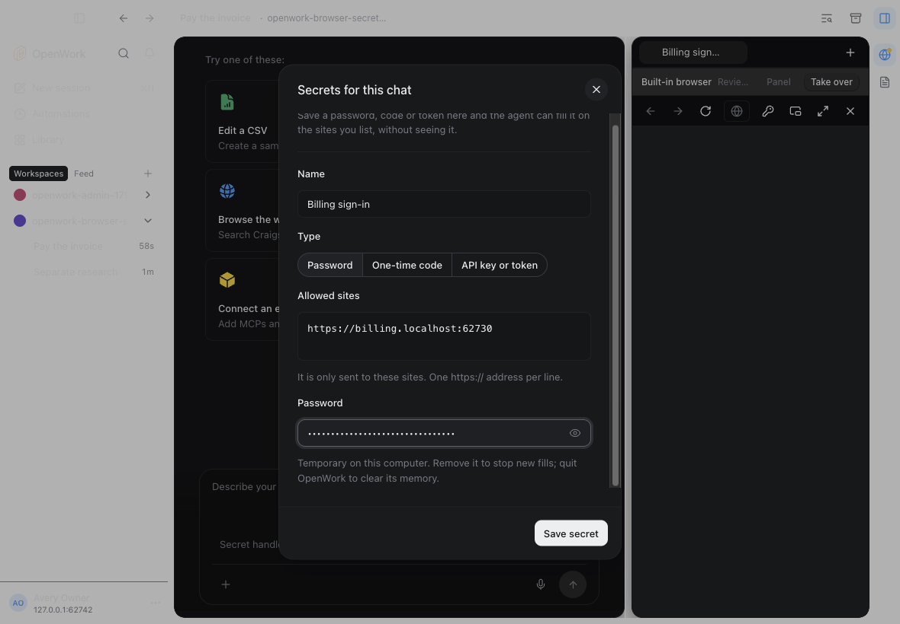
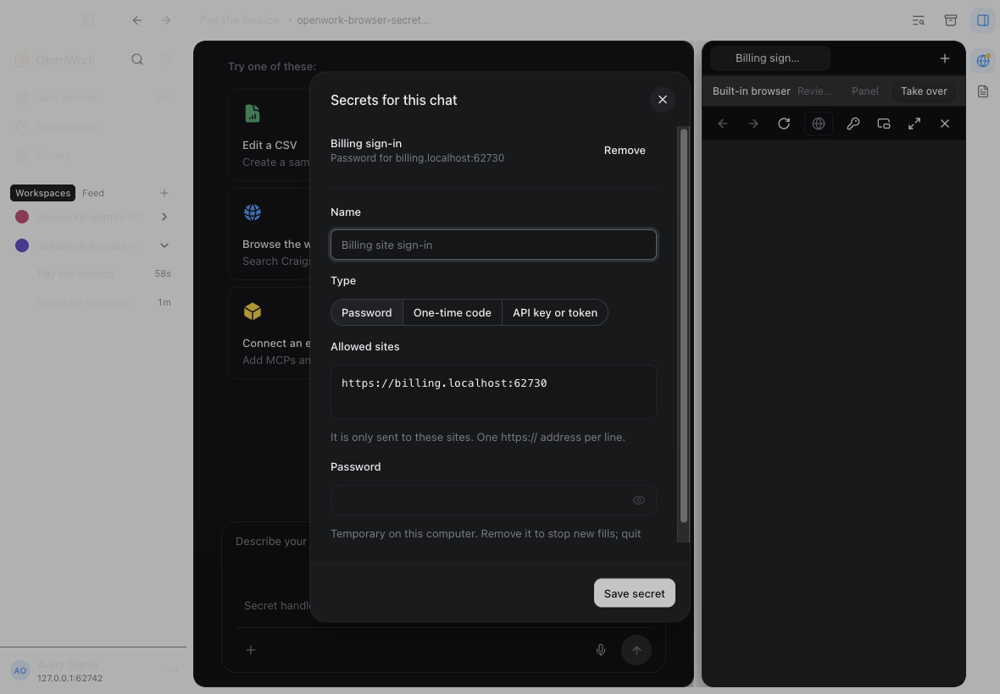
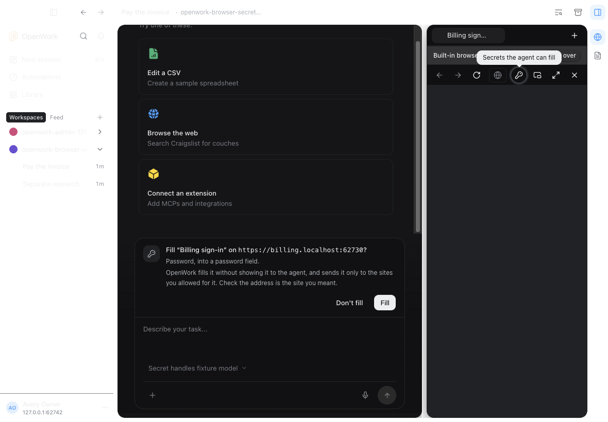

# Secret handles for the built-in browser

A person saves a password, one-time code, or API key or token for one
conversation, and lists the sites it may go to. When the agent signs in on one
of those sites in the built-in browser, it refers to the secret by a handle.
The fill call carries no value, and what is typed into the page is a
placeholder. This protects the outgoing path, not arbitrary server echoes:
see the limits below before enabling it.

- Feature key: `browserSecretHandles`
- Deployments: cloud and self-hosted, off by default
- Author: `benjaminshafii`
- Surface: OpenWork desktop only (the built-in browser). See
  [Where it works](#where-it-works).

What one run on the real app showed, with screenshots, is in
[secret-handles-verification.md](./secret-handles-verification.md).

## How it works

1. The person enters the secret in OpenWork's own dialog (Secrets, the key in
   the browser toolbar): a name, a type, the allowed sites as exact `https://`
   addresses, and the value. The value goes straight to the desktop's main
   process and is kept in memory only, per conversation. It is not written to
   disk, logs, or the conversation.
2. On a page of an allowed site, the agent sees each secret's handle, name and
   type, and asks to fill one with the `fill_secret` browser action. It never
   passes or receives the value.
3. OpenWork asks the person in the chat each time:
   `Fill “name” on https://site?`, with the type and the kind of field. A
   standing "always for this site" approval for typed passwords never covers a
   saved secret.
4. On Fill, a random placeholder is typed into the field. The field, and any
   page script that reads it, holds only the placeholder.
5. When the page sends a request, OpenWork replaces the placeholder with the
   value in the outgoing request, only when that request goes to one of the
   secret's allowed sites. A request to any other destination keeps the
   placeholder.
6. Everything the browser tools return to the agent is checked for the value
   and the placeholder, in the encodings a page could echo them in, and both
   are replaced before the agent reads them. A page that received a secret is
   not screenshotted.

The existing way of signing in, where the agent types a value the person gave
it in chat, is unchanged and keeps its own approval card.

## What it protects, and what it does not

On the supported outgoing path, the model supplies only a handle and the host
substitutes only for allowed origins. Readback redaction covers known raw,
URL/form/JSON, HTML, hex and base64 spellings; it is not a general-purpose
information-flow barrier against arbitrary re-encodings.

It does not hide the value from a site the person did list. That site receives
the real value, which is the point, and anything it sends back is delivered to
the page as is: OpenWork does not rewrite responses. If an allowed site echoes
the value in a response, that page's script can read it, and it can end up in
the page's cookies, storage or cache like any other response. Only list sites
you trust with the secret.

## Where it works

- **OpenWork desktop**: saving a secret, approving a fill and the swap all
  work, as described above.
- **Cloud browser**: not available. The same swap rules are implemented and
  tested for the cloud browser host, but there is no trusted screen yet for
  entering a secret or approving a fill there, so its secret routes are off
  and `fill_secret` answers `secrets_unavailable`.

## How to try it

1. Turn on `browserSecretHandles` for your organization in `/admin` ›
   organization › Features. The desktop picks it up within about a minute,
   without a restart.
2. In OpenWork desktop, open a conversation and its built-in browser, and go
   to the sign-in page of a site.
3. Choose Secrets (the key in the browser toolbar). Add a name, pick the type,
   keep or edit the allowed site, enter the value, and choose Save secret.
4. Ask the agent to sign in with the saved secret.
5. Check the address on the `Fill “name” on https://site?` card in the chat,
   then choose Fill. The field fills and the sign-in goes through; the agent's
   steps show the handle and an outcome, never the value.
6. Remove the secret from the same dialog when you are done. Quitting
   OpenWork also drops every secret.

## Turning it off

Turning the feature off, for the organization or with the kill switch, takes
effect without a restart:

- Every saved secret is removed from the store, and its placeholders are
  revoked: a request that still carries one is sent with the placeholder only.
- The `fill_secret` action answers `secrets_unavailable`, and the agent hands
  the sign-in back to the person.
- The Secrets control leaves the browser toolbar.
- Typing a credential the person gave the agent in chat works as before, with
  its own approval card.

Removing or revoking a secret stops new fills and substitutions. Redaction
material for every enrolled value stays in the main process until OpenWork
quits, so a later observation cannot expose an earlier echo after removal.
Revocation is not memory erasure. A tab whose request was rewritten stays
watched until it closes, with no time limit, so a redirect or history replay
cannot carry rewritten bytes to another origin. Request-lineage metadata also
stays until that tab closes; close the sign-in tab when finished to release it.
Quitting clears the in-memory store, not any ordinary browser storage an
allowed site's response may have created.

The enrollment store creates no vault or configuration file, so it needs no
migration. This is not a global no-persistence guarantee: an allowed site's
responses can enter browser storage, as explained above.

## What to watch

- `fill_secret` steps report `verified` or `failed`, and each carries a
  status for the secret: `pending`, `sent` (with the sites it was sent to), or
  `not_sent` with a reason (`in_url`, `other_origin`, `unsupported_encoding`,
  `left_without_secret`, `expired`, `interception_lost`, `removed`).
- A rise in `not_sent` on a site people rely on means that site's sign-in is
  one of the known limits below; the agent hands off to the person instead of
  retrying.
- `secrets_unavailable` while the feature is on means request interception
  could not be turned on for the tab; nothing was typed.
- If interception is lost on a tab after a request was rewritten, OpenWork
  closes that tab rather than leave it unwatched.
- The value must never appear in a log, an error, a tool result, or the
  conversation. Treat any sighting as a security bug and turn the feature off.

## Known limits

- **Responses are not rewritten.** See
  [What it protects](#what-it-protects-and-what-it-does-not).
- A site that transforms the placeholder before sending it (hashing,
  encrypting, base64) never sends a recognizable placeholder. This is reported as
  `not_sent`, and the agent hands the sign-in to the person.
- WebSocket messages cannot be rewritten, so a secret is never swapped into
  one.
- Only requests paused in the root page session are substituted, including
  the tested dedicated-worker fetch. Separate frame and worker targets are
  not attached. Tested out-of-process frame and forwarded service-worker
  requests retain the placeholder. Shared workers are excluded by construction,
  not a real-worker integration proof. Same-process frames and native form
  navigation into a service-worker-controlled page are not proven; do not use
  this feature for those paths.
- One-time-code inputs that accept only digits, or only a few characters,
  reject the placeholder. The step reports `failed`.
- Secrets live in memory for one conversation on one computer. They are gone
  when OpenWork quits and are not shared with other conversations.

## Screenshots

From the run described in
[secret-handles-verification.md](./secret-handles-verification.md), with a
synthetic password and a local test site.

The Secrets dialog, with the value masked as it is typed:

The saved secret, listed by name, type and site:

The approval card in the chat:

