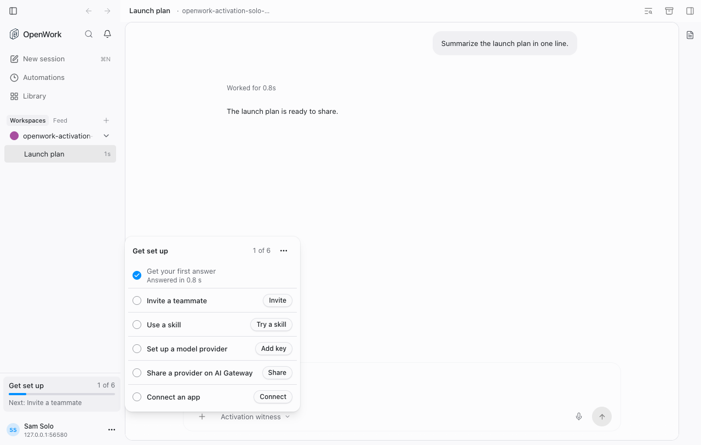
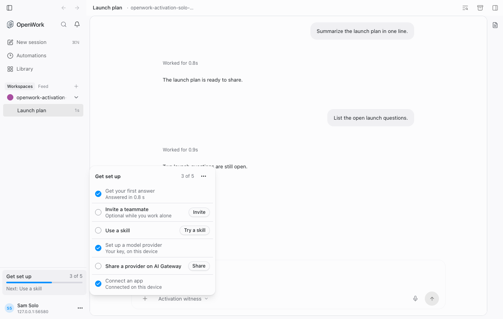

# Get set up counts what already works on the device (`activationLocalSetup`)

- **Feature key:** `activationLocalSetup`
- **Deployments:** cloud and self-hosted (`everywhere`), off by default
- **Author:** @benjaminshafii
- **Surfaces:** Desktop app and Workbot (the checklist they share)

## What people get

A person who works alone, with a model provider and connections they set up on
their own computer, could never finish **Get set up**: the provider step only
counted a key saved through one dialog, the connection step only counted
connections made through OpenWork Cloud, and inviting a teammate was required.

With the feature on:

- **Set up a model provider** checks off once a provider the person set up on
  this device has completed an answer. Providers the organization or OpenWork
  supplies do not count here, and neither do the engine's built-in models,
  which need no key.
- **Connect an app** checks off once the engine on this device reports a
  connection of the person's own as connected. The row says
  **Connected on this device**. A connection made through OpenWork Cloud still
  shows its name.
- **Invite a teammate** stays in the list with its Invite action and reads
  **Optional while you work alone** while nobody else has joined or been
  invited. It is not counted and is never the "Next" step, so the checklist
  can finish at five of five. Once someone is invited it counts as before.

| Off | On |
| --- | --- |
|  |  |

## How it works

- The app reports two things only it can observe, each at most once per
  person: `own_provider` (existing) when its per-provider outcome record holds
  a completed answer for a workspace on this device, and `connector` (new,
  stored as `activation.connector`) when the engine's connection status lists
  a connected server that OpenWork did not add.
- Den stores `connector` and marks inviting optional only while the feature is
  on for the organization. Reports are idempotent.
- The app cannot see how many tools a connection offers, so "connected" is the
  whole signal for the connection step.

## Try it

1. In `/admin`, turn `activationLocalSetup` on for an organization with one person.
2. In the desktop app, in a workspace on this computer with your own provider
   and a connected server, send a message.
3. Open **Get set up** in the sidebar.

`evals/proofs/activation-local-setup.proof.test.ts` does this in headless Chrome.

## Off

Nothing changes from before: six counted steps, inviting required, the app
sends neither report, and Den ignores a `connector` report. Steps already
checked off from a provider stay checked; a device connection stops counting.
