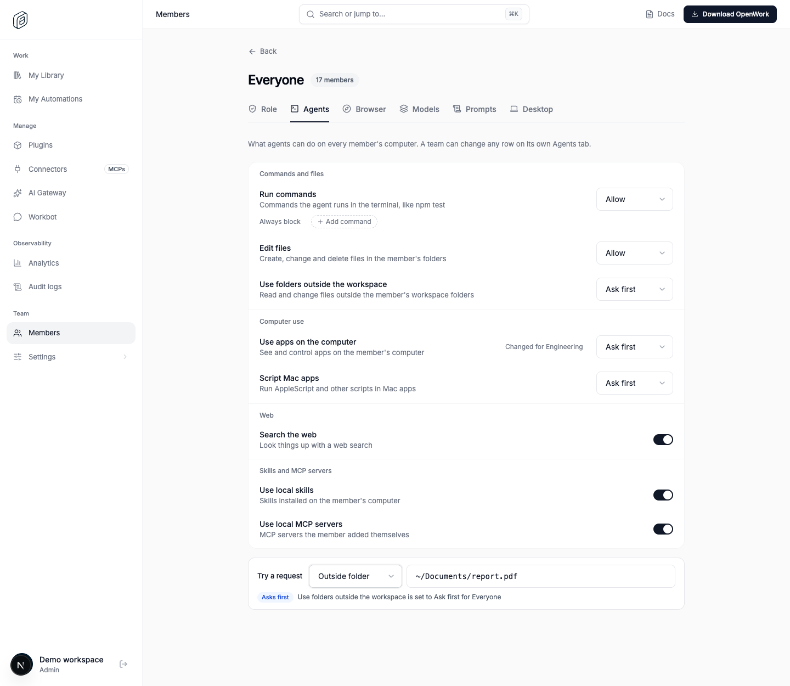
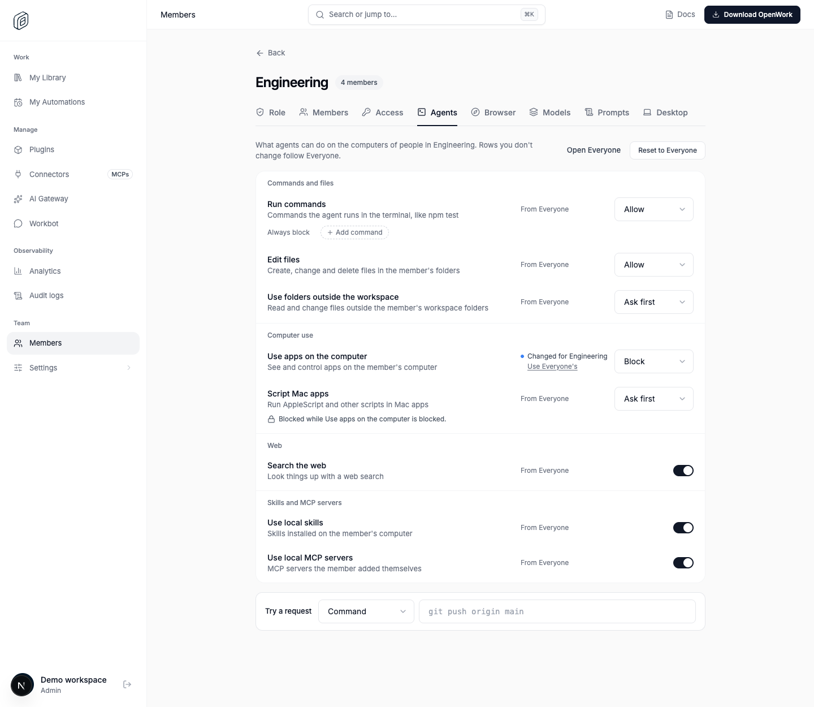
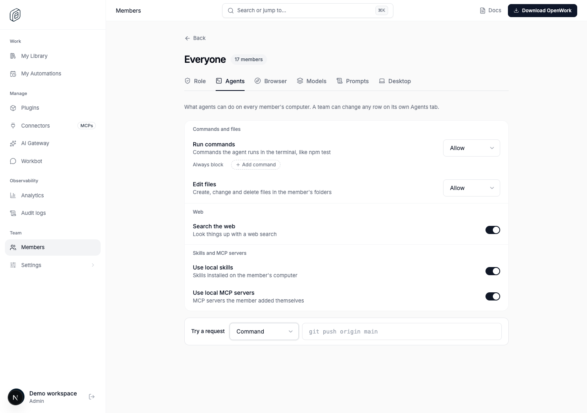

# Agent harness permissions

- Feature key: `agentHarnessPermissions`
- Deployments: cloud and self-hosted
- Default: off
- Author: `benjaminshafii`

## What changes and for whom

Organization admins can choose Allow, Ask first or Block for folders outside the workspace, computer use and Mac app scripting on Everyone's or a team's Agents tab. Team overrides inherit Everyone's settings when unset; the strictest decision among a member's teams wins. Nothing set means no additional rules, preserving today's behavior.

Blocking computer use also blocks app scripting. Computer use Ask first requests approval before taking control in each chat. App scripting Ask first requires approval for every script, without a standing approval. Folder access uses the OpenCode v2 `external_directory` permission; OpenCode v1 does not enforce folder rules, like the existing engine permissions. Computer and scripting permissions apply at the desktop host for both engines. Organization-provided skills and connections are unaffected.

## How to try it

Enable `agentHarnessPermissions` for a test organization or selected active members in `/admin`. Member overrides affect both the admin editor and the rules delivered to that member; turn it on for the admin and test member when testing both. Open Everyone's or a team's Agents tab, set the three permissions, save, and refresh the member's desktop organization settings. Check `/v1/agent-permissions` and `/v1/me/desktop-config` for the saved settings and delivered rules. Try computer use, an app script and access outside the workspace with Allow, Ask first and Block, including a member in several teams.

## Turning it off

The kill switch hides the new settings in Den responses and removes `computer`, `script` and `external_directory` rules from desktop config. Desktops receive no harness rules and return to current behavior when their settings refresh. Saving or clearing existing permissions while this feature is off ignores incoming harness settings and preserves stored harness settings inside the save transaction, including its audit before/after snapshots. Turning it back on restores those settings. Existing commands, file edits, web, skills and MCP permissions continue unchanged.

## What to watch

Watch permission-save errors, the agent permission audit trail, desktop config responses and desktop policy refresh errors. Verify blocked actions never execute, computer approval lasts only for its chat and resets when rules change, and scripting Ask first never offers standing approval. Exercise both Everyone and team policies, flag-off saves and re-enabling, member overrides and the deployment kill switch. A desktop must refresh settings before a rollout change reaches it; computer rules may be cached briefly. On a policy read failure the desktop retains its last known rules, or current behavior if no rules are known.

## Screenshots

Real local Den, with `agentHarnessPermissions` enabled for a generic demo workspace:

- Everyone: outside folders, computer use and app scripting set to Ask first; an outside-folder request also asks first.
  
- Team: computer use set to Block, with the neutral lock explaining why app scripting is blocked even though its saved setting follows Everyone.
  

- Feature off: the existing Agents tab, with no harness rows or Computer use group.
  

The editor reuses the existing rows, selects, source lane and neutral blocked-state treatment (DESIGN.md P4, P5, S2, C3, C5, P10). Disabling the rollout removes these rows, the Computer use group and the Outside folder request kind; the Browser tab is unchanged.
