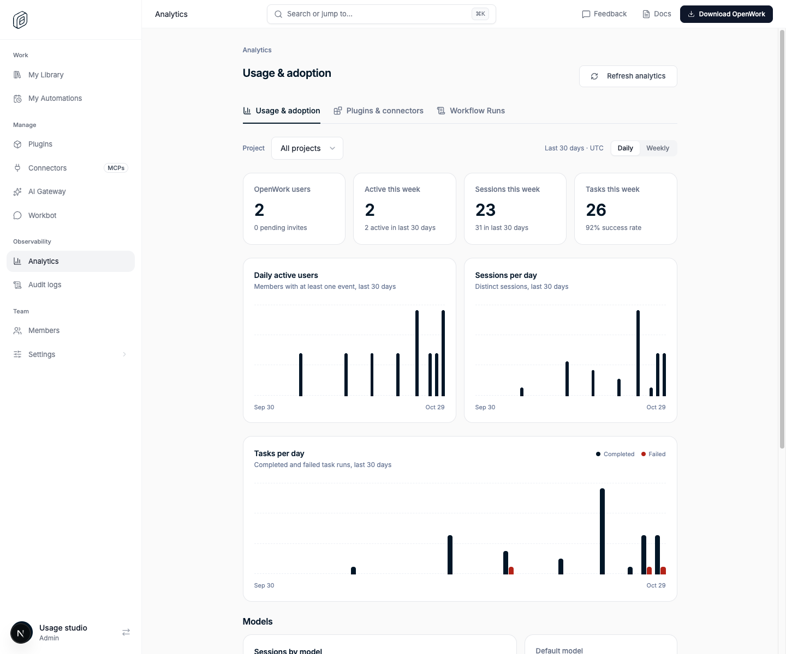

# Analytics: daily trends

> **GA:** Available without a feature flag. The former rollout key is retired.
> Off/on screenshots below are historical comparisons, not current deployment options.

Retired rollout key: `analyticsDailyTrends` · Deployments: cloud and self-hosted · Status: generally available (no flag) · Author: @benjaminshafii

## What people get

Usage & adoption (Den › Analytics) previously charted only weekly activity.
The three trend charts (active users, sessions, tasks completed
and failed) show one bar per UTC day for the last 30 days, today included. A
**Daily / Weekly** switch next to the project filter returns to the 12-week
weekly charts. Daily is selected by default. The project filter applies to
both views.

The summary cards (this week, last 30 days) and the Models section do not
change.

## How it works

- `GET /v1/telemetry/analytics` adds a `daily` array (30 entries,
  `{ day, activeMembers, sessions, tasksCompleted, tasksFailed }`). `weekly` is unchanged.
- Days are UTC calendar days starting at midnight UTC 29 days ago. The last
  entry is today so far. Events from a client clock that runs ahead count as
  today.
- The query reuses the weekly trend's plan (`selectDailyActivity` in
  `ee/packages/telemetry/src/analytics.ts`) over a shorter 30-day window, so
  it adds one indexed scan per page load.

## Availability

Generally available. The rollout flag is retired; organization/member overrides,
operator locks and old kill-switch rows no longer disable this behavior.
Authorization, provider setup, consent and runtime compatibility still apply.

## What to watch

Latency of `GET /v1/telemetry/analytics` for large organizations, filtered by
project and unfiltered.
