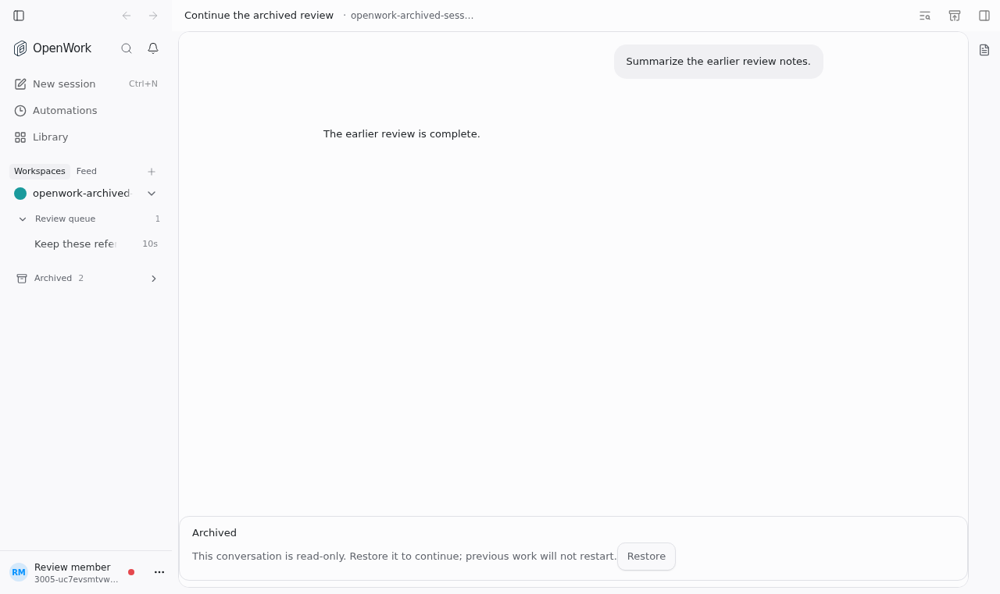
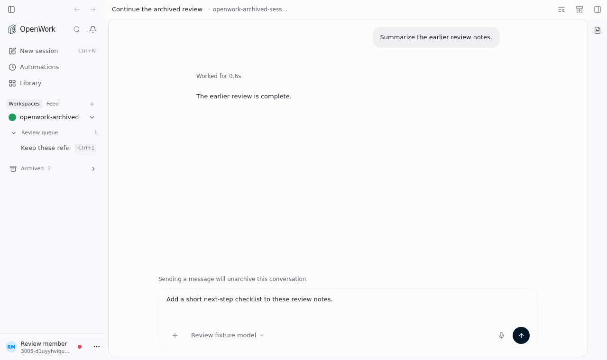
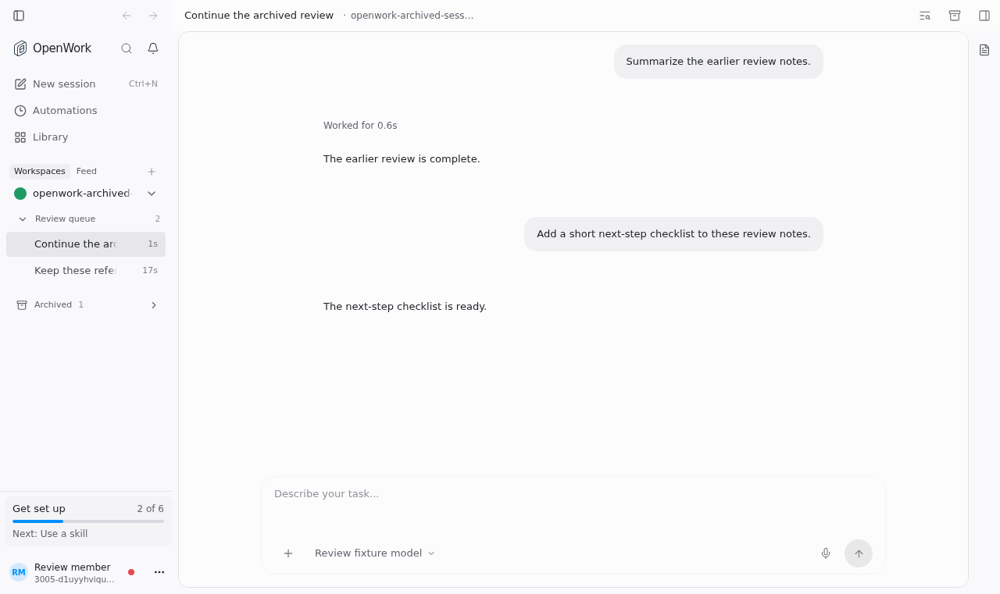

# Continue archived conversations

- **Feature key:** `archivedSessionCompose`
- **Deployments:** cloud and self-hosted
- **Default:** off
- **Author:** @yomgui

## What changes

An archived conversation keeps its normal message composer. A quiet line makes
its state explicit: “Sending a message will unarchive this conversation.”
The send action is named **Send & unarchive**.

Opening the conversation, drafting a message and adding attachments do not
unarchive it. An explicit send first unarchives the same conversation, then
submits the new request through the normal send path. Previous work does not
restart. Group membership and model selection stay unchanged.

The hint is aligned to the composer's column. The hint, send/preparing label and
restore-failure messages use the normal translation system.

The composer restores silently: **Send & unarchive** does not show a separate
“Session unarchived” toast or offer **Undo** while the new follow-up is running.
The existing **Restore** banner remains when the feature is off. Ordinary
Restore and sidebar/header/palette unarchive actions retain their usual
**Undo / View** notification. Agent commands, automatic sends, queued work and
archive rules are unchanged.

## Failure and rollback

If unarchiving fails, the draft and attachments stay in the composer and no
message is sent. The composer shows one inline error, not a second error toast.
It distinguishes a failed restore, an unverifiable restore and a timeout; each
message confirms that the draft is saved and offers a retry.

Restoration has a 15-second deadline; cancellation or a changed
conversation/account releases its send slot even if the network request stalls.
A late restoration receipt never sends the follow-up. The agent and account
selection are captured when the person sends, not after the wait.

Once unarchiving succeeds, ordinary send errors use the normal chat recovery
behavior; the conversation is not silently archived again.

Turn the feature off through the normal Features controls to restore the
read-only archived view. Existing drafts and history are retained. Conversations
already unarchived stay unarchived; disabling the feature does not undo work.

## Try it

1. With the feature off, open an archived conversation and verify the existing
   read-only banner and **Restore** action.
2. Enable `archivedSessionCompose` for a test organization or member.
3. Open an archived conversation and type a follow-up. It should remain archived
   until the person explicitly sends it.
4. Send the follow-up. Verify that the same conversation becomes active, receives
   exactly one new request, and keeps its title, model and group.
5. Turn the feature off and verify that another archived conversation uses the
   existing read-only view. Do not enable it globally merely to run a test.

## Screenshots

Captured from the real app in headless Chrome against isolated Den and native
OpenCode v2; only the model responses are scripted.

Off: the existing read-only archive remains unchanged.

On: drafting leaves the conversation archived, with the normal composer.

Sending unarchives the same conversation and adds one follow-up without an
unarchive **Undo / View** toast.

## Verification

The focused archived-composer tests cover restore-before-send, timeout and
cancellation cleanup of real shared send claims/holds, identity and agent
capture, and late-receipt exclusion. Restore failures occur before the normal
composer-clearing/submission path. Existing send failures retain normal recovery.

`evals/proofs/archived-session-compose.proof.test.ts` exercises both flag states
through the real UI, drafting without restoration, hint-to-composer alignment,
exactly-one follow-up with no unarchive/Undo toast, unchanged earlier work and
neighboring conversations, group retention and reload. The off story verifies
that explicit Restore still offers its ordinary Undo/View notification.
It does not inject a restore transport failure; that boundary is unit-tested.

Design: continuity and draft preservation (P11), outcome-specific action labels
(C1–C2), neutral archive state (C5/V2), and the existing composer controls (P5/T5).
