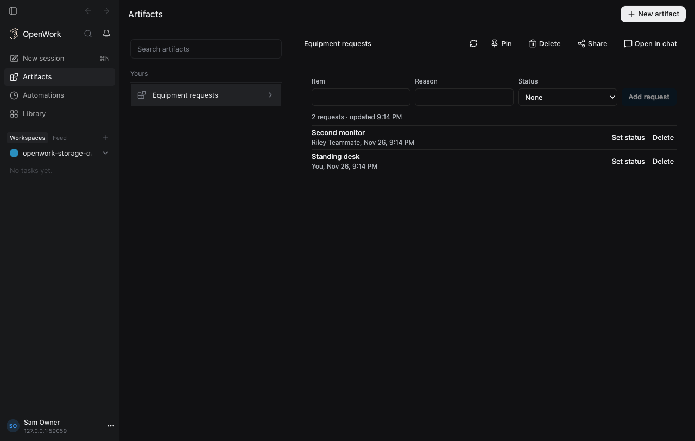
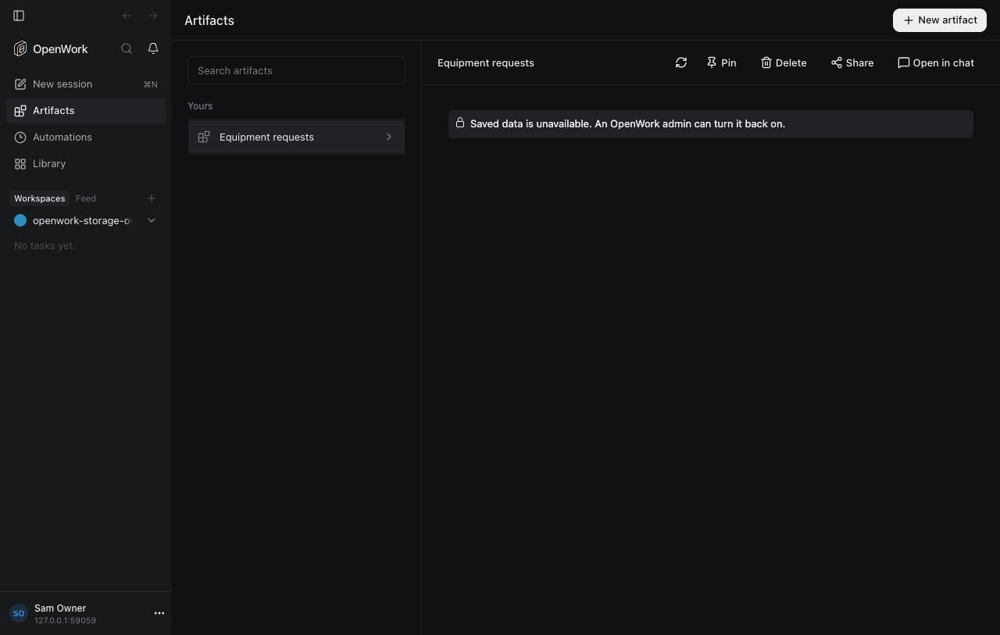

# Save data in an artifact (`artifactStorage`)

- **Feature key:** `artifactStorage`
- **Deployments:** Cloud only for now, off by default; self-hosted later
- **Author:** @benjaminshafii

## What people get

An intake form, tracker, approval queue, or checklist can keep its own rows in
OpenWork. Close it, reopen it, or publish a new revision: the saved rows are
still there. No connection is needed for data that belongs to the artifact.

With the feature off, or with no storage backend, the same artifact reports
that its data is kept but unavailable:

## Opt in

Pass `storage: { collections: [...] }` to `prepare_app` and `create_app`. Each
collection names its fields, their types (text, number, boolean, or date), and
which ones are required. Text fields can have a fixed set of choices. The
`records` starter wires the first collection. On update, omit `storage` to
keep the declaration, or pass the replacement to add fields or collections.
Removing a field hides its values; it does not erase them.

- `storage_read` lists rows in a collection with optional filters, sort and
  paging. It can run when the artifact opens; no click is needed.
- `storage_write` adds, changes, or deletes one row. In the artifact UI, each
  write requires its own button click, one call per click.

In chat, `read_app_data` and `write_app_data` take the same arguments plus an
artifact ID. The agent can answer a question about the rows without opening the
artifact.

## Who can use the data

Existing artifact sharing decides who can use the artifact. Share its Plugin
with members or teams using the usual grants. Within that audience, each
collection sets row access:

| Setting | Who can see or change a row |
| --- | --- |
| `scope: "shared"`, `edit: "anyone"` (defaults) | Everyone who can use the artifact can see, change and remove its rows. |
| `scope: "shared"`, `edit: "creator"` | Everyone who can use the artifact can see its rows; only the member who added a row can change or remove it. |
| `scope: "personal"` | Only the member who added a row can see, change or remove it. |

OpenWork enforces row access and field validation, not the artifact's code.
Public artifacts cannot use storage. There are no anonymous writes.

## Limits and lifecycle

The default caps are 10,000 rows across all collections and 20 MiB of saved
values per artifact. Set `DEN_ARTIFACT_STORAGE_MAX_ROWS` and
`DEN_ARTIFACT_STORAGE_MAX_BYTES` to override them. Both are checked inside the
write's own transaction, so a write that would pass a cap never commits, even
when several people write at once; it fails with `storage_full`. Removing rows
frees room at once. One row holds at most 16 KB.

Organization admins can export the artifact's database as SQLite or export
one collection as CSV, from the artifact's row on its Plugin page in Den. An
export includes every member's personal rows: the data is the organization's.

Deleting the artifact or its organization deletes the saved data. Den first
marks the artifact's registry row as deleted, then asks the backend, and drops
the row only when the backend has confirmed. While a row is marked, the
artifact reads as empty and takes no writes. A removal the backend could not
finish is retried every ten minutes and on the next deletion, and a write that
lands during a removal is undone. Archiving an artifact keeps its data.

## Where data lives

Den uses one SQLite database per artifact behind a storage-backend interface.
The `mcp_app_storage` registry records which artifacts have a database and
pins each one to the backend that created it: after an install switches
backend, existing artifacts report their data as unreachable rather than
starting empty on the new one. Moving data between backends is a deliberate
operator step, not something Den does.
Choose the backend at install time, separately from the organization flag:

- `DEN_ARTIFACT_STORAGE_BACKEND=celld` is for production and multi-instance Den.
  Set `DEN_ARTIFACT_STORAGE_CELLD_URL` and `DEN_ARTIFACT_STORAGE_CELLD_TOKEN`.
- `DEN_ARTIFACT_STORAGE_BACKEND=local` keeps the databases on the Den instance's
  disk under `DEN_ARTIFACT_STORAGE_LOCAL_DIR`. It is available only with
  `OPENWORK_DEV_MODE=1`. Use celld outside dev mode.

Watch `artifact_storage_backend_unavailable` for an unavailable backend and
`mcp_app_storage_failed` for storage operations that fail unexpectedly.

## Off

Turning the flag off removes the storage tools and stops reads and writes.
The artifact says "Saved data is unavailable. An OpenWork admin can turn it
back on." It does not show an empty list. Nothing is deleted; turning the flag
back on restores access to the same rows.

## Try it

1. Configure a storage backend and turn `artifactStorage` on for your Cloud
   organization in `/admin`.
2. Ask an agent to build a shared request tracker that keeps its own rows.
   Add a request, change its status, and reopen the artifact. The request
   should still show its updated status.
3. Share the artifact with another member and check the collection's access
   rules. Ask in chat how many requests are open without opening the artifact.
4. Turn the flag off and reopen the artifact. Check that saved data is blocked
   and write controls are absent. Turn it back on and confirm the rows return.

## The celld backend

`ee/apps/artifact-storage-cell` is the Worker a celld fleet runs: one cell
(Durable Object) per artifact, named `<organizationId>/<appId>`, behind a
bearer token. Den sends it SQL it wrote itself, after it has checked who is
asking, so the fleet never sees a member. Its README covers the HTTP contract
and deployment. A fleet runs one application, so this needs its own fleet or
bucket prefix beside the headless runner's.

Run the contract and the row rules against a real celld node with
`CELLD_BIN=/path/to/celld pnpm --filter @openwork-ee/artifact-storage-cell test:celld`.

## Not yet proven

- celld is verified on one `celld dev` node (v0.6.3, macOS arm64) with its
  local object store: the backend contract, every row rule and cap including
  racing writers, export, delete, and rows surviving a node restart. An
  S3-compatible bucket, a fleet of two or more nodes, failover, backup and
  restore, production latency and exports near the size cap have not been run.
- No celld fleet for artifact storage is deployed, so the feature cannot be
  turned on in production until one is and Den has its URL and token.
- A write whose answer is lost on the way back from the backend may have been
  saved; trying again then adds a second row. There is no request id yet.
- An export taken while people are writing is not a single snapshot.
- Changing a celld URL to a different fleet is not detected; the registry pins
  the backend kind, not its address.
- On the page a browser opens for an artifact, a saved-data write needs a
  recent click in the page and only one runs at a time, but the click is not
  tied to that exact write. Other changing tools on that page are not
  click-gated at all; that predates this feature.
