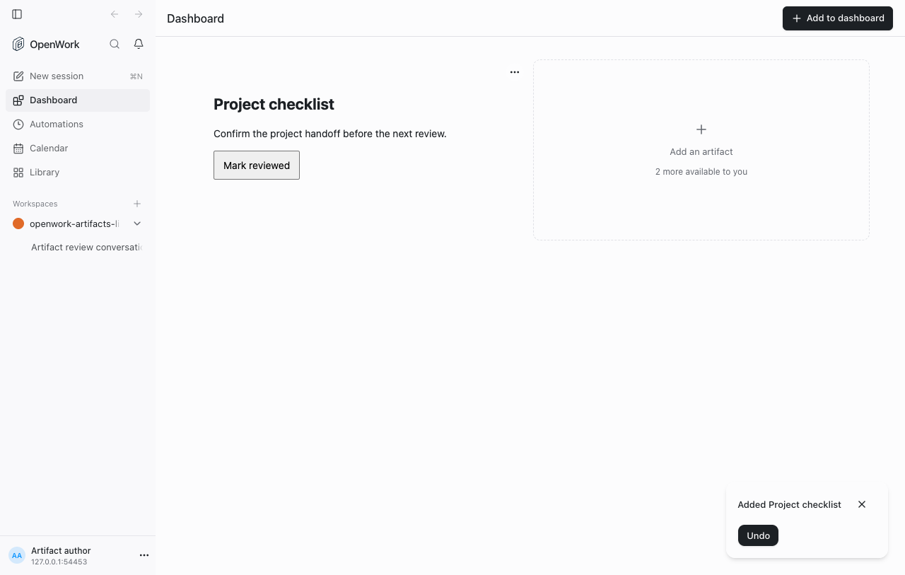
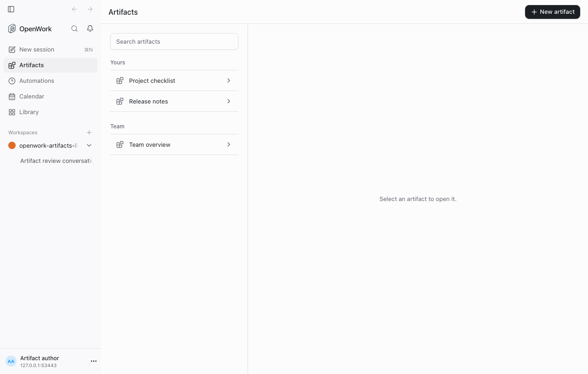
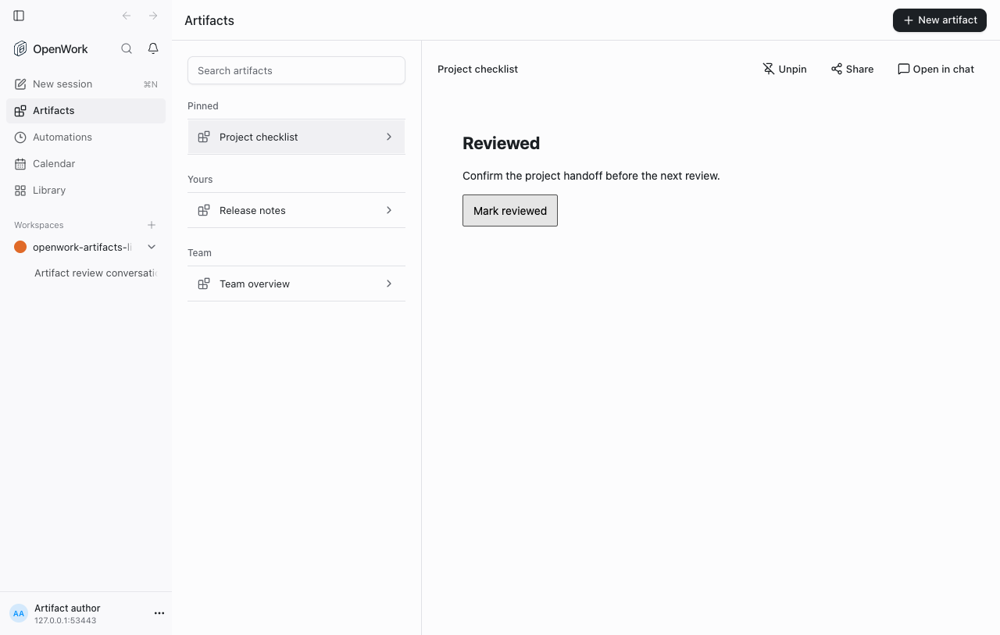

# List-first Artifacts

- **Former rollout:** `artifactsListFirst` (retired)
- **Deployments:** Cloud and self-hosted
- **Author:** [benjaminshafii](https://github.com/benjaminshafii)
- **Availability:** generally available; no organization override needed

The desktop and web app replace the Dashboard masonry with an Artifacts list.
The groups are **Pinned**, **Yours** (created by this member), and **Team**
(other accessible artifacts). A newly built App is available in Yours without
finding it in a second picker. Catalog provenance is display-only: existing
App/plugin permissions continue to control access and sharing.

## What changes

- Listing artifacts does not mount or launch their Apps.
- Opening a row mounts one live artifact. Pinning, unpinning, or regrouping does
  not remount it.
- The selected view stays mounted, hidden and inert, across Calendar, Library,
  and chat navigation. Returning keeps unsaved interaction state, not just a
  remembered title. A member, organization, or deployment change discards it.
- The existing chat preview gains Pin/Unpin. Placement remains this member's
  existing local desktop/browser storage, not a new organization-wide pin.
- Successful create/update calls invalidate the member's catalog. Updates stay
  attached to the same App id; they do not create a new list entry.
- App build progress becomes one named artifact row, with the existing stages
  and technical output available on disclosure.
- Legacy saved artifacts remain available. The list does not migrate or
  delete them, or infer authorship from an admin's edit permissions.

The list does not run connectors to fill speculative summary columns. The first
open still needs the normal authorized App launch and data reads. The list
makes no sub-second latency promise and does not pre-authorize a tool, bypass
consent, or convert a mutating workflow into a read-only one.

## Try it

Sign in and open Artifacts; no rollout setup is needed. Create an App in chat
or open one already shared with the member.
Use Pin in the preview and verify it moves to Pinned. Interact with the opened
artifact, visit Calendar or a chat, and return: the same interaction should
still be visible. No sibling App should have launched.

## Availability

The former rollout's disabled overrides, kill switch and operator locks no
longer restore Dashboard or its old picker. App records, revisions, grants,
and local pins keep their existing meaning.

## Watch

Check App launch failures, permission/reconnect states and catalog errors. A
revoked or removed catalog entry must disappear and unmount its live view.
The selected view must not survive sign-out or a member/org/deployment change.

## Evidence

`evals/proofs/artifacts-list-first.proof.test.ts` covers list-first entry,
ownership groups, one selected live App, unsaved review state across page
navigation and pinning, without an `artifactsListFirst` override.

Screenshots below are captured from the real headless app with isolated test
accounts, not the design video.

### Historical: Dashboard tiles (no longer an opt-out)

### List first (now generally available)

### After: one retained view

