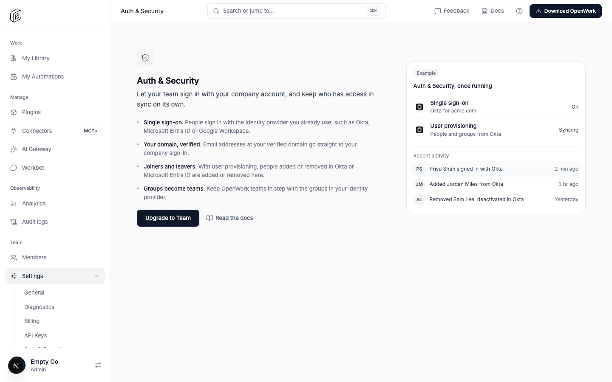
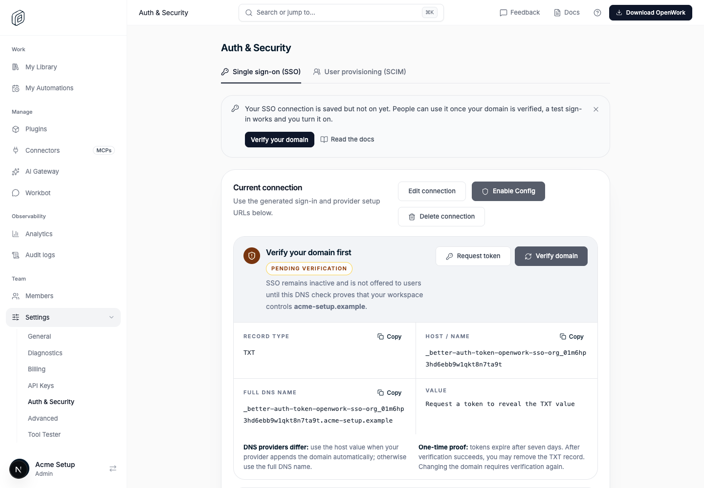
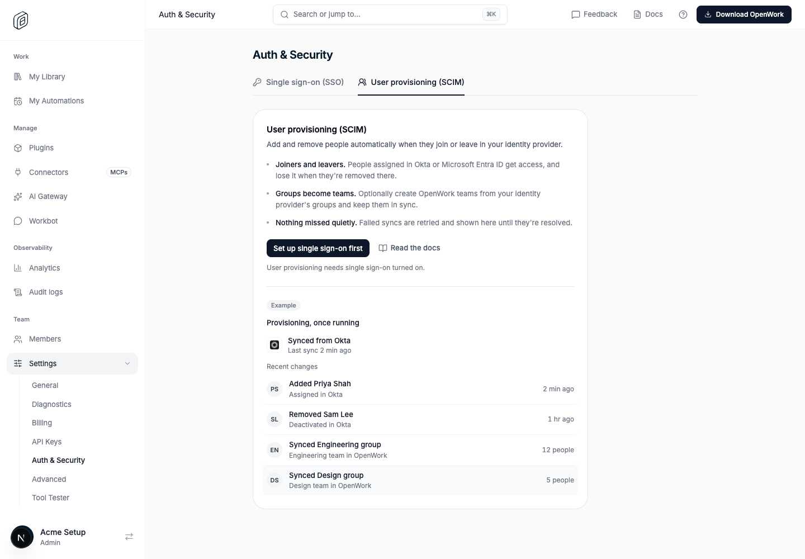

# Auth & Security settings (`authSecuritySettings`)

- **Feature key:** `authSecuritySettings`
- **Deployments:** cloud and self-hosted (`everywhere`), off by default
- **Author:** @OmarMcAdam
- **Operator lock:** `DEN_FEATURE_AUTH_SECURITY_SETTINGS=true|false` (Helm `config.features.authSecuritySettings`)

## What changes

Den's Settings group shows one **Auth & Security** entry instead of separate
**SSO** and **SCIM** entries. The page has two tabs, each the existing screen
without its own page title:

| Tab | URL | Was |
| --- | --- | --- |
| Single sign-on (SSO), the default | `/dashboard/auth-security` or `?tab=sso` | `/dashboard/sso` |
| User provisioning (SCIM) | `/dashboard/auth-security?tab=scim` | `/dashboard/scim` |

Nothing about how SSO or SCIM work changes: same API (`/v1/sso*`, `/v1/scim*`),
same permissions (`sso.view`/`sso.manage`, `scim.view`/`scim.manage`), same
plan locks (SSO on Team, SCIM on Enterprise) and the same SSO test pop-up.

- **Navigation:** the entry shows when the person could see either SSO or SCIM
  before. The command palette lists **Settings › Auth & Security** and finds it
  by "sso", "saml", "oidc", "scim", "provisioning", "okta", "entra" and similar.
- **Old links:** with the feature on, `/dashboard/sso` and `/dashboard/scim`
  redirect to the matching tab and keep any other query parameters. With it
  off, `/dashboard/auth-security` redirects back to `/dashboard/sso` or
  `/dashboard/scim`, so a link works whichever state an organization is in.
  The SSO test return page (`/sso/test/complete`) talks to the opener window
  and is unaffected.
- **Feature intros** (only with `featureIntros` on too): the page explains
  itself while nothing is set up. Keys `auth-security`, `auth-security.sso`,
  `auth-security.scim` in
  `ee/apps/den-web/app/(den)/dashboard/_features/feature-intros/intros/auth-security.tsx`.
  - No SSO connection and no SCIM connector: full-screen intro. The action is
    **Set up single sign-on** (straight to the SSO form via `?tab=sso&setup=1`),
    **Upgrade to Team** on the Free plan for people who manage billing, or a
    lock with who can change it.
  - SSO tab: box when there is no connection; banner while a saved connection
    is not on yet (**Verify your domain** or **Test and turn on SSO**).
  - SCIM tab: box when there is no connector (**Create a SCIM connector**,
    **Set up single sign-on first** when SSO isn't on, **Talk to us about
    Enterprise** without the plan); banner when a connector exists but nobody
    has synced yet (**Connect your identity provider**).







## For whom

Organization owners and anyone granted the SSO or SCIM permissions. Members
without them never saw these entries and still don't.

## Try it locally

Start den-api with the operator lock (or turn it on for one organization in
`/admin` › Features):

```sh
DEN_FEATURE_AUTH_SECURITY_SETTINGS=true DEN_FEATURE_FEATURE_INTROS=true pnpm dev:den:api
```

Open **Settings › Auth & Security**. To see the plan locks, also set
`DEN_PLAN_GATING_ENABLED=true`; an organization on the Free plan then gets the
Upgrade to Team intro, and one whose `organization.metadata.plan.tier` is
`enterprise` gets both tabs unlocked.

## Turning it off

Settings shows **SSO** and **SCIM** again exactly as before, and
`/dashboard/auth-security` links redirect to them. No data moves, so turning
it on or off at any time is safe; an open page switches on its next load.

## What to watch

Nothing new on the server. In den-web, check that `/dashboard/sso` and
`/dashboard/scim` visits end on the Auth & Security tab (no redirect loop) and
that the SSO test pop-up still reports back to the tab.
