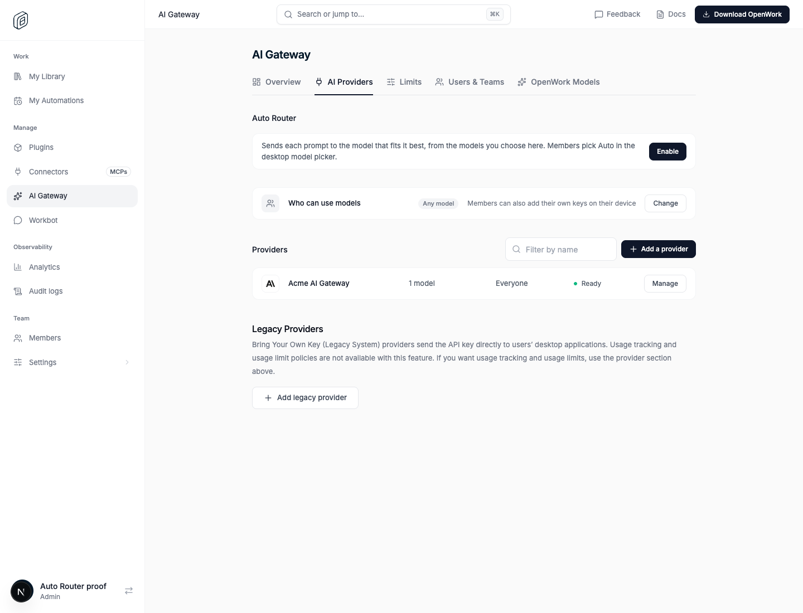
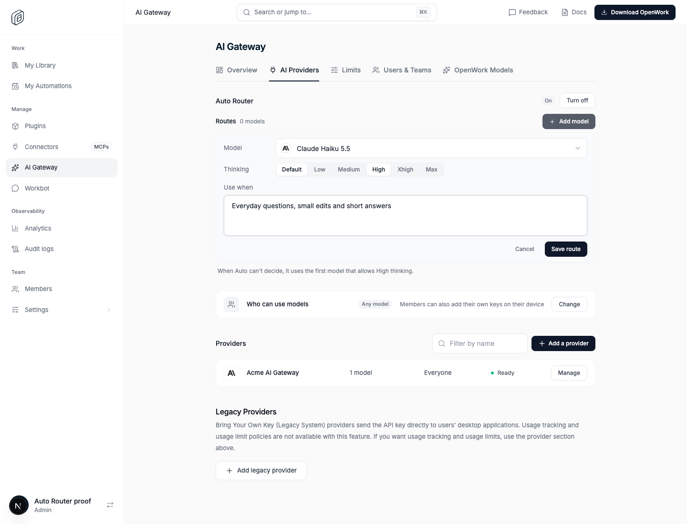
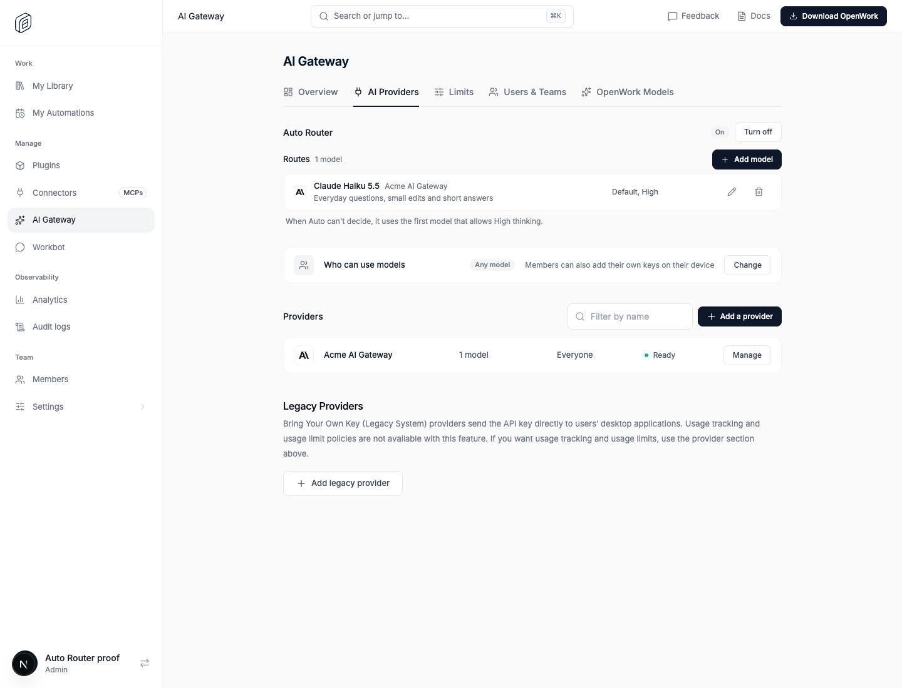
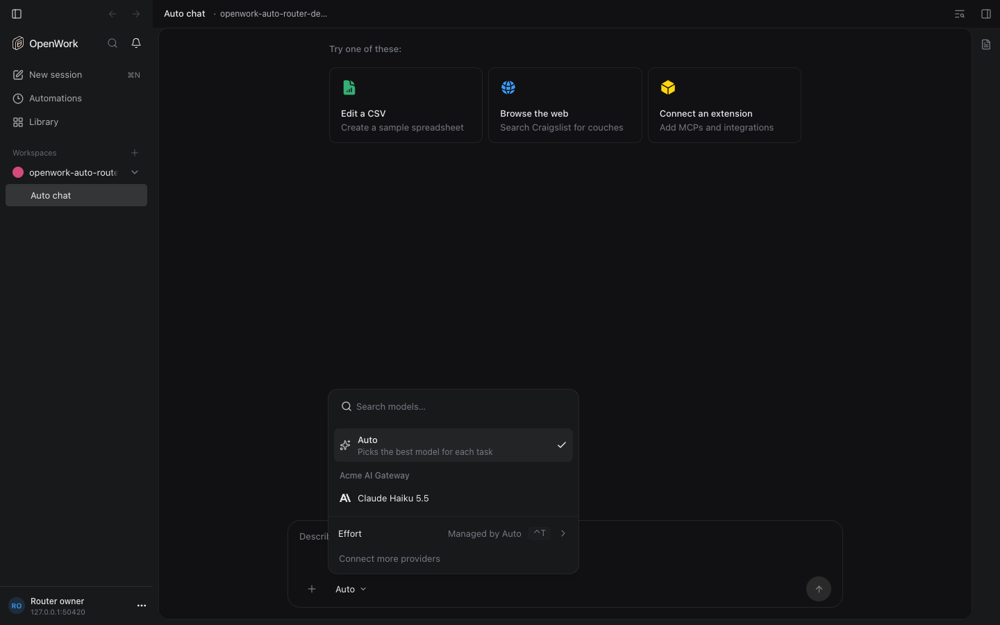

# Auto Router

- **Feature key:** `autoRouter`
- **Deployments:** cloud only (Jev is called through TypeSafe's hosted API)
- **Author:** OmarMcAdam
- **Default:** off

## What people get

**Organization admins** see an **Auto Router** section above Providers on
AI Gateway › AI Providers. Until it is enabled it explains what it does and
offers **Enable**. Once enabled it lists routes, edited like the desktop's
keyboard shortcuts:

- **Model**: any model already added to the AI Gateway (active provider,
  in an active model group) whose protocol Auto can translate to.
- **Thinking**: one or more levels, limited to what that model allows
  (`default` plus the effort values in its catalog entry).
- **Use when**: a full-width description of the prompts this model should get.

Saving writes `auto_router` (one row per organization, `enabled`) and
`auto_router_route` (the provider id, catalog model id, prompt, thinking levels
array and position).

**Members** whose organization has an enabled Auto Router, and who can use at
least one of its models, get **Auto** as the first option in the desktop model
picker. The free starter model that used to be labelled Auto is now
**OpenWork Free**.

Each Auto reply says which model answered it, with its thinking level, below
the reply (for example "Claude Haiku 5.5 · High").

## How a request is routed

1. The desktop registers Auto as an OpenAI-compatible provider pointing at the
   gateway (`GET /v1/org/auto-router/connect` returns the base URL and the
   member's own Gateway key) and sends model `openwork-auto` to
   `POST /api/v1/chat/completions`.
2. The gateway loads the organization's routes (feature checked, 15s cache)
   and keeps only routes the member's access grants allow.
3. At the start of a turn (the last message is the user's) it asks Jev one
   Choice question: each option is one route at one thinking level, keyed
   `route_<n>_<level>`, described by the model name, the admin's "Use when"
   text and the level. Jev never sees provider or model ids. Requests that
   continue the turn (tool results) reuse the turn's choice for an hour, so the
   model, its thinking and its prompt cache stay consistent.
4. If Jev is not configured, fails, times out (4s) or answers nothing usable,
   the first route that allows **High** is used at High (else the first route
   at its first level).
5. The request is rewritten under the member's own `gwm_…` alias for that
   model and handed to the normal Gateway pipeline, so access checks, usage
   limits, credentials, request logs and spend work exactly as if the member
   had picked the model.
   Each upstream protocol has a translator (`ee/apps/gateway/src/auto-router/`):
   - Anthropic Messages (Anthropic, Claude on Vertex, Microsoft Foundry):
     `anthropic.ts`. Effort uses adaptive thinking on Claude 4.6 and later.
   - OpenAI Responses (OpenAI, Azure OpenAI's v1 API): `openai-responses.ts`,
     the same way the desktop calls them: `reasoning.effort` with
     `summary: "auto"` and encrypted reasoning, stateless (`store: false`).
     Chat Completions rejects function tools with a reasoning effort.
   - OpenAI Chat Completions (OpenAI-compatible, OpenRouter, Mistral,
     Bedrock's OpenAI-compatible endpoint): `chat.ts`, with
     `reasoning_effort` (OpenRouter: `reasoning.effort`).
   - Gemini generateContent (Google AI Studio and Vertex AI): `google.ts`,
     with `thinkingLevel` (Gemini 3) or `thinkingBudget` (2.5), JSON Schema
     cleaned to Gemini's subset.
   - Bedrock Converse: `bedrock.ts`, decoding AWS event streams; thinking only
     for Claude 4.6 and later.
   Requests and responses (JSON and streams) are translated both ways.
6. Provider reasoning that must be replayed after a tool call (Claude's signed
   thinking, Gemini thought signatures, Bedrock reasoning blocks, OpenAI
   encrypted reasoning items) cannot travel
   through Chat Completions. The gateway stores it for an hour, encrypted, in
   `auto_router_reasoning` keyed by organization and tool call id, so any
   gateway instance can continue the turn. If it is missing anyway, that
   request runs with thinking off rather than failing.

## The key

Auto uses the member's existing AI Gateway key (`ow_gw_…`), the same key every
AI Gateway provider on their desktop uses; no new key is issued. OpenCode reads
each provider's key from an environment variable named for that provider, so
the desktop stores the same value under `OW_AUTO_ROUTER_API_KEY` for the Auto
provider, as it does under each `IPR_…` name for the others.

## Which model answered

Every Auto response carries it:

- Headers `x-openwork-auto-provider`, `x-openwork-auto-model`,
  `x-openwork-auto-thinking`, `x-openwork-auto-reason`
  (`jev`, `turn` or `fallback`) and `x-openwork-auto-model-name` (the
  model's display name from the organization's catalog, URI-encoded).
- The first streamed chunk (or the JSON body) has
  `openwork_route: { provider, model, thinking, reason, name }`, and Anthropic
  responses use the real model id as the chunk `model`.
- The gateway request log records the real provider, model and usage.

The desktop shows it under each Auto reply, beside the provider's logo, as
"<model name> · <thinking>" (no thinking part for `default`). Opaque
`ipr_…`/`gwm_…` ids are never shown; without a name the catalog model id is.

How it gets there (OpenCode v2 does not record which model an
OpenAI-compatible provider really used):

1. The OpenWork server registers the `openwork.auto-route` engine plugin
   (`apps/server/src/opencode-plugins/openwork-auto-route-v2.ts`). It hooks
   `http.response` for the `openwork-auto` provider only, and only main-loop
   requests (not titles or compaction), reads the headers above and appends
   `{ at, provider, model, name, thinking }` to the session's metadata under
   `openworkAutoRoutes` (the latest 50). Session metadata is durable engine
   state, so it survives restarts and reloads. A failed write never fails the
   reply.
2. The app reads it from the session (`GET /session/:id`) and from the live
   `session.metadata.updated` event (`apps/app/src/app/lib/opencode-v2-adapter.ts`),
   into `useAutoRouteStore`.
3. Each Auto reply takes the latest decision recorded between its start and
   its completion (`autoRouteForReply` in
   `apps/app/src/react-app/domains/session/sync/reply-model.ts`), so every
   reply, including earlier ones and retried requests, gets its own model.
   Without one (for example from a gateway without this change) the footer keeps
   saying "Auto".

Nothing is recorded when the organization has no Auto Router: the plugin only
reads `openwork-auto` responses, and desktops only have that provider while
the feature is on.

## Proof

`evals/proofs/auto-router.proof.test.ts` boots a real Den, AI Gateway and Den
web against a deterministic Anthropic upstream: the admin enables the router and
saves a route in the UI, then a chat request for `openwork-auto` with the
member's Gateway key is answered by that model (with real Jev when
`TYPESAFE_API_KEY` is set). A second test signs the app (headless Chrome, v2
engine) in to the same kind of Den and gateway: the member picks Auto (first in
the picker), asks a question, gets the upstream's reply, and sees which model
answered it, before and after reloading the chat. Run them with
`pnpm evals:e2e auto-router --local`.

## Operating it

Gateway environment (see `ee/apps/gateway/README.md`): `TYPESAFE_API_KEY`
(required for Jev; without it every prompt takes the fallback route),
optional `TYPESAFE_BASE_URL`, `AUTO_ROUTER_JEV_MODEL` (`jev-latest`),
`AUTO_ROUTER_JEV_TIMEOUT_MS` (`4000`), and `DEN_DEPLOYMENT=cloud` so the gateway
resolves cloud-only features the same way Den API does.

Watch for `[gateway] Auto Router could not ask Jev` warnings (Jev errors or
timeouts) and `auto_router_*` error codes in responses:
`auto_router_unavailable` (404, off or unconfigured),
`auto_router_no_models` (403, the member can use none of the routes).

## Turning it off

The kill switch (or turning the feature off for an organization) makes the
gateway answer Auto requests with `auto_router_unavailable` within 15 seconds,
Den stops returning the connect payload, and desktops drop Auto at their next
provider sync. Saved routes stay in the database and come back when the
feature is turned on again. Nothing else in the AI Gateway changes.
