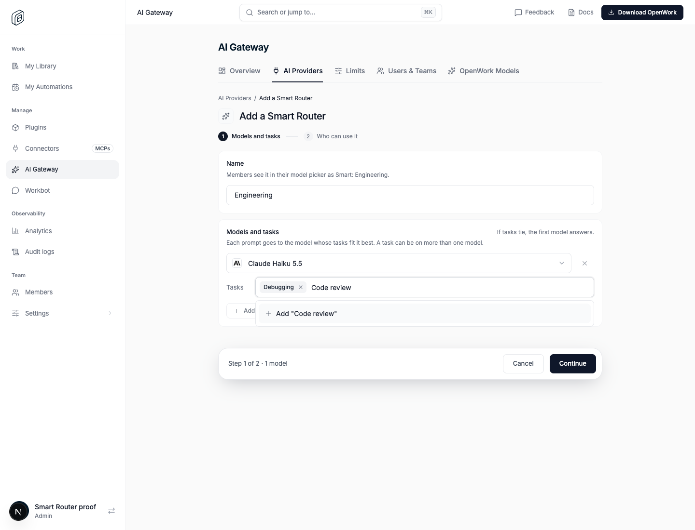
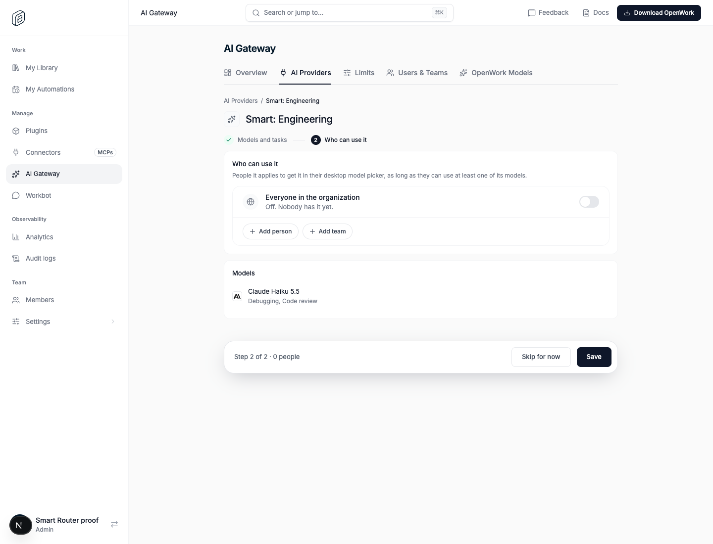
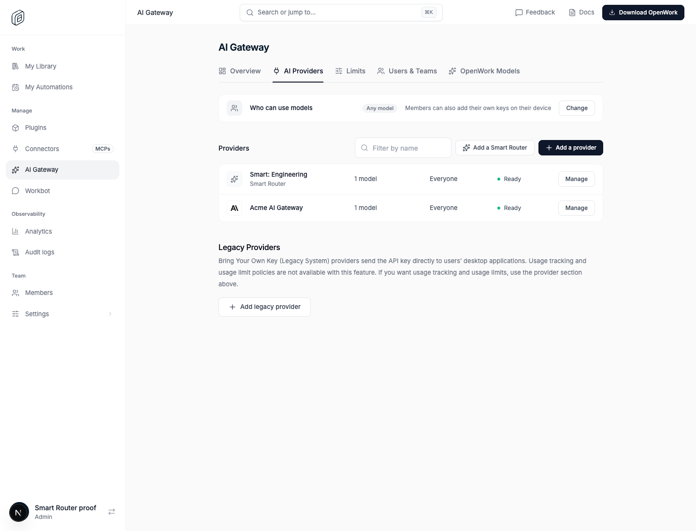
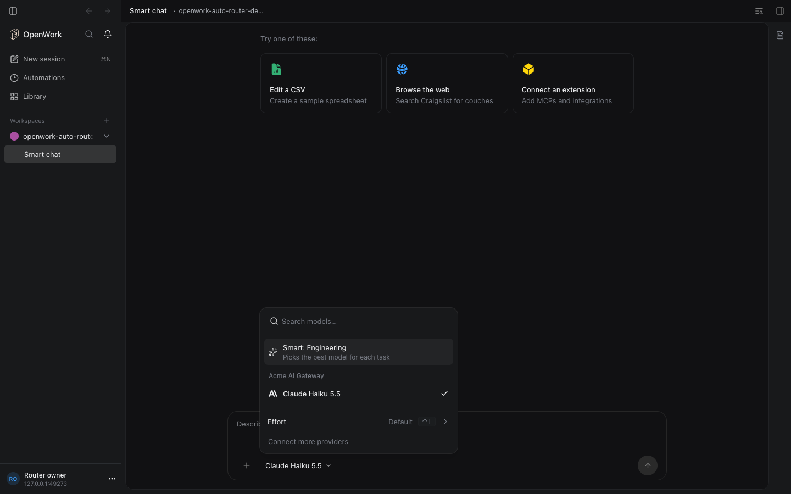
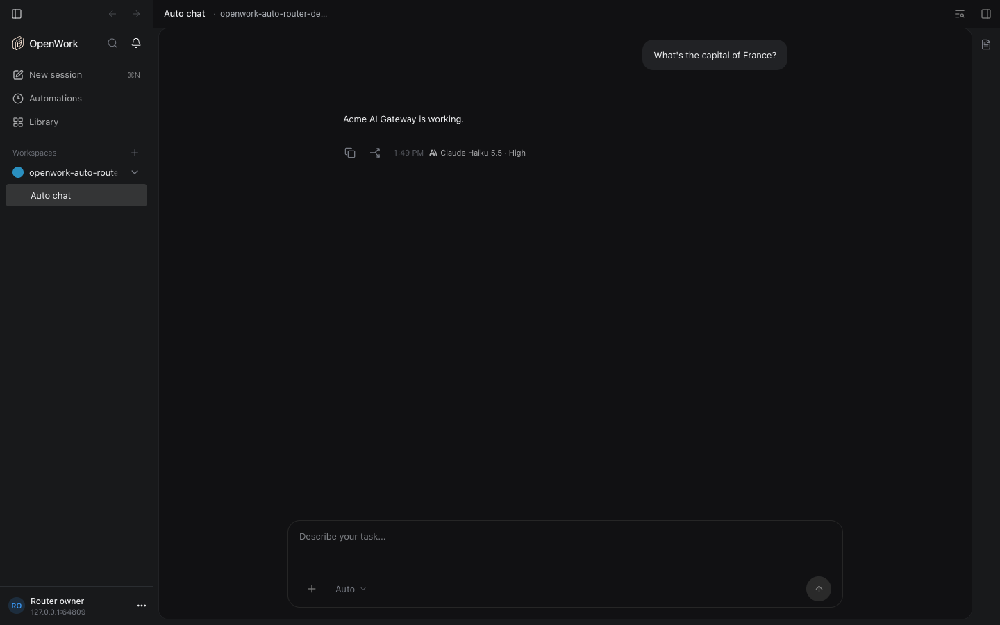
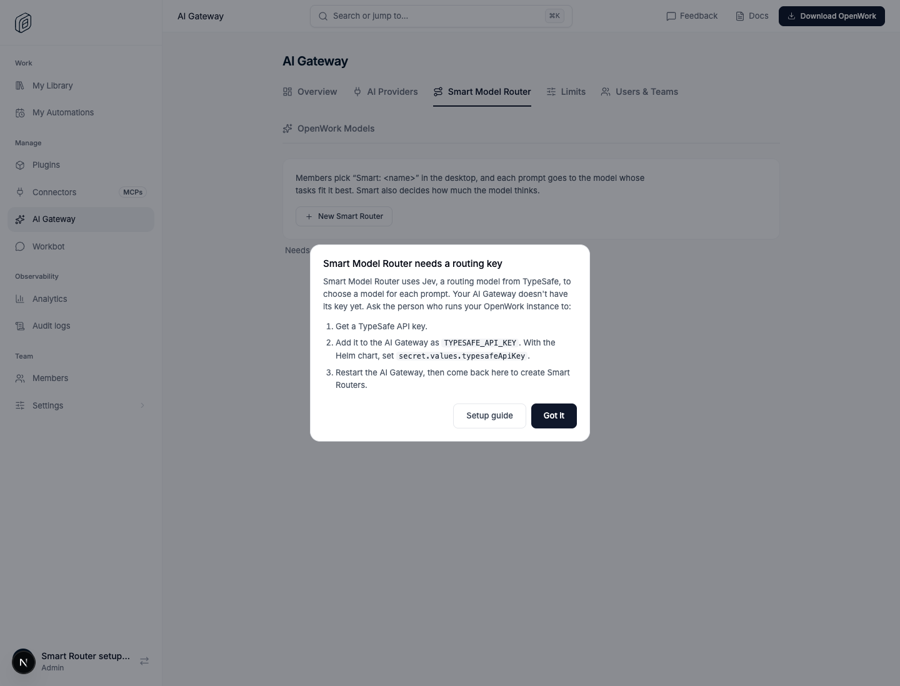

# Smart Model Router

- **Feature key:** `autoRouter` (internal names keep "auto": tables `auto_router*`, routes `/v1/org/auto-router*`, provider `openwork-auto`)
- **Deployments:** cloud only (Jev is called through TypeSafe's hosted API)
- **Author:** OmarMcAdam
- **Default:** off

## What people get

**Organization admins** see Smart Routers at the top of AI Gateway › AI
Providers (`/dashboard/ai-gateway?tab=ai-providers`), laid out like
providers: "Smart: <name>", models, who it applies to, status (Ready, Give
access when it applies to nobody, Paused without the TypeSafe key) and
Manage / Set up. **Add a Smart Router** sits left of **Add a provider**. An
organization can have up to 50. Adding one takes two steps:

1. **Models and tasks** (`/dashboard/ai-gateway/smart-routers/new`): the
   name (members see "Smart: <name>"), then any AI Gateway model (active
   provider, in an active model group, a protocol Smart can translate to),
   each with the **tasks** it handles (at least one). Tasks are picked from a
   combobox listing every task in the organization, or typed and added with
   Enter; text left in the box is added too. A task can sit on several models
   of the same router. **Continue** creates the router
   (`POST /v1/org/auto-routers`), applying to nobody.
2. **Who can use it** (`…/smart-routers/<id>?step=access`): the usual Who can
   use it block (everyone, teams, people), saved with
   `PUT /v1/org/auto-routers/<id>/assignment` and stored in
   `auto_router_access` like other organization items. Models some of those
   people can't use through their AI Gateway grants are marked, and a tooltip
   names them. **Skip for now** leaves it applying to nobody.

A router's page (`…/smart-routers/<id>`) edits both together and removes it.
Applying to everyone needs the Share with everyone permission (unless it
already did).

There are no thinking levels and no default model to configure. The first
model in a router wins ties and answers when Jev cannot.

Tasks are shared across the organization: one `auto_router_task` row per
name, unique on (`organization_id`, `name_key`) where `name_key` is the name
trimmed, spaces collapsed and lowercased (`autoRouterTaskKey`). Saving or
deleting a router removes tasks no model uses anymore.

Tables: `auto_router` (name), `auto_router_access` (org_wide / team /
member), `auto_router_model` (provider id, catalog model id, position),
`auto_router_task`, `auto_router_model_task` (model ↔ task, position).
Migration `0175_smart_routers` dropped the earlier single Auto Router's data.

**Members** get one **Smart: <name>** model at the top of the desktop model
picker for each router that applies to them (everyone, one of their teams, or
them directly) and that has at least one model their grants reach. All of
them are models of one runtime provider, `openwork-auto`, with ids
`openwork-smart-<router id>`.

Each Smart reply says which model answered it, with its thinking level, below
the reply (for example "Claude Haiku 5.5 · High").

## How a request is routed

1. The desktop registers the `openwork-auto` OpenAI-compatible provider
   pointing at the gateway (`GET /v1/org/auto-router/connect` returns the base
   URL, the member's own Gateway key and one model per router) and sends model
   `openwork-smart-<router id>` to `POST /api/v1/chat/completions`.
2. The gateway loads the organization's routers (feature checked, 15s cache),
   checks the router is assigned to the member (team memberships cached 15s),
   and keeps only the router's models the member's access grants allow.
3. At the start of a turn (the last message is the user's) it asks Jev one
   request with a **Score** question per distinct task of those models
   (`task_<n>`: unrelated / partly / clearly this task, normalized to 0..1)
   plus a `thinking` Score (none / light / moderate / deep). Jev sees task
   names and the conversation, never model or provider ids.
4. Each model's total is the **sum** of its tasks' scores. The highest total
   wins; ties go to the model listed first. A model with two good matches
   (0.7 + 0.6) beats one with a single better match (0.9).
5. The thinking score maps to none / low / medium / high, then to the closest
   effort level the chosen model's catalog allows (ties to more reasoning);
   `default` when the model takes no effort levels. With only one usable
   model, Jev is asked for thinking only.
6. Requests that continue the turn (tool results) reuse the turn's model and
   thinking for an hour, in memory and in `auto_router_reasoning` (keyed by a
   hash of key, router, session and turn), so another gateway instance keeps
   them too.
7. If Jev fails, times out (4s) or answers nothing usable, the first usable
   model answers at `default` thinking.
8. The request is rewritten under the member's own `gwm_…` alias for that
   model and handed to the normal Gateway pipeline (access checks, limits,
   credentials, request logs and spend as if the member had picked it), with
   a translator per upstream protocol in `ee/apps/gateway/src/auto-router/`
   (Anthropic Messages, OpenAI Responses, Chat Completions, Gemini, Bedrock
   Converse). Provider reasoning that must be replayed after a tool call is
   stored encrypted in `auto_router_reasoning` for an hour.

## Which model answered

Every Smart response carries headers `x-openwork-auto-provider`,
`x-openwork-auto-model`, `x-openwork-auto-thinking`, `x-openwork-auto-reason`
(`jev`, `turn` or `fallback`) and `x-openwork-auto-model-name`, and
`openwork_route` on the first chunk or JSON body. Errors from the chosen model
end with "(Smart chose <model> · <thinking> thinking.)". The OpenWork server's
`openwork.auto-route` engine plugin records these in session metadata
(`openworkAutoRoutes`), and the app shows them under each reply.

## Operating it

Gateway environment (see `ee/apps/gateway/README.md`): `TYPESAFE_API_KEY`
(required: without it Smart is off), optional `TYPESAFE_BASE_URL`,
`AUTO_ROUTER_JEV_MODEL` (`jev-latest`), `AUTO_ROUTER_JEV_TIMEOUT_MS` (`4000`),
and `DEN_DEPLOYMENT=cloud`.

Watch for `[gateway] Smart Model Router could not ask Jev` warnings and
`auto_router_*` error codes: `auto_router_unavailable` (404: feature off,
router deleted or not assigned to the member), `auto_router_no_models` (403:
the member can use none of the router's models), `auto_router_not_configured`
(404: no TypeSafe key).

Without the TypeSafe key, Den reports `routing: "missing_key"` on
`GET /v1/org/auto-routers`, refuses to save routers
(`auto_router_not_configured`), and answers 404 on connect so desktops drop
Smart models. `unknown` (gateway unreachable) blocks nothing.

## Turning it off

The kill switch (or turning the feature off for an organization) makes the
gateway answer Smart requests with `auto_router_unavailable` within 15
seconds, Den stops returning the connect payload, and desktops drop Smart
models at their next provider sync. Saved routers stay in the database and
come back when the feature is turned on again.

## Proof

`evals/proofs/auto-router.proof.test.ts`, run with
`pnpm evals:e2e auto-router --local`.
