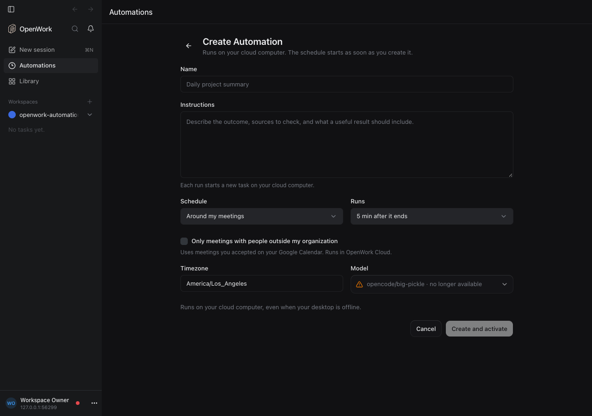

# Automations: before or after meetings

- Feature: `automationCalendarTriggers`
- Deployments: cloud and self-hosted
- Default: off
- Owner: `benjaminshafii`

A Cloud Automation can run around each meeting on its owner's primary Google
Calendar instead of on a clock: "5 minutes after every meeting with people
outside the organization, write up the action items", "15 minutes before each
meeting titled review, pull the latest numbers".

```json
{ "kind": "calendar", "timezone": "Europe/Paris", "edge": "end", "offsetMinutes": 5, "rule": { "withExternalAttendees": true } }
```

`offsetMinutes` runs from the meeting's `edge` (negative is before), at most
two hours either way. A meeting counts when it is timed (not all-day), not
cancelled, accepted by the owner (or organized by them), and has someone else
invited besides rooms. `rule.withExternalAttendees` keeps only meetings with
someone from another email domain; `rule.titleIncludes` matches the title,
ignoring case.

In the desktop Automation editor it is **Around my meetings**: when it runs
(before a meeting starts or after it ends) and whether only meetings with
people outside the organization count. Agents create one with
`createCloudAutomation`, or propose one with `automation.propose`.



## How it runs

- `calendar` is a schedule kind, so a revision always has exactly one reason
  to run. It has no clock occurrences: `nextDueAt` stays null.
- Den's scheduler reads the owner's calendar (`readMemberGoogleCalendar`, the
  read the member's agent already uses) at most every 5 minutes per owner and
  only for owners with an active calendar-triggered Automation. The pure
  `calendarTriggerOccurrences` (`packages/automations`) turns the events into
  occurrences with a stable key; each due one is claimed once, keyed by
  Automation and that key. A moment more than 10 minutes old is never
  replayed, and meetings from before the trigger was saved never run.
- The run gets the person's instructions plus facts Google or the owner
  control inside `<meeting>`: local start and end, invitee email domains
  (checked as hostnames, never addresses) and a Google Meet or Calendar link.
  The run is unattended, so nothing the invite's sender wrote (title,
  description, names) reaches the model from the trigger, and the prompt never
  points the agent at the event. The event id and title are stored with the
  run for the owner (`triggerContext`); the title also serves
  `rule.titleIncludes`.
- Cloud placement only. If the owner's Google Calendar is not connected (or
  lacks the calendar scope) the Automation needs attention with "Connect
  Google Calendar…"; a Google API error is retried on the next read.

## Older desktops

Same rule as every-few-hours schedules: a first-party desktop that does not
name `calendar` in `x-openwork-automation-schedule-kinds` never receives these
Automations, and the agent index lists them in `moreAutomations`.

## Turning it off

Den stops reading calendars for these Automations. They stay, keep their
trigger through edits that do not change it, and resume when the feature is
back. New calendar triggers are refused with
`400 automation_calendar_trigger_disabled`.

## What to watch

Proof: `evals/proofs/automation-schedule-triggers.proof.test.ts`; rules and the
calendar source: `ee/apps/den-api/test/api/automation-calendar-triggers.api.test.ts`;
which meetings and when: `packages/automations/src/calendar-trigger.test.ts`.

Logs from `automation_calendar_triggers` (read failures per owner), runs whose
`scheduledFor` follows meetings, and Automations needing attention with
`connect_access_unavailable`.
