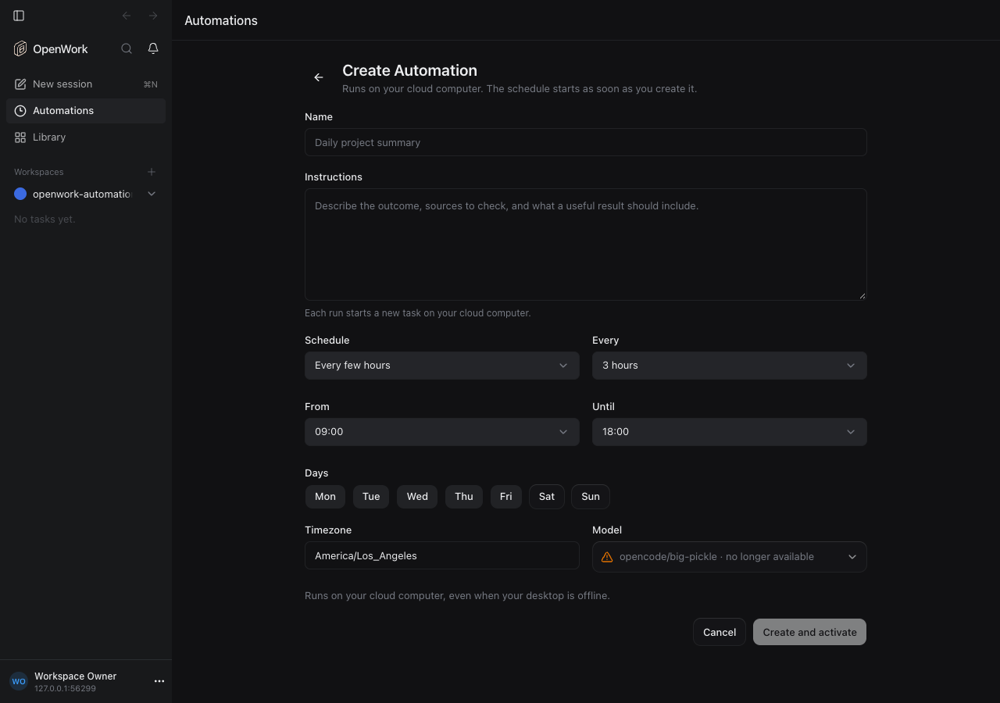

# Automations: every few hours

- Feature: `automationIntervalSchedules`
- Deployments: cloud and self-hosted
- Default: off
- Owner: `benjaminshafii`

An Automation can repeat every few hours instead of once a day or once a
week: every `everyHours` hours (1–24) on the hour, counted from a start hour
each listed day and stopping before an end hour, in the schedule's own time
zone. Every 3 hours from 09:00 until 18:00 on weekdays runs at 09:00, 12:00
and 15:00, Monday to Friday. People no longer create eight daily Automations
to get "every 3 hours".

```json
{ "kind": "interval", "timezone": "Europe/Paris", "everyHours": 3, "daysOfWeek": [1, 2, 3, 4, 5], "startHour": 9, "endHour": 18 }
```

`daysOfWeek` defaults to every day and the window to the whole day. Daylight
saving follows the same rules as daily schedules: a skipped hour moves to the
next valid minute and runs once, a repeated hour runs once.



## Who gets it

- The desktop Automation editor and the Calendar's Edit schedule offer
  **Every few hours** when the feature is on for the member.
- Agents create them through `automation.propose` (desktop) and
  `createCloudAutomation` / `updateAutomation` (Den capabilities). With the
  feature off Den answers `400 automation_interval_schedule_disabled`, and
  the agent is told to offer a daily or weekly schedule instead.

## Older desktops

Released desktops parse schedules strictly and the Calendar throws on a kind
it does not know. Den therefore leaves interval Automations out of
`GET /v1/automations` and answers 404 for them to a first-party desktop that
does not name the kind in `x-openwork-automation-schedule-kinds` (every
desktop has sent `x-openwork-automation-model-attention` since August 2026,
which is how Den tells a desktop from Den web, agents and API clients, who see
everything). The agent's `automation://index.json` lists them in
`moreAutomations`, which released desktops ignore, with a plain `summary`.
Desktop runners are unaffected: a run assignment carries no schedule.

## Turning it off

Nothing is deleted. Existing interval Automations stay, keep their schedule
through edits that do not change it, and every due occurrence is recorded as
a skipped run ("Every-few-hours schedules are turned off for this
organization.") until the feature is back. New interval schedules are refused.

## What to watch

Skipped runs with that message, and `automation_interval_schedule_disabled`
answers. Proof: `evals/proofs/automation-schedule-triggers.proof.test.ts`;
rules: `ee/apps/den-api/test/api/automation-interval-schedules.api.test.ts`.
