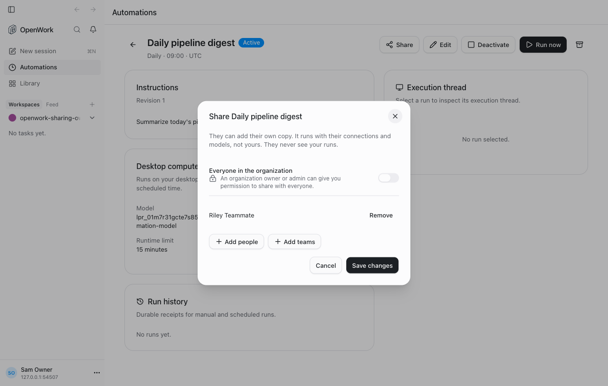
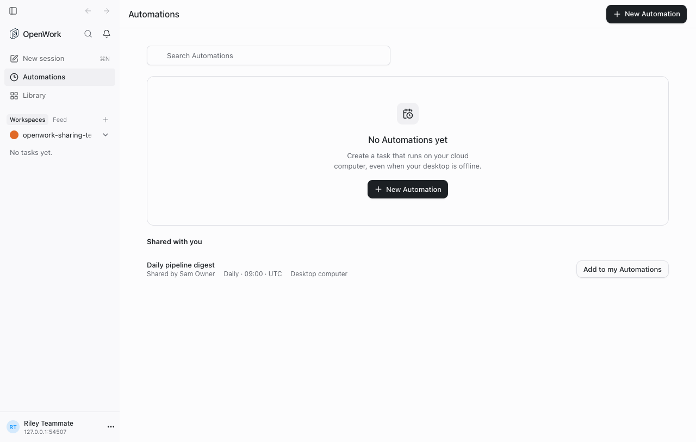

# Share an Automation with teammates (`automationSharing`)

- **Feature key:** `automationSharing`
- **Deployments:** cloud and self-hosted
- **Author:** `benjaminshafii`

## What people get

A member can share one of their own Automations with specific people, with
teams, or with everyone in the organization. Sharing with everyone needs the
same permission as sharing anything else organization-wide
(`sharing.share_org_wide`); without it the option stays visible, locked, with
the reason.

People it is shared with see it on the Automations page under **Shared with
you**, with who shared it and its schedule. **Add to my Automations** gives
them their own copy:

- The copy belongs to them. It runs with their connections, their models and,
  for a desktop Automation, their computer.
- The copy starts paused, so they can read the instructions and turn it on
  when ready.
- It is independent from then on. Later edits to the original do not reach it.

Sharing never lets anyone run, edit, pause or archive someone else's
Automation, and never shows its runs or results. Only the definition is shared:
name, instructions (or the pinned Workflow), schedule and where it runs.

| The owner shares | The teammate adds a copy |
| --- | --- |
|  |  |

## How it works

- `automation_share` holds one row per person, team or whole-organization
  grant for an Automation. Saving the share dialog replaces the set.
- `GET` / `PUT /v1/automations/:id/sharing` read and replace who an Automation
  is shared with. Owner only.
- `GET /v1/shared-automations` lists definitions shared with the caller. It
  reads through a definition-only query, so it never touches the owner's run
  state. Archived Automations and Automations whose owner left are not listed.
- `POST /v1/shared-automations/:id/copy` creates the caller's copy through the
  normal create path, so placement, model access and Workflow access are
  checked for the person adding it, not the person who shared it. The owner's
  workspace is never copied.
- Removing a member or deleting a team removes their grants.
- The four operations are available to agents (`getAutomationSharing`,
  `updateAutomationSharing`, `listSharedAutomations`, `copySharedAutomation`).

## Off

The four routes answer 404 `feature_disabled`, the Share action and the
**Shared with you** section are not shown, and agents do not find the
operations. Copies people already added are ordinary Automations and keep
running. Grants stay stored untouched, so turning the feature back on restores
what was shared.

## Try it

1. Turn `automationSharing` on for an organization with two members.
2. As the first member, open an Automation, choose **Share**, add the second
   member, save.
3. As the second member, open Automations: it is under **Shared with you**.
   Choose **Add to my Automations**; the paused copy opens.
4. As the first member, remove the second member in the share dialog. It
   leaves their **Shared with you** list; their copy stays.

## What to watch

- `/admin` › Features › `automationSharing` for who uses it.
- Copy requests answering 409 (`model_access_lost`, `provider_unavailable`):
  the person adding the copy cannot use the original's model.
- Audit events for the sharing and copy routes. Instructions are never
  recorded.

## Code

- `ee/packages/den-db/src/schema/automations.ts` (`AutomationShareTable`)
- `ee/apps/den-api/src/automations/sharing.ts`
- `ee/apps/den-api/src/routes/automations/index.ts`
- `packages/types/src/automations.ts`
- `apps/app/src/react-app/domains/automations/`
- `ee/apps/den-api/test/api/automation-sharing.api.test.ts`
- `evals/proofs/automation-sharing.proof.test.ts` (two members on the real app)
