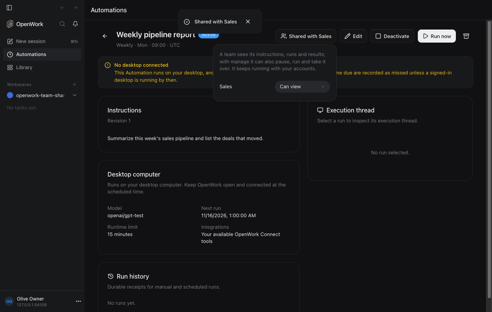
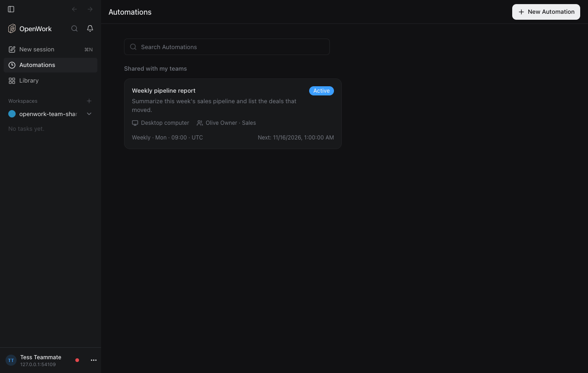
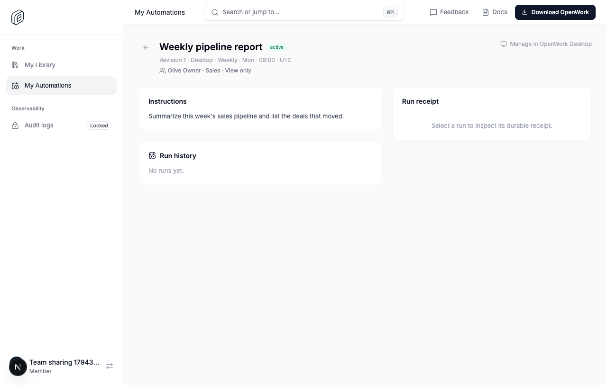
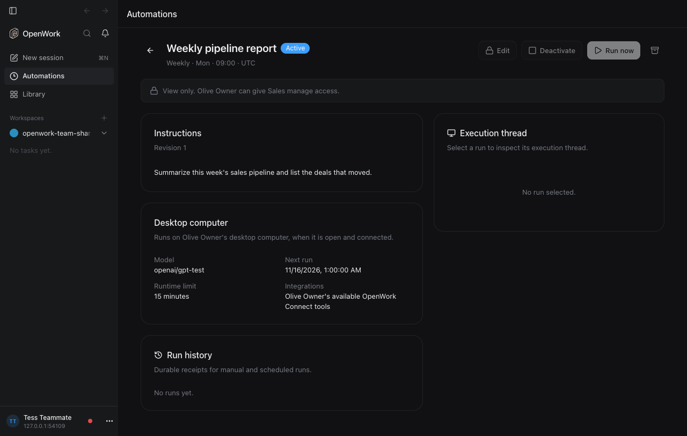
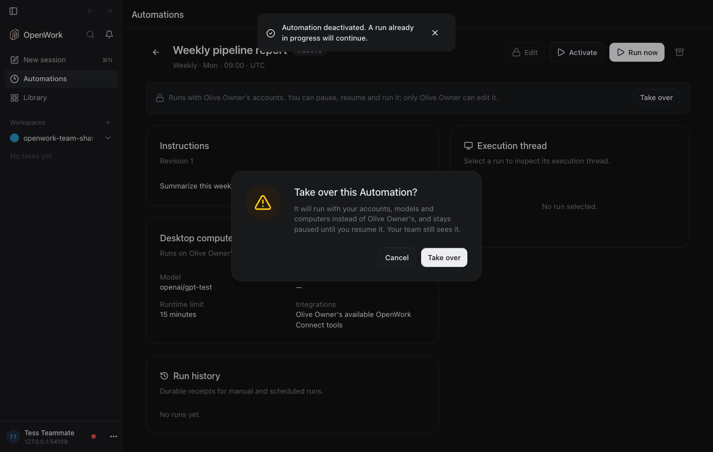

# Share Automations with teams

- **Feature key:** `automationTeamSharing`
- **Deployments:** cloud and self-hosted
- **Author:** benjaminshafii
- **Default:** off

## What people get

An Automation used to be visible to its owner only. With this on, the owner
shares it with a team they are on, and that team can follow it or operate it.

**The owner** opens an Automation in the app (Desktop or OpenWork Web) and
uses **Share**. The panel lists the teams they are on, each with one choice:
Not shared, Can view, Can manage. A change saves at once and is undone by
changing it back. The button then reads "Shared with Sales", and the card in
their list says the same.

**Teammates** on that team get a **Shared with my teams** section under their
own Automations, in the app and on Den's My Automations. Each card names the
owner and the team ("Olive Owner · Sales").

| Access | A teammate can |
| --- | --- |
| Can view | read the instructions, schedule, model, run history and each run's result |
| Can manage | all of that, and pause, resume and run it, cancel a run, and take it over |

Editing, archiving, sharing and choosing where a run executes stay with the
owner. Those controls are shown locked with who can change them, and a line
under the title says what the teammate's team can do.

**Taking over.** A teammate with manage access can make the Automation theirs
(**Take over**, confirmed once). It then runs with their accounts, models and
computers, so it comes back paused for them to review and resume; a workspace
pinned on the previous owner's computer is dropped. The teams it is shared
with are kept, so the previous owner still sees it. Taking over is refused
while a run is in progress. This is also how a team recovers an Automation
whose owner has left the organization.

## The rule behind it

An Automation always runs as its owner: their connected accounts, their
models, their desktop or cloud computer. A share never changes that. It only
decides who else may look and who may operate.

That is why a teammate cannot edit instructions (they would be writing
instructions that act with someone else's accounts) and why sharing is the
owner's decision alone: a share shows the team what the Automation did with
the owner's accounts. An organization admin who is not on the team sees
nothing.

The owner can share only with teams they are on. Access follows team
membership: leaving the team ends it, and deleting a team removes its shares.
An archived Automation is its owner's only.

## How it is built

- Table `automation_team_share` (migration `0192_automation_team_share`): one
  row per Automation and team, with `access` (`view` or `manage`).
- `ee/apps/den-api/src/automations/sharing.ts` is the one place that decides
  access. The Automation service stays owner-scoped: for a teammate the route
  resolves their access, then calls the service in the owner's scope.
- New routes: `GET /v1/shared-automations`,
  `GET /v1/automations/:id/sharing`,
  `PUT` and `DELETE /v1/automations/:id/sharing/teams/:teamId`,
  `POST /v1/automations/:id/take-over`. All but take-over are agent tools
  too (`listSharedAutomations`, `getAutomationSharing`,
  `shareAutomationWithTeam`, `stopSharingAutomationWithTeam`).
- Existing routes (`getAutomation`, `listAutomationRuns`, `getAutomationRun`,
  `activateAutomation`, `deactivateAutomation`, `runAutomationNow`,
  `cancelAutomationRun`) accept a teammate with enough access. List items and
  details gain `access`: the caller's role, the owner's name and the teams.
- `GET /v1/automations` is unchanged: it lists only the caller's own, so
  released desktops never show a teammate's Automation as editable.

## Turning it off

The kill switch, or turning it off for an organization, takes effect on the
next request: teammates stop seeing shared Automations and the sharing routes
answer `feature_disabled`. Nothing is deleted. Owners and their schedules are
unaffected, shares are kept and work again when it is turned back on, and an
Automation that was taken over stays with its new owner.

## Trying it

1. Turn `automationTeamSharing` on for an organization in `/admin`.
2. Put two members on a team (Members › Teams).
3. As one of them, open an Automation and use **Share**.
4. As the other, open Automations: it is under **Shared with my teams**.

## What to watch

- Feature use per organization in `/admin` › Features (every request through
  a sharing route, and every teammate read or action on a shared Automation).
- Audit log: `automation_run.completed` names the teammate who cancelled a
  run; requests to the sharing routes carry the team as a resource.
- Tests: `ee/apps/den-api/test/api/automation-team-sharing.api.test.ts` (the
  access rules) and `evals/proofs/automation-team-sharing.proof.test.ts` (the
  flow in the app).

## Not in this version

- Run history does not yet show which teammate started a manual run (the
  audit log does).
- Sharing is with teams only, not with single people or the whole
  organization.
