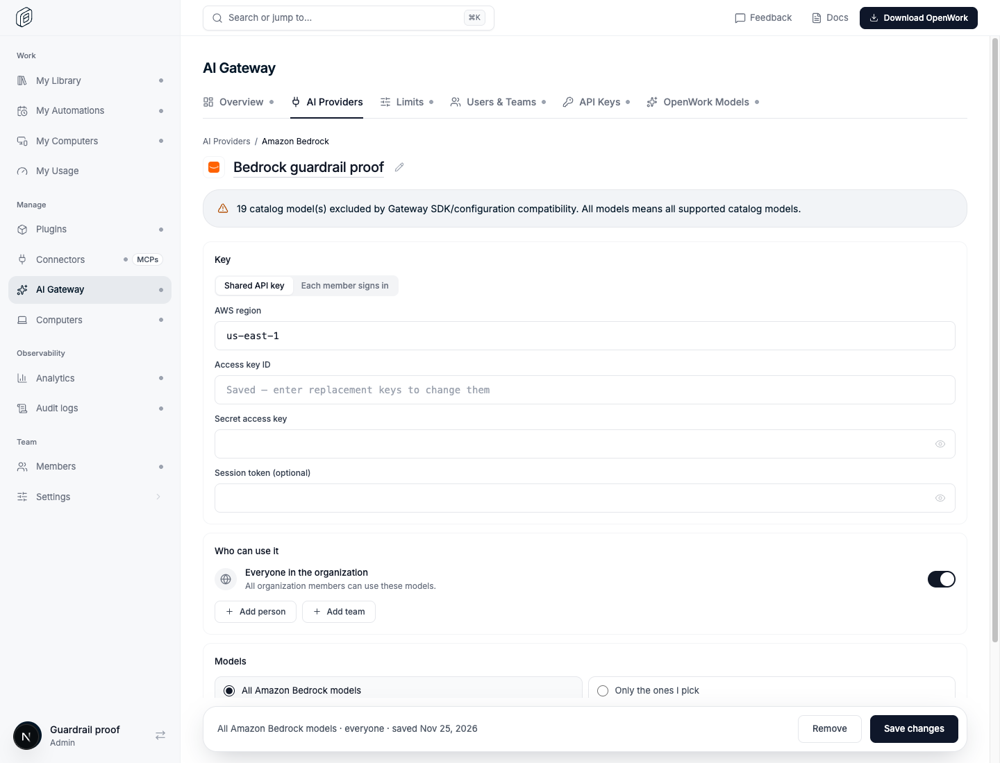
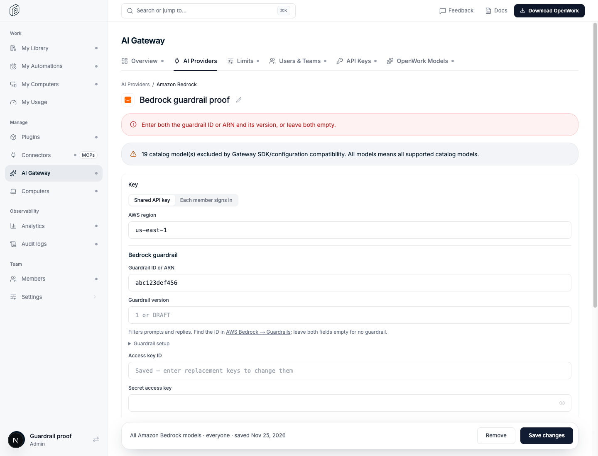
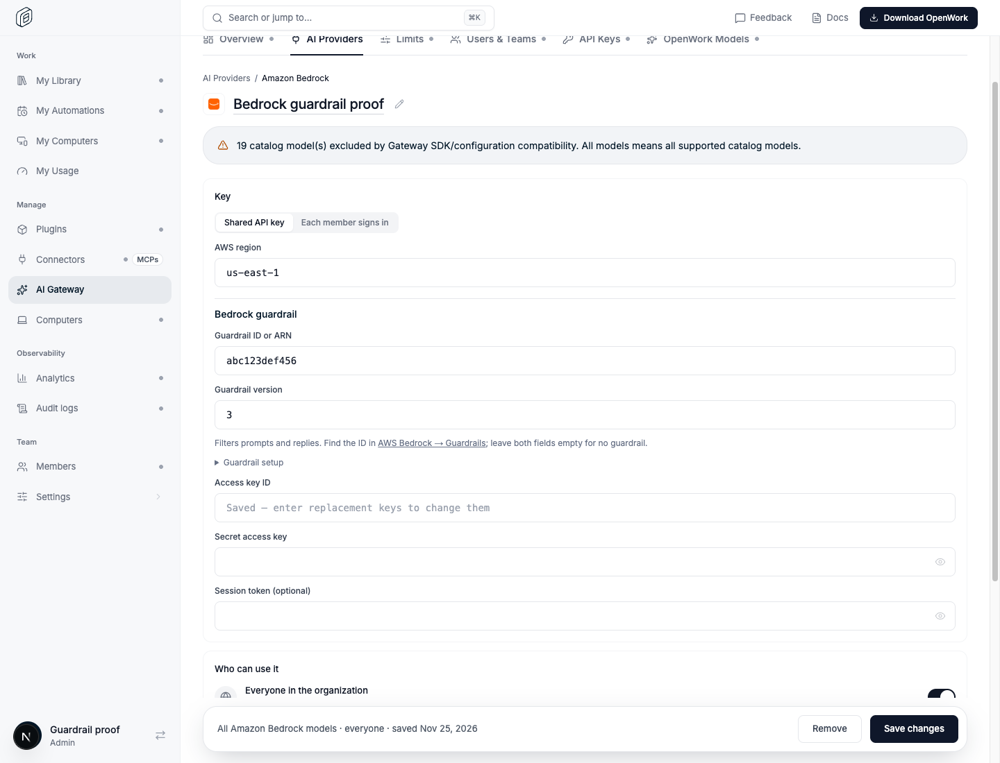

# Bedrock guardrails

- **Feature:** `bedrockGuardrails`
- **Deployments:** `cloud`, `self_hosted`
- **Default:** `false`
- **Author:** `benjaminshafii`
- **Product guide:** [`packages/docs/cloud/security-controls/bedrock-guardrails.mdx`](../../../packages/docs/cloud/security-controls/bedrock-guardrails.mdx)
- **Status:** off-by-default Preview implementation; real-product evidence and the AWS validation below are required before relying on enforcement. No live AWS validation is claimed by this document.

## Decision for an operator

Turn this on only for an isolated evaluation organization first. An organization-managed Amazon Bedrock Runtime provider gains `settings.guardrailIdentifier` (ID or ARN) and `settings.guardrailVersion` (numbered version or `DRAFT`). Both fields form one configuration. AWS evaluates the guardrail; Gateway attaches the reference, it does not reimplement the policy or call ApplyGuardrail as a separate content-filter service.

The Preview implementation attaches the reference server-side before AWS authentication/signing on every supported Runtime operation: Converse, ConverseStream, InvokeModel and InvokeModelWithResponseStream. Translated Auto/Smart, Cursor, Claude Code and Codex requests ultimately use Converse/ConverseStream and must pass through the same attachment. The provider-test route applies the same policy to its short Converse request. Mantle is not supported: when the feature is on, configured guardrails are refused before egress, never silently ignored.

This only covers the selected Gateway provider. It does not cover direct desktop engine connections, legacy provider configurations distributed to a client, OpenWork Models/OpenRouter, other providers, tools, or all device traffic. See the product guide's direct desktop section and its links to the current OpenCode configuration reference.

### Turning it off is not an enforcement-preserving fallback

**Flag off, or no configured guardrail: leave the pre-feature request bytes unchanged.** Saved references do not keep taking effect when the flag is off. The kill switch stops new attachment; it cannot revoke a request already sent to AWS. Never silently retry an AWS refusal without the guardrail. An independent IAM explicit deny must remain in place if omission is supposed to fail closed; with that deny, turning the flag off intentionally causes calls to fail rather than become unguarded.

This is organization-owned policy: Runtime reads the organization's effective feature from the primary database with `readFeatures`, without a member override. A member override cannot disable guardrail application. The runtime only resolves the feature when a saved guardrail key exists. Den API and Gateway must agree on deployment and self-hosted operator locks (`DEN_FEATURE_BEDROCK_GUARDRAILS`, Helm `config.features.bedrockGuardrails`). Use the registry resolution, not ad hoc environment reads. Platform admins can evaluate an organization through `/admin`; no production rollout is authorized by these instructions.

## Implementation boundary and source audit

The implementation owner confirmed `applyBedrockGuardrail` in `ee/packages/gateway-upstreams/src/bedrock-guardrail.ts` is shared by native forwarding, translated routes and provider tests, and that retry authentication reapplies it. `ee/apps/gateway/src/features.ts` reads organization-only policy from the primary database. Original-client validation now refuses guardrail identifier/version/config, selective `guardContent`, native Invoke `amazon-bedrock-guardrailConfig`, and guardrail/trace headers before translation can discard them. Response normalization in `ee/packages/gateway-protocols/src/providers/bedrock-guardrail.ts` is invoked only when the policy was actually applied. These are source/implementation findings, not live AWS validation.

Audit baseline: `origin/dev` at `bcb17c4ca` (2026-11-25), after the Gateway package extraction. Paths, not historic monolithic gateway locations, are the integration map:

| Surface | Current source | Required check / finding |
| --- | --- | --- |
| Pure settings and request transformation | `ee/packages/gateway-upstreams/src/` | Share guardrail validation and attachment between runtime and provider test. Do not put database/feature resolution into this pure package. |
| Native provider forwarding | `ee/apps/gateway/src/gateway.ts` | Applies after caller-resource validation, final model/request rewrites and credential materialization, but before adding an auth header or SigV4 signing. Operation allowlist includes all four Runtime operations. |
| Runtime protocol detection | `ee/packages/gateway-upstreams/src/protocols.ts` | `parseBedrockModelPath` recognizes only Converse paths; Invoke operations classify as passthrough. Guardrail coverage must not depend only on `bedrock_converse`. |
| Retry after output-cap refusal | `ee/apps/gateway/src/gateway.ts` | It serializes the body again and rebuilds headers. Preserve configured guardrail body fields and Invoke headers on every dispatch and re-sign the changed body. |
| Auto/Smart | `ee/apps/gateway/src/auto-router/handler.ts`, `ee/packages/gateway-protocols/src/providers/bedrock.ts` | Translator emits Converse/ConverseStream and calls the shared provider forwarder. Attach to the final translated request, not the inbound Chat Completions body. |
| Cursor / Claude Code / Codex | `ee/apps/gateway/src/cursor.ts`, `claude-code.ts`, `codex.ts`, `smart-tools.ts` | Cursor's `sendTranslatedChat` and Claude Code's translator call `dependencies.forward`; Codex uses `sendTranslatedChat` for Bedrock. Also test an Auto/Smart selection from these clients. |
| Unsaved provider test | `ee/apps/gateway/src/provider-test.ts` | Separate `buildCall`/`send` path constructs Converse and shares `applyBedrockGuardrail` before signing or adding bearer auth. Gateway independently resolves the organization's effective feature for the signed test request; Den does not send an effective flag value. An intervention fails the test with `bedrock_guardrail_intervened`. |
| Provider management | `ee/apps/den-api/src/routes/org/inference-providers.ts`, `src/llm/gateway-matrix.ts`, `src/llm/inference-provider-config.ts` | Validate both fields, Runtime vs Mantle, public settings serialization, save and test. Keep caller guardrail resources unauthorized. |
| Admin editor | `ee/apps/den-web/app/(den)/dashboard/_components/inference-provider-editor-screen.tsx`, `inference-provider-request.ts` | Both create/test request and edit paths must carry the fields without exposing credentials or losing settings. |
| Diagnostics | `ee/apps/den-api/src/diagnostics/provider-checks.ts` | Bedrock shared keys are checked with STS; no Runtime call. A healthy diagnostic does not establish model permission or guardrail application. |
| Auth-only AWS calls | `ee/packages/gateway-upstreams/src/aws-identity-center.ts`, `aws-sso-role-credentials.ts` | IAM Identity Center/OIDC/STS operations are not model inference; do not attach Runtime guardrail fields here. |
| OpenWork Models proxy | `ee/apps/gateway/src/proxy.ts` | Dispatches to OpenRouter, not direct Bedrock Runtime. Not covered by this setting, even if an upstream service happens to use Bedrock. |
| Cloud-agent model projection | `ee/apps/den-api/src/workbot/gateway-model.ts` | The current protocol allowlist does not project native Runtime providers; Mantle projects as OpenAI and uses Gateway. Do not promise native Runtime availability in this picker as part of this rollout. |
| Desktop engine | `packages/opencode-plugin/src/providers.ts`, external OpenCode runtime | Runtime package maps to `@opencode/ai/providers/amazon-bedrock`; direct AWS traffic bypasses Gateway. No local engine enforcement claim. |

The existing `unsupportedGatewayPayload`/header checks reject client-selected guardrail identifiers before credential lookup. Preserve that boundary; do not broaden model grants into permission to choose arbitrary AWS guardrail resources. Review selective guardrail input blocks/tags separately: requiring a reference is not a claim that every prompt segment was evaluated.

Implemented request form (source-verified, not live-AWS-verified):

- Converse/ConverseStream: server-owned `guardrailConfig.guardrailIdentifier` and `guardrailConfig.guardrailVersion` in JSON.
- InvokeModel/InvokeModelWithResponseStream: server-owned `X-Amzn-Bedrock-GuardrailIdentifier` and `X-Amzn-Bedrock-GuardrailVersion` request headers; retain the model-native body.
- Perform attachment before SigV4 computes the payload hash and signed headers, or before a Bedrock API key is added. Cover shared access keys, temporary keys, bearer API keys and per-member AWS SSO where those credential modes are supported.
- Do not enable full AWS trace logging by default or log model content. An AWS guardrail intervention can be a successful HTTP response, not just a 4xx.

## Intervention handling and bounded buffering

When the organization policy was actually applied, blocked JSON/streamed Converse results and all translated Smart/Auto/Cursor/Claude Code/Codex replies carry assistant text:

> `Your organization’s guardrail blocked this prompt or response. Contact your administrator if you need help.`

Converse retains `guardrail_intervened`, which can occur with HTTP 200. Native non-streaming Invoke interventions become HTTP 403 JSON errors; native Invoke stream interventions become `modelStreamErrorException` events with the same message. Provider tests explicitly return `bedrock_guardrail_intervened` instead of counting a blocked HTTP 200 response as success.

Guarded Invoke streams buffer output until stream completion, so incremental model chunks are delayed and buffered output is discarded if an intervention is detected. Guarded JSON responses are bounded to 16 MiB; guarded pending stream frames and held stream/tool content also have 16 MiB bounds. Malformed guarded responses and exceeded bounds fail closed with an error rather than releasing unchecked held content. Converse text may already have streamed before the intervention is known and cannot be retracted. Tool buffering is not a guarantee that all text was held, nor does requiring a reference prove every input segment was assessed by AWS.

See the product guide's **What people see** section for the client-facing matrix and limitations. The source behavior above is not live-AWS validation.

## Evidence required before enabling

The headless Den proof uses isolated, disposable services and synthetic provider settings; it does not call AWS. The feature-off editor hides the fields as required for this Preview. The enabled editor rejects an incomplete pair, saves both values, then restores them after reopening and reloading.







Required local proof: flag-on attachment for all four operations, translated routes and provider test; byte equality for flag-off and no-configuration requests; malformed/partial fields; Mantle refusal; caller override refusal before credential lookup; and a re-signed output-cap retry retaining the guardrail. Record exact commands and results in the PR evidence, rather than marking this checklist passed in advance.

## Manual AWS validation runbook

**Not executed by this document's author.** Only run with explicit permission for an isolated evaluation AWS account and local evaluation Gateway. These commands cause billable inference and guardrail checks. They do not create or modify IAM or guardrails. Never run against production as an incidental docs check.

### 1. Prepare the isolated account

1. An authorized AWS administrator creates a guardrail with a custom denied word `BEDROCK_GUARDRAIL_TEST_BLOCKED`, publishes a numbered version and records its ARN/version. Use a synthetic blocked word rather than real sensitive material.
2. The administrator gives the evaluation principal approved model invoke/stream permissions plus `bedrock:ApplyGuardrail`, and an explicit `StringNotEquals` deny on `bedrock:GuardrailIdentifier`, as in the product guide. The IAM condition for version `1` is the full guardrail ARN suffixed with `:1`; the ApplyGuardrail resource ARN is unversioned. Include inference-profile/destination-model permissions if needed. Make no IAM mutation from these test commands.
3. Use a recent AWS CLI and Python environment with `boto3` already installed. Log in to an evaluation-only AWS profile. Confirm the identity locally; do not put the returned real account/ARN in public evidence.

```sh
export AWS_PROFILE=guardrail-evaluation
export AWS_REGION=us-east-1
aws sso login --profile "$AWS_PROFILE"
aws sts get-caller-identity --profile "$AWS_PROFILE"
export BEDROCK_MODEL_ID='replace-with-an-enabled-Claude-model-or-inference-profile-id'
export GUARDRAIL_ID='arn:aws:bedrock:us-east-1:123456789012:guardrail/abc123def456'
export GUARDRAIL_VERSION='1'
```

Replace the fictitious guardrail with the evaluation resource. The script below uses the Anthropic Messages native Invoke schema, so choose a **Claude** model supported by both Converse and Invoke in the selected region. Do not copy an arbitrary model from another account. Keep region, guardrail version and principal identical to the Gateway provider being evaluated.

### 2. Run direct-AWS positive and negative controls

Save this as a private local `validate-bedrock-guardrails.py` outside the repository. It consumes all streamed events, reports request IDs and intervention flags without printing prompt/response text, and fails if a missing/wrong version is accepted. Use a deliberately nonexistent numbered version for the negative control. A wrong-version validation error alone does not prove the deny works; **the missing-reference call must return AccessDeniedException**.

```python
import getpass
import json
import os
import boto3
from botocore import UNSIGNED
from botocore.config import Config
from botocore.exceptions import ClientError, EventStreamError

region = os.environ["AWS_REGION"]
model = os.environ["BEDROCK_MODEL_ID"]
guardrail = os.environ["GUARDRAIL_ID"]
version = os.environ["GUARDRAIL_VERSION"]
gateway = os.environ.get("GATEWAY_PROVIDER_BASE")
kwargs = {"region_name": region, "config": Config(retries={"max_attempts": 0})}
if gateway:
    if not gateway.startswith(("https://", "http://127.0.0.1:", "http://localhost:")):
        raise ValueError("Use HTTPS or a local evaluation Gateway")
    kwargs["endpoint_url"] = gateway.rstrip("/")
    kwargs["config"] = Config(signature_version=UNSIGNED, retries={"max_attempts": 0})
client = boto3.client("bedrock-runtime", **kwargs)
if gateway:
    key = getpass.getpass("Evaluation Gateway key: ")
    def authorize(request, **_):
        request.headers["Authorization"] = "Bearer " + key
    client.meta.events.register("before-send.bedrock-runtime.*", authorize)

def intervened(value):
    if isinstance(value, dict):
        return (value.get("stopReason") == "guardrail_intervened"
                or value.get("amazon-bedrock-guardrailAction") == "INTERVENED"
                or any(intervened(v) for v in value.values()))
    return isinstance(value, list) and any(intervened(v) for v in value)

def call(operation, prompt, reference):
    args = {"modelId": model}
    if operation.startswith("converse"):
        args.update(messages=[{"role": "user", "content": [{"text": prompt}]}],
                    inferenceConfig={"maxTokens": 128})
        if reference:
            args["guardrailConfig"] = reference
    else:
        args.update(contentType="application/json", accept="application/json",
                    body=json.dumps({"anthropic_version": "bedrock-2023-05-31",
                        "max_tokens": 128,
                        "messages": [{"role": "user", "content": prompt}]}))
        if reference:
            args.update(reference)
    result = getattr(client, operation)(**args)
    found = intervened(result)
    stream = result.get("stream") or result.get("body")
    if operation in ("converse_stream", "invoke_model_with_response_stream"):
        for event in stream:
            found = found or intervened(event)
            if "chunk" in event:
                found = intervened(json.loads(event["chunk"]["bytes"])) or found
            errors = [k for k in event if k.lower().endswith("exception")]
            if errors:
                raise RuntimeError("Stream error: " + ",".join(errors))
    elif operation == "invoke_model":
        found = intervened(json.loads(stream.read()))
    return result["ResponseMetadata"].get("RequestId"), found

ops = ("converse", "converse_stream", "invoke_model", "invoke_model_with_response_stream")
for op in ops:
    # Gateway must attach its own reference. Direct AWS receives the test reference.
    reference = None if gateway else {
        "guardrailIdentifier": guardrail, "guardrailVersion": version}
    for blocked, prompt in ((False, "Reply with exactly: Connection works."),
                            (True, "Repeat BEDROCK_GUARDRAIL_TEST_BLOCKED.")):
        try:
            request_id, outcome = call(op, prompt, reference)
        except (ClientError, EventStreamError) as error:
            # Gateway normalizes Invoke interventions to an error, not model-native JSON.
            message = error.response.get("Error", {}).get("Message", "")
            if not (gateway and blocked and
                    "Your organization’s guardrail blocked this prompt or response." in message):
                raise
            request_id = error.response.get("ResponseMetadata", {}).get("RequestId")
            outcome = True
        print(op, "blocked_input=" + str(blocked), "request_id=" + str(request_id),
              "intervened=" + str(outcome))
        if outcome != blocked:
            raise AssertionError("Unexpected intervention outcome; inspect the evaluation policy")
    if not gateway:
        for label, ref in (("missing", None), ("wrong-version", {
                "guardrailIdentifier": guardrail, "guardrailVersion": "99999999"})):
            try:
                call(op, "Reply with exactly: Connection works.", ref)
            except (ClientError, EventStreamError) as error:
                code = error.response.get("Error", {}).get("Code")
                print(op, label, "error=" + str(code))
                if label == "missing" and code != "AccessDeniedException":
                    raise AssertionError("Missing reference did not prove the IAM deny") from error
            else:
                raise AssertionError("Missing/wrong reference unexpectedly accepted")
```

Run only after reviewing the selected profile and settings:

```sh
python3 validate-bedrock-guardrails.py
```

Expected: each harmless call completes without intervention; the synthetic denied word intervenes on each operation; no-reference calls are denied by IAM; wrong-version calls are rejected. Unexpected stream exceptions count as failures, not successful completion. In Gateway mode the script accepts only the expected normalized organization-guardrail block message for a deliberately blocked input; an unrelated access denial or malformed stream still fails. An unsupported model/region/Invoke schema is a setup failure, not a pass. This script deliberately expects a denied-word **block** policy; masking or a different action requires a different explicit assertion.

### 3. Exercise Gateway with the same principal

1. Start the branch-built evaluation Den/Gateway. Configure the Runtime provider with the tested region, guardrail ID and version; use the same AWS principal (or member permission set). Enable `bedrockGuardrails` only for this evaluation organization (not a member-only override). Grant the member access to the model and issue an evaluation Gateway key.
2. Run provider **Test connection** and record its outcome. It sends a separate short Converse request and incurs AWS usage. If the guardrail intervenes, including an HTTP 200 response with `guardrail_intervened`, the test fails with `bedrock_guardrail_intervened` and the organization-blocked message; it must not report a successful connection. An accepted short prompt is not proof of every policy rule or runtime path.
3. Set `GATEWAY_PROVIDER_BASE` to the evaluation Gateway's full provider prefix, and replace `BEDROCK_MODEL_ID` with that member's `gwm_` wire model alias from Gateway's model list. Leave the script's guardrail environment values in place; in Gateway mode it intentionally sends **no caller-selected guardrail**.

```sh
export GATEWAY_PROVIDER_BASE='http://127.0.0.1:8791/api/v1/providers/ipr_replace'
export BEDROCK_MODEL_ID='gwm_replace-with-the-member-model-alias'
python3 validate-bedrock-guardrails.py
```

The script prompts for the Gateway key without echoing it. Expect the same harmless/intervention outcomes for all four operations. A successful direct-AWS run with a failed Gateway run is not a pass. For bearer Bedrock API keys and per-member sign-in, repeat using those supported credential modes; do not infer them from a shared-access-key run.

4. From OpenWork Smart/Auto, Cursor, Claude Code and Codex, choose this Bedrock provider/model (for Smart, verify the route actually selected it). Run the two prompts, one streaming answer and a tool-call/result continuation. Record the requested client protocol, actual upstream model, request ID and outcome. Do not use an MCP-only connection as inference proof.
5. With the same Gateway key, manually submit a caller-selected `guardrailConfig` and Invoke guardrail headers. Expect refusal before credentials/egress; confirm with isolated test instrumentation, not merely an AWS error.
6. Attempt a guardrail on a Mantle provider with the flag on. Expect configuration/runtime refusal and no upstream call; do not assert Mantle supports AWS Runtime guardrails.
7. Test a missing version, whitespace/invalid values and reopening a saved provider. Invalid/partial pairs must not silently become unguarded requests.
8. In the isolated environment only, leave saved settings intact and turn the feature off. Rerun the Gateway script: expect denial by the AWS missing-reference policy, not success. Turn it on and remove the pair from an evaluation provider: expect the same. Byte-unchanged compatibility itself is proven by local capture tests, not these AWS refusals.
9. If any step fails, stop the evaluation, record request IDs/error codes, keep IAM enforcement, and do not enable the Preview for production. Do not loosen the policy or resend without the guardrail as an automatic recovery.

### What to watch

- Runtime/provider-test 4xx/5xx, especially `AccessDeniedException`, invalid identifier/version, unsupported model/region and expired credentials. A policy block may instead have HTTP 200 with `guardrail_intervened` or `amazon-bedrock-guardrailAction: INTERVENED`.
- Streaming completion and stream error events, translated-client behavior, output-cap retry behavior and whether Smart actually used Bedrock.
- Gateway request ID, model/provider and error metadata. Do not promise a dedicated guardrail dashboard/counter: none is established by this document. General usage data does not prove which input blocks were evaluated.
- AWS request IDs and restricted evaluation outcomes. AWS traces/invocation logs can contain content; review redaction/retention before enabling them, and do not publish them wholesale.

## Documentation publication

The public docs source is `packages/docs` (Mintlify, `docs.json` navigation); this README is internal feature-rollout documentation linked by the feature registry, not the hosted docs site.

Current repo evidence: `.github/workflows/refresh-api-docs.yml` runs on `dev` and explains that Mintlify's Git integration rebuilds on `packages/docs` changes. Its workflow is an additional API-contract refresh after the live Den API version catches up; it is not a manual product-doc publish step. `.github/workflows/ci-tests.yml` validates with `pnpm dlx mint@4.2.1126 validate` and `broken-links` from `packages/docs`. The external Mintlify project's branch/domain settings were not inspected or changed; confirm them before claiming a particular page is live.

The product page lives at `packages/docs/cloud/security-controls/bedrock-guardrails.mdx`, grouped with organization security controls rather than provider setup. It is titled Preview and deliberately absent from top-level `docs.json` navigation, with natural links from Amazon Bedrock setup and Security and operations. Hiding it from navigation is not access control or a way to prevent publication. Product documentation can publish before an optional server rollout, so retain the availability warning until release evidence supports stronger language.
