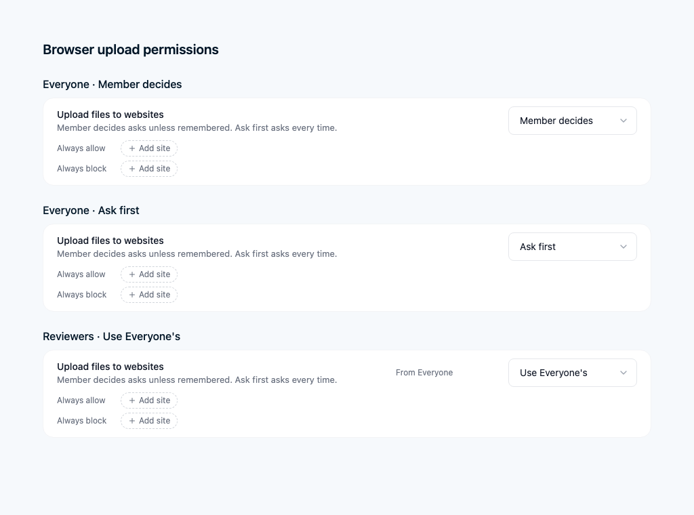
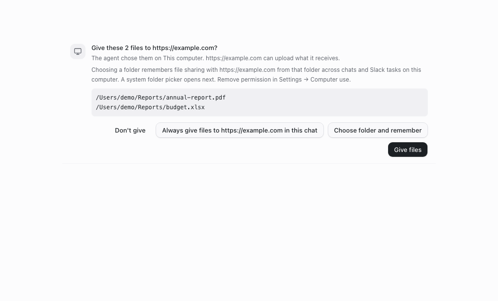
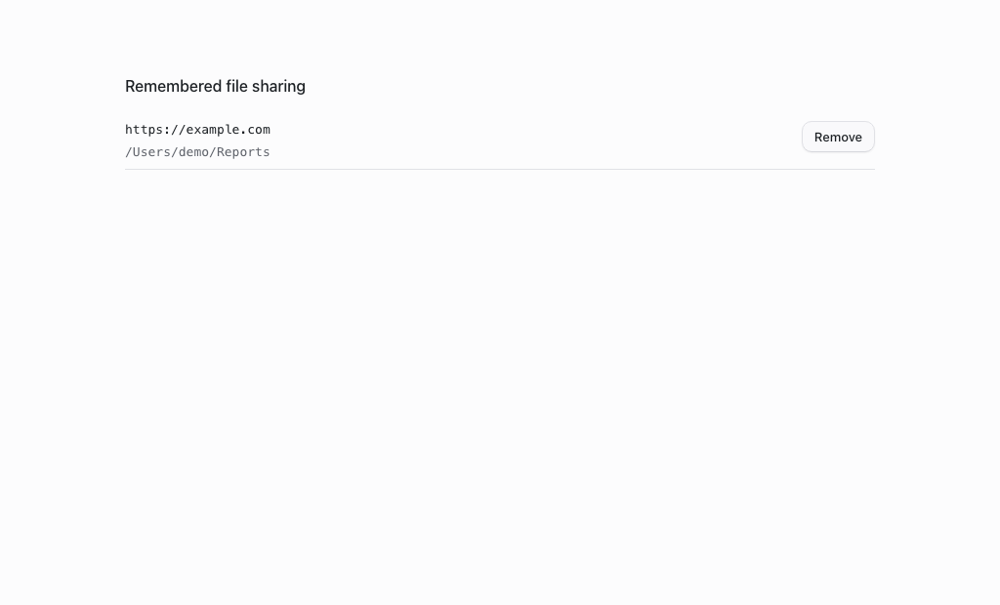

# Managed and remembered browser file sharing

- **Feature:** `browserUploadPermissions`
- **Deployments:** cloud and self-hosted
- **Default:** off
- **Owner:** @benjaminshafii

## Two ways to avoid repeat prompts

### Administrator policy

In Den, open the organization's **Browser** tab, or a team's Browser tab. The
**Upload files to websites** control uses the existing Agent Permissions editor:

| Setting | Effect |
| --- | --- |
| Member decides (default) | Ask unless this member remembered consent for the exact website and a containing folder on this computer. Existing chat-only consent also works. |
| Allow | Authorize browser file handoff without a member prompt. The administrator may scope exceptions with website patterns. |
| Ask first | Always ask for this upload. Neither remembered nor chat-standing approvals replace this administrative requirement. |
| Block | Refuse the upload, including uploads covered by earlier remembered consent. |

Teams inherit Everyone unless they override it. Existing strictest-team and
block-list precedence applies. Clearing a decision restores inheritance while
preserving any website exception lists. User grants never override a sourced
administrative Ask or Block.



### Member's site-and-folder consent

The existing approval card adds **Choose folder and remember**. It opens the
system folder picker. The member explicitly chooses the folder whose readable
files (including subfolders) may be handed to that **exact HTTP(S) origin**.
The selected files must be within that real folder; links do not widen it.

It applies across new chats, app restarts, and Slack-started remote tasks that
execute on the **same desktop under the same signed-in organization/member**.
It does not sync to another computer or authorize uploads on a Workbot cloud
computer. The old **Always … in this chat** option remains chat-only and is
never silently migrated to a durable grant.



**Settings → Computer use → Remembered file sharing** lists exact origins and
folders, with Remove. An administrative block remains visible; Remove still
works. Account changes clear the renderer's list, and the main process verifies
the account again before returning folders or sharing files.



These screenshots render the production React components and styles in an
isolated headless fixture. IPC replies are test data. They are not live-account
or native-folder-picker end-to-end evidence.

## Enforcement and storage

- New browser-only permission action `browser_upload`. It is not sent to native
  OpenCode permission grammar. It controls built-in browser handoff, not shell
  commands, native apps, connectors or general network egress: this is not DLP.
- Electron asks the local server for fresh policy verified with Den. That read
  supplies deployment, organization and member identity; renderer/model input
  never chooses the account. Missing verification cannot use a remembered grant.
- Private local `userData/browser-file-grants/` JSON is partitioned by a hash of
  deployment + organization + member and the local built-in-browser scope. No
  credentials or prompts are stored. Writes are serialized and atomic; invalid
  storage fails closed. It is not a cloud preference.
- Policy/account and revocation revisions are checked again after asynchronous
  reads, immediately before handoff. Actual paths must still be readable regular
  files at their real paths. Revocation invalidates pending authorization.
- The receiving chooser frame is checked too: a cross-origin frame never inherits
  the top-level website's consent, and a same-origin blocked-path iframe remains
  blocked. Permissions authorize handoff to the page, not the website's subsequent
  choice of upload endpoint.

## Compatibility, rollout and rollback

Both new desktop-config readers and admin editors send
`X-OpenWork-Browser-Upload-Permissions: 1`. With the feature off, stored upload
rules and member grants are preserved but inactive and the existing consent
flow remains. Old editors cannot erase upload settings they do not understand.

An older desktop that cannot understand an active managed upload rule receives
an existing `webfetch` Block rule, conservatively disabling website access until
it updates. This protects clients that implement website Agent Permissions;
clients predating that enforcement must be upgraded before relying on a browser
policy. Do not promise enforcement on unsupported historical clients.

Deploy Den and the updated desktop before enabling the flag for a test member.
Test Member decides, Allow, Ask first and Block; then remember a real folder,
start another task from Slack on that desktop, and revoke the grant. Do not turn
it on deployment-wide until production impact has been reviewed. Turning the
flag off stops using remembered grants and restores chat-only prompts; no
files, permissions or customer resources are deleted.

The separate approval-transport fix in PR #6895 should be deployed first so a
person taking more than five minutes to answer does not hit a transport timeout.

### Read-only production impact check (required before rollout)

No production permissions or rollouts were changed during implementation. The
production admin connector was not available in this worktree, so these checks
have **not** been run against production. Do not infer zero affected organizations.
Run via the read-only admin query tool and keep results private:

```sql
SELECT feature_key, enabled, killed FROM feature_rollout
WHERE feature_key = 'browserUploadPermissions';

SELECT enabled, COUNT(*) AS organizations FROM organization_feature
WHERE feature_key = 'browserUploadPermissions' GROUP BY enabled;

SELECT enabled, COUNT(*) AS members FROM member_feature
WHERE feature_key = 'browserUploadPermissions' GROUP BY enabled;

SELECT decision, COUNT(DISTINCT organization_id) AS organizations,
       COUNT(*) AS settings
FROM agent_permission_setting WHERE permission_key = 'browserUploads'
GROUP BY decision;
```

With the feature off, before/after upload authorization is unchanged. For each
organization selected for rollout, inspect the effective team rules and client
versions: an active rule can conservatively block browsing on old clients.
Choose a test member, upgrade their desktop, review the intended website scope,
and enable only that member first. No database migration or production data copy
is required.

## Verification

- Real API round trips cover independent flags, replacement/reset preservation,
  authorization and explicit upload Allow/Ask.
- Real filesystem and composed broker tests cover cross-chat/restart reuse,
  account separation (including chat-standing consent), folder/symlink escapes,
  mandatory Ask/Block, corruption and revoke-during-policy-read races.
- A headless real-Chromium chooser test hands one fixture file to a permitted
  top-level input and none to a same-origin administratively blocked iframe.
- Component tests cover consent and revoke UI. A complete Slack → native folder
  picker → desktop upload end-to-end recording has not been made.
