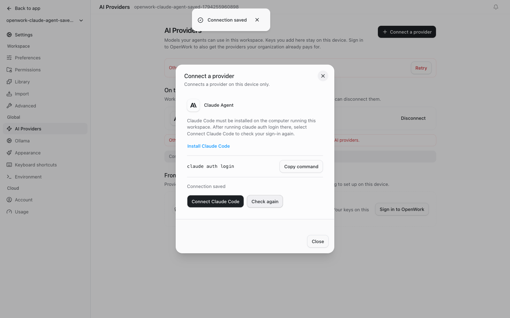

# Claude Code sign-in

- Feature: `claudeAgentProvider`
- Deployments: cloud and self-hosted
- Owner: @benjaminshafii
- Default: off

## What changes

AI providers offers the engine's **Claude Agent** connection, which uses the
unmodified Claude Code installation and its own login on the same computer as
the OpenWork server. Anthropic API keys remain a separate option. OpenWork does
not collect Claude subscription credentials, reuse the retired Anthropic OAuth
flow, install Claude Code, or run its login command on the person's behalf.

This needs OpenCode 2.2.3 or newer (the bundled version is 2.2.6) and Claude
Code 2.1.248 or newer. Use the official Claude Code installation instructions,
then run `claude auth login` on the computer running the engine. Hosted or remote
workspaces cannot use a Claude Code login from the viewer's computer.

## Try it

Enable `claudeAgentProvider` for a test organization in /admin. Open Settings →
AI providers → Add provider and choose Claude Agent. Follow the installation
and sign-in instructions, then save the connection. The upstream engine probes
Claude Code asynchronously; a saved connection or cached model list is not a
fresh login verification. Native sign-in problems remain visible. Also try with Claude Code
missing or signed out, and with an organization that only permits its assigned
AI providers.

## Turn it off

Turning the feature off locks the setup entry point. It does not sign out of
Claude Code, delete the engine's saved connection, interrupt a running turn, or
change Anthropic API-key connections. Existing connections and history remain
readable; organization model-access policy continues to govern use.

## Setup state

The real app connected to an isolated discovery-only Claude Code fixture. No
Claude credentials or model requests were used. A saved external reference is
not shown as verified authentication.

## What to watch

Check setup errors for missing/outdated Claude Code, a login that needs to be
refreshed, and an unavailable native engine. A saved external connection alone
is not proof that Claude Code is signed in. Never log credentials or raw login
state while investigating. API-key setup must still go through the Anthropic
provider, not Claude Agent.
