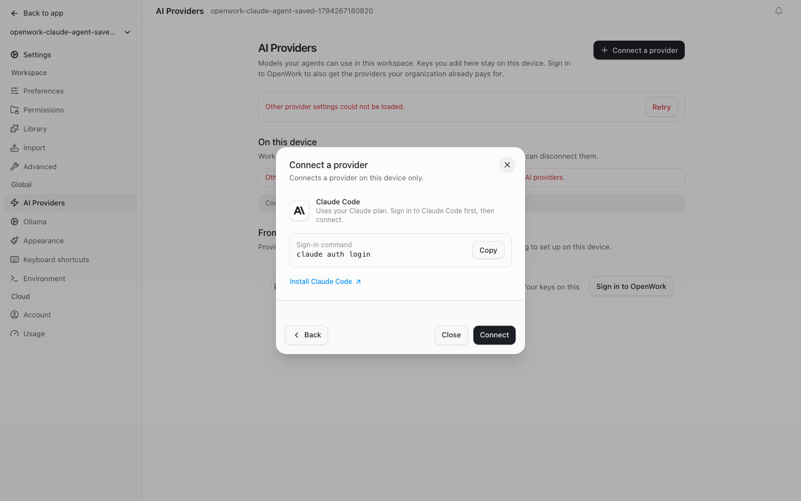
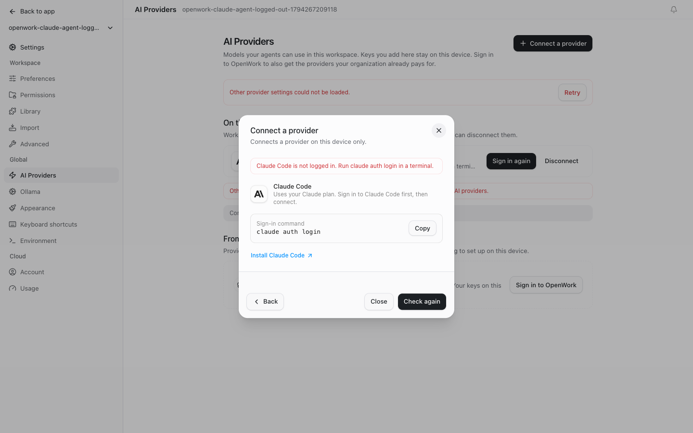
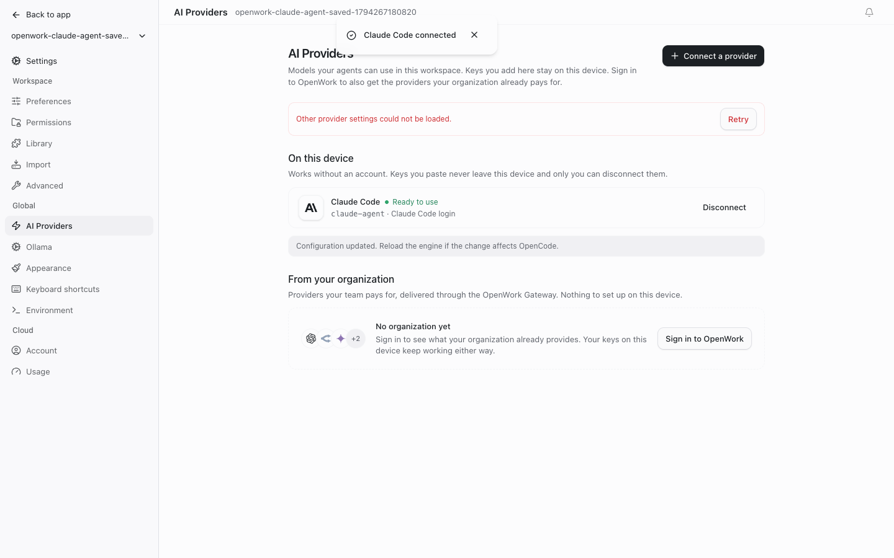

# Claude Code sign-in

> **Generally available:** `claudeAgentProvider` is retired; its enabled behavior is standard on Cloud and self-hosted. Actual settings, permissions, billing rules and consent remain enforced. Rollout/off-state instructions below are historical; see [the retirement guide](../globally-enabled-retirement/README.md).

- Feature: `claudeAgentProvider`
- Deployments: cloud and self-hosted
- Owner: @benjaminshafii
- Default: off

## What changes

Connect a provider offers **Claude Code** as one of the ways to connect
Anthropic, next to its API key. It uses the engine's Claude Agent connection:
the unmodified Claude Code installation and its own login on the same computer
as the OpenWork server. OpenWork does not collect Claude subscription
credentials, reuse the retired Anthropic OAuth flow or install Claude Code.

In the desktop app, on a workspace on the same computer, Connect also signs
Claude Code in when it needs it: the OpenWork server runs `claude auth status`
and, if Claude Code is signed out, `claude auth login`, which opens Claude's
sign-in in the browser. The server only learns whether each command succeeded.
It never reads their output, the sign-in link or Claude Code's tokens. Only the
desktop app that started the server can ask for this (host token), so a remote
viewer cannot open a sign-in on someone else's computer. Everywhere else
(OpenWork in the browser, remote workspaces) the step shows the command to run
in a terminal, as before.

The engine calls this provider "Claude Agent" (id `claude-agent`). People see
"Claude Code" everywhere: in Connect a provider, on AI Providers and in the
model picker.

This needs OpenCode 2.2.3 or newer (the bundled version is 2.2.6) and Claude
Code 2.1.248 or newer. Hosted or remote workspaces cannot use a Claude Code
login from the viewer's computer.

## Try it

Enable `claudeAgentProvider` for a test organization in /admin. Open Settings →
AI Providers → Connect a provider → Anthropic → Claude Code, then press Connect.

In the desktop app, a Claude Code that is already signed in connects straight
away. A signed-out one opens Claude's sign-in in the browser; the step reads
"Continue in your browser" with Cancel until it finishes (ten minutes at most),
then connects by itself. After a failure the button reads Sign in again, which
always opens a fresh sign-in. The desktop step shows no command to run. In the
browser, run `claude auth login` in a terminal first.

The desktop step also looks for Claude Code when it opens. When it is not
installed the step reads "Claude Code is not on this computer yet" and its one
action is Get Claude Code, which opens Anthropic's install guide. OpenWork
looks again every few seconds and whenever its window is focused, so once the
install finishes the step reads "Claude Code is installed" and offers Connect,
with no restart. `~/.local/bin`, where Claude's installer puts `claude`, is on
the engine's PATH even before that folder exists.

Connect then waits for the engine's own check of `claude` and ends one of two ways:

- the sheet closes with "Claude Code connected" and AI Providers lists a
  Claude Code row marked Ready to use, or
- the step stays open with the reason (not logged in, too old, sign-in not
  finished) and the button reads Sign in again or Check again.

A row whose login later breaks reads "Needs your sign-in" with Sign in again,
which reopens the same step. After a restart, before the engine has checked
`claude`, the row reads "Not checked yet".

Also try with Claude Code missing or signed out, closing the browser tab
without signing in, pressing Cancel, and with an organization that
only permits its assigned AI providers (Connect a provider is locked there, as
for every personal provider).

## Turn it off

With the feature off nothing about Claude Code is shown, read or changed: no
entry under Anthropic, no row on AI Providers, no locked placeholder. Turning it
off does not sign out of Claude Code, delete the engine's saved connection or
interrupt a running turn; organization model-access policy continues to govern
use. Anthropic API-key connections are unaffected.

## How "connected" is decided

Connecting only records the choice; the engine then checks `claude` and reports
a problem on the connection. The engine keeps Claude Code's model list between
checks and gives a new connection no status until its check ends, so a repeat
check looks clean at first. OpenWork therefore treats a first connect as done
once the models appear with no problem (confirmed by a second read), and holds a
repeat check open for five seconds for a problem to arrive (it arrives in about
one second with Claude Code 2.1 on a Mac). It reads once more fifteen seconds
later so a slow computer cannot leave a wrong "Ready to use". After 65 seconds
without an answer it says it could not confirm and offers Check again.

## Screens

The real app connected to an isolated, discovery-only Claude Code fixture. No
Claude credentials or model requests were used. In this local run the engine's
own provider list could not be read, which is why the page behind the sheet
shows a notice and Anthropic opened straight on Claude Code.

## What to watch

Check setup errors for missing or outdated Claude Code, a login that needs to be
refreshed, and an unavailable native engine. Never log credentials or raw login
state while investigating. API-key setup still goes through Anthropic's API key
option, not Claude Code.
