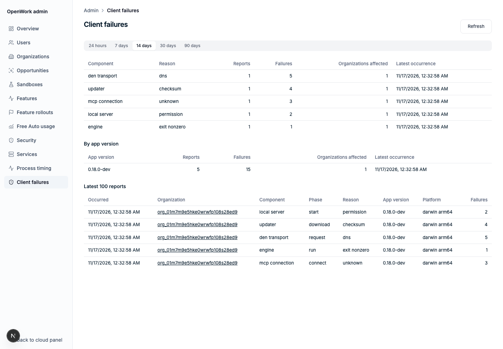

# Client failure reports

`clientFailureReports` is off by default on cloud and self-hosted deployments.
Owner: `openwork`.

When enabled for a signed-in desktop member, the desktop keeps a bounded durable
outbox of fixed-schema failures and sends batches to the member's Den. Reports
contain only enumerated failure classes, version, platform, architecture, times,
random report IDs and bounded numeric counts/statuses. They contain no content,
error text, paths, service names or device identifiers.

Enable for a test organization, trigger a desktop failure, reconnect and inspect
`/admin/client-failures`. Watch report volume, repeated failures and delivery
errors. No reports means unknown, not healthy.

The resolved member flag and a hashed account/organization/server scope are
cached with the outbox for at most 14 days. This lets a previously signed-in
app record an engine startup failure or an offline Den request after restarting.
Raw credentials and addresses are never stored in the outbox or sent in reports.
Switching account, organization or Den discards the previous scope's pending reports.
A new installation records nothing before it first resolves the flag on.
`OPENWORK_DESKTOP_SENTRY_DISABLED=1` (also `true`, `yes` or `on`) overrides reporting through the existing telemetry opt-out parser.

Turning the feature off stops ingest immediately. When the desktop resolves the
off flag, or signs out, it stops recording and delivery and deletes its pending
outbox and cached authorization. Offline clients use the last resolved policy
until it expires or they reconnect; Den rejects their batches while off. Existing
server reports remain readable to staff until retention removes them. Local
reports expire after 14 days; server reports after 90 days.

The main process writes an atomic, mode-0600 JSON outbox under its existing user
data directory. It holds at most 200 reports, folds consecutive identical failures
within a minute up to 1000 occurrences, and sends batches of 50. Failed sends back
off from 30 seconds to one hour. In-flight reports are not folded or mutated;
a lost renderer's delivery lease expires so an idempotent batch can be retried.

Detection covers managed OpenCode v1/v2 startup and unexpected child exits, local
Node HTTP listener startup/error/unexpected close, local managed MCP handshake
and authorization failures, engine MCP registration/live failures, updater
check/download/install errors, and observed authenticated Den transport errors.
OS termination of the entire desktop process and failures inside an external
installer after the desktop has exited cannot be recorded by the dead process.
The Bun standalone HTTP adapter is not reported by this desktop-only path.

The staff page reuses Den headers, notices, tables, segmented controls, buttons
and skeletons. Applied DESIGN.md rules: P1, P2, P5, P6, P7, S1, S2, V1 and V2.
No reports is explicitly unknown, never healthy.

Verified on a local Den preview with a signed-in member posting five synthetic
reports through curl (HTTP 204): the staff page shows five reports and 15 folded
failures, with organization links.

