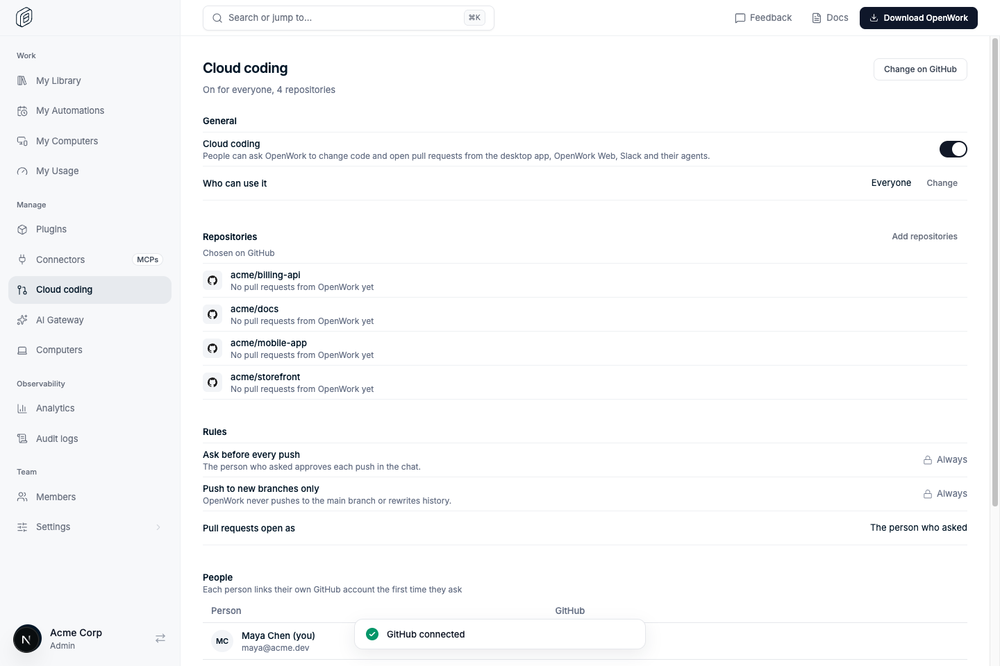
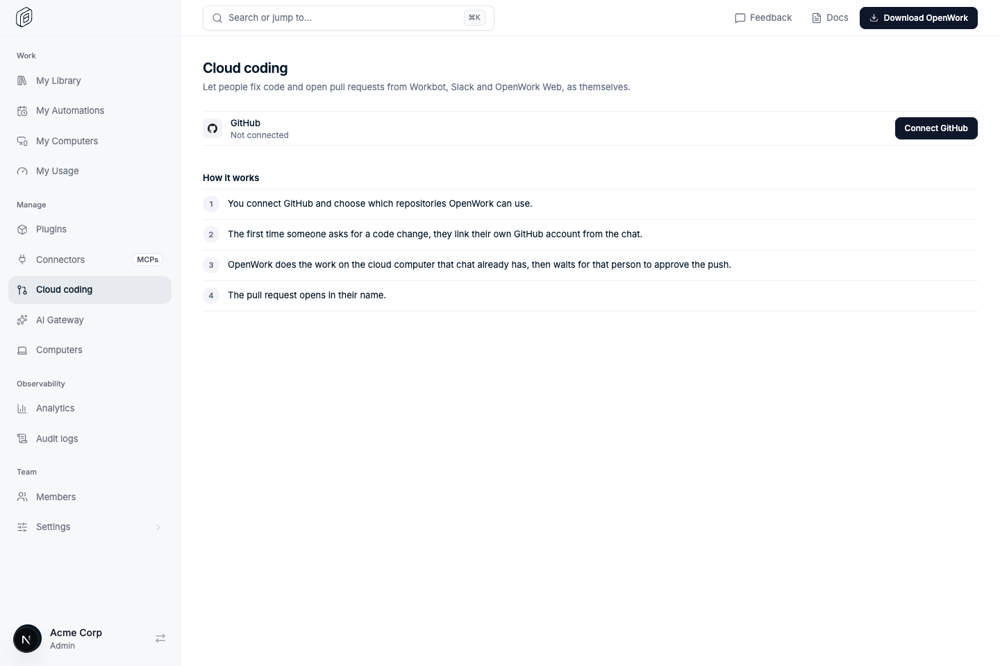
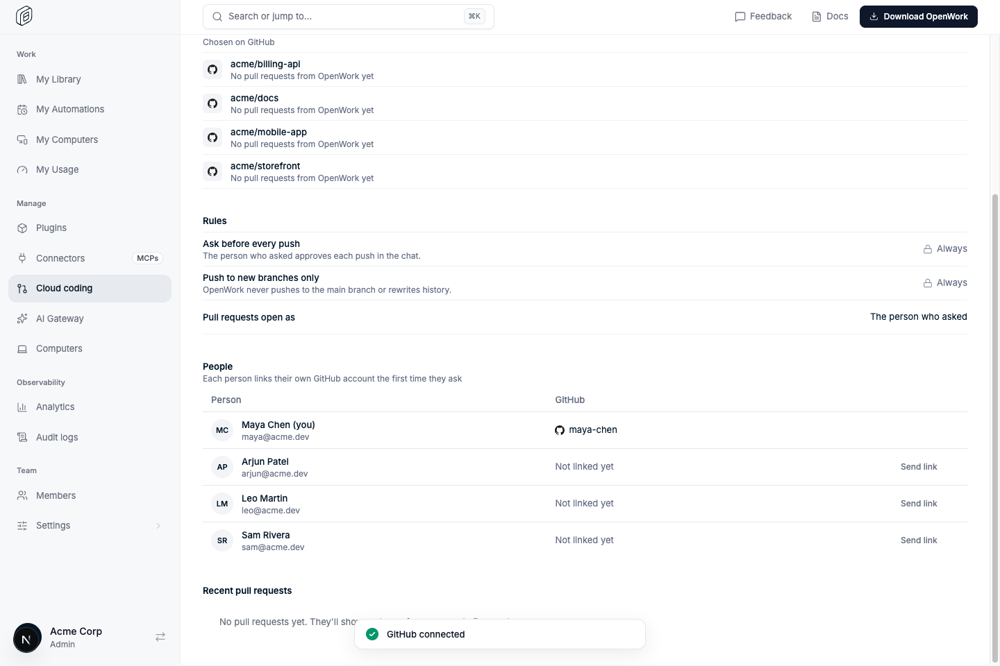
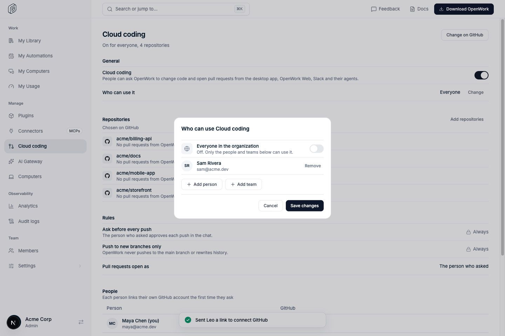
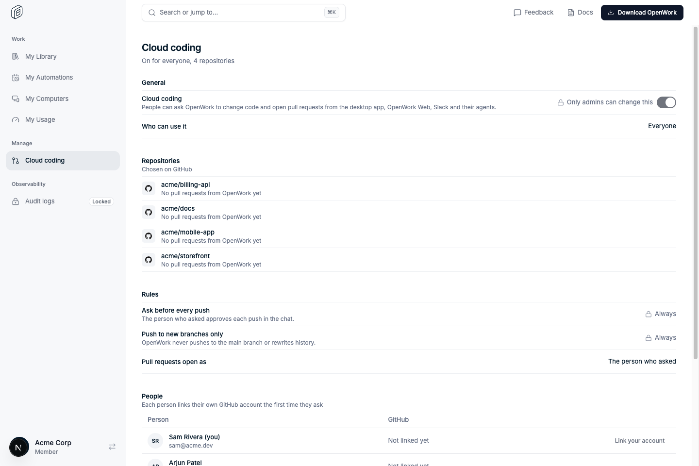
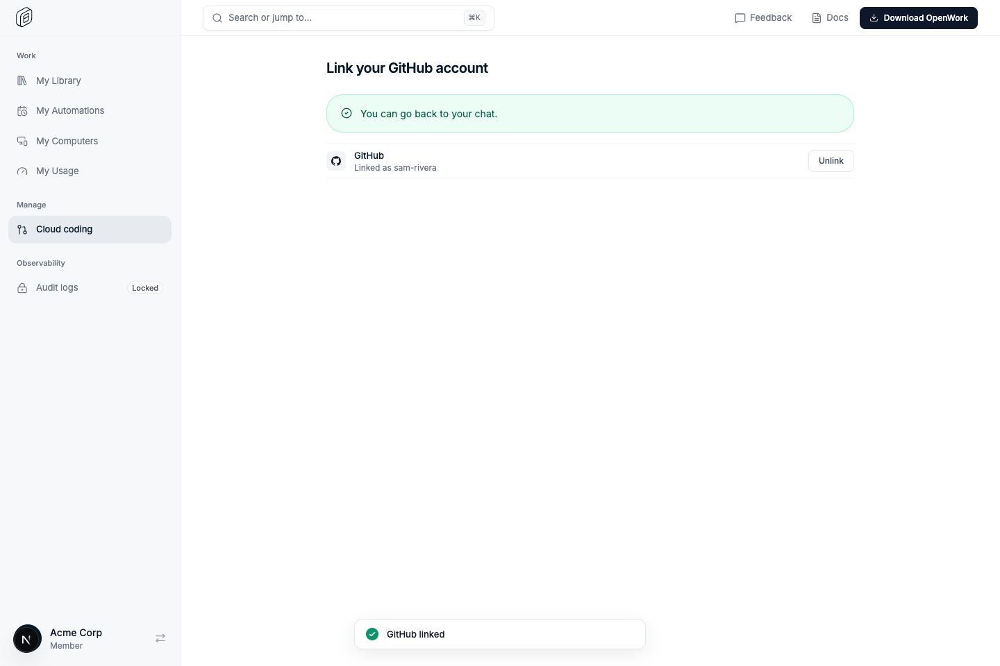
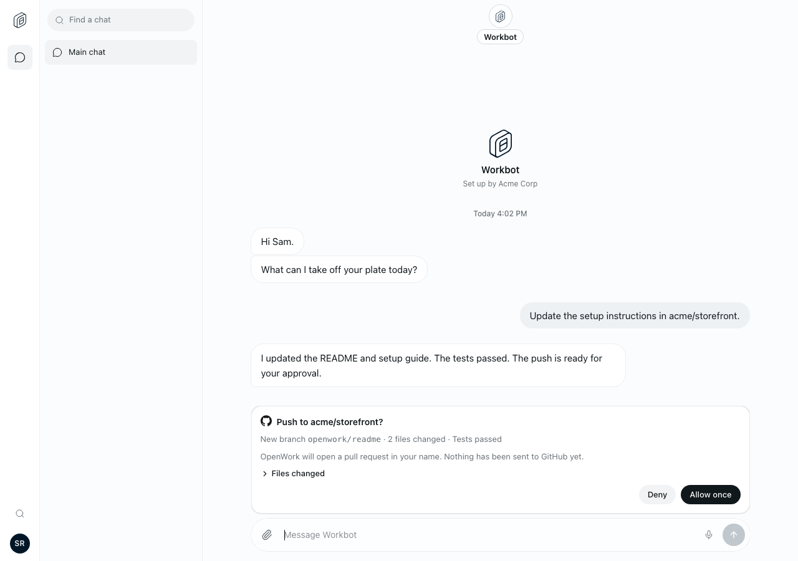
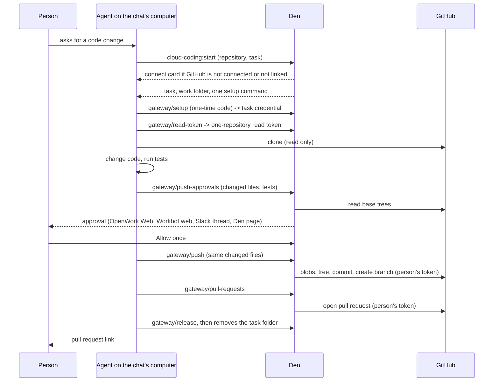

# Cloud coding (`cloudCoding`)

- **Feature key:** `cloudCoding`
- **Deployments:** cloud
- **Author:** `benjaminshafii`
- **Status:** off by default. Turn it on for one organization at a time.

Anyone in an organization can ask OpenWork to change code from **Workbot**
(Slack and Workbot web) or from an **OpenWork Web** chat. The work runs on the
computer that chat already has. Before anything reaches GitHub the person who
asked sees the repository, the new branch, the files changed and the test
result, and chooses **Deny** or **Allow once**. The pull request then opens
under that person's own GitHub identity.

The desktop app is not part of this release. With the feature on, a desktop
chat is offered nothing new: no capability, no instruction, no panel, and a
developer's local files, git and credentials work exactly as before.

| | |
| --- | --- |
| Before GitHub is connected |  |
| People and their GitHub links |  |
| Who can use it |  |
| What a member who cannot manage sees |  |
| Linking your own account |  |
| Approving a push in Workbot web |  |

## Try it

1. A person creates the "OpenWork Cloud coding" GitHub App once per deployment
   and sets the `GITHUB_CLOUD_CODING_*` variables (see [Setup](#setup)).
2. As a platform admin, open `/admin`, choose a test organization and turn
   `cloudCoding` on for it.
3. As an organization admin, open **Cloud coding** in Den, choose **Connect
   GitHub**, and pick repositories on GitHub's own install page.
4. In a Slack thread with Workbot, a Workbot web conversation or an OpenWork
   Web chat, ask for a code change in one of those repositories. The first
   time, the chat asks you to link your GitHub account.
5. When the work is done the chat shows the push for approval: a panel above
   the composer in OpenWork Web and Workbot web, a message with **Approve** and
   **Deny** in the Slack thread. Allowing it pushes a new branch and opens the
   pull request as you.

Turning the feature off (organization override, or the kill switch) hides the
page and the chat entry points, and the gateway refuses every call, including
from computers that are mid-task. Stored links, approvals and the pull
request list stay and reappear when it is turned back on.

## Decisions

**A separate GitHub App.** Den already has a read-only GitHub App for plugin
and marketplace imports. Cloud coding needs Contents and Pull requests write
plus user authorization. Adding those to the existing app would force every
organization that installed it to re-approve permissions, and would give the
import integration write access it never needs. Cloud coding therefore uses
its own app, `GITHUB_CLOUD_CODING_*`, and never reads the import app's
configuration or installations.

**Workbot and OpenWork Web only.** Den decides who is asking on its own side,
never from what a client says about itself (see [Who may use it](#who-may-use-it)).
Every other caller, the desktop app included, gets no `cloud-coding:*`
capability from search, the normal "unknown capability" answer when it calls
one directly, and no Cloud coding instruction.

**The work runs on the computer the chat already has.** Nothing starts a
separate cloud session. `cloud-coding:start` prepares the chat's own computer
and hands the same agent one setup command to run in its own shell.

| Where the person asked | Computer | Folder for one task |
| --- | --- | --- |
| Slack thread, Workbot web | That conversation's own Linux computer | `/workspace/cloud-coding/<taskId>` |
| OpenWork Web chat | The chat's cloud computer | `/tmp/openwork-cloud-coding/<key>/<taskId>`, `<key>` being the first 16 hex characters of `sha256(conversation id)` |

**The computer never holds a credential that can write to GitHub.** It gets a
task credential for Den's git gateway and, on request, a GitHub installation
token limited to one repository and `contents: read`. Pushes and pull requests
are made by Den with the person's own GitHub App user token, which never leaves
Den.

**The task credential is short-lived and belongs to one conversation.** It is
scoped to the conversation, the repository and the person. It stops working
when the turn ends or after 60 minutes, whichever comes first, and is removed
together with the checkout once the pull request opens or the push is denied.
A later turn of the same conversation gets a fresh one for the same folder by
calling `cloud-coding:start` with the `taskId`; another conversation cannot.

**One approval, shown everywhere.** The push waiting for the person is one row
in Den. OpenWork Web, Workbot web, the Slack thread and the approval page in
Den all show that row; deciding in one place settles it in all of them.

**Den builds the commit.** The computer sends the changed files (not a
git pack). Den works out the exact commit SHA from those files before asking
the person, and the approval is bound to that SHA. At push time the same files
are sent again; Den recomputes the SHA, requires it to equal the approved one,
creates the objects on GitHub, requires GitHub's commit SHA to equal it too,
and only then creates the branch. A changed file, message, base or branch is a
different SHA and needs a new approval. Den never stores file contents.

**The branch is created, never updated.** Den creates `refs/heads/<branch>`
with GitHub's create-ref call, which fails when the branch exists. There is no
code path that updates or deletes a ref, so a force push or a push to the
default branch cannot be expressed.

**Fixed rules.** Ask before every push, new branches only, pull request opens
as the person who asked. None of them is a setting.

## Who is who

| Thing | Table | Notes |
| --- | --- | --- |
| The organization's GitHub connection | `cloud_coding_installation` | One GitHub App installation per organization, and one organization per installation. Holds the on/off switch and "everyone". |
| Repositories it can reach | `cloud_coding_repository` | Mirror of GitHub's list. Chosen on GitHub, refreshed by webhook and on demand. |
| Chosen people and teams | `cloud_coding_access_grant` | Used when "everyone" is off. |
| A person's GitHub account | `cloud_coding_github_link` | User access and refresh tokens, encrypted at rest (`encryptedTextColumn`). One GitHub account per person per organization. |
| One request to change code | `cloud_coding_task` | Records where it was asked (`surface`: `workbot`, `slack` or `web`), the conversation and the turn. Only hashes of its setup code and credential are stored. |
| One push waiting for the person | `cloud_coding_push_approval` | Bound to `head_sha`, single use, expires after 24 hours. |
| Pull requests opened | `cloud_coding_pull_request` | State follows GitHub's `pull_request` webhook. |
| The Slack message for an approval | `cloud_coding_slack_notice` | Where the message was posted, who asked, and which state it last showed. |

## Who may use it

`resolveCloudCodingCaller` (`ee/apps/den-api/src/cloud-coding/caller.ts`)
answers `workbot`, `slack`, `web` or nothing for every request to OpenWork
Connect.

| Caller | How Den knows |
| --- | --- |
| Workbot web, Slack | The request carries a headless run token. Den mints these only for a Workbot or Slack turn and knows which conversation and turn each belongs to. |
| OpenWork Web | The OpenWork server on the chat's cloud computer signs its Connect registration: `x-openwork-cloud-worker-id` plus `x-openwork-cloud-worker-proof`, an HMAC of the worker id and the bearer token, keyed with that worker's activity token. Den checks the worker belongs to the same person and organization and recomputes the proof. The activity token itself is never sent. |
| Anything else | Not offered. The desktop app and OpenWork Web share one client id, so only the proof tells them apart, and the desktop has no worker to sign with. |

## Flow

If the turn ends while the push is still waiting, the credential ends with it.
Once the person has approved, the next turn of that conversation calls
`cloud-coding:start` with the `taskId`, runs the new setup command against the
same folder and finishes the push. In Slack, Den starts that follow-up turn
itself about 20 seconds after the approval when no pull request has appeared.

## Den API

All routes are active-organization routes behind `orgMemberRoute()` and
`requireFeature("cloudCoding")` unless noted. Shapes are in
`packages/types/src/den/cloud-coding.ts`.

| Route | Who | What |
| --- | --- | --- |
| `GET /v1/cloud-coding` | member | `CloudCodingOverview`. Members who cannot manage get the same page read-only. |
| `PUT /v1/cloud-coding/settings` | manage | On/off and who can use it. |
| `POST /v1/cloud-coding/github/install/start` | manage | `{ redirectUrl }` to `https://github.com/apps/<slug>/installations/new?state=…`. |
| `GET /v1/cloud-coding/github/installations` | manage | GitHub accounts the caller can connect when the app is already installed on more than one. |
| `POST /v1/cloud-coding/github/install/complete` | manage | Connects one of those accounts after checking the caller can reach it on GitHub. |
| `POST /v1/cloud-coding/github/sync` | manage | Re-reads the installation and its repositories from GitHub. Removes the connection when GitHub says the app was uninstalled. |
| `POST /v1/cloud-coding/github/link/start` | member who can use it | `{ redirectUrl }` to GitHub's "Authorize OpenWork" page. |
| `DELETE /v1/cloud-coding/github/link` | member | Revokes the token at GitHub and deletes the link. |
| `POST /v1/cloud-coding/github/callback` | member, signed state | GitHub returns the browser to Den web, which posts the `code` and `state` here from the signed-in session. The state must have been issued to this same person and organization, so a link started by someone else cannot be completed in your browser. Verifies the installation belongs to the GitHub user who just authorized (`GET /user/installations`), stores the link, binds the installation. |
| `POST /v1/cloud-coding/people/:memberId/send-link` | manage | Emails that person a link to connect their GitHub account. |
| `POST /v1/cloud-coding/admin-requests` | member | Emails the organization's admins that this person asked for Cloud coding. |
| `GET /v1/cloud-coding/approvals?status=pending` | member, own | Pushes waiting for this person. |
| `GET /v1/cloud-coding/approvals/:approvalId` | member, own | One approval, with its pull request once opened. |
| `POST /v1/cloud-coding/approvals/:approvalId/decision` | member, own, signed-in session only | `allow_once` or `deny`. API keys and agent tokens are refused. Denying ends the task. |
| `GET /v1/workbot/cloud-coding/approvals` | Workbot web sign-in, own | Pushes waiting for this person, for the card in Workbot web. |
| `GET /v1/workbot/cloud-coding/approvals/:approvalId` | Workbot web sign-in, own | One approval, with its pull request once opened. |
| `POST /v1/workbot/cloud-coding/approvals/:approvalId/decision` | Workbot web sign-in, own | Same decision. Only the person's own `openwork-workbot` token is accepted; the per-turn agent token, other clients and API keys are refused, so an agent cannot approve its own push. |
| `POST /v1/integrations/slack/:connectionId/interactions` | Slack, signed | The existing Slack interactions route also handles the **Approve** and **Deny** buttons. |
| `POST /v1/webhooks/cloud-coding/github` | GitHub, signed | `installation`, `installation_repositories`, `repository`, `pull_request`, `github_app_authorization`. |

"manage" is the `connections.manage` organization permission.

### Git gateway

Called by the helper on the chat's computer. `setup` takes the one-time code
(single use, 10 minutes); every other route takes
`Authorization: Bearer <task credential>` and re-checks on each call that the
feature is on, Cloud coding is on for the organization, the person is still a
member who may use it and still has a linked account, and the repository is
still in the installation.

For a Workbot or Slack task Den also checks the turn on every call: the run
token that started it must still be valid, and the runner must report that
exact turn as running. Otherwise the answer is `task_closed`. An OpenWork Web
chat has no turn Den can ask about, so the OpenWork server on the cloud
computer releases the credential itself when the turn ends
(`apps/server/src/opencode-plugins/cloud-coding-turn-release.ts`).

| Route | What |
| --- | --- |
| `GET /v1/cloud-coding/gateway/helper.mjs` | The helper script. Public, no secrets. |
| `POST /v1/cloud-coding/gateway/setup` | Setup code → task credential (once). A new code for the same task replaces the earlier credential. |
| `GET /v1/cloud-coding/gateway/task` | The task: repository, base branch, author identity. |
| `POST /v1/cloud-coding/gateway/read-token` | Installation token for this one repository, `contents: read`. |
| `POST /v1/cloud-coding/gateway/push-approvals` | Asks the person. Replaces an earlier pending request of the same task. |
| `GET /v1/cloud-coding/gateway/push-approvals/:approvalId?waitMs=` | Long-poll for the decision. |
| `POST /v1/cloud-coding/gateway/push-approvals/:approvalId/push` | Pushes the approved commit to the new branch. |
| `POST /v1/cloud-coding/gateway/pull-requests` | Opens the pull request for a pushed approval, as the person. Safe to repeat. |
| `POST /v1/cloud-coding/gateway/release` | Ends the credential. Safe to repeat. |

### Rules the gateway enforces

| Refusal | When |
| --- | --- |
| `default_branch_refused` | The branch is the repository's default branch. |
| `branch_exists` | The branch already exists on GitHub (also the outcome of any attempt to move an existing branch). |
| `invalid_branch` | Not a plain branch name (`refs/…`, `..`, control characters, and so on). |
| `workflow_files_refused` | A changed path is under `.github/workflows/`. The app has no Workflows permission, and Den says so instead of asking for more. |
| `path_refused` / `file_mode_refused` | Paths outside the repository or inside `.git`; symlinks and submodules. |
| `change_too_large` / `no_changes` | Over the file or byte limits; an empty change. |
| `approval_pending` / `approval_denied` / `approval_expired` / `approval_used` | The approval is not an unused "Allow once". |
| `commit_mismatch` | The files sent at push time are not the approved commit, or GitHub built a different commit. |
| `repository_not_available` | The repository left the installation, was archived, or its id changed. |
| `turned_off` / `not_allowed` / `account_not_linked` / `github_not_connected` / `github_suspended` / `feature_disabled` | The person or organization can no longer use Cloud coding. |
| `task_closed` | The credential is unknown, older than 60 minutes, released, its turn ended, or its task ended (pull request opened, or the push was denied). |

### How Den computes the commit

1. Decode each changed file and compute its git blob SHA.
2. Read the base commit and only the trees on the changed paths from GitHub
   (installation token, read only).
3. Apply the changes and compute each new tree SHA bottom-up (git tree
   encoding; a directory left empty is removed).
4. Compute the commit SHA from tree, parent (`baseSha`), author and committer
   (the person's name and GitHub noreply email), the commit time stored on the
   approval, and the message.

At push time Den repeats 1–4 from the files sent again, compares with the
approved `head_sha`, then creates blobs, the tree and the commit on GitHub with
the person's token and compares GitHub's commit SHA before creating the branch.

## The helper on the chat's computer

The setup command returned by `cloud-coding:start` downloads one small Node
program from Den (`GET /v1/cloud-coding/gateway/helper.mjs`, so it always
matches the gateway) into the task folder and runs it. It needs only Node and
git. Everything for one task lives under that one folder, passed as `--root`:
`state.json` (mode 600, in a folder of mode 700), the checkout, and the pull
request description. Nothing is written to the home folder or to git config.

| Command | What it does |
| --- | --- |
| `setup --api <den api> --code <setup code> --root <folder>` | Trades the one-time code for the task credential, clones the repository with the read token passed to git for that one process only, and prints the folder plus the install and test commands it found. Run again with a new code on the same folder, it replaces the credential and keeps the checkout and the pending approval. |
| `detect --root <folder>` | Works out install and test commands from the repository itself: package manager and scripts, Makefile, Python, Go, Rust and Ruby conventions, and CI workflow steps. Nobody fills in a setup page. |
| `request-push --root <folder> --branch … --title … --tests passed\|failed\|not_run` | Commits locally, sends the changed files to Den and waits for the person. |
| `wait --root <folder>` | Keeps waiting, then pushes the same changed files and opens the pull request. Prints the link. |
| `status --root <folder>` | The task, the approval and the pull request link. |
| `finish --root <folder>` | Releases the credential and removes the folder. |

| Exit code | Meaning |
| --- | --- |
| 0 | Done. For `request-push` and `wait`: the pull request is open. |
| 1 | Failed. |
| 3 | Still waiting for the person. |
| 4 | Denied. Nothing was pushed. |
| 5 | The request expired or was replaced by a newer one. |
| 6 | The credential ended. Call `cloud-coding:start` with the `taskId` and run the new setup command. |

Waits default to 240 seconds and are capped at 280, because one shell command
on Workbot's computer may run for at most 300 seconds.

After the pull request opens, and after a denial, the helper releases the
credential and deletes the task folder, itself included, so nothing stays on a
computer that outlives the task. An expired or replaced request keeps the
folder, because the work continues with a new request.

The helper builds the change from git (`baseSha` to the local commit), so the
files sent for approval and for the push are byte-identical even if the working
tree changes in between.

## Chat

- The agent uses three OpenWork Connect capabilities: `cloud-coding:start`,
  `cloud-coding:status`, `cloud-coding:repositories`. They are returned and
  accepted only for the callers in [Who may use it](#who-may-use-it).
- `cloud-coding:start` checks readiness first. "GitHub is not connected" is a
  connection card owned by an admin (an admin gets **Connect GitHub**, anyone
  else is told an admin must connect it and can **Ask an admin**). "Not linked"
  is the usual member connection question; after GitHub's "Authorize OpenWork"
  the same call continues. Slack and Workbot have no cards, so results also
  carry plain links: `setupUrl` (Cloud coding in Den), `linkUrl` (the personal
  link page) and, from `cloud-coding:status`, `approvalUrl` (the approval page
  in Den web).
- When ready it answers `{ taskId, workFolder, setupCommand, instructions,
  expiresInMinutes }`. A chat that has no computer is told Cloud coding is not
  available there, and nothing is created.

The same approval on each surface:

| Surface | What the person sees |
| --- | --- |
| OpenWork Web | A panel above the composer with **Deny** and **Allow once**, fed by `GET /v1/cloud-coding/approvals`. It is not mounted in the desktop app. |
| Workbot web | The same panel above the composer, fed by the Workbot routes. |
| Slack | A message in the thread: repository, new branch, files changed, short commit SHA, test result, **Approve** and **Deny**, and a link to the Den page. |
| Den web | The approval page, `/dashboard/cloud-coding/approvals/<id>`. |

After the decision every surface follows the row: "Allowed. Pushing…" then the
pull request link, or "Denied. Nothing was pushed.", with "elsewhere" added
when the decision was made on another surface. The Slack message loses its
buttons and shows the outcome. A second decision, on the same surface or a
different one, is answered "already decided" and changes nothing.

**Only the person who asked can decide.** In a shared Slack thread the Slack
user who presses a button must map to the OpenWork member who asked. Anyone
else, including people with no OpenWork account, gets a private reply that
only the requester can approve or deny, and the message does not change. A
button payload must also come from the channel and message Den posted.

## Setup

Create a GitHub App (GitHub → Settings → Developer settings → GitHub Apps):

| Setting | Value |
| --- | --- |
| Name | `OpenWork Cloud coding` (any free name; the slug goes in `GITHUB_CLOUD_CODING_APP_SLUG`) |
| Homepage URL | the Den web origin |
| Callback URL | `<den web origin>/dashboard/cloud-coding/github/callback` |
| Request user authorization (OAuth) during installation | on |
| Expire user authorization tokens | on |
| Setup URL | leave empty (GitHub does not allow one when authorization is requested during installation) |
| Webhook URL | `<den-api origin>/v1/webhooks/cloud-coding/github`, with a secret |
| Repository permissions | Contents: read and write · Pull requests: read and write · Metadata: read |
| Organization and account permissions | none |
| Subscribe to events | Pull request · Repository (Installation events are always sent) |
| Where can this app be installed | Any account |

| Variable | Value |
| --- | --- |
| `GITHUB_CLOUD_CODING_APP_ID` | App ID |
| `GITHUB_CLOUD_CODING_APP_SLUG` | the app's URL slug |
| `GITHUB_CLOUD_CODING_APP_CLIENT_ID` | Client ID |
| `GITHUB_CLOUD_CODING_APP_CLIENT_SECRET` | a generated client secret |
| `GITHUB_CLOUD_CODING_APP_PRIVATE_KEY` | a generated private key (PEM; `\n` escapes are accepted) |
| `GITHUB_CLOUD_CODING_APP_WEBHOOK_SECRET` | the webhook secret |

With any of the first five unset the page reports that Cloud coding is not set
up on this deployment and every connect action is refused; nothing else in Den
changes.

The OpenWork Web cloud computer image needs `git` (added to
`ee/apps/den-worker-runtime/Dockerfile.daytona-snapshot`) and the OpenWork
server from this change, which signs the Connect registration; rebuild the
snapshot before turning the feature on. Cloud computers created from an older
snapshot are treated like the desktop app: Cloud coding is not offered.

Workbot needs its conversation computer (`HEADLESS_COMPUTER`). With the feature
on for a person, their Slack sessions ask for that computer too. Where no
computer is available the session works as before and Cloud coding says it is
not available in that chat.

**Slack.** The buttons need interactivity turned on in the Slack app, with the
request URL `<den-api origin>/v1/integrations/slack/<connection id>/interactions`,
and the `chat:write` scope. The manifest Den generates already has both, so a
Slack app created from it needs no change and nobody has to reinstall. A Slack
app set up by hand without interactivity shows the message, but its buttons do
nothing; the link to the Den page still works. The message is posted and kept
up to date by the Slack assistant worker (`DEN_SLACK_ASSISTANT_WORKER_ENABLED`).

## Rollout

1. Create the GitHub App and set the variables above on Den API (cloud).
2. Apply migrations `0223_cloud_coding` and `0224_cloud_coding_surfaces`, and
   rebuild the cloud computer snapshot.
3. Turn `cloudCoding` on for our own organization in `/admin`, connect one
   test repository and open one pull request end to end from each of Slack,
   Workbot web and OpenWork Web.
4. Turn it on for more organizations one at a time, watching the
   `cloud_coding.*` audit events (`push.refused` with its reason is the one to
   read first).
5. Anything wrong: turn it off everywhere in `/admin`. Computers that are
   mid-task get `feature_disabled` on their next gateway call; nothing is
   pushed without an approval either way.

Nobody is affected until the feature is turned on for their organization: the
tables are new, the routes answer `feature_disabled`, and the only code that
runs for every organization is the cleanup on member removal, which deletes
from the new tables. With the feature on, the desktop app is still unaffected.

## Not in this feature

- The desktop app. It comes later; today a desktop chat is offered nothing.
- People's own agents and other MCP clients. They are treated like the desktop
  app.
- A Den secrets store. Tests that need keys are out of scope; the instructions
  tell the agent to say which tests it could not run.
- Updating an existing branch or pull request. Every push is a new branch.
