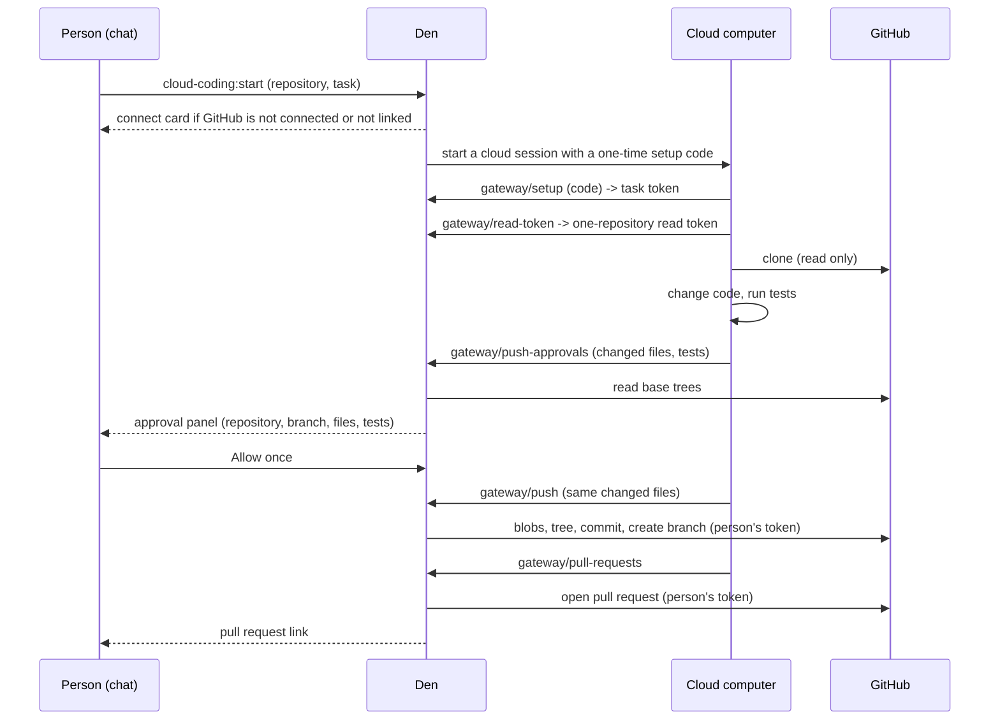

# Cloud coding (`cloudCoding`)

- **Feature key:** `cloudCoding`
- **Deployments:** cloud
- **Author:** `benjaminshafii`
- **Status:** off by default. Turn it on for one organization at a time.

Anyone in an organization can ask OpenWork, from any chat, to change code. The
work runs on a cloud computer. Before anything reaches GitHub the person who
asked sees the repository, the new branch, the files changed and the test
result, and chooses **Deny** or **Allow once**. The pull request then opens
under that person's own GitHub identity.

## Try it

1. A person creates the "OpenWork Cloud coding" GitHub App once per deployment
   and sets the `GITHUB_CLOUD_CODING_*` variables (see [Setup](#setup)).
2. As a platform admin, open `/admin`, choose a test organization and turn
   `cloudCoding` on for it.
3. As an organization admin, open **Cloud coding** in Den, choose **Connect
   GitHub**, and pick repositories on GitHub's own install page.
4. In any OpenWork chat, ask for a code change in one of those repositories.
   The first time, the chat asks you to link your GitHub account.
5. When the work is done the chat shows the push for approval. **Allow once**
   pushes a new branch and opens the pull request as you.

Turning the feature off (organization override, or the kill switch) hides the
page and the chat entry points, and the gateway refuses every call, including
from cloud computers that are mid-task. Stored links, approvals and the pull
request list stay and reappear when it is turned back on.

## Decisions

**A separate GitHub App.** Den already has a read-only GitHub App for plugin
and marketplace imports. Cloud coding needs Contents and Pull requests write
plus user authorization. Adding those to the existing app would force every
organization that installed it to re-approve permissions, and would give the
import integration write access it never needs. Cloud coding therefore uses
its own app, `GITHUB_CLOUD_CODING_*`, and never reads the import app's
configuration or installations.

**The cloud computer never holds a credential that can write to GitHub.** It
gets a task token for Den's git gateway and, on request, a GitHub installation
token limited to one repository and `contents: read`. Pushes and pull requests
are made by Den with the person's own GitHub App user token, which never leaves
Den.

**Den builds the commit.** The cloud computer sends the changed files (not a
git pack). Den works out the exact commit SHA from those files before asking
the person, and the approval is bound to that SHA. At push time the same files
are sent again; Den recomputes the SHA, requires it to equal the approved one,
creates the objects on GitHub, requires GitHub's commit SHA to equal it too,
and only then creates the branch. A changed file, message, base or branch is a
different SHA and needs a new approval. Den never stores file contents.

**The branch is created, never updated.** Den creates `refs/heads/<branch>`
with GitHub's create-ref call, which fails when the branch exists. There is no
code path that updates or deletes a ref, so a force push or a push to the
default branch cannot be expressed.

**Fixed rules.** Ask before every push, new branches only, pull request opens
as the person who asked. None of them is a setting.

## Who is who

| Thing | Table | Notes |
| --- | --- | --- |
| The organization's GitHub connection | `cloud_coding_installation` | One GitHub App installation per organization, and one organization per installation. Holds the on/off switch and "everyone". |
| Repositories it can reach | `cloud_coding_repository` | Mirror of GitHub's list. Chosen on GitHub, refreshed by webhook and on demand. |
| Chosen people and teams | `cloud_coding_access_grant` | Used when "everyone" is off. |
| A person's GitHub account | `cloud_coding_github_link` | User access and refresh tokens, encrypted at rest (`encryptedTextColumn`). One GitHub account per person per organization. |
| One request to change code | `cloud_coding_task` | Only hashes of its setup code and token are stored. |
| One push waiting for the person | `cloud_coding_push_approval` | Bound to `head_sha`, single use, expires after 24 hours. |
| Pull requests opened | `cloud_coding_pull_request` | State follows GitHub's `pull_request` webhook. |

## Flow

## Den API

All routes are active-organization routes behind `orgMemberRoute()` and
`requireFeature("cloudCoding")` unless noted. Shapes are in
`packages/types/src/den/cloud-coding.ts`.

| Route | Who | What |
| --- | --- | --- |
| `GET /v1/cloud-coding` | member | `CloudCodingOverview`. Members who cannot manage get the same page read-only. |
| `PUT /v1/cloud-coding/settings` | manage | On/off and who can use it. |
| `POST /v1/cloud-coding/github/install/start` | manage | `{ redirectUrl }` to `https://github.com/apps/<slug>/installations/new?state=…`. |
| `GET /v1/cloud-coding/github/installations` | manage | GitHub accounts the caller can connect when the app is already installed on more than one. |
| `POST /v1/cloud-coding/github/install/complete` | manage | Connects one of those accounts after checking the caller can reach it on GitHub. |
| `POST /v1/cloud-coding/github/sync` | manage | Re-reads the installation and its repositories from GitHub. Removes the connection when GitHub says the app was uninstalled. |
| `POST /v1/cloud-coding/github/link/start` | member who can use it | `{ redirectUrl }` to GitHub's "Authorize OpenWork" page. |
| `DELETE /v1/cloud-coding/github/link` | member | Revokes the token at GitHub and deletes the link. |
| `POST /v1/cloud-coding/github/callback` | member, signed state | GitHub returns the browser to Den web, which posts the `code` and `state` here from the signed-in session. The state must have been issued to this same person and organization, so a link started by someone else cannot be completed in your browser. Verifies the installation belongs to the GitHub user who just authorized (`GET /user/installations`), stores the link, binds the installation. |
| `POST /v1/cloud-coding/people/:memberId/send-link` | manage | Emails that person a link to connect their GitHub account. |
| `POST /v1/cloud-coding/admin-requests` | member | Emails the organization's admins that this person asked for Cloud coding. |
| `GET /v1/cloud-coding/approvals?status=pending` | member, own | Pushes waiting for this person. |
| `GET /v1/cloud-coding/approvals/:approvalId` | member, own | One approval, with its pull request once opened. |
| `POST /v1/cloud-coding/approvals/:approvalId/decision` | member, own, signed-in session only | `allow_once` or `deny`. API keys and agent tokens are refused. |
| `POST /v1/webhooks/cloud-coding/github` | GitHub, signed | `installation`, `installation_repositories`, `repository`, `pull_request`, `github_app_authorization`. |

"manage" is the `connections.manage` organization permission.

### Git gateway

Called by the helper on the cloud computer. `setup` takes the one-time code;
every other route takes `Authorization: Bearer <task token>` and re-checks on
each call that the feature is on, Cloud coding is on for the organization, the
person is still a member who may use it and still has a linked account, and
the repository is still in the installation.

| Route | What |
| --- | --- |
| `GET /v1/cloud-coding/gateway/helper.mjs` | The helper script. Public, no secrets. |
| `POST /v1/cloud-coding/gateway/setup` | Setup code → task token (once). |
| `GET /v1/cloud-coding/gateway/task` | The task: repository, base branch, author identity. |
| `POST /v1/cloud-coding/gateway/read-token` | Installation token for this one repository, `contents: read`. |
| `POST /v1/cloud-coding/gateway/push-approvals` | Asks the person. Replaces an earlier pending request of the same task. |
| `GET /v1/cloud-coding/gateway/push-approvals/:approvalId?waitMs=` | Long-poll for the decision. |
| `POST /v1/cloud-coding/gateway/push-approvals/:approvalId/push` | Pushes the approved commit to the new branch. |
| `POST /v1/cloud-coding/gateway/pull-requests` | Opens the pull request for a pushed approval, as the person. Safe to repeat. |

### Rules the gateway enforces

| Refusal | When |
| --- | --- |
| `default_branch_refused` | The branch is the repository's default branch. |
| `branch_exists` | The branch already exists on GitHub (also the outcome of any attempt to move an existing branch). |
| `invalid_branch` | Not a plain branch name (`refs/…`, `..`, control characters, and so on). |
| `workflow_files_refused` | A changed path is under `.github/workflows/`. The app has no Workflows permission, and Den says so instead of asking for more. |
| `path_refused` / `file_mode_refused` | Paths outside the repository or inside `.git`; symlinks and submodules. |
| `change_too_large` / `no_changes` | Over the file or byte limits; an empty change. |
| `approval_pending` / `approval_denied` / `approval_expired` / `approval_used` | The approval is not an unused "Allow once". |
| `commit_mismatch` | The files sent at push time are not the approved commit, or GitHub built a different commit. |
| `repository_not_available` | The repository left the installation, was archived, or its id changed. |
| `turned_off` / `not_allowed` / `account_not_linked` / `github_not_connected` / `github_suspended` / `feature_disabled` | The person or organization can no longer use Cloud coding. |
| `task_closed` | The task token is unknown, expired, or its task ended. |

### How Den computes the commit

1. Decode each changed file and compute its git blob SHA.
2. Read the base commit and only the trees on the changed paths from GitHub
   (installation token, read only).
3. Apply the changes and compute each new tree SHA bottom-up (git tree
   encoding; a directory left empty is removed).
4. Compute the commit SHA from tree, parent (`baseSha`), author and committer
   (the person's name and GitHub noreply email), the commit time stored on the
   approval, and the message.

At push time Den repeats 1–4 from the files sent again, compares with the
approved `head_sha`, then creates blobs, the tree and the commit on GitHub with
the person's token and compares GitHub's commit SHA before creating the branch.

## The helper on the cloud computer

The cloud session's first instruction downloads one small Node program from
Den (`GET /v1/cloud-coding/gateway/helper.mjs`, so it always matches the
gateway) and runs it. It needs only Node and git.

| Command | What it does |
| --- | --- |
| `setup --api <den api> --code <setup code>` | Trades the one-time code for the task token (kept in `~/.openwork/cloud-coding/<task>.json`, mode 600), clones the repository with the read token passed to git for that one process only, and prints the folder plus the install and test commands it found. |
| `detect` | Works out install and test commands from the repository itself: package manager and scripts, Makefile, Python, Go, Rust and Ruby conventions, and CI workflow steps. Nobody fills in a setup page. |
| `request-push --branch … --title … --tests passed\|failed\|not_run` | Commits locally, sends the changed files to Den and waits for the person. Exit 3 means still waiting, 4 denied, 5 expired or replaced. |
| `wait` | Keeps waiting, then pushes the same changed files and opens the pull request. Prints the link. |
| `status` | The task, the approval and the pull request link. |

The helper builds the change from git (`baseSha` to the local commit), so the
files sent for approval and for the push are byte-identical even if the working
tree changes in between.

## Chat

- The agent uses three OpenWork Connect capabilities: `cloud-coding:start`,
  `cloud-coding:status`, `cloud-coding:repositories`.
- `cloud-coding:start` checks readiness first. "GitHub is not connected" is a
  connection card owned by an admin (an admin gets **Connect GitHub**, anyone
  else is told an admin must connect it and can **Ask an admin**). "Not linked"
  is the usual member connection question; after GitHub's "Authorize OpenWork"
  the same call continues.
- The approval panel is fed by `GET /v1/cloud-coding/approvals` and sits above
  the composer in the desktop app and OpenWork Web. After **Allow once** it
  stays in place until the pull request link arrives.
- Slack, Workbot and people's own agents use the same three capabilities. They
  have no cards, so results carry plain links: `setupUrl` (Cloud coding in
  Den), `linkUrl` (the personal link page) and, from `cloud-coding:status`,
  `approvalUrl` (the approval page in Den web, with the same Deny and Allow
  once).

## Setup

Create a GitHub App (GitHub → Settings → Developer settings → GitHub Apps):

| Setting | Value |
| --- | --- |
| Name | `OpenWork Cloud coding` (any free name; the slug goes in `GITHUB_CLOUD_CODING_APP_SLUG`) |
| Homepage URL | the Den web origin |
| Callback URL | `<den web origin>/dashboard/cloud-coding/github/callback` |
| Request user authorization (OAuth) during installation | on |
| Expire user authorization tokens | on |
| Setup URL | leave empty (GitHub does not allow one when authorization is requested during installation) |
| Webhook URL | `<den-api origin>/v1/webhooks/cloud-coding/github`, with a secret |
| Repository permissions | Contents: read and write · Pull requests: read and write · Metadata: read |
| Organization and account permissions | none |
| Subscribe to events | Pull request · Repository (Installation events are always sent) |
| Where can this app be installed | Any account |

| Variable | Value |
| --- | --- |
| `GITHUB_CLOUD_CODING_APP_ID` | App ID |
| `GITHUB_CLOUD_CODING_APP_SLUG` | the app's URL slug |
| `GITHUB_CLOUD_CODING_APP_CLIENT_ID` | Client ID |
| `GITHUB_CLOUD_CODING_APP_CLIENT_SECRET` | a generated client secret |
| `GITHUB_CLOUD_CODING_APP_PRIVATE_KEY` | a generated private key (PEM; `\n` escapes are accepted) |
| `GITHUB_CLOUD_CODING_APP_WEBHOOK_SECRET` | the webhook secret |

With any of the first five unset the page reports that Cloud coding is not set
up on this deployment and every connect action is refused; nothing else in Den
changes.

The cloud computer image needs `git` (added to
`ee/apps/den-worker-runtime/Dockerfile.daytona-snapshot`); rebuild the snapshot
before turning the feature on.

## Not in this feature

- A Den secrets store. Tests that need keys are out of scope; the kickoff
  prompt tells the agent to say which tests it could not run.
- Approve and Deny buttons inside Slack. Slack gets a link to the approval
  page.
- Updating an existing branch or pull request. Every push is a new branch.
