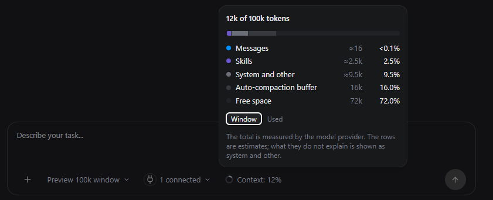
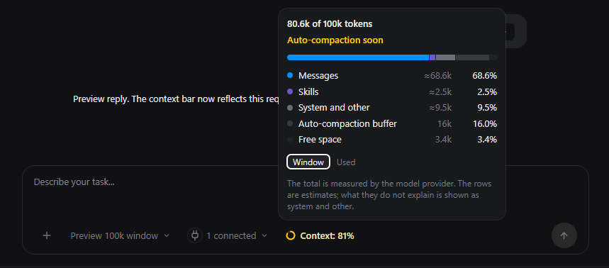
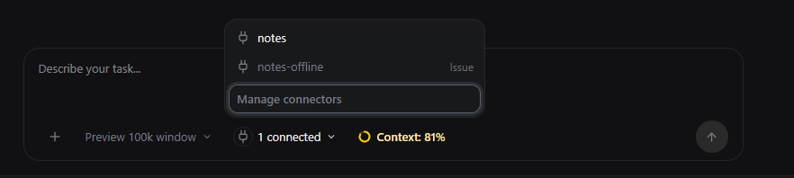

# Context and connectors in the chat box (`composerContextIndicators`)

- **Feature key:** `composerContextIndicators`
- **Deployments:** cloud and self-hosted (`everywhere`), off by default
- **Author:** @m-froehlich
- **Surfaces:** Desktop app, chat box next to the model picker

## What people get

Two quiet controls next to the model picker.

- **Connectors** shows how many MCP servers are connected, as a count and a stack of logos. A click opens a list:
  connected servers first, the others dimmed with their sign-in action or a short note.
- **Context** shows how full the model's context window is, for example **Context: 34%**, with a ring that fills as
  the conversation grows. The ring is neutral below 70% of the window, amber from 70%, and a stronger amber shortly
  before the engine compacts the conversation on its own (the popover then says **Auto-compaction soon**). It never
  turns red. A click opens a segmented bar and one row per category: messages, active skills, the skill list, tools,
  system and other, the auto-compaction buffer and free space. A switch changes the percentages between share of the
  window (the default) and share of the used context.

| Neutral | Strong step, shares of the window |
| --- | --- |
|  |  |

## How it works

Everything is computed on the device from what the app already holds; no model is asked.

- The total is the usage the provider reported for the latest reply, with each engine's own formula for what counts
  toward its overflow limit: OpenCode v1 `tokens.total`, OpenCode v2 the sum of input, output, reasoning and both
  cache counters. The OpenCode v2 adapter keeps that usage block and turns `session.step.ended` into a
  `session.usage.measured` event; a small store beside the transcript holds the latest figure per session.
- The window is the model's `limit.context`. The compaction ceiling follows the engine: v1 `limit.input` minus the
  reserved tokens, or `limit.context` minus the output limit; v2 the smaller of the input limit and the context window, minus the configured buffer (a token count or a share such as `20%`), or `max(15%, 16000)` when none is set.
- The category rows are estimates (characters divided by four) scaled down if they exceed the measured total; what is
  left is shown as system and other, so the rows add up. OpenCode v1 reads the engine's tool list; OpenCode v2 reads
  `GET /api/session/{id}/context`.
- A compaction clears the live figure, because the usage of the summary is not the size of the context that follows.
- Not shown on the new-task screen: there is no usage yet.

## Try it

1. In `/admin`, turn `composerContextIndicators` on for an organization.
2. In the desktop app, open a chat and send a message. The Context control appears after the first reply.
3. Connect an MCP server to see it in the Connectors list.

## Off

The controls disappear and nothing else changes. No stored data depends on the feature; the only thing kept is the
percentage basis a person picked, in the browser's local storage.
