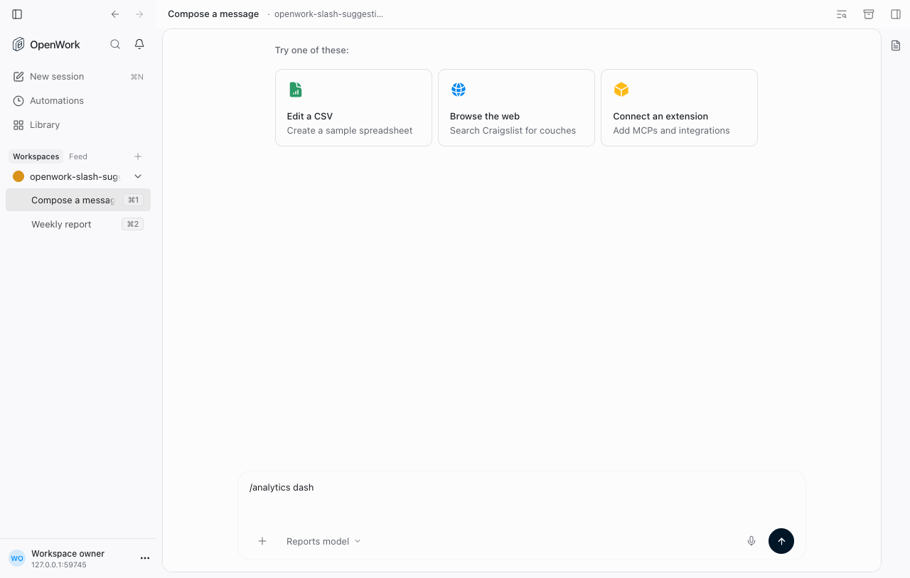
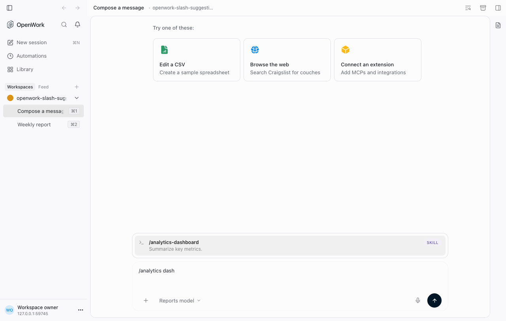
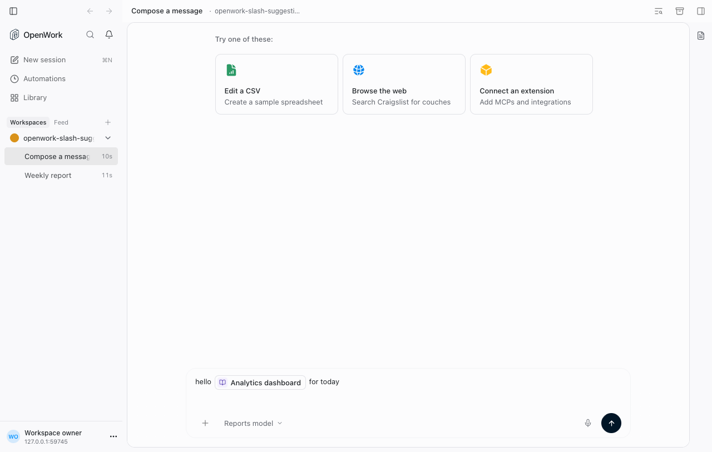
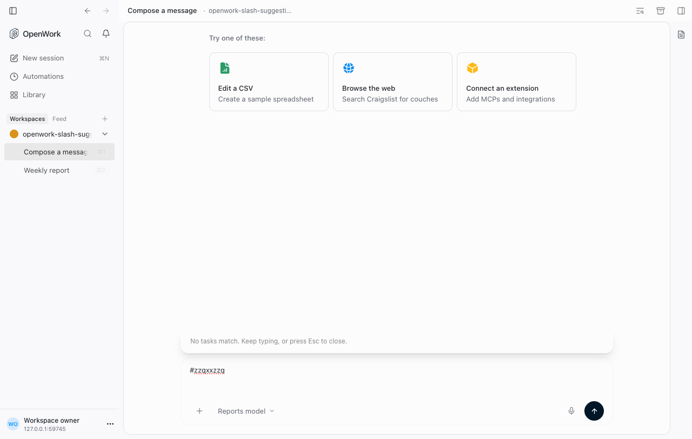
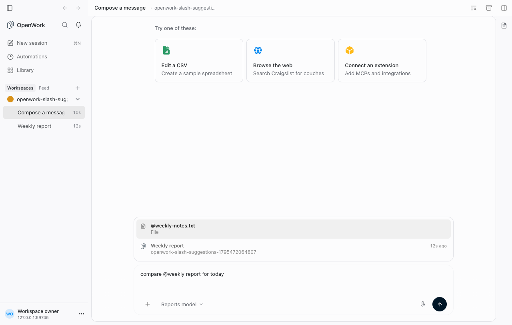
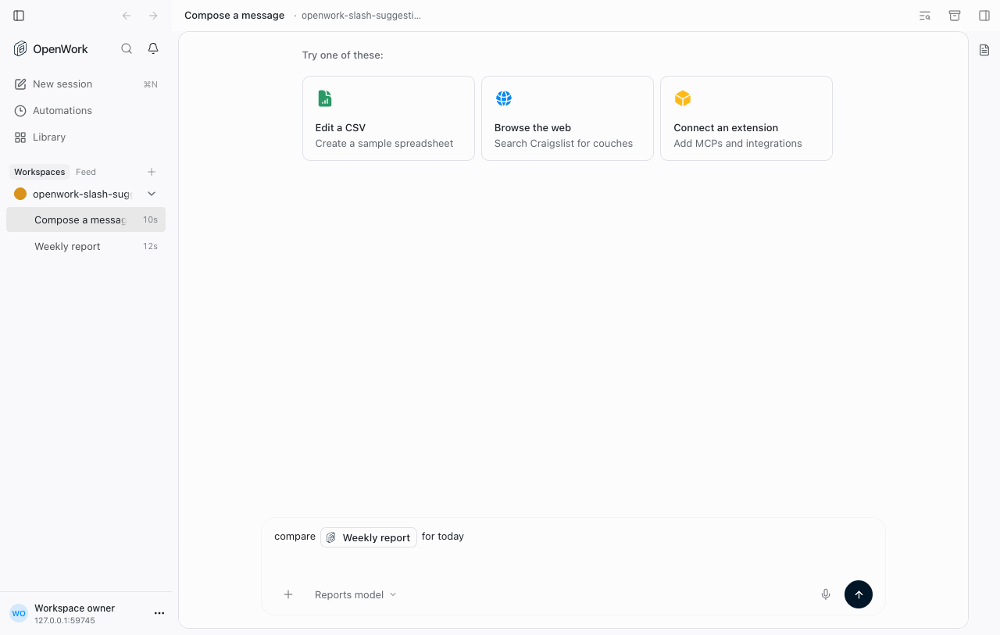

# Suggestions anywhere in a message

- Feature key: `composerInlineSuggestions`
- Deployments: cloud and self-hosted, off by default
- Owner: `different-ai`

Turn on **Suggestions anywhere in a message** for an organization in `/admin`. In a chat with a skill named `analytics-dashboard`, type `/analytics dash` or `hello /analy`. Pick the skill to insert its chip without replacing the rest of the draft. Commands still appear only at the start of a draft. Paths and URLs are not treated as skill queries.

Type `@weekly report` to find a task by title. Tasks share the **Mentions** list with files, agents, and computers. Up to four non-task matches come first, followed by up to four task matches. Non-task matches use the first word. Select a result to insert it without replacing the rest of the draft. Press Escape to dismiss suggestions for that mention. Unmatched queries do not open a popover.

Turning the flag off restores the original `/`, `@`, and `#` menus. Existing task and skill chips still render, and command execution is unchanged.

Design: the popover uses the existing component and one keyboard selection (P5, S6, S7). A tokenized border replaces the shell shadow (V3); suggestions still open without animation (V6).

| Flag off | Flag on |
| --- | --- |
|  |  |

| Original task search | Inline mentions |
| --- | --- |
|  |  |

