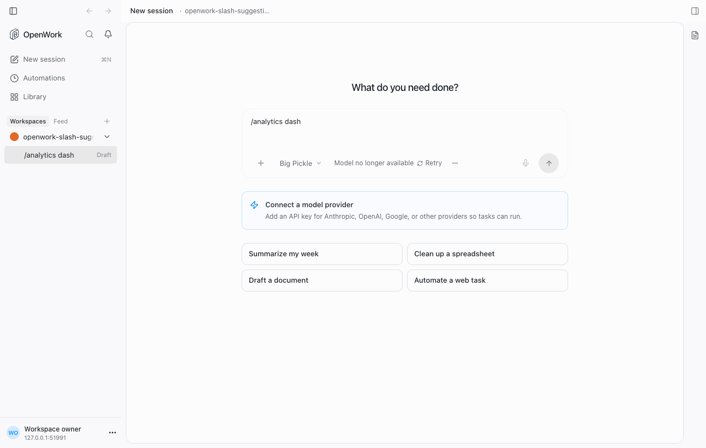
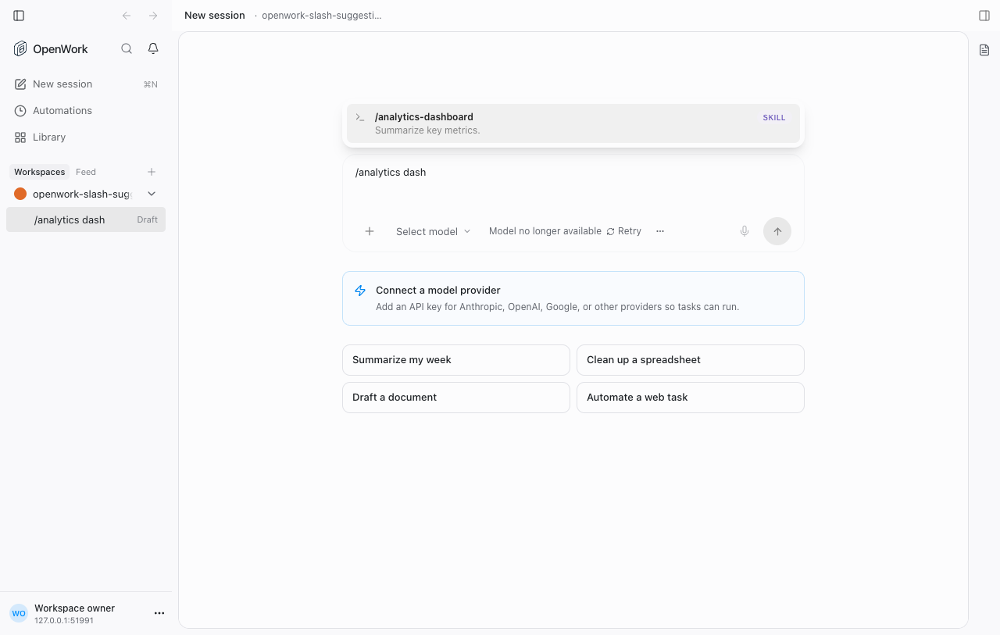
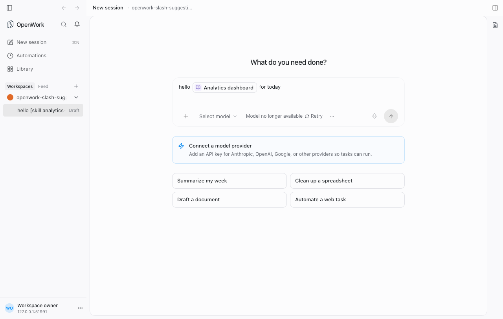

# Slash suggestions throughout a message

- Feature key: `composerSlashAnywhere`
- Deployments: cloud and self-hosted, off by default
- Owner: `different-ai`

Turn on **Slash suggestions throughout a message** for an organization in `/admin`. In a chat with a skill named `analytics-dashboard`, type `/analytics dash` or `hello /analy`. Pick the skill to insert its chip without replacing the rest of the draft. Commands still appear only at the start of a draft. Paths and URLs are not treated as skill queries.

Turning the flag off restores the original slash menu. Saved skill chips and command execution are unchanged.

Design: the existing suggestion menu and keyboard controls are reused (P5, S6, S7).

| Flag off | Flag on |
| --- | --- |
|  |  |

