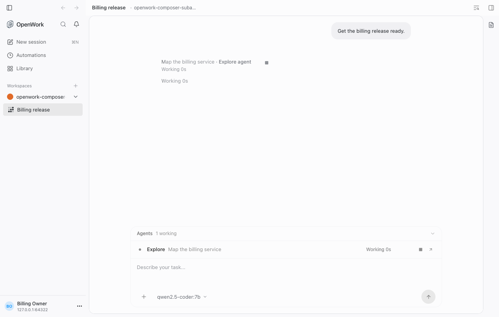
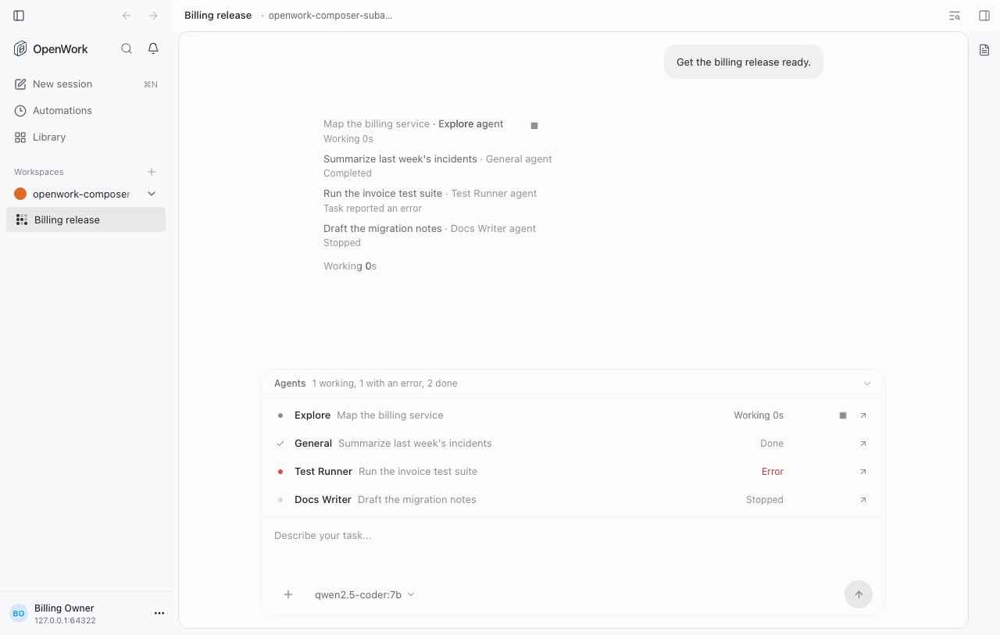
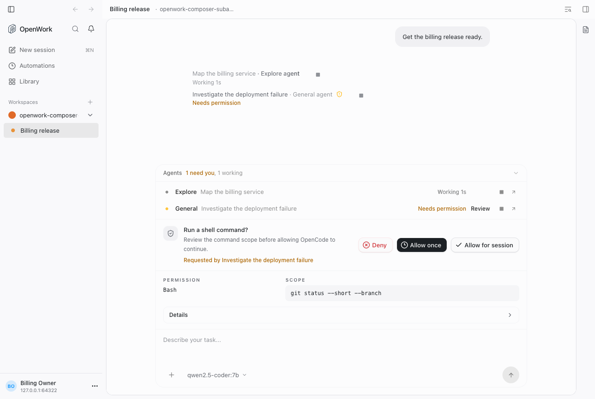
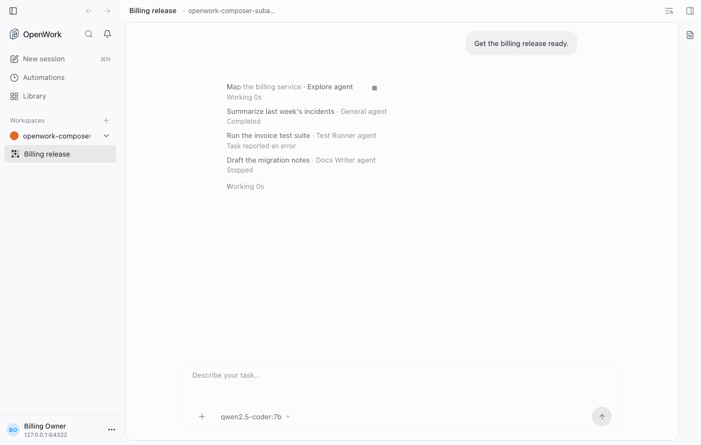

# Sub-agents above the composer

Generally available on cloud and self-hosted. Former rollout key:
`composerSubagentTracker` (retired). Author: @benjaminshafii.

## What people get

On the desktop (and the app in a browser), when a turn on OpenCode v2 starts
sub-agents (the engine's `subagent` tool, shown as `task` in the app), an
**Agents** list attaches to the top of the composer, in the same slot as the
to-do progress, questions and approvals. The composer is sticky, so the list
stays in view while the sub-agent rows in the chat scroll away.

- The header reads `Agents`, the counts (attention first:
  `1 need you, 1 working, 1 failed, 2 done`) and a chevron after them. Click it
  to fold or open.
- One row per agent, the same row for a local helper and for a task on another
  computer (`AgentTrackerRow`): the agent's name (or the computer), its task
  (hidden in a narrow window), one status word, then a fixed action lane. Names
  start on the composer text's left edge.
- Status: while an agent works only its time shows (`12s`; screen readers hear
  `Working 12s`), since the header already says how many work. Otherwise one
  word: `Retrying`, `Reconnecting`, `Starting`, `Needs permission`,
  `Waiting for your answer`, `Done`, `Stopped`, `Failed`. Colour marks only the
  word (amber for attention, red for a failure), never the row. Settled rows fade.
- Actions: **Open** (the agent's own chat) and **Stop** (only that agent, while
  it runs) appear when the row is hovered or focused; **Review** stays visible
  when it needs the person. Review moves focus to the
  approval or question card that already sits above the composer for that
  agent, or opens the agent's chat when there is none. Clicking the agent's
  name or task opens its chat too, the same as Open.
- The list opens on its own when an agent needs the person, or when there are
  at most three agents still busy; several quiet agents start folded. Once the
  turn ends and every agent has settled, the list goes away; the chat rows
  keep the record.
- While the list shows an agent, that agent's Stop lives only in the list:
  its chat row drops the small square Stop button and stays a plain link to
  the agent's chat. Agents the list doesn't show (earlier turns, or the flag
  off) keep the Stop on their chat row.

The rows use the same state as the chat's sub-agent rows
(`useSubagentRunState()` / `subagentRunActivity()` in
`apps/app/src/components/chat/subagent-run-line.tsx`), so the two never
disagree.

Running, flag on:

Several agents, opened:

Needs permission, with the approval card under it:

Flag off (as shipped): only the rows in the chat.

## How to try it

Turn it on for an organization in `/admin`, open a chat on OpenCode v2 and ask
for work the agent splits into sub-agents. The proof
`evals/proofs/composer-subagent-tracker.proof.test.ts` walks every state with
dev-only seeds (`eval.subagent_tracker.seed`).

## Turning it off

The list disappears on the next feature refresh (at most a minute). It stores
nothing; running sub-agents keep running and stay in the chat, where their
rows still offer Open and Stop. Approvals and questions keep their own cards.

## Not behind the flag

- The chat's sub-agent row now reads its state through the shared
  `useSubagentRunState()` / `useElapsedSeconds()` hooks. What it shows is
  unchanged.
- The approval and question cards above the composer gained a
  `data-composer-interaction` wrapper (no visual change).
