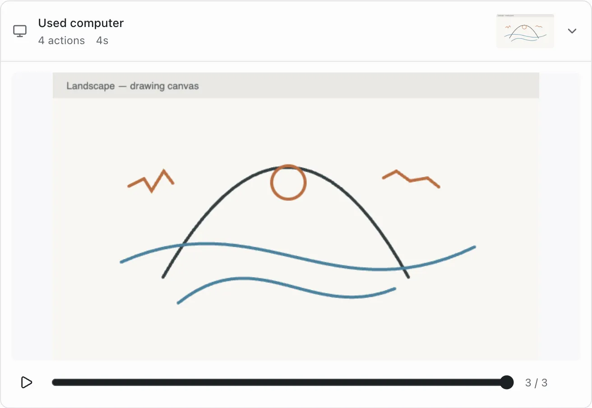

# Computer session history

Feature: `computerSessionHistory`. Cloud and self-hosted. Author: `reachjalil`.
Off by default.

Computer actions in one assistant turn share a compact card. Open it to browse
the screenshots the agent received, play them in sequence, or inspect the
original actions. Narration, other attachments, failed calls and approval
requests remain in the conversation. No new recording or screenshot capture
is introduced.

Enable the feature for a test organization or member in platform admin, then
open a conversation with computer actions. Signed-out clients follow the
deployment's feature setting. A missing or unreachable setting stays off.

The collapsed card follows the newest capture. Browsing an earlier view pins
it while new captures arrive; scrubbing to the end returns to following. Playback is
explicit, stops at the final view, and pauses when closed or the tab is hidden.
Unchanged consecutive captures share one view; every action remains available.
Sessions without screenshots still offer their actions. Interrupted work is
shown as status unavailable rather than reported complete.

Turning the feature off immediately restores individual actions and image
attachments. Stored conversation data is retained and no computer input is sent
by browsing or replaying history. Existing Computer view controls and approvals
keep their current behavior.
