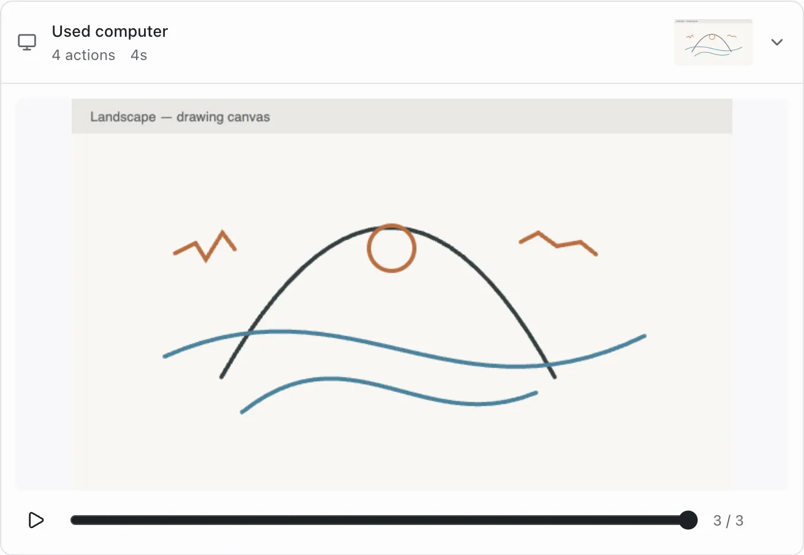

# Computer session history

Feature: `computerSessionHistory`. Cloud and self-hosted. Author: `reachjalil`.
Off by default.

Computer actions in one assistant turn share a compact card. Open it to browse
the screenshots the agent received, play them in sequence, or inspect the
original actions. Narration, other attachments, failed calls and approval
requests remain in the conversation. No new recording or screenshot capture
is introduced.

Built-in browser steps are not part of the card; they keep their usual
"Used browser" steps in the conversation.

While the feature is on, the floating live computer view no longer opens by
itself: the card shows the work. While the chat's computer is working, the
newest card offers **Watch live**, which opens the usual floating view (it can
still pop out into its own window), and **Hide live view** closes it again. The
view still opens on its own when the person is needed, such as after a
takeover. The next computer session starts in the card again.

Files the session made are listed on the card, under its header, without
opening it, newest first and each once with its latest size: each file a Mac
`save_as` or `save_image` step confirmed on disk (`file_saved`), wherever it is, and each file in
the chat's output folder (`~/Downloads/OpenWork/<chat>`, the `save_folder`
`computer_open` returns) that changed between the session's first step and the
end of its turn, whether an app, a `computer_script` export or a shell command
wrote it. The agent is told to put every deliverable there, never only in a
temporary folder, and to end by naming the files it delivered. In the desktop
app each offers **Open** (its default app), **Show in Finder**, and **Attach to chat**, which adds it to the
chat's message box as a file mention, as the message box's own file picker
does. A save that was not confirmed on disk is not listed. Saves need no
approval unless the organization's Agent permissions ask first. Open launches only a
file this chat made: one its computer use saved on this computer since the app
started, or a regular, non-executable file in its output folder. Any other path
from the conversation is shown in Finder instead.

With [`parallelComputerUse`](../parallel-computer-use/README.md) on, the newest card also lists
the chat's subagents that used its computer, one row each, with a small live view; a row opens
that agent's live view. A turn whose own steps used no computer shows the crew alone.

Enable the feature for a test organization or member in platform admin, then
open a conversation with computer actions. Signed-out clients follow the
deployment's feature setting. A missing or unreachable setting stays off.

The collapsed card follows the newest capture. Browsing an earlier view pins
it while new captures arrive; scrubbing to the end returns to following. Playback is
explicit, stops at the final view, and pauses when closed or the tab is hidden.
Unchanged consecutive captures share one view; every action remains available.
Sessions without screenshots still offer their actions. Interrupted work is
shown as status unavailable rather than reported complete.

Turning the feature off immediately restores individual actions and image
attachments. Stored conversation data is retained and no computer input is sent
by browsing or replaying history. Existing Computer view controls and approvals
keep their current behavior.
