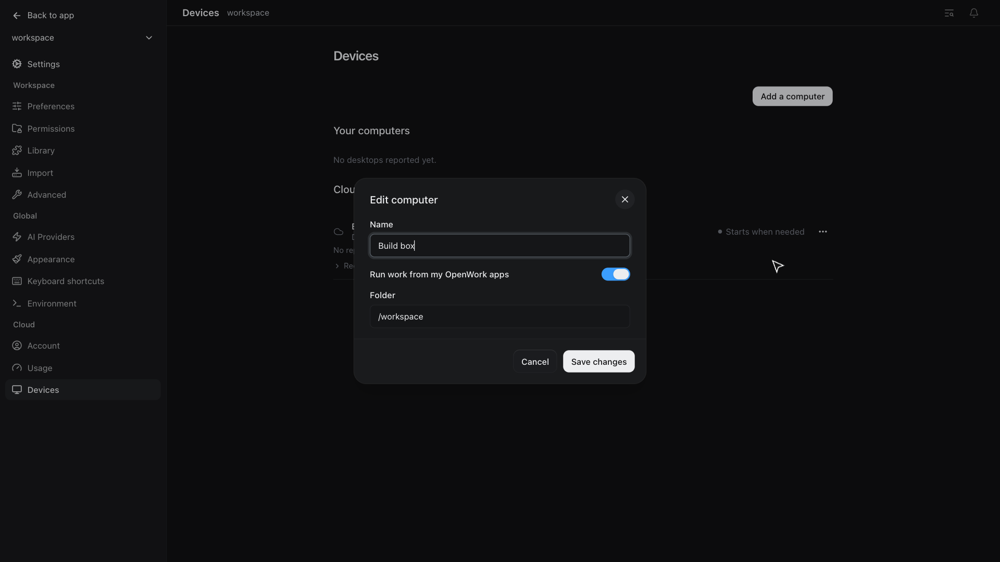

# Computers

`computers` is off by default on cloud and self-hosted deployments. Owner: `benjaminshafii`.

A computer runs work: a personal machine, registered VM, or Workbot cloud computer. The boundary is the sandbox, not the tool list: the goal is to work in a folder there with the same tools as here.

## Two doors, one core

Both use `packages/computers`. Native: name a computer in a desktop prompt. The agent calls `runs_on` to send that chat's normal file and shell tools there. MCP: `computers:list` and `computers:shell`.

## Three checks

The narrowest permission wins:

1. **Organization:** The existing "tasks from other devices" setting must allow it.
2. **Computer:** The owner opts in. For a registered VM, use its edit dialog under **Settings > Devices**.
3. **Source:** Only folders shared with this source are allowed.

A permission refusal says which check stopped it and who can change it.

## Native routing today

Den decides on each routed `shell`, `read`, `write`, `edit`, `glob`, and `grep` call (`POST /v1/computers/:id/authorize`). Before contacting the member's own registered Daytona computer, the local OpenWork server checks the paths or working directory against the shared folders again. It uses `DAYTONA_API_KEY` from its environment and starts the computer if stopped. Den stores no provider credentials. Bound chats refuse local-only tools. Remote MCP tools are unaffected, and no connector secrets are copied to the computer. Failed calls never fall back locally.

OpenCode 2.2.6 has a per-session file and process seam only in its embedded host, not the `opencode2 serve` sidecar OpenWork runs. OpenWork uses its own sandbox seam: the plugin re-registers tools and the sandbox tool host runs them. That host supplies tool output, background commands cannot run remotely, and attachments and the file browser stay local.

Cloud computers show **Ready**, **Starts when needed**, or **Has a problem**, never **Offline**. Personal machines keep **Online** and **Offline**. Names are unique per person; rename reports taken names. If two computers match, the agent asks which one.

## What is not built yet

- A composer picker. Name the computer instead.
- Providers other than Daytona.
- An on-computer runner. The local server rechecks folders; Den verifies the member, not the calling desktop.
- Workbot or other computers reaching a personal desktop's sandbox. The queue has no desktop executor.
- MCP read, write, or search.
- List cleanup: one row per physical machine, older entries behind "Show older", and one Workbot computer per person.
- Remote background commands.

## Try it

Enable the flag for a test organization in `/admin`. Set `DAYTONA_API_KEY` for the local server and register your Daytona computer. In its edit dialog, turn on **Run work from my OpenWork apps** and share a folder. Ask "List `/workspace` on my Build box" using your folder and computer name.

## Turning it off

Member routes return 404. Within about half a minute, `runs_on` and routing disappear on the next prompt, and bound chats run locally again. Stored choices stay.

Watch for authorize refusals and provider errors in the local server log.

## Settings

