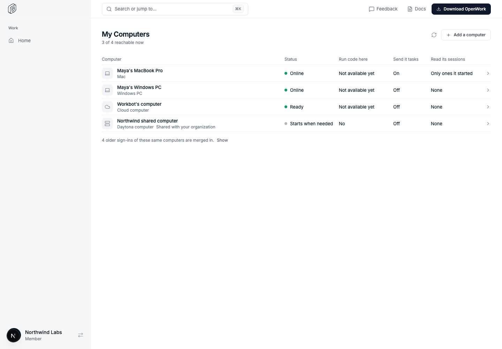
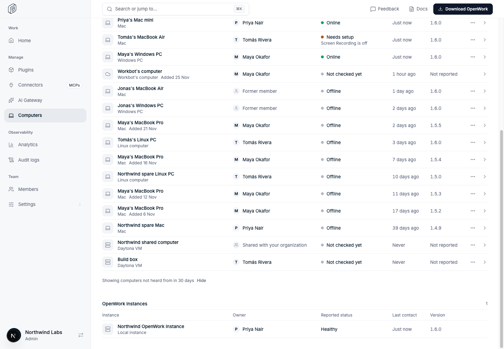
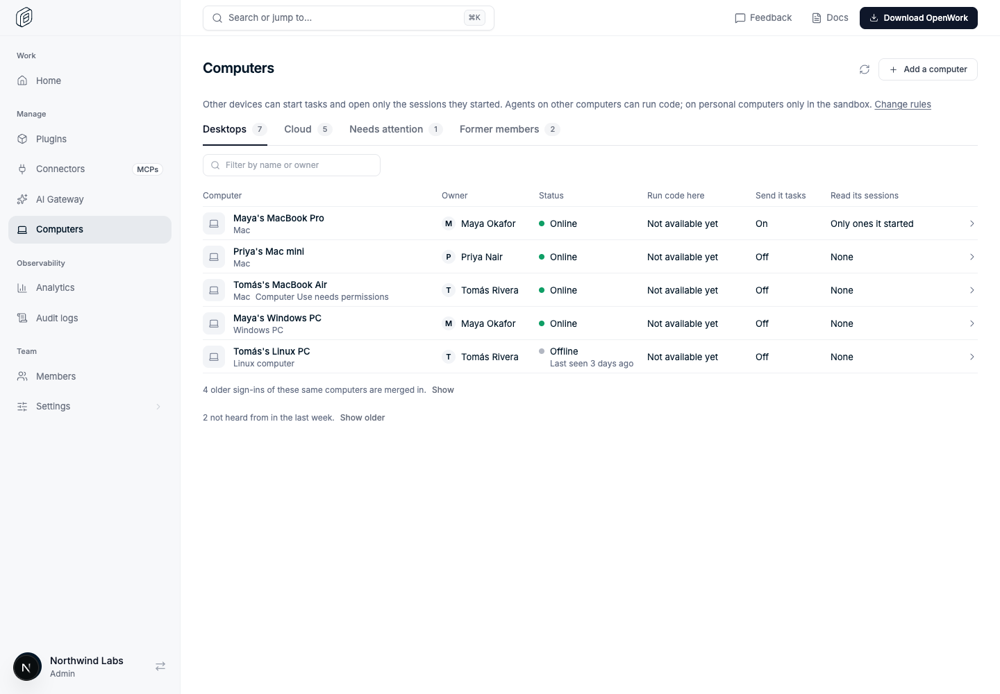
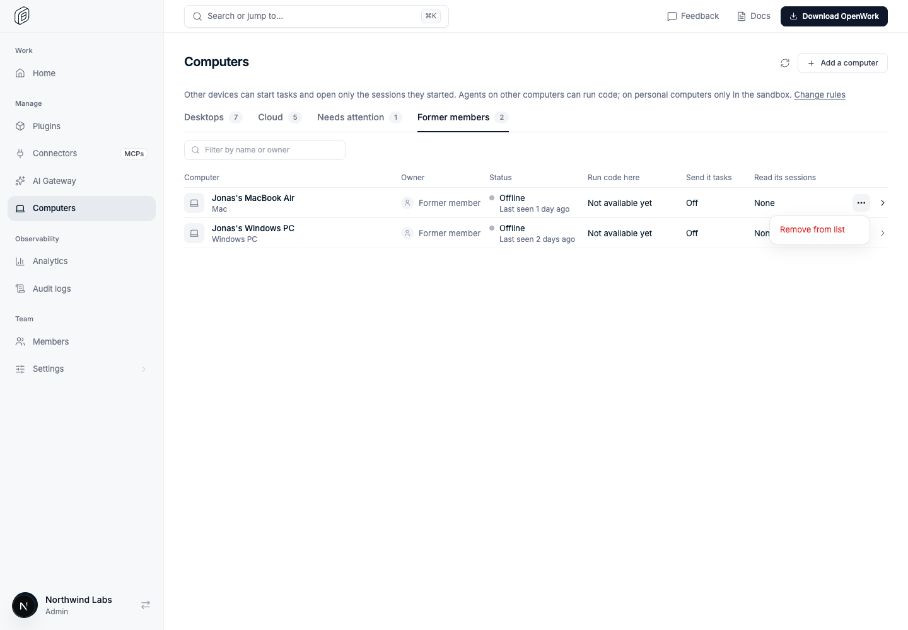
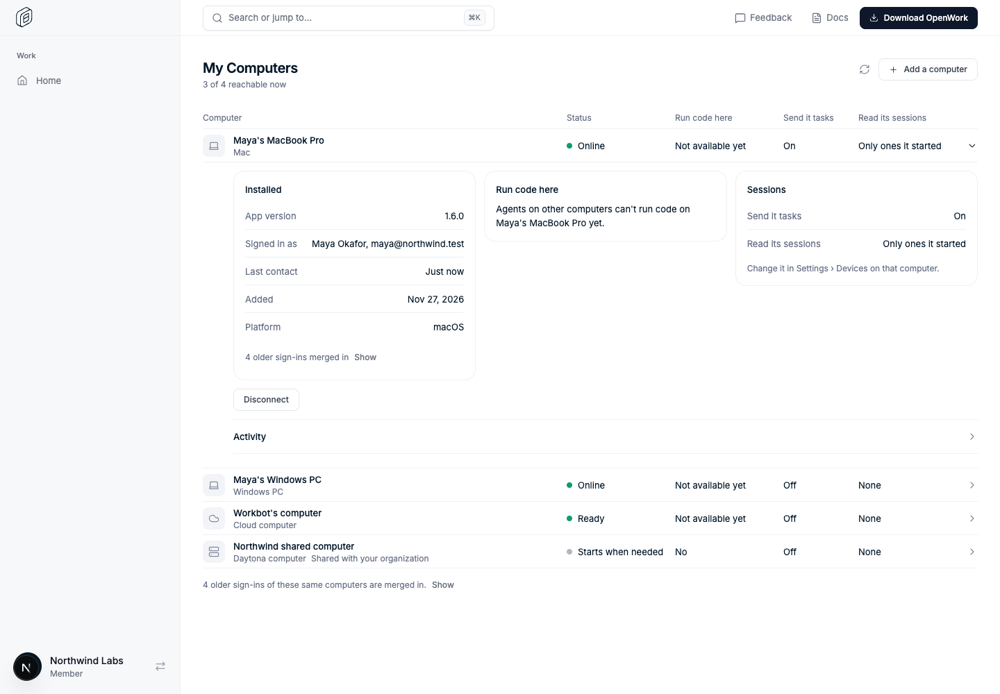
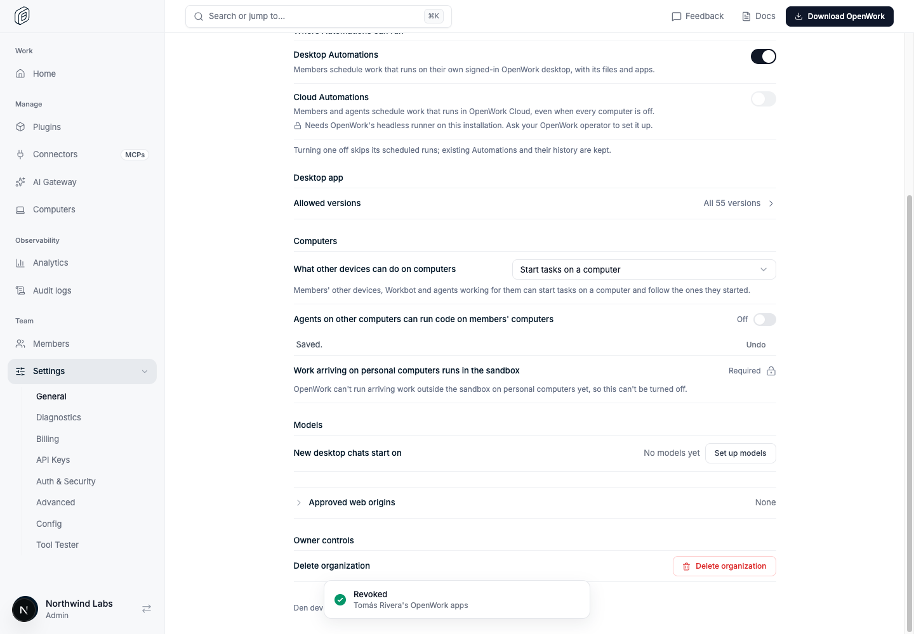

# Computers

`computers` is off by default on cloud and self-hosted deployments. Owner: `benjaminshafii`.

A computer is a place work can run: a personal Mac or PC, a registered cloud computer, or Workbot's cloud computer. With the flag on, Den shows one row per computer, a desktop chat can use its file and shell tools on the owner's own registered cloud computer, and admins get rules, revoke and activity for that access. Personal computers can't take work from another computer yet.

## The two Den pages

Flag off, My Computers lists every sign-in. The same MacBook signed in five times is five rows, and each Workbot conversation is a row.

Flag on, it lists computers.

The admin page before: every sign-in, cloud computers that read "Not checked yet", and a separate OpenWork instances table.

After: tabs with counts, one line for the organization rules, and older computers behind **Show older**.

Columns, in order: Computer, Owner (admin page only), Status, Run code here, Send it tasks, Read its sessions. App version, added date and platform are in the row detail, which has three cards: Installed, Run code here, Sessions.

### One row per physical machine

A row is a set of sign-ins that Den treats as the same machine. Folding is display only. It never moves access choices, grants, runners or sessions between sign-ins. The newest sign-in in contact is the row, and the others are counted in one line under the list.

Two sign-ins are the same machine when they have the same owner and one of these holds:

1. **Same machine key.** With the flag on, the desktop sends a SHA-256 of the operating system's hardware id (macOS `IOPlatformUUID`, Windows `MachineGuid`, Linux `/etc/machine-id`) under the domain `openwork.computers.machine.v1`. It is computed in the Electron main process and the raw id never leaves it. Den stores it hashed again with the organization id and never returns it.
2. **No key, same name, never in contact together.** Sign-ins without a key fold when the platform and name match and their contact periods overlap by no more than ten minutes. This covers every sign-in that existed before this change.

Limits:

- A replaced logic board, a reimaged Windows or Linux install, or a cloned virtual machine changes or duplicates the hardware id.
- The name rule folds two different computers of one person when they share a name and were never used in the same period, for example a replacement laptop restored from a backup. Two same-named computers that are both in use stay two rows.
- If two existing rows could both take a sign-in without a key, it stays its own row.
- The key is a hint for display. It is not a credential.

Workbot shows one computer per person. Conversation machines are not rows. OpenWork instances appear as rows in the Cloud tab.

### Status

Status only says whether OpenWork is installed and reachable. Desktops are **Online** or **Offline** with the last time seen. Cloud computers are **Ready**, **Starts when needed** or **Has a problem**. A problem in another feature, such as missing Computer Use permissions, is a note on the row and in the detail. It never changes the status.

### The three capability columns

- **Run code here:** can an agent on another computer run commands and edit files here. **No**, **Not available yet**, **In sandbox, N folders**, or **Yes, whole computer**. Personal computers read **Not available yet**. A registered Daytona computer reads **Yes, whole computer** once its owner allows it. **In sandbox** only appears for a computer whose runner declares that it mounts just the shared folders, and none does yet.
- **Send it tasks:** can the owner's other devices send it a message. **On** or **Off**.
- **Read its sessions:** **None**, **Only ones it started** or **All sessions**.

Send and Read are two views of the one remote-tasks setting the owner chooses in **Settings > Devices** on that computer.

## Rules, revoke and activity

**Organization settings > Computers** holds three rules. The Computers page shows them as one line with a link.

1. What other devices can do on computers. This is the existing remote-tasks setting.
2. Agents on other computers can run code on members' computers. Until an admin chooses, it follows the first rule, so nothing changes for existing organizations. Once chosen it is independent: an admin can allow sending a task to a Mac and block running tools on it.
3. Work arriving on personal computers runs in the sandbox. Required. It can't be turned off because OpenWork has no way to run arriving work outside the sandbox on a personal computer.

The Run code here card lists who may use the computer and for which folders. The owner can revoke a source and allow it again. An admin who may disconnect computers can revoke. A revocation holds through the computer's own reports and applies to queued commands when they are picked up.

Accepted work writes an activity entry on the target: "Workbot was allowed to run a command in /Users/maya/repo for Maya Okafor". It names the source, the kind of action, the folder and the person. It never holds the command or file contents. Calls from a desktop chat to the same folder are grouped within ten minutes.

## Two doors, one core

Both use `packages/computers`. In a desktop prompt, name your registered cloud computer. The agent calls `runs_on` to send that chat's file and shell tools there. In Workbot, `computers:list` shows computers and whether they can take work from the chat. `computers:shell` can check a queued command's result, but no shipping desktop can pick up commands, and Workbot can't send commands to a registered cloud computer.

## Checks before work runs

The narrowest permission wins:

1. **Organization:** the run code rule above.
2. **Computer:** the owner opts in. For a registered cloud computer, in its edit dialog under **Settings > Devices** or in its row detail in Den.
3. **Source:** for a registered cloud computer, only the owner's signed-in OpenWork apps. It has one working folder, which is a starting point, not an access limit.
4. **The chat's own approval.** A routed shell, write, edit, read, glob or grep call asks with the same permission keys as the local tool, as the session that made the call, before anything is sent. Deny rules apply. A rejection never falls back to running locally.

A refusal says which check stopped it and who can change it, if anyone. A personal computer answers in one sentence that it can't take work from other computers yet.

## Outcomes

- Not reached: "OpenWork couldn't reach Build box. Nothing ran there."
- Handed over and then lost: the outcome is unknown, it may have finished, and the message says to check on that computer before running it again.
- A queued command that no computer picked up says nothing ran. One that was picked up and not reported is `unknown`. The computer that picked it up can report late, and the result can then be read by its id.

## Shared folders on personal computers

A runner advertising `computer_shell_v1` must run each assignment inside its sandbox and mount only the host folders in the assignment's `scope.folders`. Den checks an explicit working directory or file path to refuse requests early. It can't tell which files a command will use, so this check is not a boundary. No shipping desktop reports these choices or runs these assignments yet.

## Native routing today

Den decides on each routed call (`POST /v1/computers/:id/authorize`). Before contacting the member's own registered Daytona computer, the local OpenWork server requires an explicit whole-computer authorization. Agents can run commands and reach files outside the working folder, within what the provider allows. It uses `DAYTONA_API_KEY` from its environment and starts the computer if stopped. Den stores no provider credentials. Bound chats refuse local-only tools. Remote MCP tools are unaffected, and no connector secrets are copied to the computer.

OpenCode 2.2.6 has a per-session file and process seam only in its embedded host, not the `opencode2 serve` sidecar OpenWork runs. OpenWork uses its own sandbox seam: the plugin re-registers tools and the sandbox tool host runs them. Background commands cannot run remotely, and attachments and the file browser stay local.

## What Den keeps

For queued commands, Den keeps the command text, the assignment and the result, including up to 32,000 bytes of output, for 15 minutes after the command completes, or 15 minutes after its deadline if it never completed. Every 15 minutes Den deletes up to 100 rows past that window. A new command, a runner listing its queue and a caller checking a command also delete rows past the window. Commands a desktop chat sends directly to a registered cloud computer don't use this queue.

## What is not built yet

- A personal Mac or PC as a target. The design is that arriving work only runs in that computer's local sandbox, with folders chosen on that computer as real mounts, read-only unless the owner allows writing. The sandbox and read-only mounts exist. The desktop runner, the folder choice in **Settings > Devices** and proof on a packaged build do not.
- A second desktop as a source for the queue. Only Workbot can queue commands.
- Turning off the sandbox requirement for personal computers.
- A composer picker. Name the computer instead.
- Desktop chat tools on cloud computers from providers other than Daytona.
- MCP read, write or search on another computer.
- Remote background commands.
- Folding old sign-ins of two computers that share a name and were used in the same period.

## Try it

Enable the flag for a test organization in `/admin`. Open **My Computers** and **Manage > Computers** in Den.

For routing, set `DAYTONA_API_KEY` for the local server and register your Daytona computer. In its edit dialog or its row detail in Den, turn on access to the whole computer and set the working folder. Ask "List `/workspace` on my Build box" using your folder and computer name. The chat asks for approval as it would locally.

## Turning it off

Both Den pages return to their previous screens and the settings section disappears. Member routes return 404. Within about half a minute, `runs_on` and routing disappear on the next prompt, and bound chats run locally again. The desktop stops sending the machine key. Stored choices, rules and machine keys stay.

Watch for authorize refusals and provider errors in the local server log.
