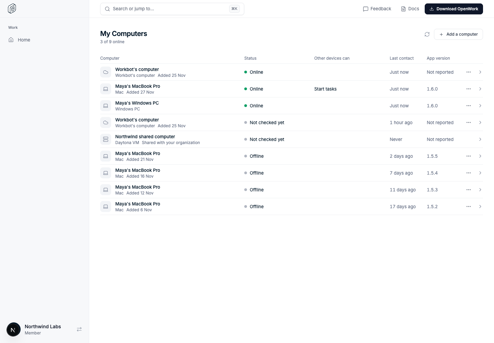
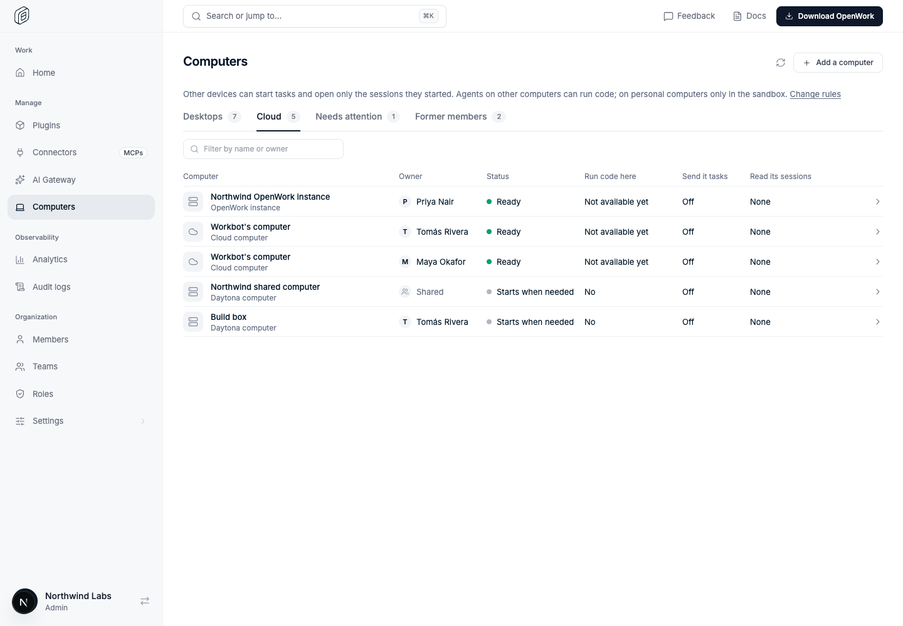
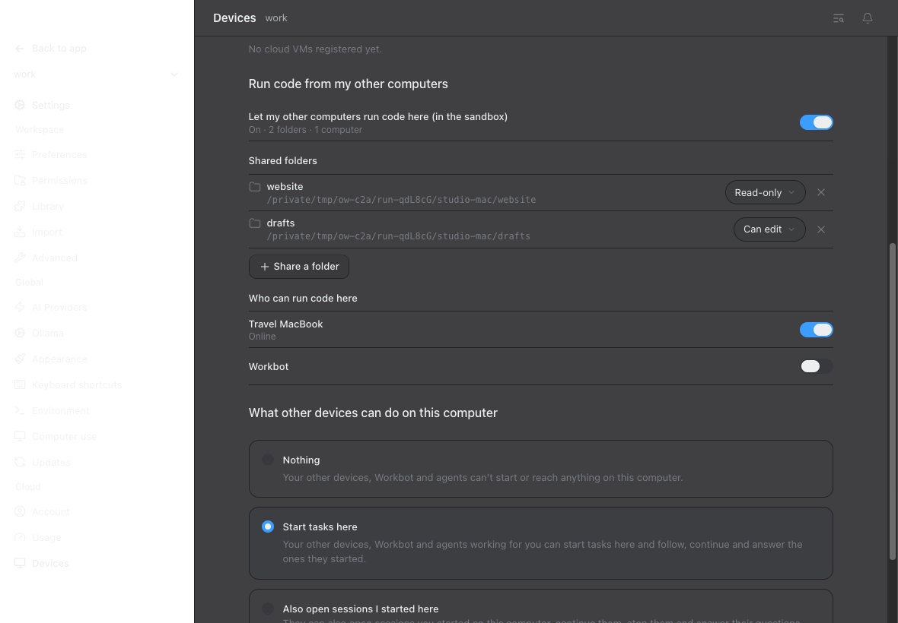
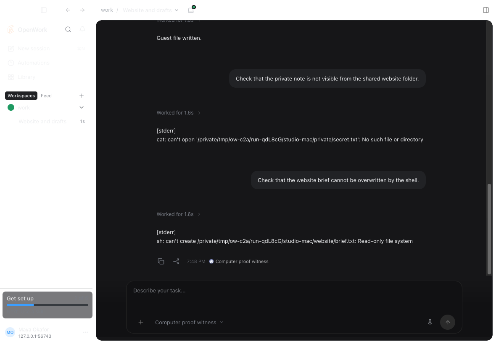
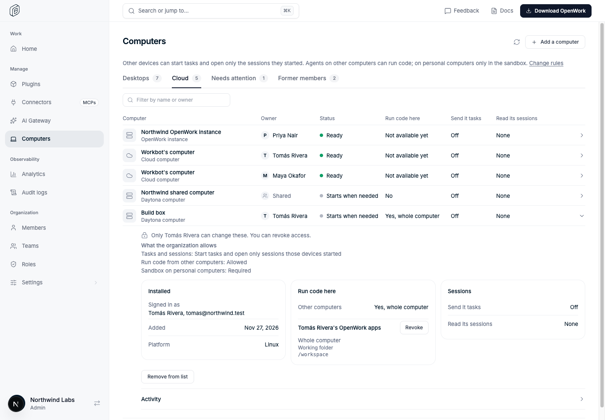
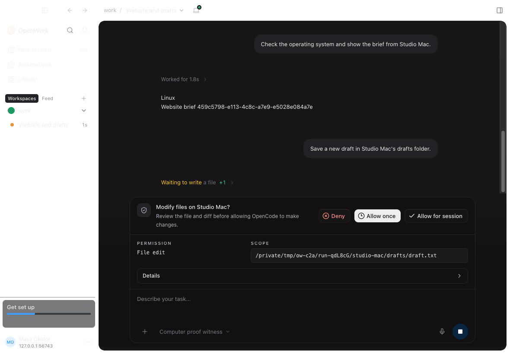

# Computers

`computers` is off by default on cloud and self-hosted deployments. Owner: `benjaminshafii`.

A computer is a place work can run: a personal Mac, PC or Linux desktop, a registered cloud computer, or Workbot's cloud computer. With the flag on, Den shows one row per computer, and a chat can use its file and shell tools on another computer the same person owns: their other laptop through its sandbox, or their registered cloud computer. Admins get rules, revoke and activity for that access.

## Who can send work where

| From | To a personal computer | To a registered cloud computer |
|---|---|---|
| A desktop chat on another of my computers | Yes, in its sandbox, in the folders I shared with that computer | Yes, the whole computer once I allowed it (Daytona, Freestyle) |
| Workbot | Yes, in its sandbox, when I allowed Workbot on that computer | No |
| A cloud computer | Only Workbot's. A registered cloud computer runs no agent of its own, so it never sends work | No |

A computer can send and take work at the same time. Work never hops: the computer that takes it runs the call in its sandbox, which has no network, and Den refuses a call whose source and target are the same computer.

## The two Den pages

Flag off, My Computers lists every sign-in. The same MacBook signed in five times is five rows, and each Workbot conversation is a row.

Flag on, it lists computers.

The admin page before: every sign-in, cloud computers that read "Not checked yet", and a separate OpenWork instances table.

After: tabs with counts, one line for the organization rules, and older computers behind **Show older**.

Columns, in order: Computer, Owner (admin page only), Status, Run code here, Send it tasks, Read its sessions. App version, added date and platform are in the row detail, which has three cards: Installed, Run code here, Sessions.

### One row per physical machine

A row is a set of sign-ins that Den treats as the same machine. Folding is display only. It never moves access choices, grants, runners or sessions between sign-ins. The newest sign-in in contact is the row, and the others are counted in one line under the list. Each sign-in keeps its own sharing settings, so a folded row shows the sharing of whichever of its sign-ins takes work and lists that sign-in's sources.

Two sign-ins are the same machine when they have the same owner and one of these holds:

1. **Same machine key.** With the flag on, the desktop sends a SHA-256 of the operating system's hardware id (macOS `IOPlatformUUID`, Windows `MachineGuid`, Linux `/etc/machine-id`) under the domain `openwork.computers.machine.v1`. It is computed in the Electron main process and the raw id never leaves it. Den stores it hashed again with the organization id and never returns it.
2. **No key, same name, never in contact together.** Sign-ins without a key fold when the platform and name match and their contact periods overlap by no more than ten minutes. This covers every sign-in that existed before this change.

Limits:

- A replaced logic board, a reimaged Windows or Linux install, or a cloned virtual machine changes or duplicates the hardware id.
- The name rule folds two different computers of one person when they share a name and were never used in the same period, for example a replacement laptop restored from a backup. Two same-named computers that are both in use stay two rows.
- If two existing rows could both take a sign-in without a key, it stays its own row.
- The key is a hint for display. It is not a credential.

Workbot shows one computer per person. Conversation machines are not rows. OpenWork instances appear as rows in the Cloud tab.

### Names

A desktop names itself after the operating system's computer name. With the flag on, its owner can rename it from the row menu in Den or in **Settings > Devices**; a chosen name survives the desktop's own reports and must be unique among that person's computers. Two of a person's computers that are in use at the same time and report the same name are told apart with a number, "Studio Mac" and "Studio Mac (2)". Names are for people. Every permission check uses ids.

### Status

Status only says whether OpenWork is installed and reachable. Desktops are **Online** or **Offline** with the last time seen. Cloud computers are **Ready**, **Starts when needed** or **Has a problem**. A problem in another feature, such as missing Computer Use permissions, is a note on the row and in the detail. It never changes the status.

### The three capability columns

- **Run code here:** can an agent on another computer run commands and edit files here. A personal computer reads **In sandbox, N folders** only when its owner turned sharing on and at least one allowed computer or Workbot has a folder. Otherwise it reads **No**, with the reason: the organization turned it off, the owner has not turned it on, nothing is shared yet, access was revoked, or the computer can't run the sandbox. A registered Daytona or Freestyle computer reads **Yes, whole computer** once its owner allows it. **Not available yet** remains for Workbot's computer, OpenWork instances and registered computers OpenWork has no way to reach (`mac_host`, `other`).
- **Send it tasks:** can the owner's other devices send it a message. **On** or **Off**.
- **Read its sessions:** **None**, **Only ones it started** or **All sessions**.

Send and Read are two views of the one remote-tasks setting the owner chooses in **Settings > Devices** on that computer. Run code here is a separate choice in the same place.

## Sharing a personal computer

On the computer that takes the work, **Settings > Devices > Run code from my other computers**:

- **Let my other computers run code here (in the sandbox).** Off by default.
- **Shared folders.** Each folder is **Read-only** unless its owner picks **Can edit**. A folder must exist, can't be the home folder itself or the root, can't overlap OpenWork's own storage, and can't sit inside another shared folder.
- **Who can run code here.** Each of the person's other signed-in computers, and Workbot, with a switch. Turning one off is the revoke.

A computer that can't run the sandbox shows one sentence saying what it needs instead of a switch. An organization that turned running code off shows the switch locked with the reason.

Turning this on does not change the person's own chats. Arriving work runs in its own sandbox, separate from the optional sandbox for local chats and from its setting.

### What the sandbox enforces

Arriving work runs in a microVM (microsandbox) that mounts exactly the shared folders, at the same paths, and has no network. A read-only folder is mounted read-only outside the guest: a root process in the guest that remounts it or mounts the share again still can't write, and links or `..` don't reach an unshared folder (`packages/sandbox-microsandbox/src/live.test.ts`, "guest root cannot make a read-only mount writable or follow a link out of its mounts"). Den also checks the path a call names, to refuse early with a clear sentence. That check is not the boundary: Den can't see which files a shell command touches. The mount is.

Before running anything it picked up, the computer checks its own settings again: sharing is still on, the sender is still in its list, and the folders Den named are still shared with at least that access. Mounts always come from the computer's own settings, never from Den.

Every allowed sender gets the same folders. The sandbox runs Linux (Alpine) with POSIX `sh`, so a command sees the shared files but not the Mac's installed programs, and it can't reach the internet.

### Windows and Linux

- **Sending** work works from any desktop: macOS, Windows and Linux use the same code path and need no sandbox.
- **Taking** work needs the sandbox: an Apple silicon Mac, or Linux (x64 or arm64) with KVM. An Intel Mac, Windows, and Linux without KVM show the sentence and never advertise that they can take work.

## Rules, revoke and activity

**Organization settings > Computers** holds three rules. The Computers page shows them as one line with a link.

1. What other devices can do on computers. This is the existing remote-tasks setting.
2. Agents on other computers can run code on members' computers. Until an admin chooses, it follows the first rule, so nothing changes for existing organizations. Once chosen it is independent: an admin can allow sending a task to a Mac and block running tools on it.
3. Work arriving on personal computers runs in the sandbox. Required. It can't be turned off because OpenWork has no way to run arriving work outside the sandbox on a personal computer.

The Run code here card lists who may use the computer: each allowed computer by name, or Workbot, with its folders as Read-only or Can edit. Grants are per pair, one sender to one computer. The owner can revoke a sender in Den or by turning it off on the computer, and allow it again. An admin who may disconnect computers can revoke. A revocation made in Den holds through the computer's own reports, shows on that computer as revoked, and applies to queued work when it is picked up. The next call after a revoke is refused.

Accepted work writes an activity entry on the target: "Travel MacBook was allowed to run a command in /Users/maya/repo on Studio Mac for Maya Okafor". It names the sender, the kind of action, the folder, the target and the person. It never holds the command or file contents. Direct calls to a cloud computer are grouped within ten minutes.

## Doors, one core

Every door uses `packages/computers` (`decide`) and the same Den service.

- **A desktop chat.** Name the computer in a prompt. The agent calls `runs_on`, which lists the person's other laptops and cloud computers by name with their state (a laptop that is offline says when it was last seen), then sends that chat's shell, read, write, edit, glob and grep there.
- **Workbot.** `computers:list` shows computers and whether they take work from the chat. `computers:shell`, `computers:read`, `computers:write`, `computers:edit`, `computers:glob` and `computers:grep` send a call to a personal computer and return its result.

## Checks before work runs

The narrowest permission wins:

1. **Organization:** the run code rule above.
2. **Computer:** the owner opts in on that computer. A personal computer: the switch in **Settings > Devices**. A registered cloud computer: its edit dialog or its row detail in Den.
3. **Source:** a personal computer only takes work from its owner's other computers or Workbot, each one allowed by name. A registered cloud computer only takes work from its owner's signed-in OpenWork apps and has one working folder, which is a starting point, not an access limit.
4. **The chat's own approval.** A routed shell, write, edit, read, glob or grep call asks with the same permission keys as the local tool, as the session that made the call, before anything is sent. The card names the computer. Deny rules apply. A rejection never falls back to running locally. Because the keys are the same, **Allow for session** on a call to another computer also allows the same action on this computer, and the other way round.

5. **The target again.** A personal computer re-checks its own settings before running a call, as described above.

A refusal says which check stopped it and who can change it, if anyone.

Remote MCP and connector tools keep running on the computer where the chat is, with that person's access. No connector secret, token or model key is copied to another computer.

## Outcomes

- Offline or asleep: "Studio Mac is offline, last seen 2 hours ago. Nothing ran there." Den treats a personal computer as reachable only while it is listening for work; one that stopped 45 seconds ago gets this answer at once.
- Not picked up: work a computer doesn't pick up within 30 seconds can never run. "Studio Mac didn't respond. It may be asleep; it was last seen 1 minute ago. Nothing ran."
- Not reached: "OpenWork couldn't reach Build box. Nothing ran there." Only when nothing can have been sent.
- Lost after sending: "OpenWork lost contact while sending work to Studio Mac. It may still run there. Check that computer before running it again."
- Picked up and not reported: the outcome is unknown, it may have finished, and the message says to check on that computer before running it again. The computer that picked it up can report late, and the result can then be read by its id.

## What follows the chat, and what doesn't

Follows: shell (foreground, up to two minutes), read, write, edit, glob (list) and grep (search). Files are UTF-8 text up to 128 KB, and output is capped at 32,000 bytes.

Stays on the computer where the chat is:

- Background commands. A routed shell call with `background` is refused: run it in the foreground.
- Attachments, the file browser, file links and artifacts.
- Skills. The skill is read where the chat is; the file and shell calls it leads to are routed.
- A subagent's model loop. Its file and shell calls use the computer its parent chat points at, and ask for approval as that subagent.
- `patch`, worktree, Drive, Gmail and Outlook draft tools. A chat pointed at another computer refuses these instead of running them on the wrong one.
- Connectors and remote MCP tools, as above.

OpenCode 2.2.6 has a per-session file and process seam only in its embedded host, not the `opencode2 serve` sidecar OpenWork runs, so OpenWork uses its own seam: the plugin re-registers tools and a tool host runs them.

## Reaching a cloud computer

Den decides on each routed call. Before contacting the member's own registered cloud computer, the local OpenWork server requires an explicit whole-computer authorization. Agents can run commands and reach files outside the working folder, within what the provider allows. The server uses the provider key from its own environment (`DAYTONA_API_KEY`, `FREESTYLE_API_KEY`) and starts the computer if stopped. Den stores no provider credentials.

### Adding a provider

`apps/server/src/computers/executors/` has one interface and one registry keyed by the computer's provider. To add one:

1. An adapter in `packages/sandbox-<name>` that implements `SandboxProvider` with the `run` and `files` blocks.
2. One entry in `executors/index.ts`: the provider's name, the environment key, how to build the adapter, and how the registered id becomes a ref.
3. The provider in `COMPUTER_EXECUTABLE_VM_PROVIDERS` (`packages/types/src/den/computers.ts`), which is what Den and the pages read.

`mac_host` and `other` have no adapter in the codebase, so those computers answer that they can't take work yet.

## What Den keeps

For work sent to a personal computer, Den keeps the call (the command, or the path and the text to write), the assignment and the result, including up to 32,000 bytes of output, for 15 minutes after it completes, or 15 minutes after its deadline if it never completed. Every 15 minutes Den deletes up to 100 rows past that window. A new call, a computer listing its queue and a caller checking a result also delete rows past the window. Calls a desktop chat sends directly to a registered cloud computer don't pass through Den.

## What is not built yet

- OpenWork instances as targets. They run chats themselves; open a chat on the instance.
- Registered `mac_host` and `other` computers as targets. No adapter exists.
- A cloud computer other than Workbot's as a sender.
- Workbot sending work to a registered cloud computer.
- Different folders for different senders. 

Every allowed sender gets the same folders.
- Internet access or the host's installed programs inside the sandbox.
- Windows, Intel Macs and Linux without KVM as targets.
- A composer picker. Name the computer instead.
- Turning off the sandbox requirement for personal computers.
- Remote background commands, attachments, the file browser, skills and MCP read, write or search on another computer.
- Folding old sign-ins of two computers that share a name and were used in the same period.

## Try it

Enable the flag for a test organization in `/admin`. Open **My Computers** and **Manage > Computers** in Den.

Laptop to laptop: sign in to OpenWork on two computers as the same person. On the one that takes work, open **Settings > Devices**, turn on **Let my other computers run code here (in the sandbox)**, share a folder and allow the other computer. On the other, ask "List the files in my website folder on Studio Mac" using your computer's name. The chat asks for approval as it would locally.

Cloud: set `DAYTONA_API_KEY` or `FREESTYLE_API_KEY` for the local server and register your computer. In its edit dialog or its row detail in Den, turn on access to the whole computer and set the working folder. Ask "List `/workspace` on my Build box".

## Turning it off

Both Den pages return to their previous screens and the settings sections disappear. Member, source and runner routes return 404. Within about half a minute, `runs_on` and routing disappear on the next prompt, bound chats run locally again, and a computer that was taking work stops asking for it. The desktop stops sending the machine key and stops advertising that it can take work. Stored choices, rules, shared folders and machine keys stay.

Watch for authorize refusals and provider errors in the local server log, and `computer_command` rows that end `expired` or stay `claimed` in Den.
