# Config blobs (internal name)

- **Feature key:** `configBlobs`, declared in `packages/features/src/registry.ts`. Cloud and self-hosted, off by default.
- **Author:** @OmarMcAdam
- **Status:** built behind the flag: export, change requests, plan-time preflight, apply, restore, config tokens, all 25 areas ([inventory.md](./inventory.md)). What remains is in [plan.md](./plan.md#status-2026-11-09).
- **Turning it off:** hides Settings › Config and answers 404 on `/v1/config-blobs/*`. Change requests already applied stay applied; queued ones wait and resume when it's on again.

## What it is

Config blobs let an admin export all or part of an organization's configuration as JSON, edit it, and import it again. Imports can go into the same org or another one, on the same instance or a different one (cloud → self-hosted and back).

An import never writes straight to the database. It becomes a **change request**: it is diffed against the org as it is now, its items are mapped, it is reviewed and then applied. The model is a mix of Drizzle's `generate` (diff snapshots, ask about ambiguous renames) and PlanetScale deploy requests (review, approval, a serial deploy queue, a revert window).

```
 export ──► blob.json ──► (edit) ──► upload (UI or API with a config token)
                                          │
                                          ▼
                              change request (queued, returns id)
                                          │
                     analyze: match items, diff, check references and secrets
                                          │
                 ┌────────────────────────┴───────────────────────┐
         needs mapping / needs input                           ready
     (admin confirms proposed matches,                           │
      supplies secrets)                                          │
                 └──────────────────────► approve ──► apply queue ──► applied
                                                         (before-snapshot of the items written,
                                                          one run report per attempt)
```

## Documents

| File | Contents |
|---|---|
| [research.md](./research.md) | How Drizzle, PlanetScale, Terraform, Kubernetes, Directus, Auth0, Grafana and Hasura handle this, and what we take from each |
| [inventory.md](./inventory.md) | The Den sidebar mapped to blob keys, the tables behind each key, secrets, and what is left out |
| [format.md](./format.md) | The blob file format: envelope, item identity, references, secrets, hashes |
| [mapping.md](./mapping.md) | How the diff and matching work: match tiers, change states, conflicts, collisions |
| [change-requests.md](./change-requests.md) | Queue lifecycle, API, config token, UI, apply and revert |
| [plan.md](./plan.md) | Phased build plan, guard rails, tests, decisions |

## Main decisions (as built)

1. **Every item carries its ID and a portable key.** An import tries to keep the source TypeID when that ID is free on the target, so cloud and self-hosted refer to the same item by the same ID. When it can't (for example, cloning an org on the same instance), we record an alias. Re-imports then match exactly, with no guessing. See [format.md](./format.md#identity).
2. **Match in tiers, and never pick for the user when two items are equally good.** The order is: ID, then alias, then `externalKey`, then a natural key that is unique on both sides. Anything else is a *proposed* match the admin must confirm, Drizzle-style. Same-name collisions are always shown to the admin. See [mapping.md](./mapping.md).
3. **Three-way diff.** Each exported item carries a revision hash. On import we compare *what you downloaded*, *what is there now* and *what you uploaded*. That way we can tell your edits apart from changes someone else made in the meantime. This is like PlanetScale's three-way merge and the Kubernetes last-applied annotation.
4. **Credentials are never exported; content is** (skills and prompts included, with a warning). **People are carried** by email; missing people become invitations.
5. **Secrets become placeholders.** Credential columns become `$secret` placeholders that say whether a value is set. On import each one is resolved: keep the current value, enter a new one, read it from an environment variable (self-hosted), or leave it unset so the item is created but needs setup.
6. **Merge by default; deleting is opt-in.** A missing area or item means "leave it alone". Deletes happen only in `mirror` mode, within the blob's scope, and each one is listed for confirmation.
7. **Applying reuses the existing services, not raw table writes.** Validation, permissions, audit logging and side effects stay the same as in the UI. Each config area is an *adapter* in one registry. A CI check makes every org-scoped table either exported or explicitly excluded.
8. **No single transaction; minimal writes; a report per attempt.** Each item is written through its service, with only the writes its planned changes need. The run stops at the first failure and its report says what was written, where it stopped and what was not reached.
9. **Every apply first saves a before-snapshot of the items it writes.** "Restore previous config" is just another change request made from it. It restores configuration only: emails sent, sign-ins revoked, credentials replaced or deleted, source syncs and history stay (each plan item lists these before approval). See [change-requests.md](./change-requests.md#apply).
10. **Known failures surface before approval.** Each area's preflight skips or blocks writes that can't work on the target (no GitHub installation, SSO not ready, a domain not allowed, a source-managed skill…). See [change-requests.md](./change-requests.md#preflight-plan-time).

## Screens

Taken from the real Den web app (light theme, local Den with seeded test organizations). The flow: export → edit the file → upload → resolve the steps the plan needs → approve → apply → revert if needed.

| Screen | |
|---|---|
| **Settings › Config › Overview**: export tree (whole organization or chosen areas), import with Merge / Mirror, and the "Require a second approver" setting. | 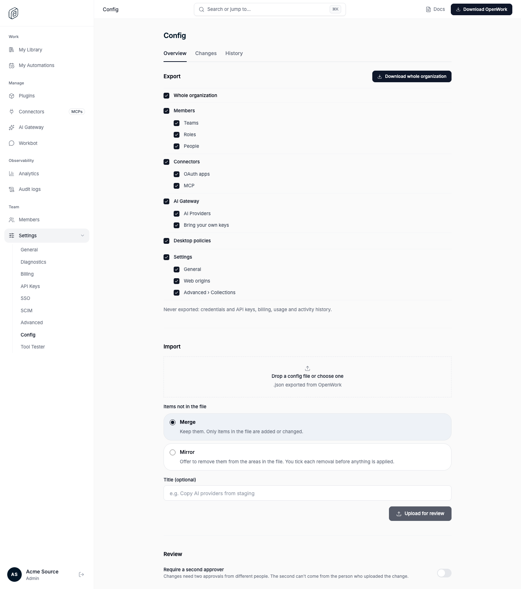 |
| **Changes**: open change requests with status and `+added ~changed −removed` counts. Applied and closed ones are under History. | 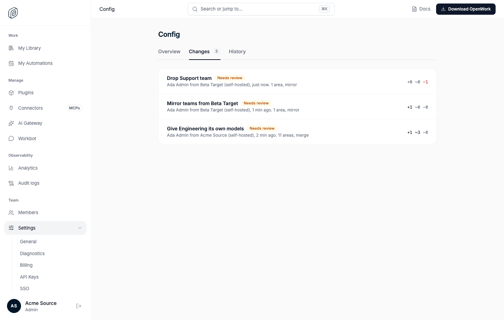 |
| **Match**: items the server can't match on its own. Each offers "Add as a new item" or a scored candidate; nothing is picked for you. | 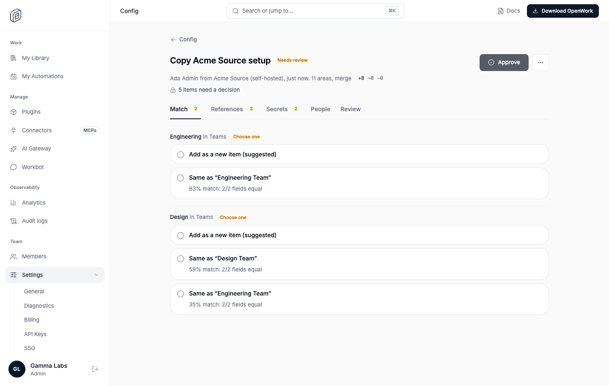 |
| **References**: a reference to something that exists neither here nor in the file: use an existing item or leave it out. | 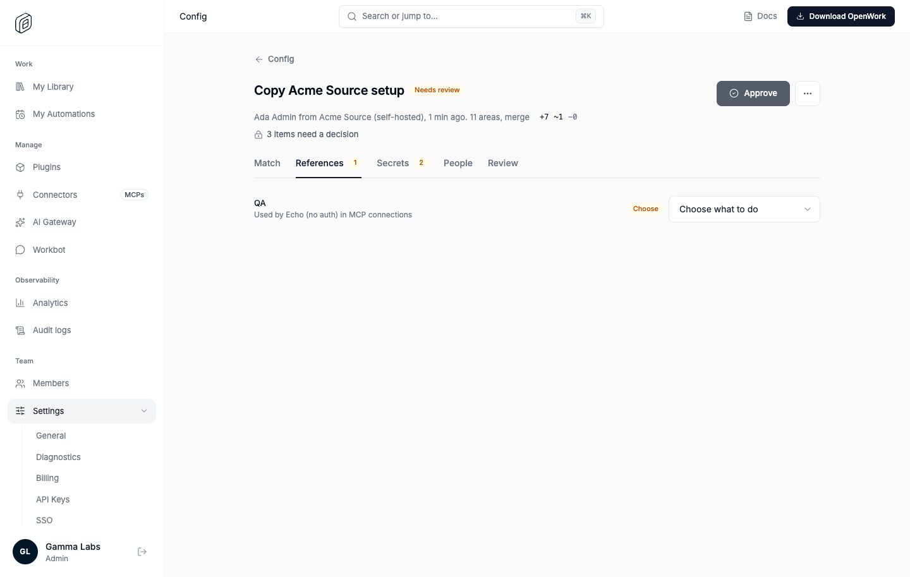 |
| **Secrets**: values are never in the file. Keep the current value (with "Keep all" when re-importing into the same organization), enter one, read an environment variable (self-hosted with an allowlist only) or leave it empty. | 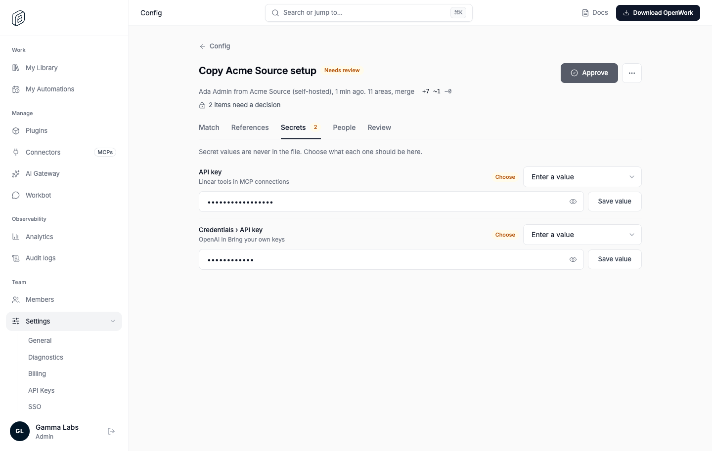 |
| **Review**: per area, what is added, renamed, changed and removed, with a field diff (set fields list what is added and removed). Removals of access or data need a tick before approval; areas with no changes fold into one line. | 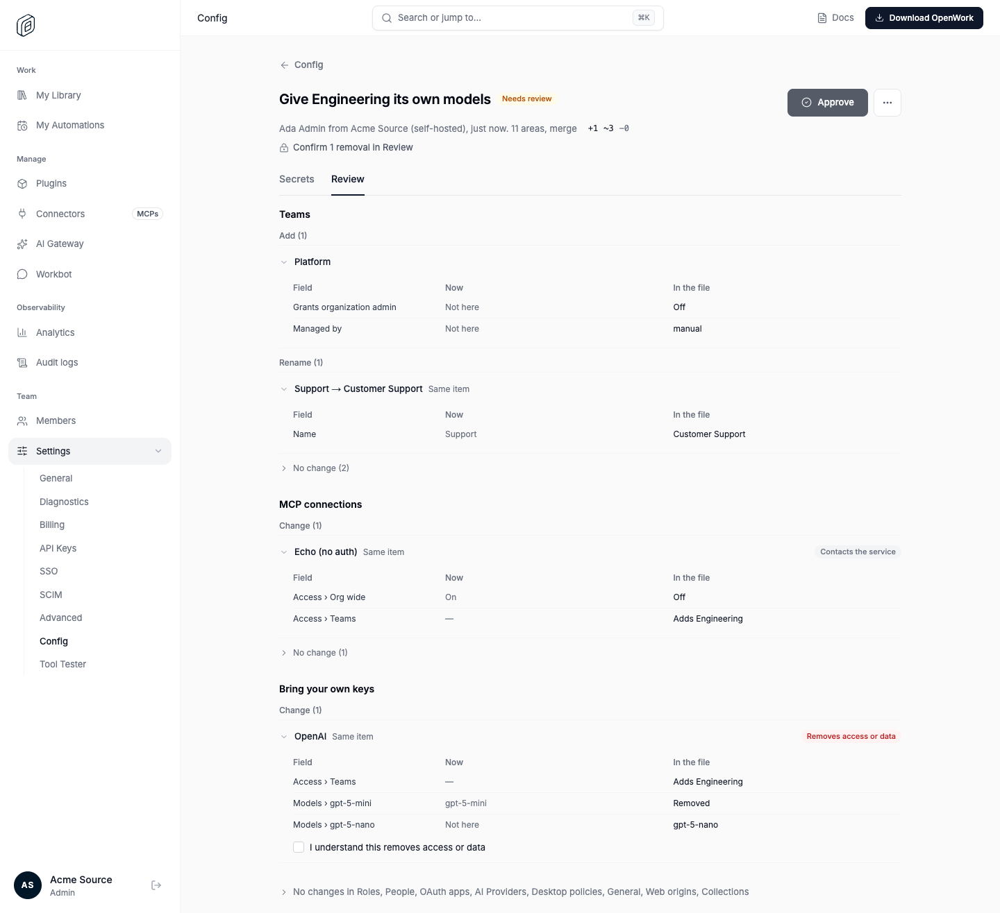 |
| **Applied**: the result of the apply, item by item, with Revert (a new change request from the before-snapshot). | 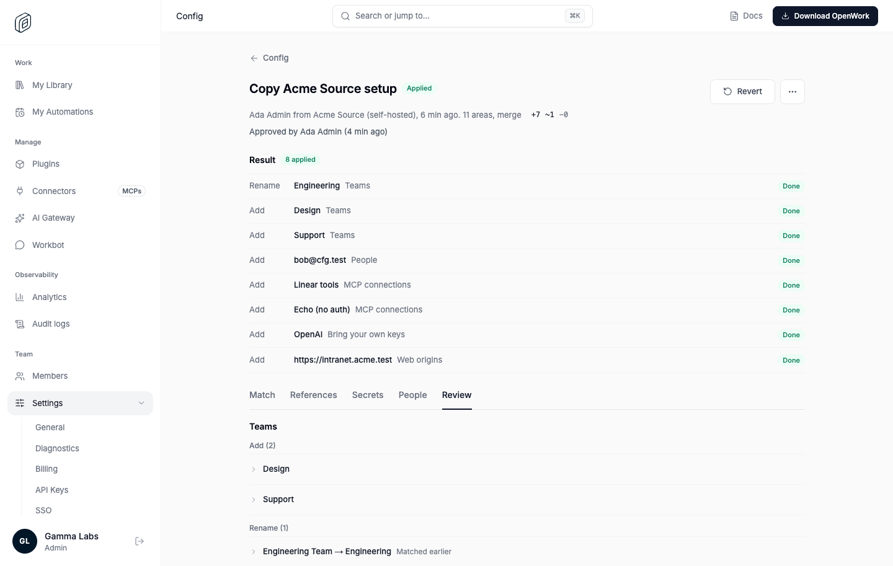 |
| **Can't be undone**: on Review, writes a later restore can't take back (here, removing an MCP connection deletes sign-ins and keys) carry a chip and the effects. | 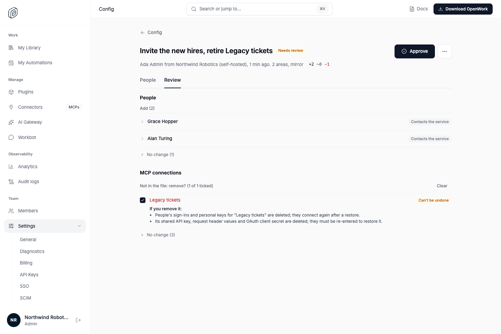 |
| **Apply runs, failed**: the run that stopped part-way, opened: what failed and where, the message, what was written for that item, and what was not reached. | 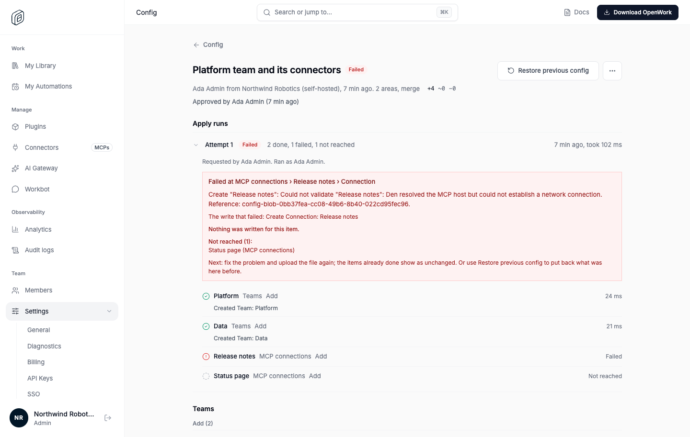 |
| **Apply runs, applied**: a successful run with every write listed under its item. | 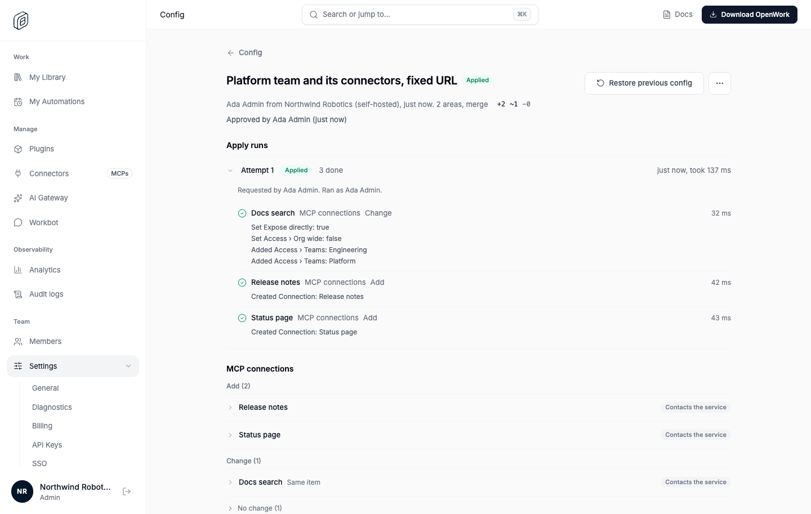 |
| **Settings › API Keys › Config token**: scopes (export, submit, approve and apply) and an optional area limit. | 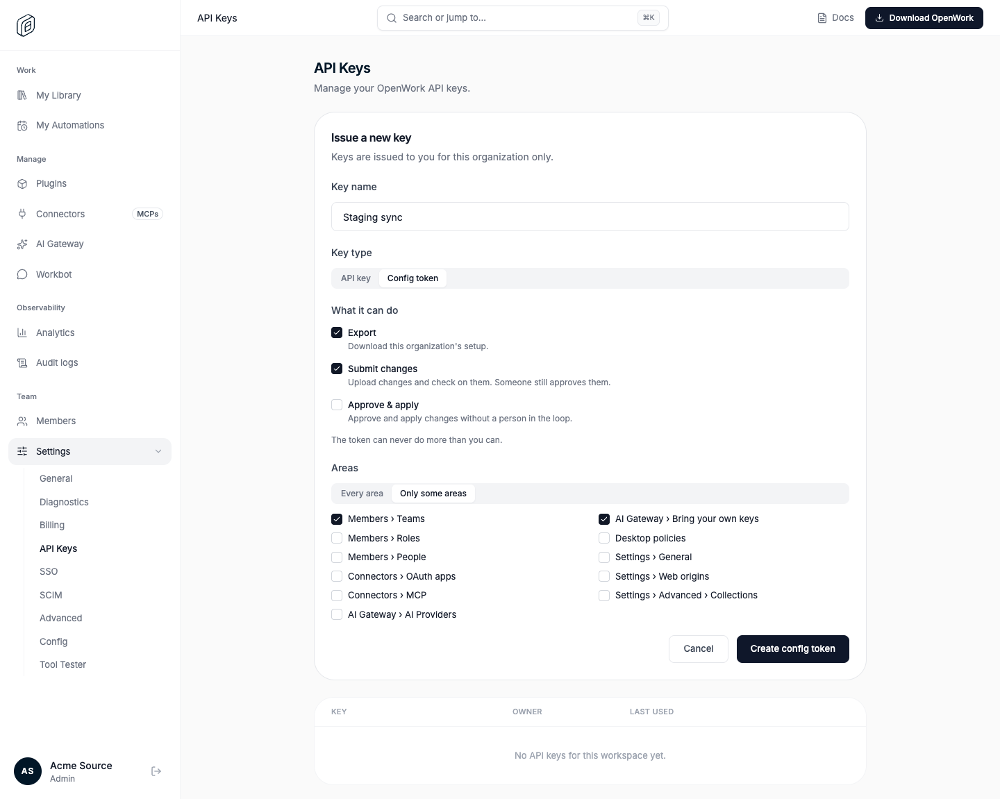 |
