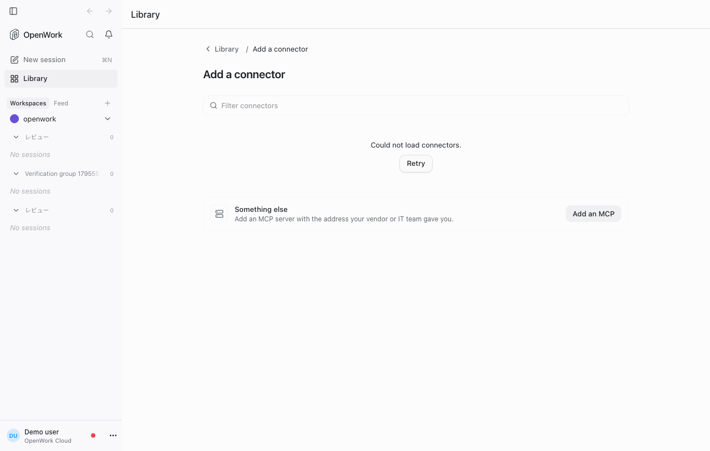

# Connector catalog recovery

`connectorCatalogRecovery` is available on Cloud and self-hosted deployments. It defaults to off. Owner: `whoElseButUmar`.

In Library, choose **Add to library**, then **Connector**. The catalog shows when the connector list is loading. If the first load fails, **Retry** requests it again. A successful load distinguishes an empty catalog from a search with no matches.

To try it, enable the feature for a test organization. Open the catalog with a slow or failing presets request, then restore the request and choose **Retry**. Confirm the connectors appear, then search for a term with no matches.

Turning off the feature returns the catalog to its previous empty state. It preserves saved connectors and access settings.
