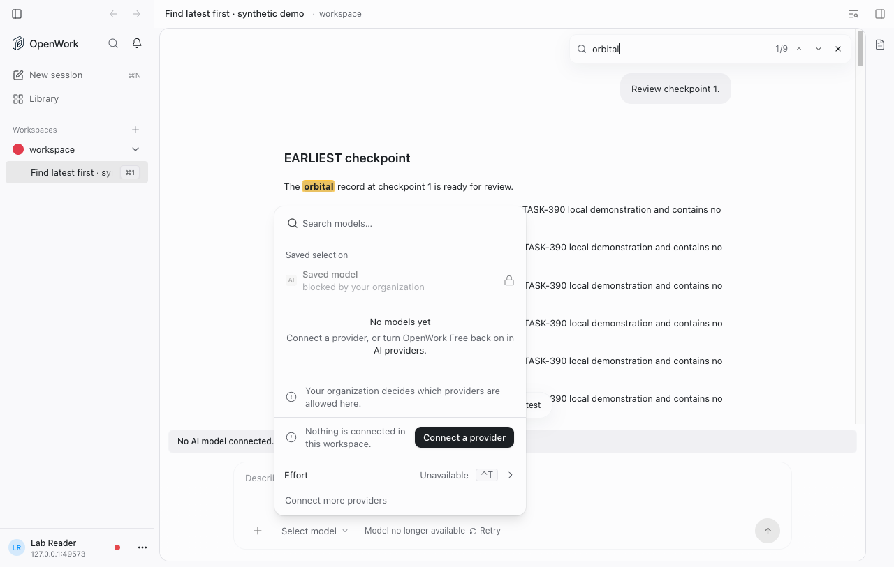
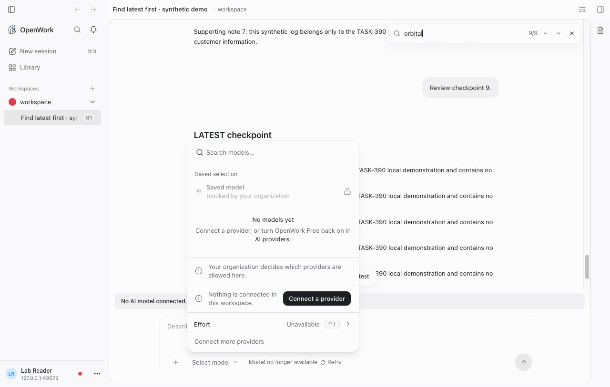

# Conversation find: latest first

- **Feature:** `conversationFindLatestFirst`
- **Deployments:** Cloud and self-hosted
- **Default:** off (including missing or unreachable feature state)
- **Owner:** [yomgui](https://github.com/yomgui)
- **Added:** 2026-11-09

## What changes

With the feature on, a new conversation search or a reopened search selects the **last rendered occurrence**. Enter moves to older matches; Shift+Enter moves to newer matches. Navigation wraps at both ends. The up arrow still moves up to older matches and the down arrow still moves down to newer matches; their tooltips show the corresponding keyboard shortcut.

The counter stays chronological: a search with three matches starts at `3/3`, then Enter selects `2/3`, then `1/3`. With the feature off, the existing first-match selection and Enter-newer / Shift+Enter-older behavior are unchanged.

This applies to find in conversations in the desktop and app-web surfaces, not workspace search or the browser's own find command. No new control or layout is introduced (DESIGN.md P5 and S6).

## Try locally

Use an isolated local deployment and synthetic conversation with the same query in several messages. Set `conversationFindLatestFirst` through the registry-backed member or organization feature control; do not change real-account rollout state for this demo.

1. With the feature off, open conversation find with Cmd+F / Ctrl+F and enter a query of at least two characters. Confirm `1/N` and Enter moving toward newer matches.
2. With the feature on, repeat the search. Confirm `N/N` and Enter moving toward older matches; verify Shift+Enter, both arrows, and wrapping.
3. Search for absent text and for one occurrence. Confirm disabled arrows / `No matches`, or `1/1` respectively.
4. Try a long conversation whose history or marks arrive after opening find. One pending query jumps when its matches arrive. Additional history or streaming preserves the selected element, and does not keep pulling the conversation away.
5. Before delayed matches arrive, deliberately scroll or use a conversation navigation control. Confirm that the pending automatic jump is cancelled. Edit or reopen the search to request a new jump.

### Real-app evidence

Verified locally with the real source app-web, native OpenCode2 2.2.0, a synthetic conversation containing nine occurrences of `orbital`, and the real local Den member override. The machine-checked demo verified active mark identity, scroll visibility, keyboard traversal, wrapping and spatial arrows; a separate member remained off. Real admin UI switches were exercised off and on.





The local interactive demo used an explicitly labeled isolated Electron viewer of app-web, **not** the official desktop bridge/runtime or a packaged-desktop proof. No model calls or real-account rollout changes were needed. The reproducible app-web proof is `evals/proofs/conversation-find-latest-first.proof.test.ts`; it exercises the real Den member control, real imported engine history, initial selection, scroll visibility, keyboard and arrow navigation, wrapping, and another member's flag-off boundary.

## Safety and rollback

This flag changes no stored conversation data and starts no background work. Turning it off restores first-match selection for the next query/reopen, and immediately restores the existing keyboard direction and tooltip hints. A selected match is retained rather than causing a surprise jump when feature state refreshes. The registry kill switch and self-hosted operator lock use the existing feature resolution path.

The existing raw-query guard, delayed-mark collection, session ownership checks, pending-query cancellation and manual-navigation listeners are retained. A query is served once when marks arrive; newly loaded older history or newly streamed matches do not re-arm it. This feature does not claim to search history that has not yet rendered.

## Usage and verification

`markFeatureUsed("conversationFindLatestFirst")` runs only when the enabled find action scrolls to a real match, not on render, focus, a short query, no matches, or a cancelled pending jump. It records no query or conversation content. Watch search-navigation regressions, unexpected repeated jumps, and the registry's member feature-usage view during rollout.

Focused checks from the repository root:

```sh
pnpm --filter @openwork/app exec bun test tests/session-find-bar.test.tsx
pnpm --filter @openwork/features test
pnpm features:sync
pnpm features:check
pnpm evals:e2e conversation-find-latest-first --local
```

The component suite uses the repository's Bun / happy-dom / React `act` patterns. It covers both flag states, zero/one/multiple matches, wrapping, query edits/reopen, delayed marks/history, stale-query and session cancellation, explicit match navigation, and manual versus nested scrolling. Real-product proof belongs in the current `evals/proofs` / `spec.world` harness, not the retired testkit layout.
