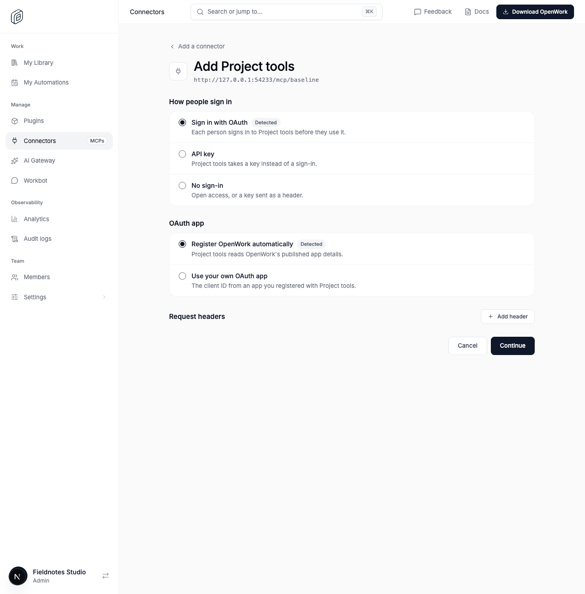
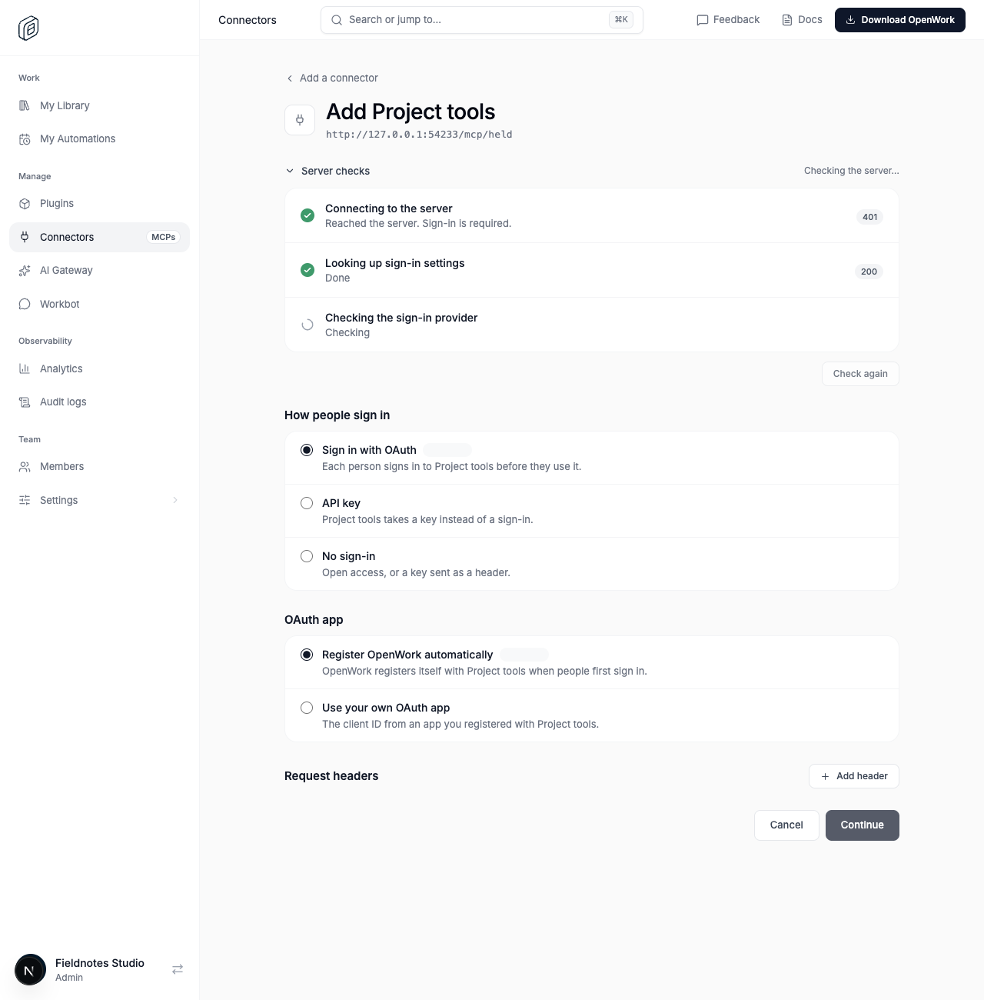
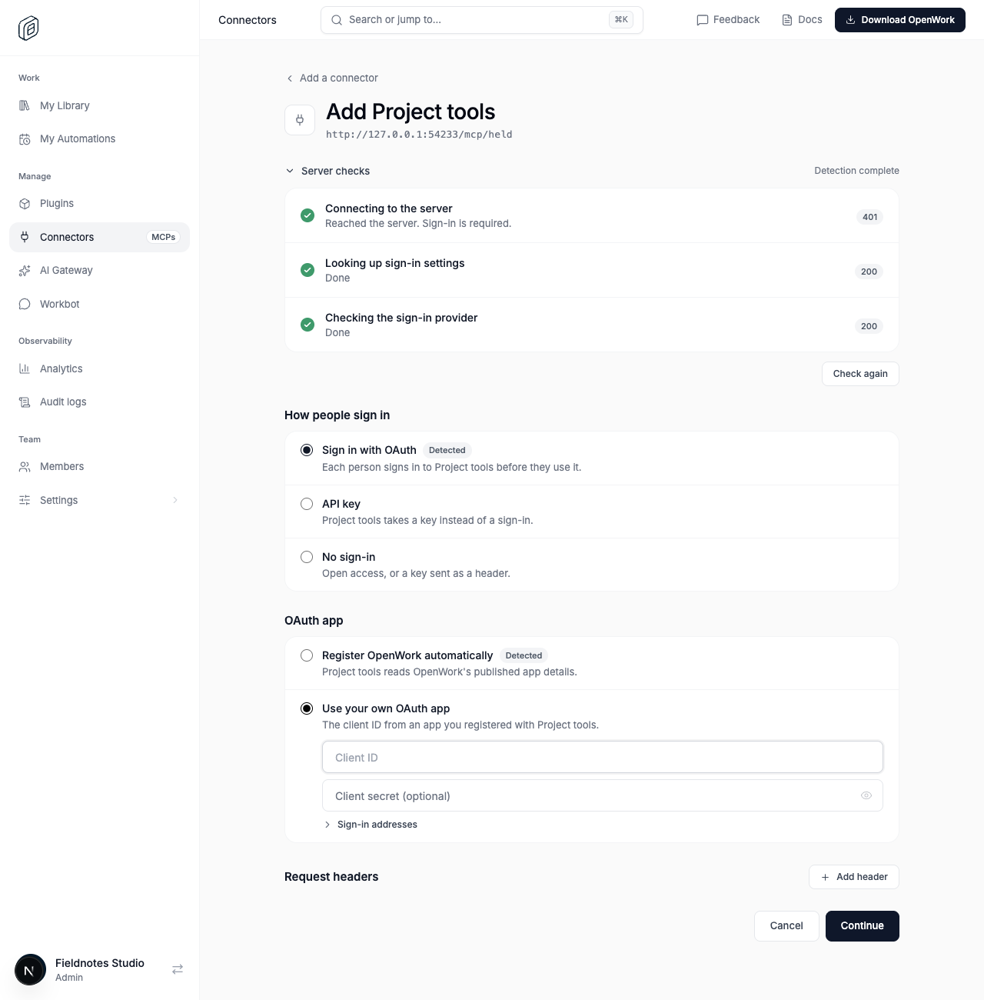
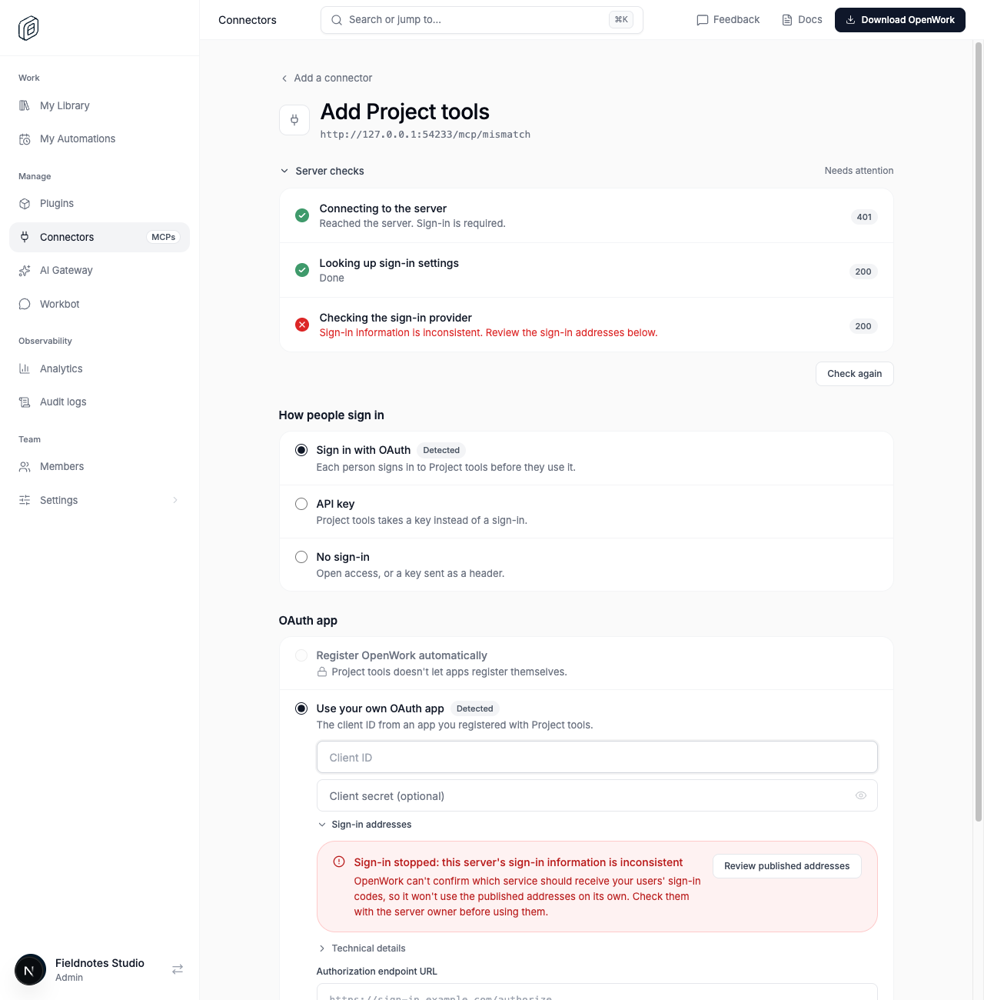

# Live checks for custom connector discovery

Feature key: `customConnectorDiscoveryChecks` · Deployments: cloud and self-hosted · Default: off · Author: @benjaminshafii

## What changes

Admins adding a custom MCP address see actual network-backed progress inline with the authentication choices:

1. Connecting to the server.
2. Looking up sign-in settings (protected-resource metadata).
3. Checking the sign-in provider (strict authorization-server metadata validation).

A 401/403 authentication challenge can be a successful server-reachability result. HTTP 200 alone is not a successful metadata check: an issuer mismatch stays failed and visible. Anonymous servers show later phases as not needed when appropriate. Completed checks collapse under Server checks; failures remain expanded. No synthetic progress timers or extra probes are used.

Admins can still choose another authentication route or their own OAuth app, add request headers, and Check again using the header draft. Detection never registers a client or signs anyone in.

## Screenshots from the real Den proof

## Rollout and kill switch

Enable for a test organization in `/admin`. With the feature off, existing JSON discovery and the existing route-choice UI stay unchanged. The new `/v1/mcp-connections/discover/stream` endpoint returns the canonical feature-disabled response. A browser encountering that response or an older API falls back to JSON discovery without inventing phase results. Existing connections, credentials, headers and OAuth sessions are untouched.

The stream uses the same org checks, guarded network transport, secure header rules and caller-result filtering as ordinary discovery. Only allowlisted stage IDs, states, safe reason codes and HTTP status numbers are streamed as progress; no raw URLs, headers, body snippets, tokens or provider exception text are included. Disconnect cancels the discovery; the browser also aborts stale requests and limits the whole attempt to 20 seconds.

## Verification

`evals/proofs/custom-connector-discovery-checks.proof.test.ts` uses a real HTTP fixture upstream and real Den/browser path. It demonstrates feature off, an early 401 result while provider metadata is held, completion, editable auth options, header-aware retry, and HTTP-200 issuer mismatch rejection. Focused package/API tests cover streaming and abort/security boundaries; frontend tests cover parsing and display states. The proof also verifies the feature-disabled endpoint returns 404 and a retry preserves an inferred own-client credential draft.

Anonymous live discovery smoke checks against Linear and GitHub returned server 401 → resource 200 → provider 200. DeepWiki returned server 200, with sign-in phases not needed. These checks did not register OAuth clients or authenticate provider accounts.

## Watch

Failed/aborted streams, discovery timeouts, metadata mismatch checks, and proxy buffering. A phase must never appear complete until its underlying validation finishes. Missing traces fall back to unavailable details rather than inferred green checks.
