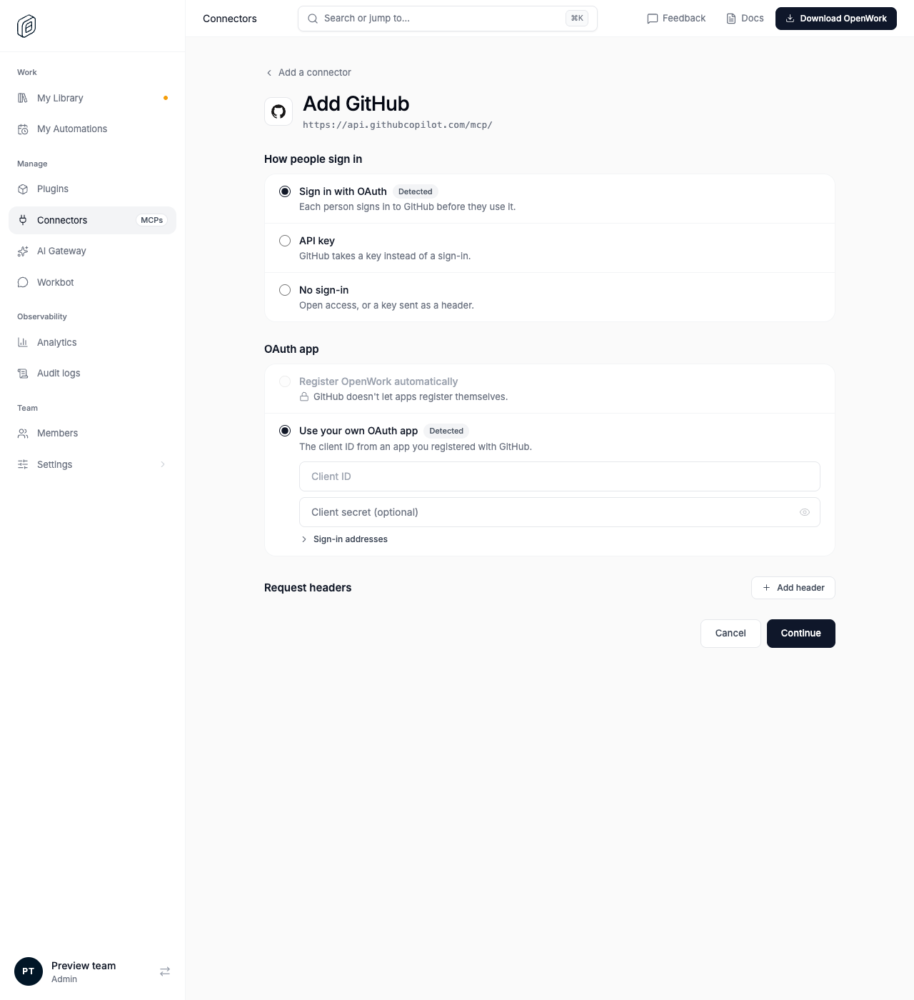

# Choose how a custom MCP signs in

Feature key: `customConnectorRoutes` · Deployments: cloud and self-hosted · Default: off · Author: @benjaminshafii

## What people get

When an admin adds a custom MCP server by address (Manage › Connectors › Add
another MCP), Den first shows how it detected the server signs in, marks the
detected options **Detected** and preselects them:

- How people sign in: Sign in with OAuth, API key, or No sign-in.
- OAuth app: Register OpenWork automatically, or Use your own OAuth app (client
  ID and secret inline). When the server allows neither automatic method, the
  automatic option is shown locked with the reason.
- Request headers: up to four name and value pairs. Values are stored
  encrypted, sent only to the MCP server's address, and never shown again.

The admin can take any route, then the usual setup checks run with it.

## Turning it off

The custom address goes straight to the setup checks, as before. Connections
already added keep their sign-in settings and request headers, and headers
are still sent. Catalog presets are never affected.

## How to try it

Turn it on for an organization in `/admin`, then add a custom MCP address,
e.g. `https://mcp.deepwiki.com/mcp` (no sign-in), `https://mcp.linear.app/mcp`
(OAuth, automatic registration) or `https://api.githubcopilot.com/mcp/` (your
own OAuth app).

## What to watch

Setup checks that fail after a route that differs from the detected one, and
`invalid_request` 400s on `requestHeaders` from `/v1/mcp-connections`.
