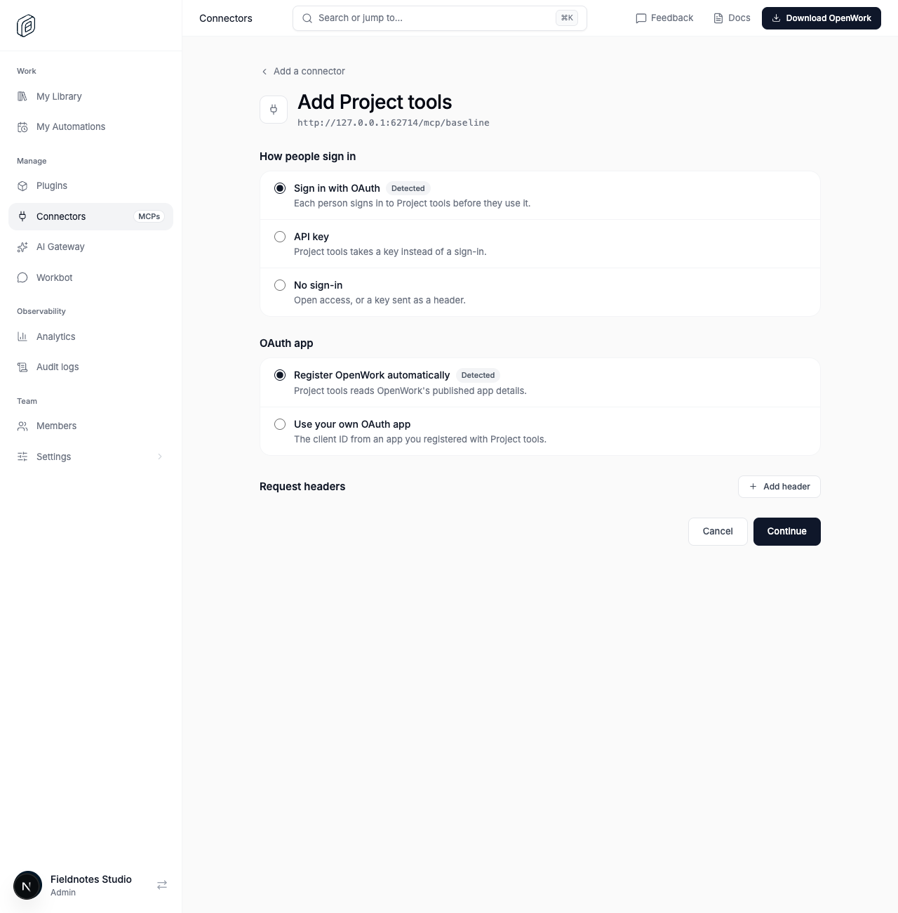
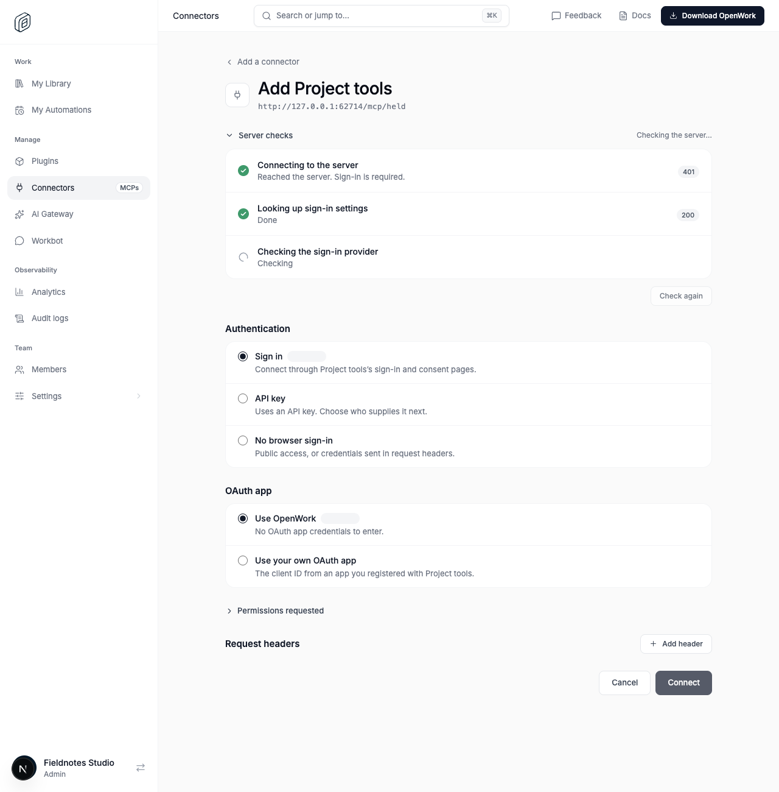
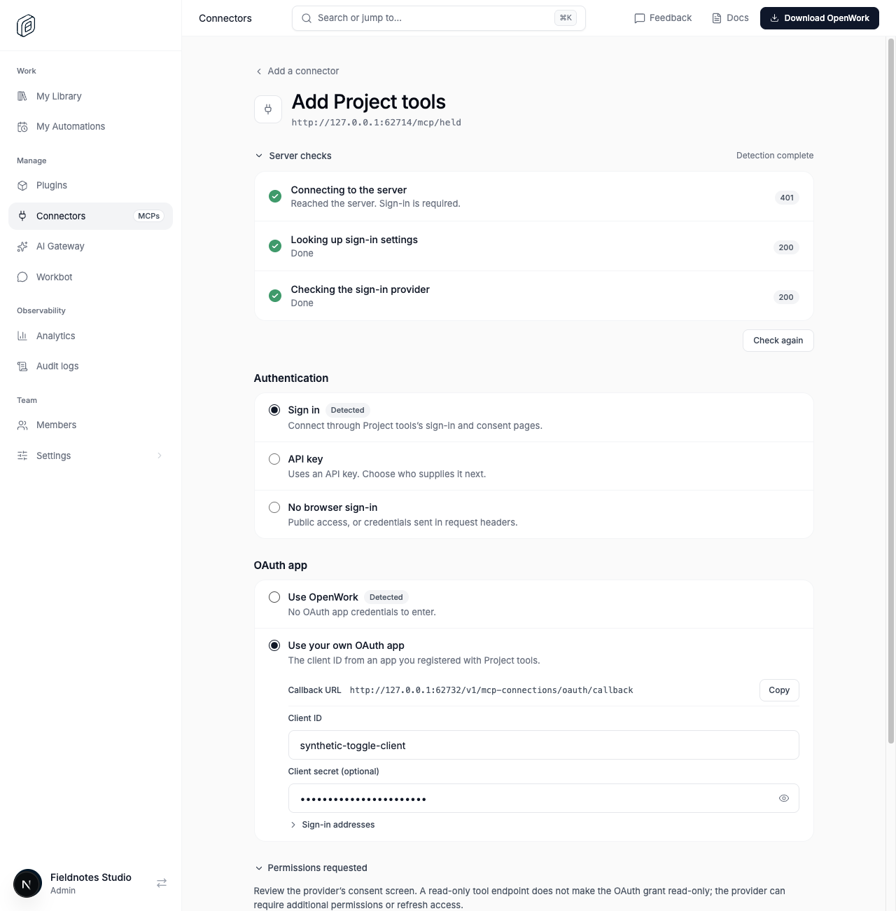
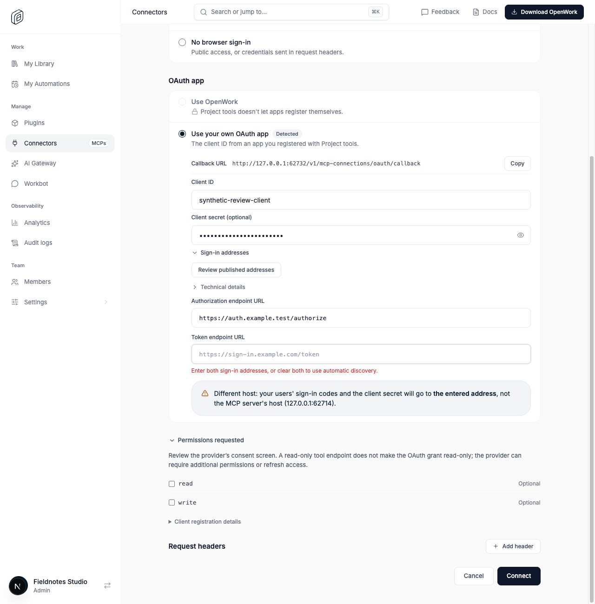
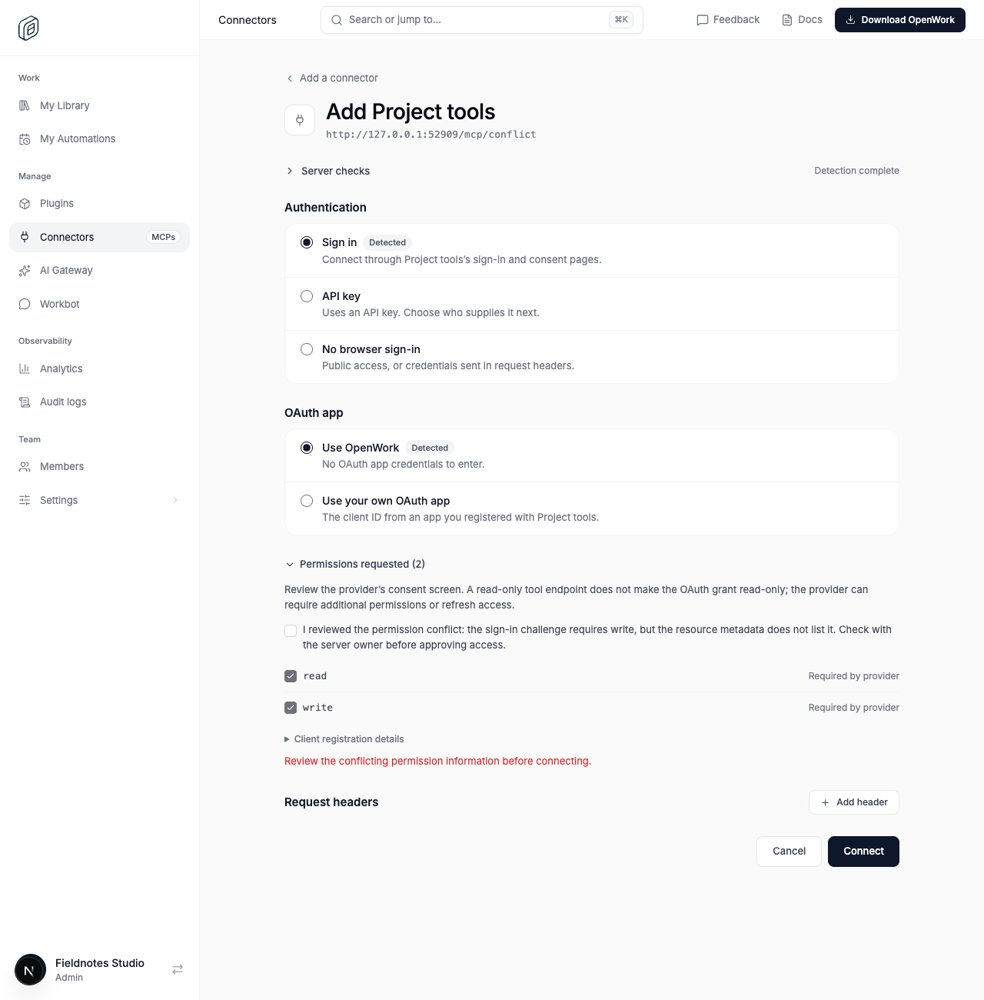
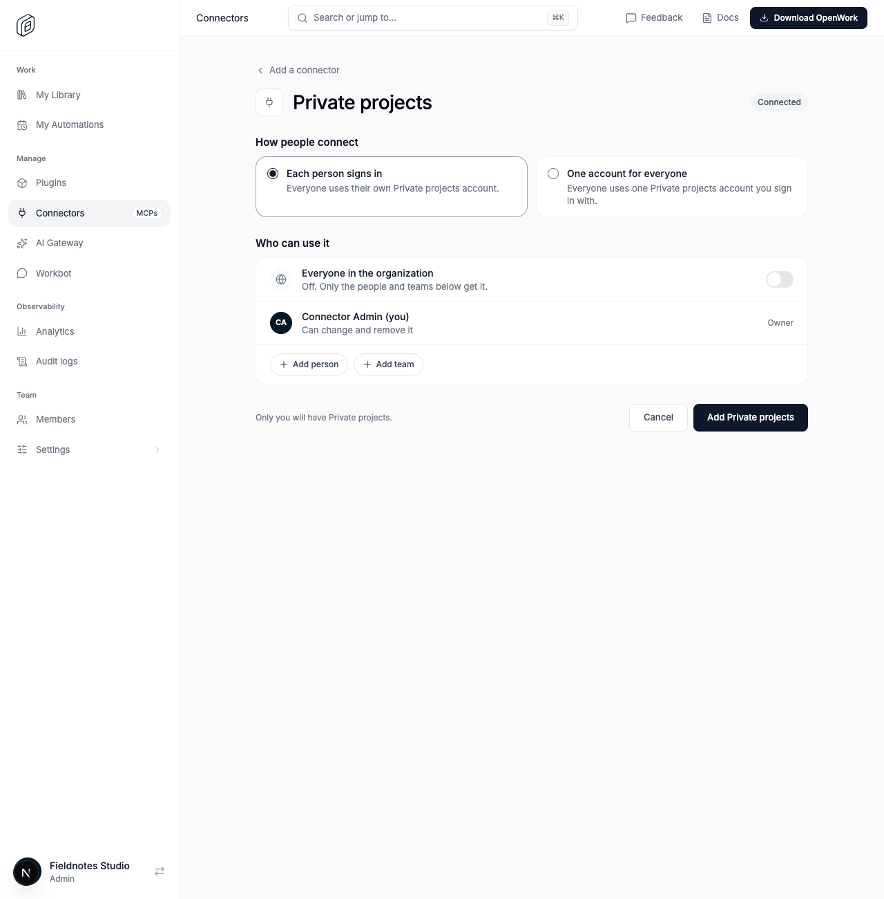
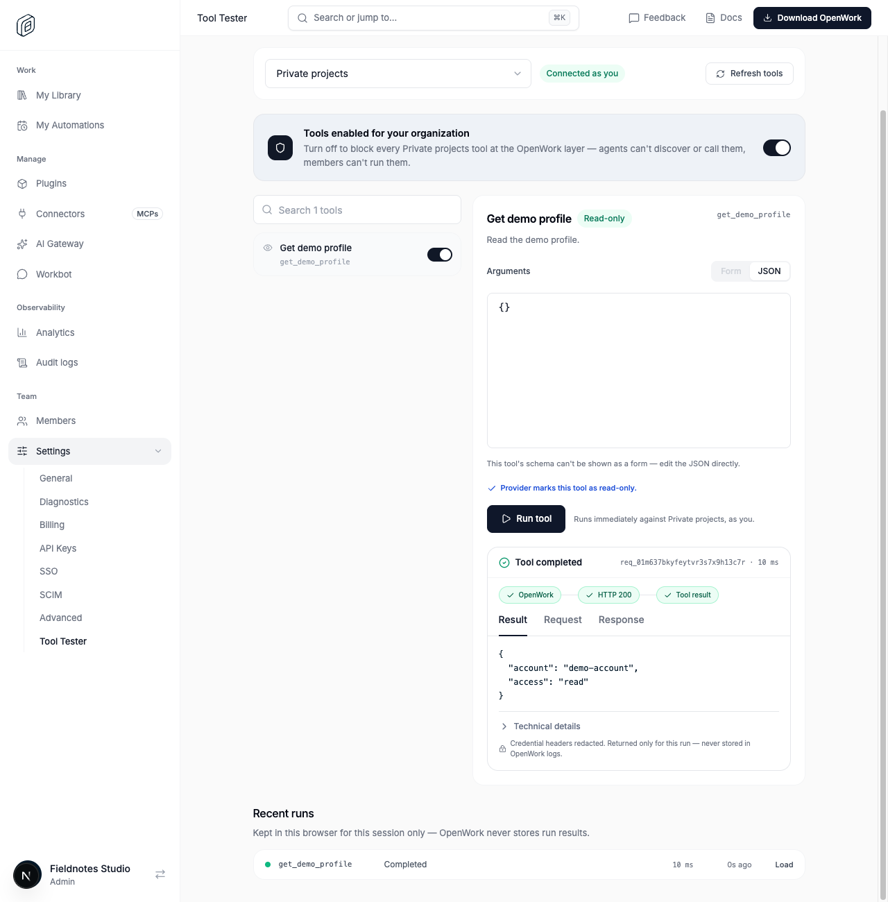
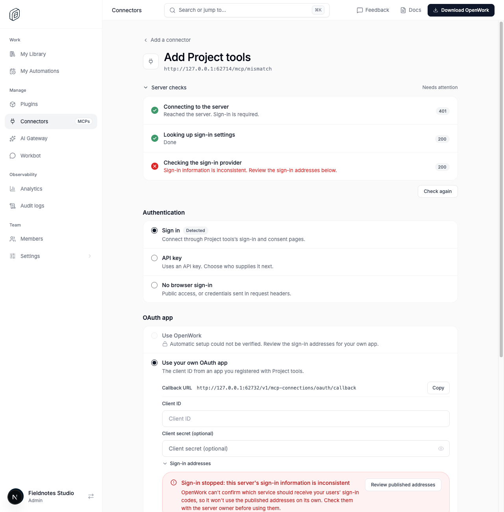
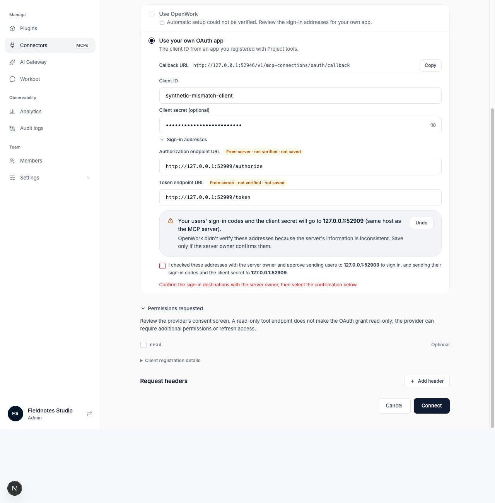

# Revised custom connector setup

> **GA:** Available without a feature flag. The former rollout key is retired.
> Off/on screenshots below are historical comparisons, not current deployment options.

Retired rollout key: `customConnectorSetup` · Deployments: cloud and self-hosted · Status: generally available (no flag) · Author: @benjaminshafii

The live discovery checklist, revised custom-MCP setup and meaningful Tool Tester results are generally available. There is no CIMD/DCR rollout or selector.

## What changes

1. **Check the address.** Actual server, protected-resource and sign-in-provider results stream inline. A 401 challenge can pass reachability; an HTTP 200 with inconsistent issuer metadata fails. Missing optional OAuth metadata on a manual-key server is shown as unavailable, not a verified OAuth success.
2. **Choose authentication.** Sign in, API key, or No browser sign-in (anonymous access or credentials in request headers). Account-sharing mode is chosen later, not assumed by this label.
3. **Choose the client when needed.** Use OpenWork keeps CIMD/DCR selection automatic, with the detected method under registration details. Your own OAuth app remains an explicit alternative, with persistent visible labels and a copyable exact callback supplied by the server's presets response. Draft credentials survive option switches and retries, but not moving to a different server or organization.
4. **Review requested permissions.** Challenge-required scopes remain required; optional advertised scopes are not all selected automatically. If no required/default scopes exist, an admin explicitly selects access rather than silently falling back to everything. Conflicting scope advertisements require review. The provider's consent page is still authoritative: read-only tool endpoints do not guarantee read-only OAuth grants.
5. **Connect.** A single Connect action opens OAuth before asynchronous work can lose the browser gesture, saves the reviewed configuration, and starts sign-in. A compact pending/recovery state replaces the four internal lifecycle rows. API keys still ask who supplies the key where that decision is necessary.
6. **Choose access.** Once authentication and tools are usable, the connector shows Connected and asks who can use it. Nothing is automatically shared with the organization.

### Manual sign-in addresses

The actual form submit handler validates both addresses, including external footer submission and Enter. Partial pairs never silently become automatic discovery. On issuer mismatch, complete reviewed endpoints and explicit destination confirmation are required. Confirmation resets if endpoints/reviewed suggestions change. Review and Undo keep their existing semantics; no published metadata is silently trusted.

OAuth creates and changed OAuth configurations also recheck strict discovery before persistence. Proven issuer mismatches fail with generic actionable guidance unless the admin supplied the existing complete manual-endpoint/own-client override. Ordinary name/access updates do not add probes. Strict SDK issuer validation always remains active.

### Tool results

Tool Tester prioritizes structured content or readable text. Complete original results, including server metadata/base64 icons, remain under Technical details. Request/response redaction and ephemeral result handling are unchanged. No remote images are loaded to render these results.

## Screenshots from the real Den proofs

Synthetic providers exercise the real Den HTTP, OAuth and browser paths; these are not mock screens.

## Availability

Generally available. The rollout flag is retired; organization/member overrides,
operator locks and old kill-switch rows no longer disable this behavior.
Authorization, provider setup, consent and runtime compatibility still apply.

## Verification

- `evals/proofs/custom-connector-discovery-checks.proof.test.ts`: default-enabled streaming checks, held metadata witness, real HTTP statuses, alternate client choice, draft retention, header-aware retry, optional/conflicting scopes, partial endpoint rejection and unconfirmed mismatch rejection.
- `evals/proofs/revised-custom-connector-flows.proof.test.ts`: confidential own-client OAuth through actual token exchange, meaningful Tool Tester result, Bearer API key, a server that genuinely requires the configured custom header, and anonymous access. It also verifies the reviewed scopes are exactly those saved and sent to the provider, and fences delayed anonymous/header saves after Edit or Cancel.
- `ee/apps/den-api/test/api/mcp-custom-oauth-setup.api.test.ts`: real HTTP/disposable DB enforcement before save, unchanged-update preservation, endpoint-scoped headers and existing manual trust boundary.
- Focused frontend, package and API unit tests cover parser safety, callback/labels, endpoint policy, consent reset, scopes and structured/text/binary result presentation.

Anonymous live discovery probes against Linear and GitHub returned 401 → 200 → 200. DeepWiki returned server 200, with sign-in phases not needed. These probes do not prove authenticated provider use. The prior GitHub tutorial completed real own-client OAuth; updated preview runs must register their own exact callback URL.

## Review decisions / limits

- **CIMD vs DCR stays automatic.** Adding a troubleshooting picker would introduce a decision most admins cannot usefully make. Registration details explain what was detected; own-client fallback remains available.
- **Provider access remains provider-controlled.** Required challenge scopes are not silently stripped; the SDK can add refresh scope or reject contradictory advertisements. Do not promise narrower consent or successful read-only OAuth against conflicting provider metadata.
- **Provider approval/login pages remain real.** The pending screen explains the account/workspace step rather than implying the first approval completed connection.
- **Loading:** the route no longer uses an unconditional null fallback in this rollout; a layout-matching connector skeleton preserves continuity. Latency-specific flashes still merit observation.
- **Security:** no new credential storage or logging. Abort/stale-event fencing remains; editing/canceling an unfinished OAuth attempt closes its tab and invalidates that attempt before late results can replace the current setup.

### CI regression checks

The Vercel filtered install includes `@openwork/enterprise-mcp-client` as a declared Den web dependency. The browser form imports its narrow `manual-oauth` export, not the server runtime or an undeclared relative source path. A clean filtered install reproduced the original missing-`zod` build failure; the same production build passes with this dependency declared.

Permission and destination confirmations use the shared Base UI checkbox, retaining checked/disabled state and label/keyboard semantics. Both connector browser proofs were rerun after this change. UI guardrails pass without baseline changes (DESIGN.md P5, V1, V2).

## Watch

Aborted/buffered streams, mismatched metadata, permission conflicts, unexpected broad consent, rejected manual endpoints, callback-origin mistakes and abandoned drafts. A green HTTP badge is never substituted for strict metadata validation or a completed account grant.
