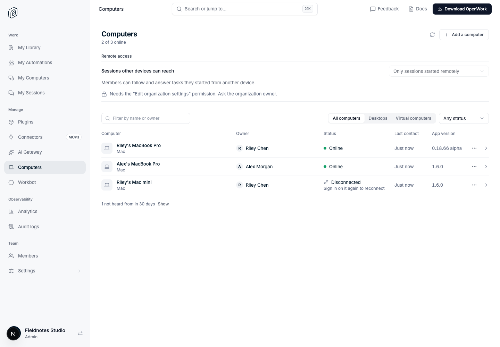
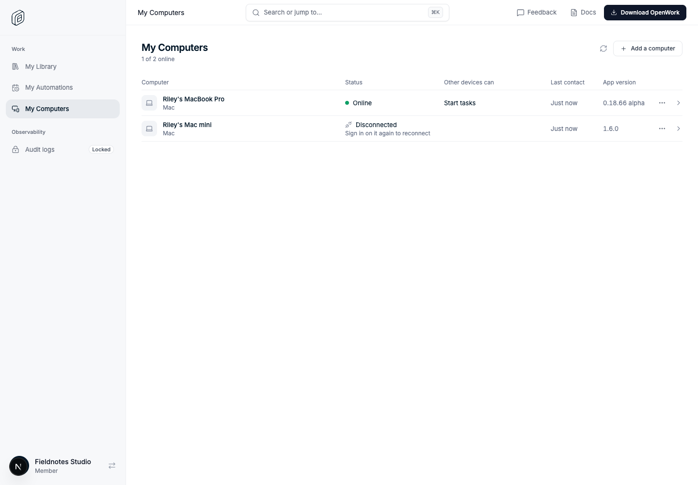

# Den: grey sidebar, white pages

Status: generally available; `denGreySidebar` was retired in November 2026 · Deployments: cloud and self-hosted · Author: @benjaminshafii

## What changes

The Den dashboard shows its sidebar on a light grey band and every page on
white, like the admin dashboard pictured on the website. The selected
navigation item is set in medium weight.

## Try it

Open any dashboard page.

## Code

- `ee/apps/den-web/app/globals.css`: the shell's colour tokens, set under
  `[data-den-shell]`.
- `ee/apps/den-web/app/(den)/dashboard/_components/org-dashboard-shell.tsx`:
  sets `data-den-shell` on the shell and uses the tokens.
