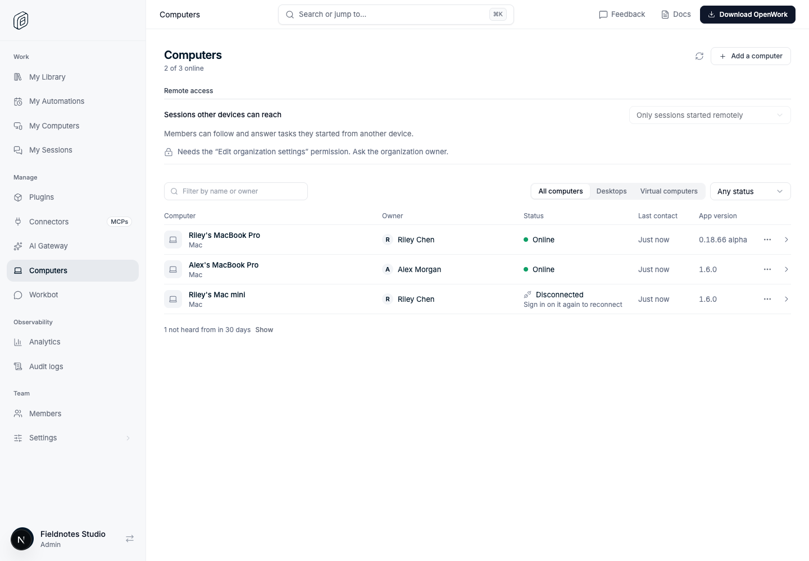
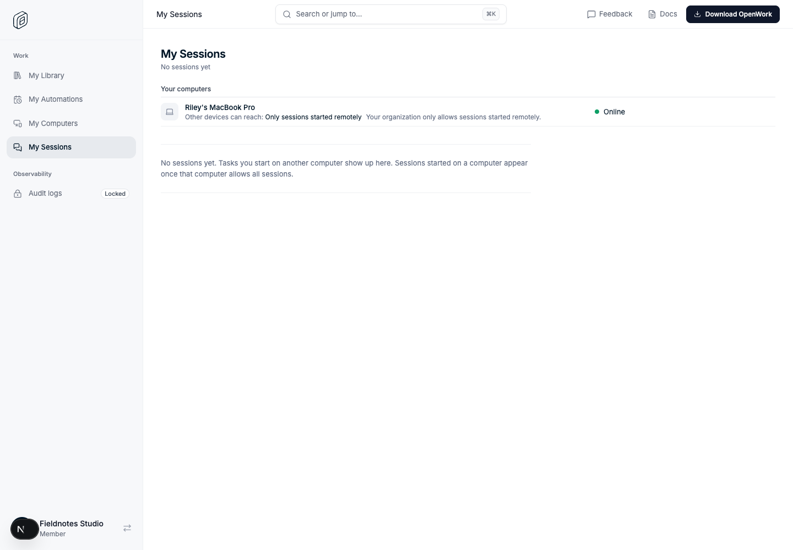

# Den: grey sidebar, white pages

Feature key: `denGreySidebar` · Deployments: cloud and self-hosted · Default: off · Author: @benjaminshafii

## What changes

The Den dashboard shows its sidebar on a light grey band and every page on
white, like the admin dashboard pictured on the website. Without the feature
the sidebar is white and pages sit on a lightly tinted canvas, as before.

Only colours change. Navigation, page layouts and every control stay where
they are. With the feature on, the selected navigation item is also set in
medium weight.

## Try it

Turn `denGreySidebar` on for an organization and open any dashboard page.

## Turning it off

Turn the feature off (or use its kill switch). The earlier colours come back
on the next load. Nothing is stored for it except, per browser, the last
appearance seen, so a reload paints the right colours before the organization
has loaded.

## Code

- `ee/apps/den-web/app/globals.css`: the shell's colour tokens. Their default
  values are the earlier colours; `[data-den-shell="grey"]` swaps them.
- `ee/apps/den-web/app/(den)/dashboard/_lib/den-shell-appearance.ts`: decides
  the mark from the organization's features.
- `ee/apps/den-web/app/(den)/dashboard/_components/org-dashboard-shell.tsx`:
  sets `data-den-shell` on the shell and uses the tokens.
- Verified in `evals/proofs/den-computer-disconnect.proof.test.ts` (the mark
  appears with the feature and goes away without it).
