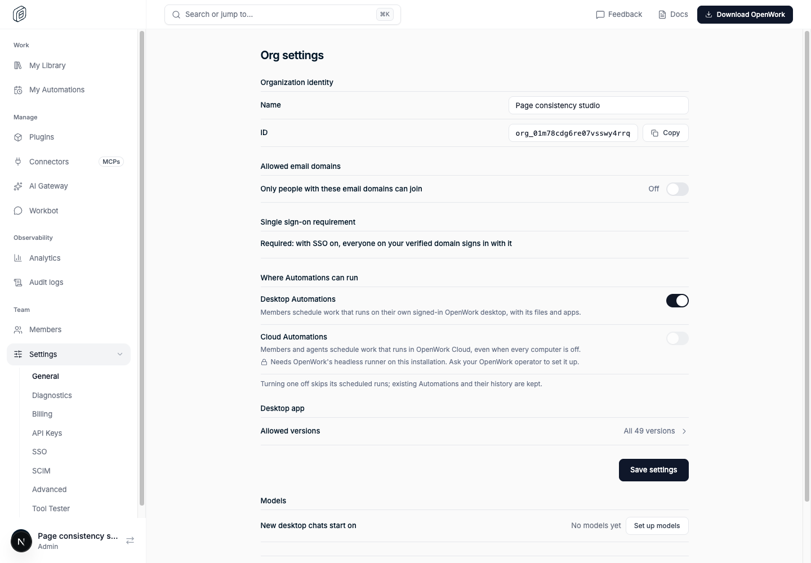
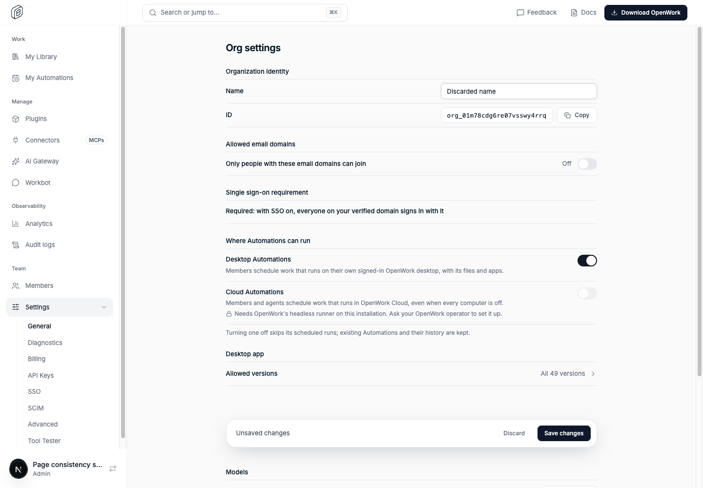

# Predictable Den page interactions

> **Generally available:** `denPageConsistency` is retired; its enabled behavior is standard on Cloud and self-hosted. Actual settings, permissions, billing rules and consent remain enforced. Rollout/off-state instructions below are historical; see [the retirement guide](../globally-enabled-retirement/README.md).

- **Feature:** `denPageConsistency`
- **Deployments:** cloud and self-hosted
- **Owner:** `benjaminshafii`
- **Default:** off

This flag controls interaction changes, not the visual polish. Compact rows, shared cards, aligned headers and centred detail columns do not change permissions or saved data and ship independently.

## On

- Audit filter changes apply immediately, with debounced exact-ID search. Advanced date/actor/origin filters stay behind Filters. Invalid ranges show feedback and do not issue a query.
- Organization settings show Save changes and Discard only while there are unsaved changes. Discard restores the last saved settings without writing. A background refresh does not erase an in-progress draft.
- A team's page offers Edit team, opening the existing Members editor. Read-only/SCIM-managed teams show why editing is locked; existing server permissions still apply.
- Analytics no longer offers Workflow Runs in its normal tab strip. Existing deep links still open the run-history page and identify the active tab. Runs on each workflow's own page are unchanged.

## Off / kill switch

- Audit filters require Apply filters.
- Organization settings retain the persistent Save settings action and no Discard action.
- Team pages use the existing editing entry points in Members rather than the additional page action.
- Workflow Runs returns to normal Analytics navigation.

No resources or run history are removed. Nothing changes in the API's permission checks. Switching off does not cancel submitted saves or discard unsaved settings; the persistent save action remains usable.

## Try it

Enable the feature for a test organization in platform `/admin`. Compare an opted-out member with the enabled owner. Edit a name, discard it, save another name and reload; compare explicit and immediate audit filters; open Edit team as an owner and inspect a read-only teammate. Open the old Workflow Runs link with the flag on and off.

`evals/proofs/den-page-interactions.proof.test.ts` covers these paths with synthetic identities and a member override. `evals/proofs/den-page-consistency.proof.test.ts` covers row geometry and wide/phone layouts.

## Screenshots

The feature-off settings page keeps its persistent save action:

The enabled owner gets a dirty-only save bar:

## Watch

Check failed settings saves, audit query errors, feature usage and customer navigation feedback during organization-by-organization rollout. Do not turn the feature on globally as part of publishing this PR.
