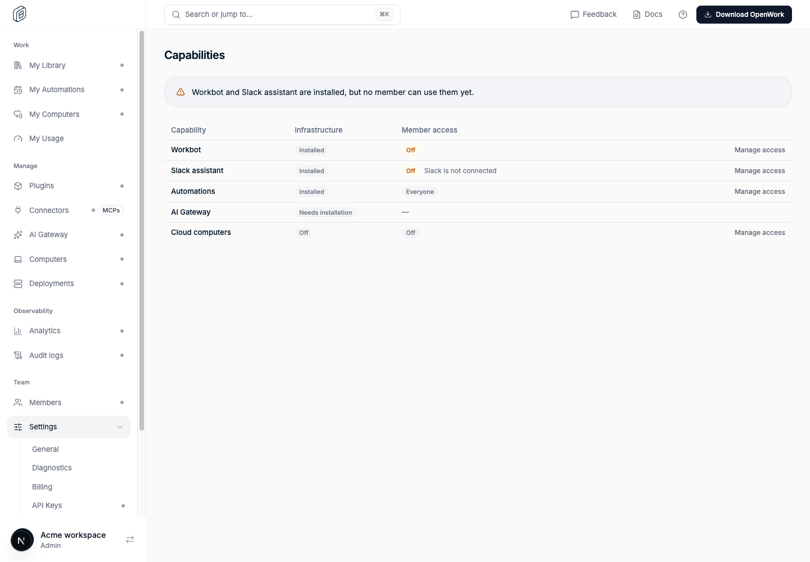
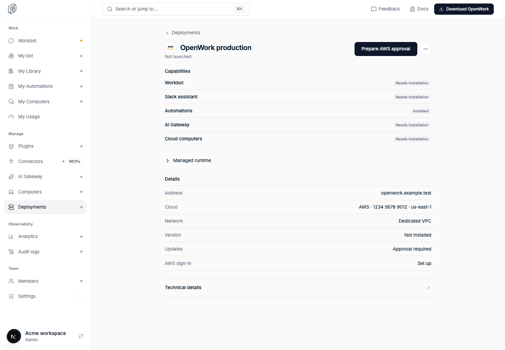
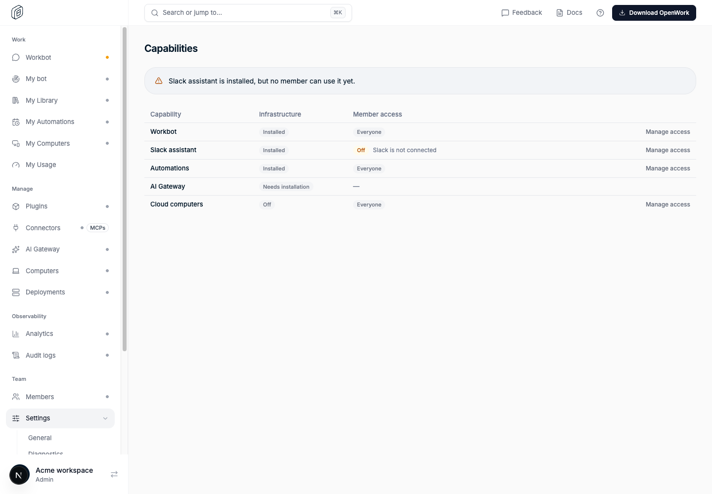
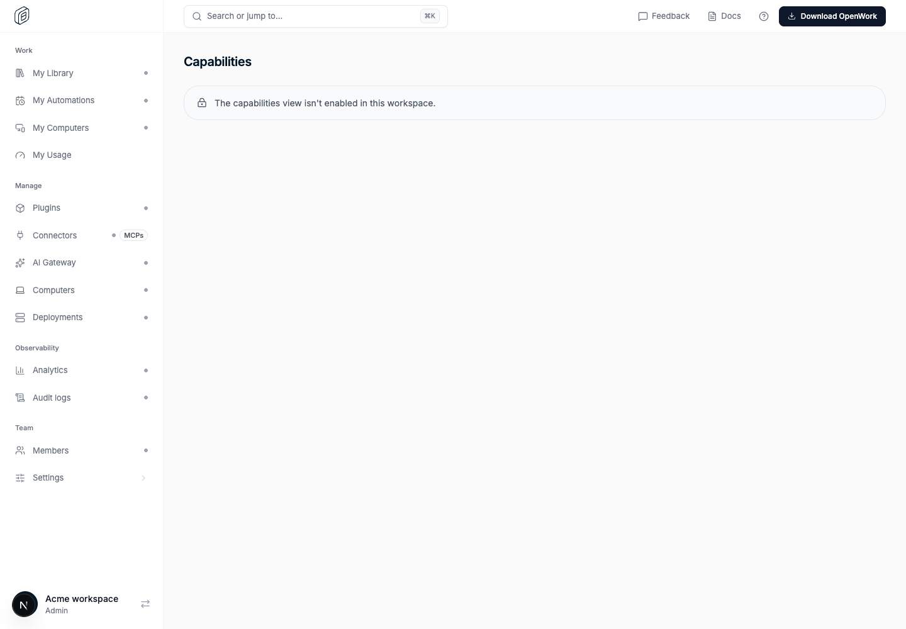

# Capabilities view (`deploymentCapabilitiesView`)

- **Feature key:** `deploymentCapabilitiesView`
- **Deployments:** cloud and self-hosted, off by default
- **Owner:** `benjaminshafii`

## What it is

Settings › Capabilities in Den lists the five things a deployment can do:
Workbot, the Slack assistant, Automations, the AI Gateway and cloud computers.
Each row answers two separate questions.

| Column | Question | Values | Source |
| --- | --- | --- | --- |
| Infrastructure | Is it installed on this deployment? | Installed, Off, Needs installation, Not available | `deploymentCapabilities.capabilities` in `GET /v1/org` |
| Member access | Which members of this organization may use it? | Everyone, Selected teams, Selected members, Off | The organization setting that decides it |

A capability that is installed is not necessarily on for members. Den reports
Workbot as installed whenever its service and the runner are configured, which
is true for every organization on that deployment, including one whose Workbot
switch is off. The page shows both columns side by side, and names every
capability that is installed while no member may use it.

Member access is read from the setting that decides it:

| Capability | Member access comes from | Manage access opens |
| --- | --- | --- |
| Workbot | The organization's Workbot switch and each team's own choice | Members › Teams › Everyone › Workbot |
| Slack assistant | The Slack connector: connected, the assistant installed and on, and who the connector is shared with | The Slack connector |
| Automations | Where the organization lets Automations run (desktop, cloud) | Settings › General |
| AI Gateway | Who a usable model group is shared with | AI Gateway › Users and teams |
| Cloud computers | The same people as Workbot, because members use computers from Workbot | Members › Teams › Everyone › Workbot |

A source the person may not read shows a lock and the permission it needs. A
source that fails to load says so. Neither reads as Off.

On a managed deployment's page, the same list shows what that deployment is
recorded to have, from `GET /v1/managed-deployments/{deploymentId}/capabilities`.
It has no member access column: access is set inside the installed deployment.

Once Workbot is on for everyone, its row reads Everyone and it leaves the
warning. Cloud computers follow it.

With the feature off, the page says so and Settings does not list it.

## Try it

1. In `/admin`, turn on `deploymentCapabilitiesView` for an organization.
2. Open Settings › Capabilities as an organization admin.
3. Turn Workbot off for everyone in Members › Teams › Everyone › Workbot and
   reload: Workbot stays Installed and its member access reads Off.

## Turning it off

The page and the deployment list disappear. No setting changes.
