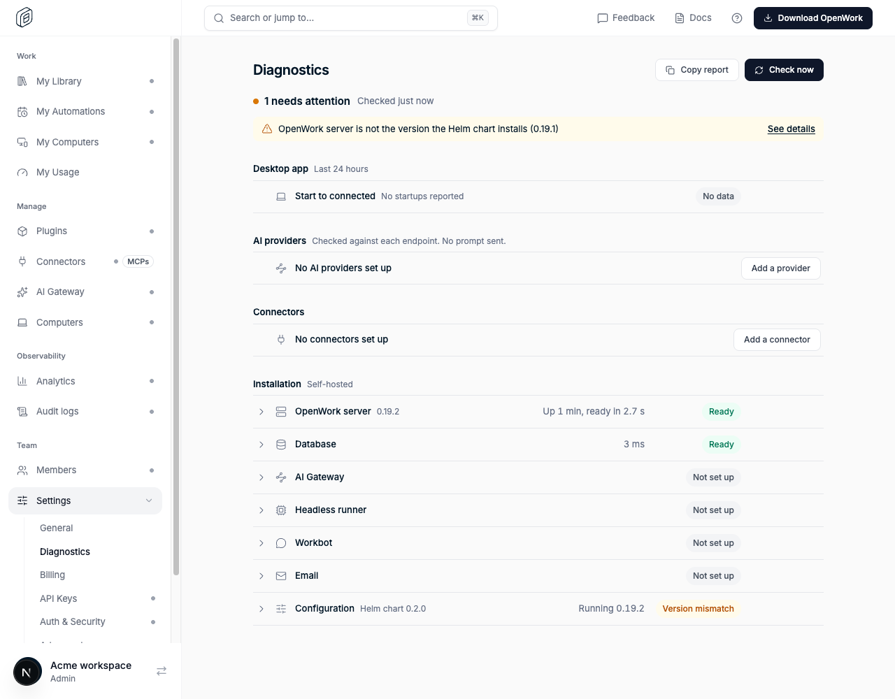
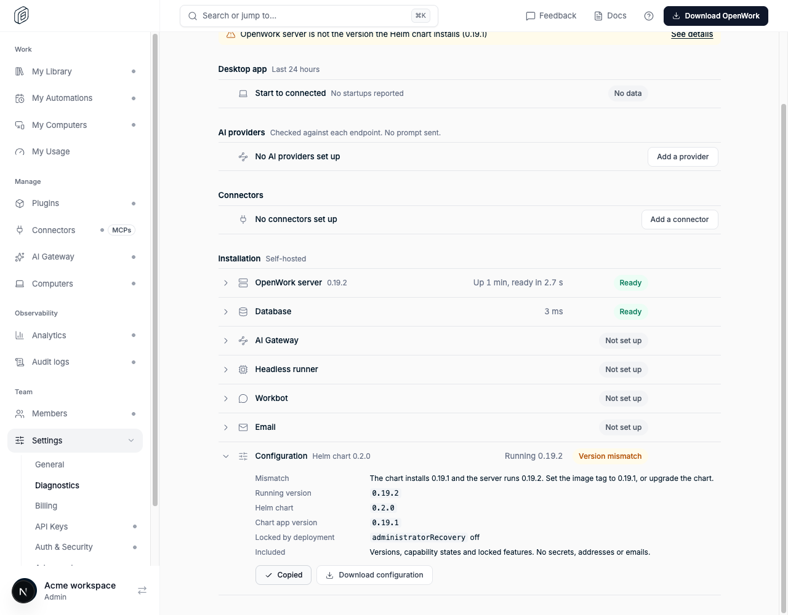

# Diagnostics: installation configuration (`diagnosticsConfigExport`)

- **Feature key:** `diagnosticsConfigExport`
- **Deployments:** self-hosted only, off by default
- **Owner:** `benjaminshafii`

## What it is

On a self-hosted install, Settings › Diagnostics gets a Configuration row in
the Installation section. Only installation administrators see it. It answers
the first questions support asks about an install whose deployment settings we
cannot see: which version is running, which version the Helm chart was written
for, and which features the deployment locks.



| Shown | Source |
| --- | --- |
| Running version | The version built into the server image |
| Helm chart, Chart app version | `OPENWORK_HELM_CHART_VERSION` and `OPENWORK_HELM_APP_VERSION`, which the chart sets |
| Version mismatch | The chart names an app version and the server runs a different one |
| Locked by deployment | Features the deployment sets on or off (`config.features` in the chart) |

A mismatch shows an amber badge on the row before it is opened. It happens
when an override pins an image tag that the chart was not written for.

Copy configuration and Download configuration produce one JSON file to send to
support:

```json
{
  "kind": "openwork.installation-config",
  "version": 1,
  "generatedAt": "2026-11-25T06:30:00.000Z",
  "deployment": "self_hosted",
  "appVersion": "0.19.2",
  "helmChartVersion": "0.2.0",
  "helmAppVersion": "0.19.1",
  "versionSkew": true,
  "deploymentCapabilities": [{ "id": "workbot", "state": "needs_infrastructure", "reason": "dependency_not_installed" }],
  "lockedFeatures": { "administratorRecovery": false }
}
```



## What the file can contain

Versions, the five capability states with their fixed reason codes, feature
keys and booleans. Nothing else has a field:

- A version must look like a release (`1.2.3`, `1.2.3-rc.1`), `dev` or
  `commit 1a2b3c4`. Any other text in a version variable is dropped, and the
  running version reads `unknown`.
- Capability states and reasons are fixed codes.
- Locked features are registry keys with `true` or `false`.

No secret, token, address, email or raw value of a setting is read into it.
`ee/apps/den-api/test/api/diagnostics-config.api.test.ts` starts Den with
secrets set and checks none of them appear.

## Who gets it

| Caller | `installation` in `GET /v1/org/diagnostics?include=config` |
| --- | --- |
| Self-hosted installation administrator | `operator`, with `config` |
| Organization owner, admin or member who is not one | `locked`, no `config` |
| Anyone on OpenWork Cloud | `managed`, no `config` |

Den adds `config` only when the request asks with `include=config`. Without
it the answer is unchanged, so a Den Web that is older than the server keeps
reading it.

## Try it

1. Set `config.features.diagnosticsConfigExport: "true"` in the chart values,
   or turn it on for the organization in `/admin`.
2. Sign in as an installation administrator (an address in
   `DEN_BOOTSTRAP_ADMIN_EMAILS`) and open Settings › Diagnostics.
3. Open Configuration, then copy or download it.

Without the chart the row still shows the running version and the locked
features, with no chart versions and no mismatch badge.

## Turning it off

The row disappears and Den Web stops asking for `config`. Diagnostics and the
existing Copy report button are unchanged. Nothing is stored.

## What to watch

`/admin` › Features shows who copied or downloaded a configuration. A report
of `unknown` as the running version means the image was built without a
release version.
