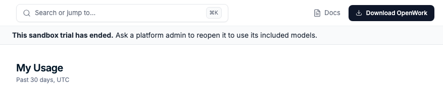

# Ended sandbox notice

Members see "This sandbox trial has ended" above chat in OpenWork and at the top of the organization dashboard when a trial expires or a platform admin closes it. Existing conversations and navigation stay accessible. A platform admin can reopen the trial in **Admin → Sandboxes**. An open app refreshes the notice within a minute while in the foreground.

The `endedSandboxNotice` feature defaults off on cloud and self-hosted deployments. Enable it for a test organization in **Admin → Organizations → the test organization → Features** to try it, or turn it off to remove the notice. The flag controls the indicator only. The feature owner is reachjalil.
