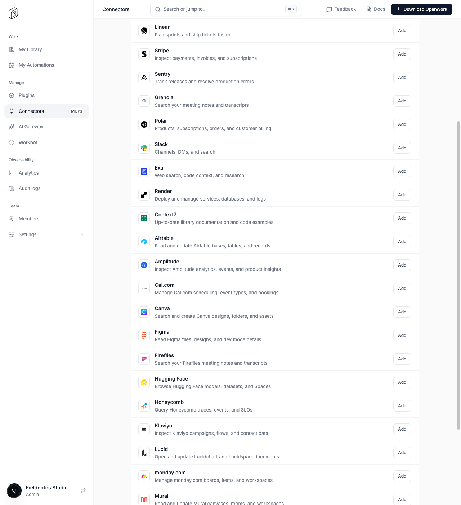
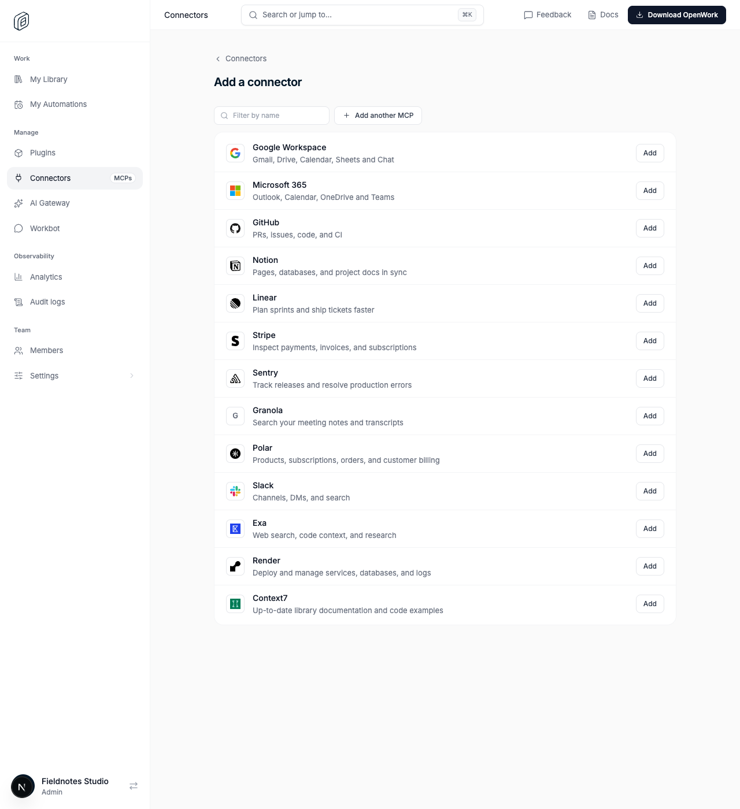

# More MCP server presets

> **GA:** Available without a feature flag. The former rollout key is retired.
> Off/on screenshots below are historical comparisons, not current deployment options.

Retired rollout key: `expandedMcpPresets` · Deployments: cloud and self-hosted · Status: generally available (no flag) · Author: @benjaminshafii

## What people get

Admins see more reviewed official MCP servers to add
with one click in Manage › Connectors, alongside the existing presets
(Notion, Linear, Stripe, Sentry, Granola, Polar, Slack, Exa, Render, GitHub,
Context7). The new presets:

- Airtable — `https://mcp.airtable.com/mcp` (OAuth)
- Amplitude — `https://mcp.amplitude.com/mcp` (OAuth)
- Cal.com — `https://mcp.cal.com/mcp` (OAuth)
- Canva — `https://mcp.canva.com/mcp` (OAuth)
- Figma — `https://mcp.figma.com/mcp` (OAuth)
- Fireflies — `https://api.fireflies.ai/mcp` (OAuth)
- Hugging Face — `https://huggingface.co/mcp` (OAuth)
- Honeycomb — `https://mcp.honeycomb.io/mcp` (OAuth)
- Klaviyo — `https://mcp.klaviyo.com/mcp` (OAuth)
- Lucid — `https://mcp.lucid.app/mcp` (OAuth)
- monday.com — `https://mcp.monday.com/mcp` (OAuth)
- Mural — `https://mcp-canvas.mural.co/mcp` (OAuth)
- PostHog — `https://mcp.posthog.com/mcp` (OAuth)
- Semgrep — `https://mcp.semgrep.ai/mcp` (OAuth)
- Tavily — `https://mcp.tavily.com/mcp` (API key from app.tavily.com)
- Vercel — `https://mcp.vercel.com` (OAuth)

Each OAuth preset uses the same CIMD/DCR auth pipeline as the existing presets
(`packages/enterprise-mcp-client`); no new auth path was added.

Manage › Connectors › Add a connector by default (the additional rows follow
Context7, each with its own brand mark):

Historical before GA, the list ended at Context7:

Brand marks: Airtable, Figma, Hugging Face, Lucid, Mural, PostHog and Vercel
use their Simple Icons mark (`ee/apps/den-web/app/(den)/_lib/brand-icon.ts`);
the others use the provider's own favicon.

## How to try it

Open Manage › Connectors › Add a connector. Adding a
server and signing in happens with the member's own account; nothing is
connected automatically. Proof: `evals/proofs/expanded-mcp-presets.proof.test.ts`
(default catalog and filtering).

## How it works

The reviewed core and expanded presets feed `/v1/mcp-connections/presets`,
connector capability search and resolution. `ALL_EXTERNAL_MCP_PRESETS` also
backs the existing preset authentication policy. Adding a catalog suggestion
does not authorize a connection or complete provider sign-in.

## Availability

Generally available. The rollout flag is retired; organization/member overrides,
operator locks and old kill-switch rows no longer disable this behavior.
Authorization, provider setup, consent and runtime compatibility still apply.

## What this is not

- Not a proof that every listed provider accepts OpenWork as an OAuth client.
  The preset URLs and their OAuth protected-resource metadata were verified by
  probing the public `/.well-known/oauth-protected-resource` endpoint;
  advertisement is not a successful connection. A real sign-in still requires
  the member to take over OAuth for their own account.
- Not an import of a third-party MCP registry. The list is a reviewed subset,
  not a mirror of an external catalog.