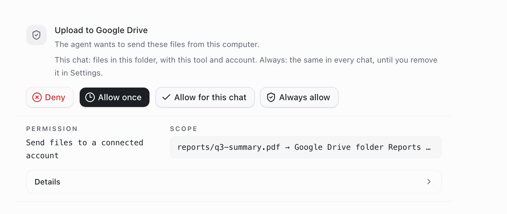
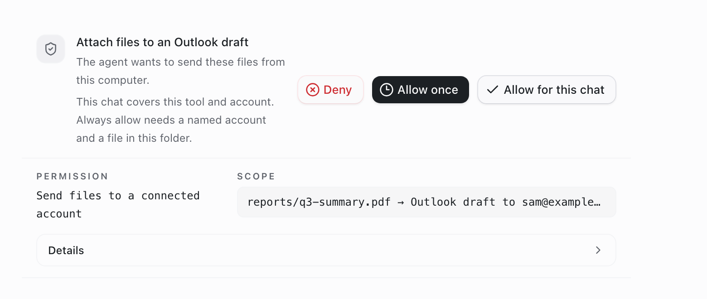
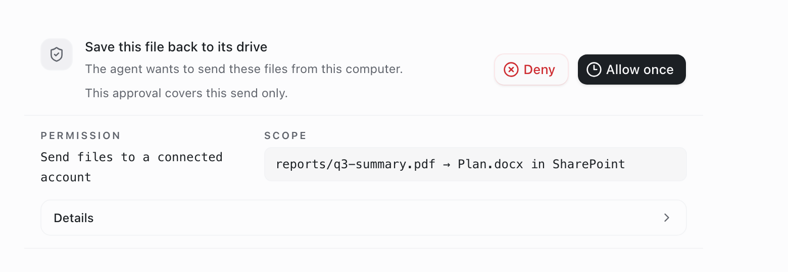
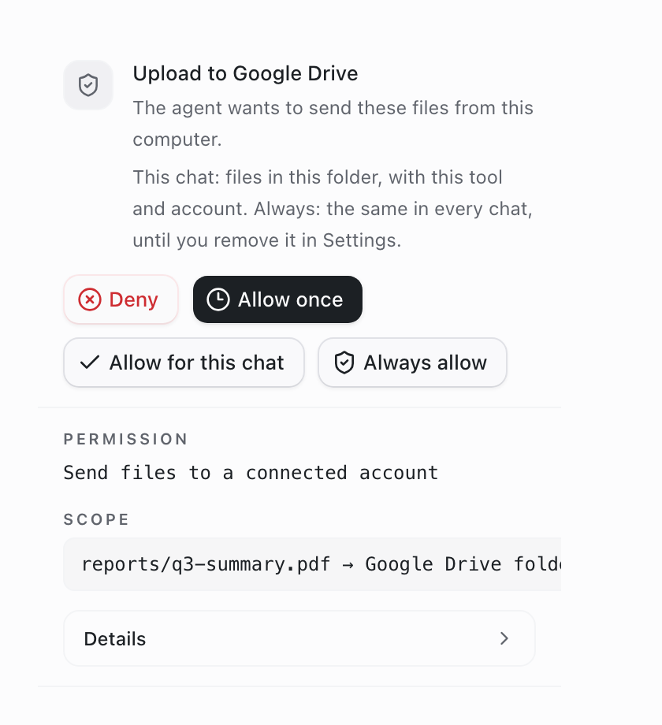
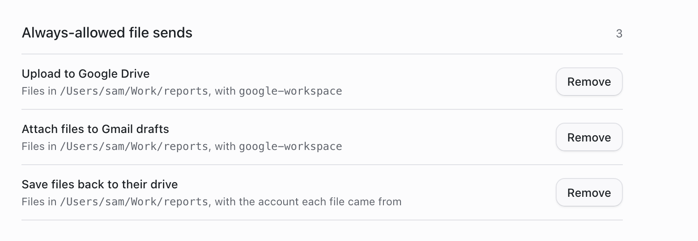

# One permission for files the agent sends to connected accounts

> **Generally available:** `fileSendPermissions` is retired; its enabled behavior is standard on Cloud and self-hosted. Actual settings, permissions, billing rules and consent remain enforced. Rollout/off-state instructions below are historical; see [the retirement guide](../globally-enabled-retirement/README.md).

- **Feature:** `fileSendPermissions`
- **Deployments:** cloud and self-hosted
- **Default:** off
- **Owner:** @benjaminshafii

Four agent tools send a file from this computer to an account the member
connected. Before this feature each had its own approval:

| Tool | Before |
| --- | --- |
| Upload to Google Drive | Chat prompt; "Allow for session" bound to one file version, folder and account |
| Save a pulled file back to Drive, OneDrive or SharePoint | Chat prompt, then a second native dialog |
| Gmail draft with attachments | Chat prompt every time |
| Outlook draft with attachments | Chat prompt every time |

None had an administrator control. With the feature on, all four go through
one approver (`apps/server/src/file-send-approval.ts`) with one permission,
`file_send`. A new tool that sends a local file joins by calling the same
approver; there is no per-tool path.

Pulling a file from a drive is not a send and is unchanged. Website uploads in
the built-in browser keep their own permission
(`docs/features/browser-upload-permissions/README.md`).

## What the member sees

The approval card offers the same choices for every tool:

| Choice | Covers | Stored |
| --- | --- | --- |
| Allow once | This send | Nothing |
| Allow for this chat | The same tool, account and agent in this chat, for files in the workspace folder | Memory, until the server restarts |
| Always allow | The same tool and named account, for files in this workspace folder, in every chat | This computer, per organization member |



The card offers only what the host can honour:

- A file outside the workspace folder can be allowed for this chat only as
  that exact file version, and only with a named account. It is never offered
  Always allow.
- A send to the default account (no account named) is Allow once only, because
  the default can change between sends.
- Saving a file back uses the account the file was pulled from.
- The Drive folder is no longer part of what is remembered: allowing uploads
  for this chat covers any folder in that account.





**Settings > Computer use > Always-allowed file sends** lists the Always
choices with Remove. The section is hidden until one exists.



These screenshots render the production React components and styles in an
isolated headless fixture with test data. They are not live-account
end-to-end evidence. The Den admin row was not captured.

## What the administrator sets

Den > Agents tab (organization or team), **Send files to connected accounts**:

| Setting | Effect |
| --- | --- |
| Member decides (default) | Ask, unless the member's chat or Always choice covers the send |
| Allow | Send without asking |
| Ask first | Ask every time; the card offers Allow once only and remembered choices are ignored |
| Block | Refuse, including sends covered by an earlier Always choice |

Teams inherit Everyone unless they override; the existing strictest-team
precedence applies.

## Enforcement and storage

- The local server decides. The engine prompt is only the surface for the
  question: each ask carries a unique `file-send-request:<id>` resource, so a
  saved engine rule can never authorize a send. `file_send` is not sent to the
  native engine permission grammar.
- Always allow: the app calls `POST /experimental/file-send/remember` with the
  open request id, then answers the prompt. Grants are JSON under the server's
  runtime storage, `file-send-grants/<hash of deployment, organization,
  member>.json`, mode 0600. They do not sync to another computer.
  `GET /experimental/file-send/grants` and `DELETE …/grants/:id` back Settings.
- The save-back native dialog is skipped only when the request carries the
  host's in-process approval marker. Other callers still get it.
- Den unreachable: if Den last answered for this organization with the feature
  on, sends are refused (`policy_unavailable`). Otherwise the previous
  per-tool behaviour applies.

Known limits:

- A remembered or administrator-allowed send does not reach the engine, so a
  path deny in a member's own OpenCode config does not stop it.
- A process holding the local server's client token could call the remember
  route to turn a pending question into an Always choice once a person answers
  it. This is the same trust level as answering engine permission prompts.
- A desktop older than this feature does not understand Block for file sends
  and keeps asking the member. Upgrade desktops before relying on Block.

## Rollout and rollback

With the feature off, or signed out, each tool keeps its previous code path;
stored admin settings and Always choices are kept but inactive. New desktop
readers and admin editors send `X-OpenWork-File-Send-Permissions: 1`, so old
editors cannot erase the setting.

Deploy Den and the desktop first, enable for one test member, and check Member
decides, Allow, Ask first and Block against a real Google and Microsoft
account. Turning the flag off restores the previous prompts; nothing is
deleted. No database migration.

No production permissions or rollouts were changed, and production has not
been queried. Before a wider rollout, check read-only:

```sql
SELECT feature_key, enabled, killed FROM feature_rollout
WHERE feature_key = 'fileSendPermissions';

SELECT decision, COUNT(DISTINCT organization_id) AS organizations
FROM agent_permission_setting WHERE permission_key = 'fileSends'
GROUP BY decision;
```

## Verification

- `apps/server/test/file-send-approval.test.ts`: every admin setting, chat and
  Always scopes, account and member separation, revoke, storage mode.
- `apps/server/test/opencode-v2-file-send-approval.test.ts`: all four tools
  through the real bridge with a fake engine; flag off keeps the old path.
- `apps/server/test/file-send-policy.test.ts`: Den-unreachable rule.
- `apps/server/test/drive-files-microsoft.test.ts`: save-back dialog skipped
  only for the approved request.
- `ee/apps/den-api/test/api/file-send-permissions.api.test.ts`: admin setting
  round trip and delivery to the desktop.
- `apps/app/tests/permission-approval-panel.test.tsx`,
  `apps/app/tests/remembered-file-sends.test.tsx`: card choices and Settings.

Not done: a live end-to-end run against real Google or Microsoft accounts.
"Always allow" through the bridge is covered only at the approver unit level.
`apps/server/test/approved-drive-upload.test.ts` "named pipes are rejected"
times out on the development Mac with and without this change.
