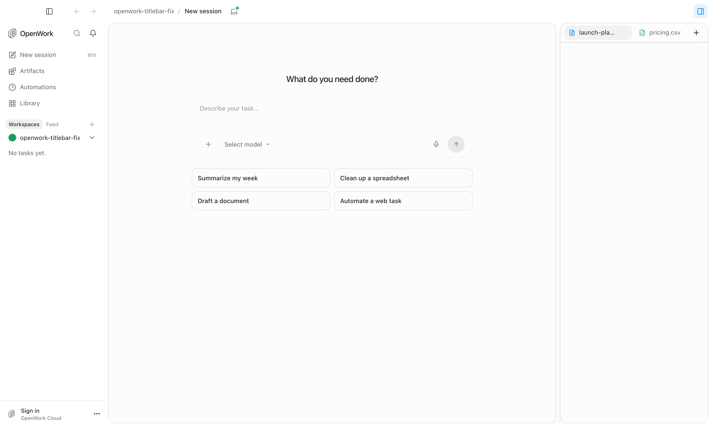
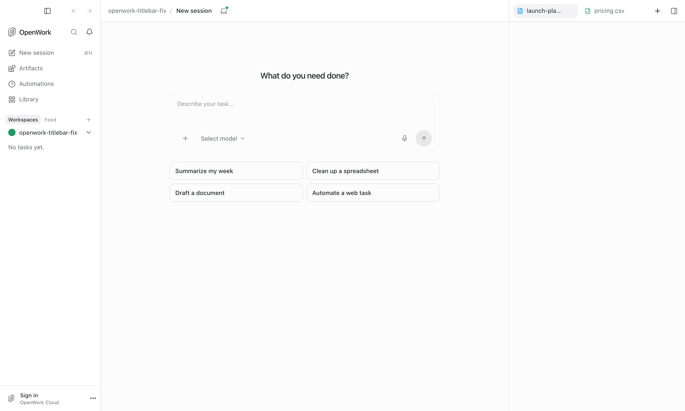

# Chat and side panel as flat columns (`flatSessionPanes`)

- **Feature key:** `flatSessionPanes`
- **Deployments:** cloud and self-hosted (`everywhere`), off by default
- **Author:** @benjaminshafii
- **Surfaces:** Desktop app, session page

## What people get

With the feature off, the chat and the side panel are two rounded cards that
float inside the window, and the side panel has its own tab row under the
title bar.

With the feature on:

- The chat and the side panel fill the window as two flat columns split by a
  thin line. The side panel reaches the window's right and bottom edges.
- The title bar runs across both columns. The side panel's tabs sit in it, and
  the button that closes the panel is at its far right.
- With the side panel closed, the chat takes the full width and the button
  that opens the panel stays in the chat's title bar.

| Off | On |
| --- | --- |
|  |  |

## How it works

- `session-page.tsx` reads the feature and, when the compact desktop chrome is
  showing, renders the session header inside the chat column so the side panel
  column starts at the top of the window.
- `side-panel.tsx` takes a `titlebar` prop: its tab strip gets the title bar's
  height, can be used to drag the window, and carries the close button.
- Mobile width, the web app, developer mode and pages that are not a session
  keep today's layout.

## Turning it off

Turn the feature off for the organization, or use its kill switch. The layout
returns to the two cards with no deploy.
