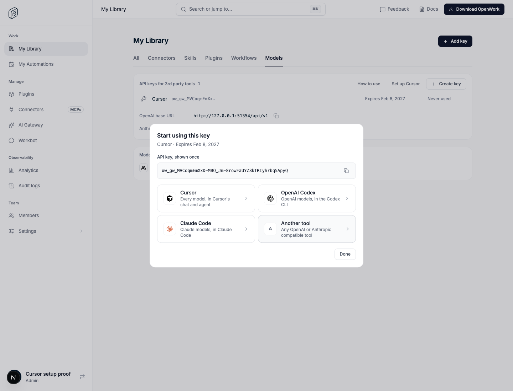
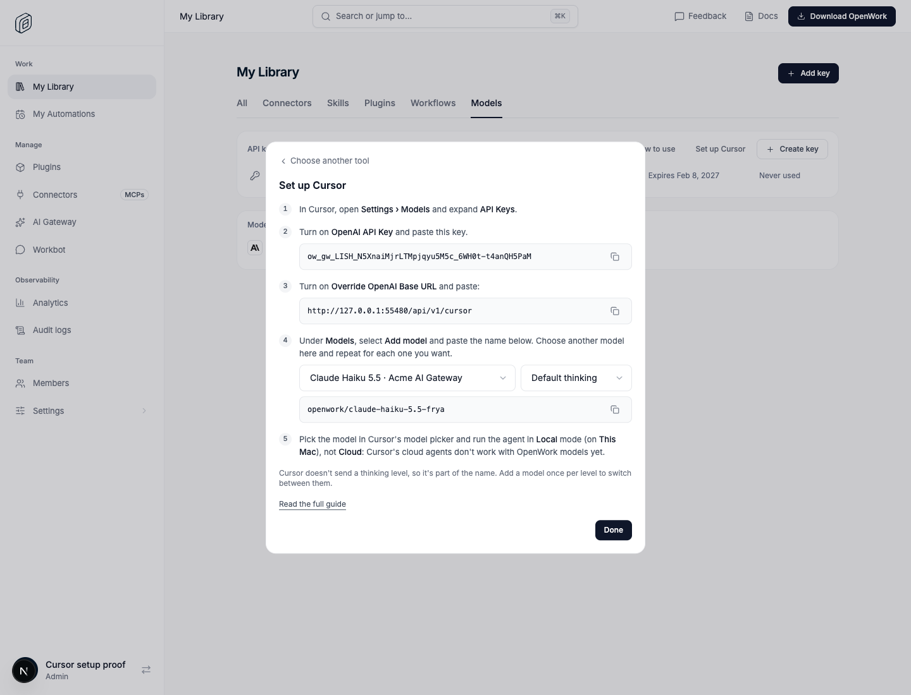
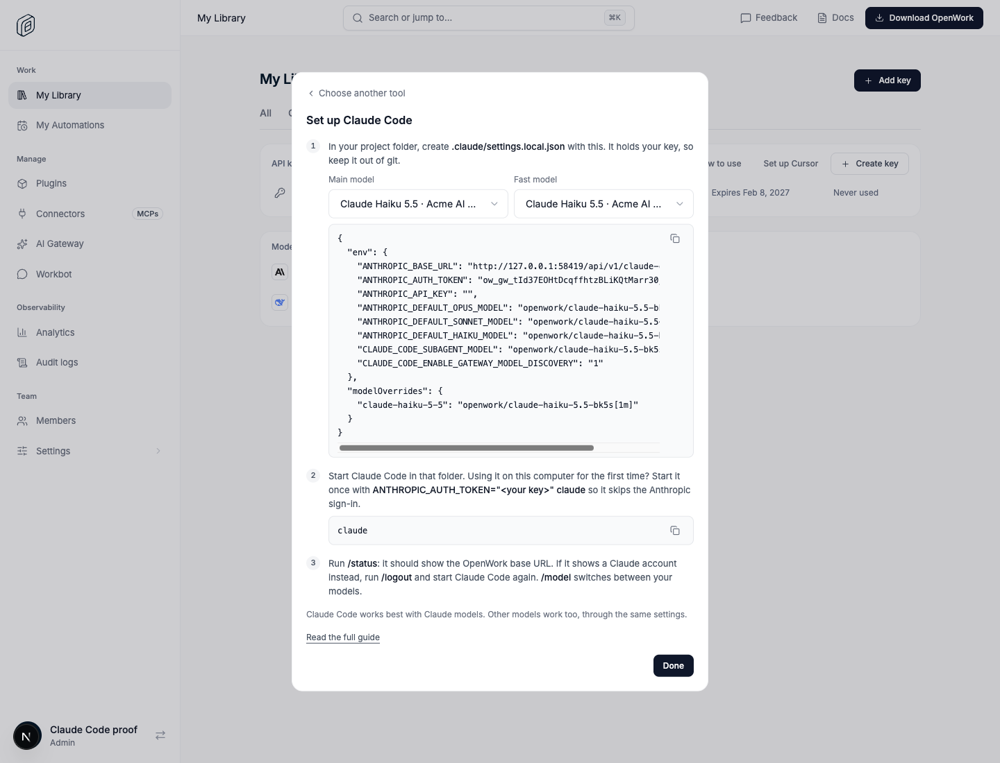
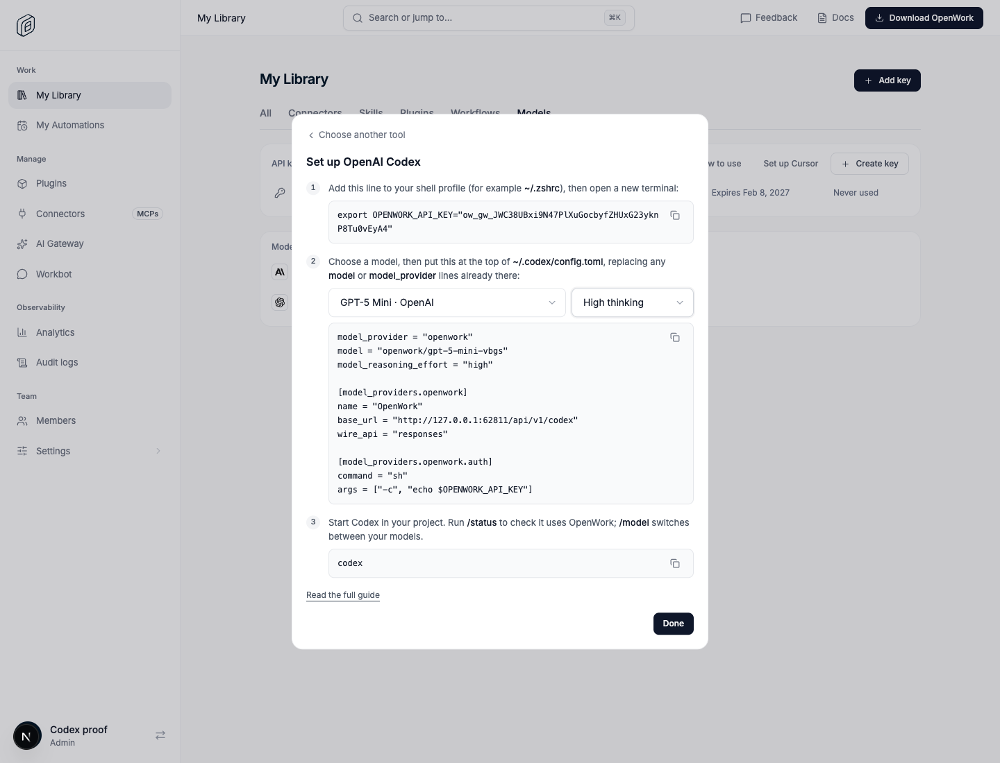
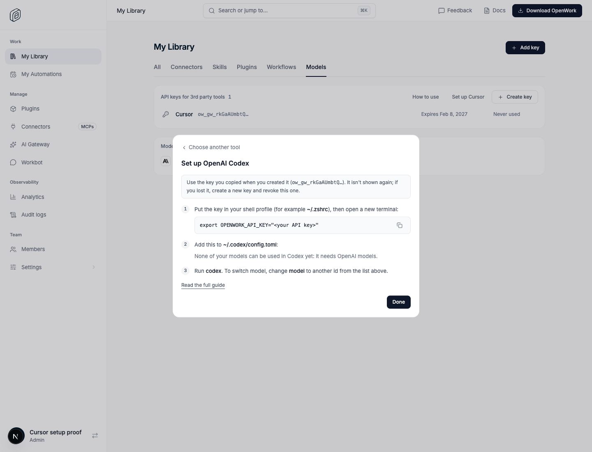
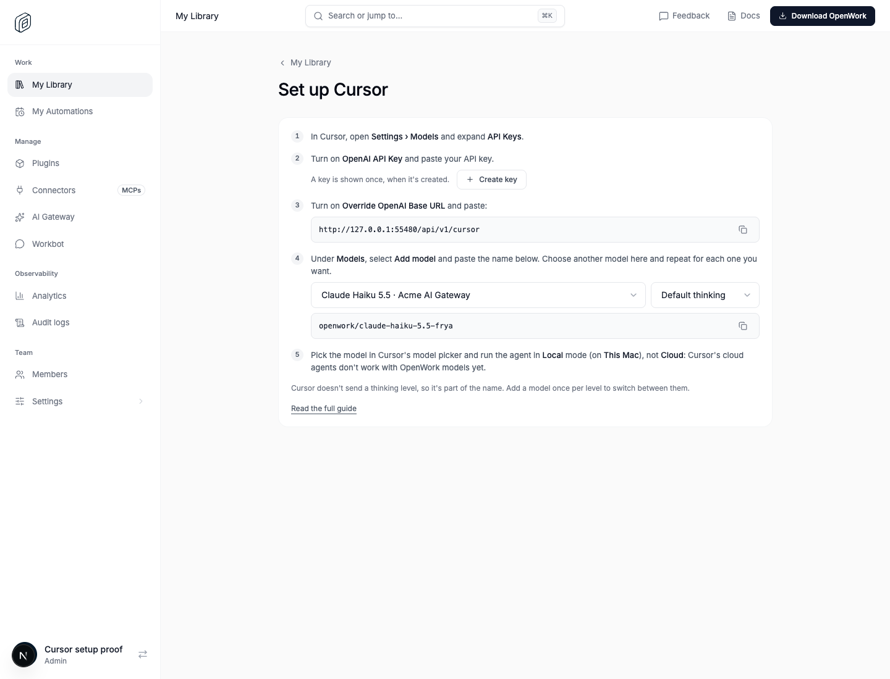

# AI Gateway: setting up Cursor and other tools

- **Feature key:** `gatewayMemberApiKeys` (part of AI Gateway API keys; see
  `docs/features/gateway-member-api-keys/README.md`)
- **Deployments:** cloud and self-hosted, off by default
- **Author:** OmarMcAdam
- **Public docs:** `packages/docs/ai-gateway/cursor.mdx`
- **Needs:** the organization's **Allow 3rd party tools & harnesses** setting on

Members use the models their organization gives them inside Cursor.

Cursor reaches another provider only through its **OpenAI API Key** and
**Override OpenAI Base URL** settings, and each model is added by typing one
string that is both its id and the name Cursor shows. So:

- the Gateway serves every model, whatever its provider speaks, through both
  OpenAI APIs Cursor may use (Chat Completions and Responses) under one base
  URL: `<gateway>/api/v1/cursor`;
- each model gets a short name a person can paste, instead of its 84-character
  `gwm_…` id.

## Model names

```
openwork/<model name as a slug>-<last 4 characters of the model's id>[:<thinking level>]
openwork/claude-opus-5.5-k3f9
openwork/claude-opus-5.5-k3f9:high
```

- The id is the model's `ipm_…` id (the last part of a `gwm_…` alias).
- The Gateway resolves a name against the models the key's member can use: by
  the id ending first, and by the slug only when two of their models share an
  ending. A renamed model keeps working. Two models with the same ending and the
  same name are refused with `ambiguous_cursor_model`.
- Case, surrounding spaces and a missing `openwork/` are forgiven.
- Cursor doesn't send a reasoning effort for models added this way, so the level
  is part of the name. Without one the provider's default applies. A level the
  model doesn't have is refused with `unsupported_thinking_level`.
- A name selects a model; it never grants one. The request then runs the normal
  Gateway pipeline under the member's own alias (grants, credentials, limits,
  usage, request log).
- The same model granted through several groups or credential sets is one name,
  served through the most specific grant (member, then team, then organization).

Shared code: `packages/types/src/den/gateway-cursor.ts`.

## What people see

**Right after creating a key** (while it can still be shown), the dialog moves
to **Start using this key**: the key once, then a large button per tool:
Cursor, OpenAI Codex, Claude Code, Claude Desktop and Another tool. Picking one shows that
tool's steps with the key, URLs and model ids already filled in, each with a
copy button; **Choose another tool** goes back.



- **Cursor:** the key, the base URL, then a model (and thinking level, for
  models that have levels) to choose from a dropdown, with its Cursor name to
  copy. The last step says to run the agent in Local mode (This Mac), not Cloud.
- **OpenAI Codex:** the key line for the shell profile, and a
  `~/.codex/config.toml` provider on the Gateway's Codex endpoint (below) for a
  model (and thinking level, as `model_reasoning_effort`) chosen from dropdowns.
  Every model is offered.
- **Claude Code:** a project settings file (`.claude/settings.local.json`) for
  a main and a fast model chosen from dropdowns, pointing at the Gateway's
  Claude Code endpoint (below). Every model is offered.
- **Claude Desktop:** the menu path to its Gateway settings, the Gateway base
  URL (the Claude Code endpoint) and the key to paste, auth scheme `bearer` and
  credential kind `Static API key`, the relaunch, and the member's models Claude
  Desktop will list (Claude models only, see below).
- **Another tool:** the key, both base URLs, and a model to choose with its id
  to copy.



Cursor, Claude Code and Codex each have their own endpoint; Claude Desktop uses
Claude Code's.





In **My Library › Models**, each key's menu has **Set up**: the same choice of
tools for a key that already exists. The key isn't shown again, so the steps
say which key to use (by its prefix) and leave a place for it. The section
doesn't list the base URLs: each tool's steps carry the ones it needs.



The section also links to **Set up Cursor** (`/dashboard/library/tools/cursor`): the same Cursor steps without a
key, with a link to create one.



## How it works

- `GET /api/v1/cursor/models`: the member's models in the OpenAI list shape,
  with the Cursor name as `id` and `openwork.thinking_levels`.
- `POST /api/v1/cursor/chat/completions`: resolves `model`, rewrites the
  request for the model's own protocol with the Smart Model Router's
  translators (`ee/apps/gateway/src/auto-router/`: Anthropic Messages, OpenAI
  Responses, Gemini, Bedrock Converse, OpenAI-compatible chat), forwards it
  through `handleGatewayRequest`, and translates the response back. Code:
  `ee/apps/gateway/src/cursor.ts`.
- `POST /api/v1/cursor/responses`: the same, for the Responses API. The request
  is read as a chat request (instructions, messages, function calls and their
  outputs, images, tools) and the answer is written back as a Responses object,
  or as Responses events when streamed (text, reasoning summaries, function
  calls, then `response.completed`). A `reasoning.effort` the model has is used
  when the name carries no level. Code: `ee/apps/gateway/src/cursor-responses.ts`.
  So a model works through either API, whichever its provider speaks.
- Cursor sends tools in the flat Responses shape (`{type, name, parameters}`) to
  `/chat/completions`; they are nested under `function` first.
- Only `ow_gw_` keys authenticate on `/api/v1/cursor/*`; OpenWork Models keys
  are never looked up. Any other path there is `404 not_found`.
- The page builds the same names in Den web from
  `GET /v1/inference-providers?scope=usable`; there is no new Den API route.

## Claude Code endpoint

`ANTHROPIC_BASE_URL` = `<gateway>/api/v1/claude-code`. Claude Code sends the key
as `Authorization: Bearer` (`ANTHROPIC_AUTH_TOKEN`; `ANTHROPIC_API_KEY` stays
empty). Code: `ee/apps/gateway/src/claude-code.ts`,
`ee/apps/gateway/src/claude-code-messages.ts`. Public docs:
`packages/docs/ai-gateway/claude-code.mdx`.

- `GET /v1/models`: the member's models in Anthropic's list shape, for Claude
  Code's gateway model discovery (`CLAUDE_CODE_ENABLE_GATEWAY_MODEL_DISCOVERY`).
  Claude Code lists only Claude models from it.
- `POST /v1/messages` (Claude Code adds `?beta=true`): names are the Cursor names
  with no thinking level, plus `[1m]` on models with a 1M token window (stripped
  before matching). A raw catalog id (`claude-sonnet-4-5`) also resolves when one
  of the member's models has it. A model on a Messages provider (Anthropic,
  Vertex Claude, Foundry) gets the request as it is (thinking, cache control,
  `anthropic-beta`); any other is translated Messages → Chat Completions → the
  model's own protocol, and back as a Messages object or event stream.
  Translated requests ask for at least 16 output tokens: Claude Code checks a
  model it switches to with `max_tokens: 1`, which OpenAI refuses.
- `POST /v1/messages/count_tokens`: an estimate (about four characters a token);
  nothing goes upstream.
- Errors are Anthropic error bodies (`{type: "error", error: {type, message}}`).

The settings file pins Claude Code's Opus, Sonnet, Haiku and subagent slots,
maps Claude models to Claude Code's own ids with `modelOverrides` (so it knows
their limits and features), and sets `CLAUDE_CODE_MAX_CONTEXT_TOKENS` when the
main model is another provider's.

Checked on 2026-11-10 with Claude Code 2.1.321-322 on a local Den and Gateway with
real Anthropic and OpenAI keys: `claude -p` and interactive sessions with tool
use on Claude Sonnet 4.5 (passed through) and GPT-5 mini (translated), `/model`
discovery and switching. Found there: Claude Code reads the project settings
file only after its first-run sign-in screen; a key in the shell or in
`~/.claude/settings.json` skips it, so the steps say to start it once with
`ANTHROPIC_AUTH_TOKEN="<key>" claude`. Not checked: an existing Claude account
login next to the settings file (the steps follow OpenRouter: `/status`, then
`/logout` if needed).

## Claude Desktop

Claude Desktop's Gateway mode (**Developer › Configure Third-Party Inference…**,
Connection **Gateway**) points at the Claude Code endpoint: **Gateway base
URL** `<gateway>/api/v1/claude-code`, the key as **Gateway API key**, auth
scheme `bearer`, credential kind `Static API key`. No Gateway code of its own:
what it sends is what Claude Code sends. Public docs:
`packages/docs/ai-gateway/claude-desktop.mdx`.

What Claude Desktop 5.1231 sends (captured with a logging proxy, and read in
its app bundle):

- Settings live in `~/Library/Application Support/Claude-3p/configLibrary/<id>.json`
  as flat keys (`inferenceProvider: "gateway"`, `inferenceGatewayBaseUrl`,
  `inferenceGatewayApiKey` sealed with the OS keychain, `inferenceGatewayAuthScheme`,
  `inferenceCredentialKind: "static"`). Gateway mode runs on its own profile
  (`Claude-3p`), apart from a signed-in Claude account's. `http://127.0.0.1`
  base URLs are accepted; other `http` URLs are not.
- `GET {base}/v1/models?limit=1000` with `Authorization: Bearer` and
  `anthropic-version`, paging with `after_id` while `has_more`. It reads `id`,
  `display_name`, `description`, `supports_1m` / `max_input_tokens`,
  `anthropic_family_tier` and `is_family_default`.
- **Only Claude models reach the picker.** Discovery keeps an id that contains
  claude, opus, sonnet, haiku or anthropic and no other family (gpt, openai,
  gemini, deepseek…), or one with an `anthropic_family_tier`; the picker then
  applies the id check again, without the tier exception. Tried live: GPT-5
  mini with `anthropic_family_tier: "sonnet"` was "4 found; picker = 3". So
  the setup lists the member's Claude models (`claudeDesktopListsModel` in
  `packages/types/src/den/gateway-cursor.ts` mirrors the check) and points to
  Claude Code, Cursor or Codex for the rest. The Gateway does not rename models
  to get past the check.
- **Test connection** and each launch: the model list, then `POST
  {base}/v1/messages` with `max_tokens: 1` on one of the listed models.
- Chats and Cowork tasks run Claude Code inside the app: `POST
  {base}/v1/messages?beta=true`, streamed, `anthropic-beta:
  interleaved-thinking-2025-05-14,claude-code-20250219`, `x-app: cli`,
  `thinking: {type: "enabled", budget_tokens: 31999}`, `max_tokens: 32000`, about
  40 tools (Bash in its VM, files, web, MCP), cache control; a title request
  without `?beta=true`; and `HEAD {base}/api/hello` without a key (answered
  `401`; Claude Desktop carries on).

Checked on 2026-11-10 with Claude Desktop 5.1231.0 (macOS) on a local Den and
Gateway with real Anthropic and OpenAI keys, set up through its own
Configure Third-Party Inference window: **Test connection**, model discovery
(Claude Haiku 4.5, Claude Sonnet 4.5 and a mock Claude listed; GPT-5 mini
hidden), a Cowork chat on Claude Haiku 4.5 that ran a shell tool and answered
(passed through), switching to Claude Sonnet 4.5 mid-conversation, and the
same request shape sent straight to GPT-5 mini through the endpoint (translated,
tool use) to show the endpoint would serve it. Nothing broke, so the Gateway is
unchanged. Found there: Claude Desktop hides non-Claude models; after Apply it
relaunched straight into Gateway mode (no start screen); Gateway mode has its
own Developer Mode, so the Developer menu disappears there (the account menu's
**Inference configuration** opens the settings); the auth middleware's `401` is
not an Anthropic error body (Claude Desktop shows its status). Not checked:
Windows, the OIDC sign-in kinds, and Claude Desktop's Code tab.

## Codex endpoint

A Codex provider's `base_url` = `<gateway>/api/v1/codex`. The setup follows
OpenRouter's Codex guide: `model_provider = "openwork"`, `wire_api =
"responses"`, and an `auth` block that runs `sh -c 'echo $OPENWORK_API_KEY'`.
Codex fetches a provider's model catalog only with command auth (`env_key`
works but gives "Model metadata … not found"). Code:
`ee/apps/gateway/src/codex.ts` (the translation is shared with Cursor in
`cursor-responses.ts`). Public docs: `packages/docs/ai-gateway/codex.mdx`.

What Codex 0.167 sends (codex-rs source at `rust-v0.167.1`, and captured):

- `GET {base_url}/models?client_version=0.167.1`, bearer key. It expects
  Codex's own catalog, `{models: [ModelInfo]}` (`codex-protocol`
  `openai_models.rs`), not the OpenAI list; an entry without
  `base_instructions` (or `model_messages.instructions_template`) fails the
  whole catalog. Each entry carries Codex's own base prompt
  (`codex-instructions.ts`, copied from `models-manager/prompt.md`,
  Apache-2.0), the model's context window, reasoning levels, and
  `apply_patch_tool_type: "freeform"` only for OpenAI GPT-5 and later (OpenAI
  refuses custom tools before; translated models edit through the shell tool).
  Codex merges the catalog with its bundled OpenAI models, so `/model` lists
  those too; ours get a negative priority to come first.
- `POST {base_url}/responses`, `stream: true`, `store: false`, `include:
  ["reasoning.encrypted_content"]`, `reasoning: {effort, summary}`,
  `prompt_cache_key`, `client_metadata` (session ids, local paths), the base
  prompt as a developer message (no `instructions`), item ids on every input
  item, and tools: functions, a `namespace` (`multi_agent_v1`), `web_search`,
  and the custom `apply_patch` when the catalog asks for it. Remote compaction
  is off for a provider not named OpenAI, so `/compact` is a normal request.
- OpenAI and Azure models: the request passes through under the member's alias
  within the Gateway's resource policy: `client_metadata` and input item ids
  (except on reasoning items with encrypted content) are dropped, hosted tools
  (`web_search`) and hosted call items are dropped, and the policy now accepts a
  `namespace` of client tools. A model without reasoning loses `reasoning` and
  the encrypted-content include.
- Other models: Responses → Chat Completions → the model's protocol, and back
  as a Responses event stream. Namespaced functions become `<ns>__<name>`,
  custom tools a function taking `{input}`, and both come back as Codex's
  items. `previous_response_id` is refused (Codex never sends it with
  `store: false`); at least 16 output tokens.
- Names are the Cursor names; a level suffix wins over `reasoning.effort`; a
  raw catalog id resolves when the member has that model. Errors are OpenAI
  error bodies.

Checked on 2026-11-10 with Codex 0.167.1 on a local Den and Gateway with real
OpenAI and Anthropic keys, the config exactly as the page writes it:
`codex exec` and a tmux session on GPT-5 mini (passed through, encrypted
reasoning across turns, native `apply_patch`), GPT-4.1 mini (passed through, no
reasoning) and Claude Haiku 4.5 (translated: shell commands, file edits,
`/compact`), `/status`, `/model` with reasoning levels, and switching
GPT → Claude → GPT mid-conversation. Found and fixed there: the Gateway's
resource policy refused Codex's requests (item ids, `client_metadata`'s
`session_id`, `namespace` and `web_search` tools); GPT-4.1 refuses custom
tools; Claude Haiku wrote `apply_patch` text with lost indentation when given
it as a function, so translated models don't get it; Codex's picker listed its
own OpenAI models first. Codex 0.167 keeps the catalog in a background
app-server daemon: a model added later shows after `codex app-server daemon
restart`. The daemon also runs the `auth` command and keeps the environment and
config it started with, and it outlives the terminal: someone who put
`OPENWORK_API_KEY` in `~/.zshrc` after the daemon first started gets 401s in
every new terminal until they restart it. Checked 2026-11-10: a daemon started
without the variable kept sending an empty key from fresh shells that had it,
and from a key file the auth command read; `codex app-server daemon restart`
from a shell with the variable fixed it (`codex exec` is not affected: it reads
the shell's environment). The steps now have a restart step. Not checked: Azure OpenAI, Windows, images, and Codex's own OpenAI
models chosen in `/model` when the member has the same model.

## Codex app (ChatGPT desktop)

Same endpoint and config as the CLI; Den web offers it as **Codex app**
(`CodexAppSteps`, test ids `gateway-tool-codex-app*`). The steps save the key
in the macOS Keychain (`security add-generic-password -U -a "$USER" -s
openwork-ai-gateway -w "<key>"`) and the `auth` block runs `/usr/bin/security
find-generic-password -s openwork-ai-gateway -w`, then quit the app with ⌘Q.
Public docs: `packages/docs/ai-gateway/codex-desktop.mdx`.

Checked 2026-11-10 with ChatGPT 26.1027 (bundled `codex-cli 0.166.0-alpha`)
against a local Den and Gateway with real OpenAI and Anthropic keys, through a
logging proxy:

- The app runs its own `codex app-server` as a child process (not the CLI's
  `~/.codex` daemon, so `codex app-server daemon restart` does nothing for the
  app). ⌘Q ends it; reopening starts a fresh one that reads the config and
  runs the auth command again. No leftover processes were seen.
- The app process itself has no shell variables, but it starts its app-server
  with the login shell's environment: `OPENWORK_API_KEY` from `~/.zshrc` was in
  the app-server's environment after a Dock launch. So the CLI steps work for
  the app too; the Keychain is the documented path because it doesn't depend
  on the shell profile, keeps the key out of dotfiles, and works the same for
  the app, the CLI and the daemon. `launchctl setenv` (OpenRouter's guide) was
  not needed.
- `supports_websockets` defaults to false for custom providers (codex-rs
  `model-provider-info`), and the app made no WebSocket attempt, so the config
  doesn't set it.
- What the app sends that the CLI doesn't: ~58 tools (CLI ~10) in namespaces
  `mcp__codex_app` (threads, automations, worktrees, artifacts),
  `mcp__cua_repl`, `mcp__node_repl`, `mcp__artifact_session`, plus goals and
  `request_user_input`; extra developer messages (client time context); a
  `client_version` of 0.167.0; and a conversation-title request with a fixed
  OpenAI model (`gpt-6-luna`, `text.format` JSON schema, `additional_tools`
  input item), which the Gateway answers `model_not_found` (harmless).
- The error people hit with Claude, `tools.18.custom.input_schema:
  input_schema does not support oneOf, allOf, or anyOf at the top level`, was
  `mcp__codex_app__automation_update`: `{type: object, properties: {}, oneOf:
  [4 $refs], $defs}`, a discriminated union nesting another union.
  `mcp__cua_repl__js` also has a root `oneOf`. Fixed in the translators for
  every client in #7255 (`auto-router/tool-schema.ts`, used by the Anthropic, Bedrock
  and Gemini translators): the root union becomes one object with every
  branch's properties, required only when all branches require them, and the
  argument sets listed in the schema's description; `allOf` merged; root
  `$ref` inlined; `$defs` kept; draft-04/07 forms Anthropic rejects as invalid
  2020-12 (tuple `items`, boolean `exclusiveMinimum`, boolean `required`,
  unknown types) rewritten. Probed against the Messages API: root `type` must
  be `"object"` (not `["object","null"]`), root combinators are refused,
  nested ones, `$ref`/`definitions`, root `not`/`if` are accepted.
- After the fix: Claude Haiku 4.5 (translated) answered, ran parallel
  `exec_command` calls to write and list a file, and answered a follow-up;
  switching to GPT-5 mini in the same thread (passed through, `apply_patch`
  added) appended to the file.

Not checked: Windows, the IDE extension, images, Gemini and Bedrock live.

## Turning it off

Turning off `gatewayMemberApiKeys` (or the organization setting) stops member
keys at the Gateway, and `/api/v1/cursor/*`, `/api/v1/claude-code/*` and `/api/v1/codex/*` answer
`404` within 15 seconds. The setup screens go with the API keys section. Nothing else is stored
for Cursor, so the model names people added to Cursor work again when it is
turned back on.

## What to watch

- Gateway: 4xx on `/api/v1/cursor/chat/completions` or
  `/api/v1/cursor/responses` with `invalid_cursor_model`
  (Cursor sent a name that isn't ours, for example one of its own model ids),
  `model_not_found` or `unsupported_thinking_level`.
- `gateway_request_logs` rows with `gateway_api_key_id` set carry Cursor's
  traffic like any other 3rd party tool; the requested model is the `gwm_` alias.

## Checked with a real Cursor

On 2026-11-10 a real Cursor answered through `openwork/gpt-5.6-luna-zp1h` on
production in **Local** mode (This Mac). Cursor's **Cloud** agents still fail
with OpenWork models, so the steps and the public docs tell people to use
Local. Still to look into: why Cloud agents fail, and whether Cursor uses Chat
Completions or Responses for each model.

## Proof

`ee/apps/gateway/test/cursor.test.ts` covers names, resolution, the model list,
Chat Completions and Responses (JSON and streamed) translated to Anthropic and
back, refusals, keys, and the feature being off.
`evals/proofs/gateway-cursor-setup.proof.test.ts` drives the page and both APIs
on a real Den and AI Gateway. `ee/apps/gateway/test/claude-code.test.ts` and
`evals/proofs/gateway-claude-code.proof.test.ts` do the same for Claude Code
(a Claude model passed through, a DeepSeek model translated), and
`ee/apps/gateway/test/codex.test.ts` and `evals/proofs/gateway-codex.proof.test.ts`
for Codex (an OpenAI model passed through, a Claude model translated, with the
config read from the page). `evals/proofs/gateway-claude-desktop.proof.test.ts`
reads Claude Desktop's base URL and key from its steps and sends Claude
Desktop's requests with them (model list, test connection, a streamed chat).
