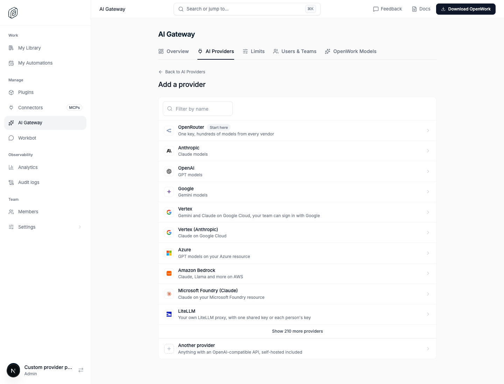
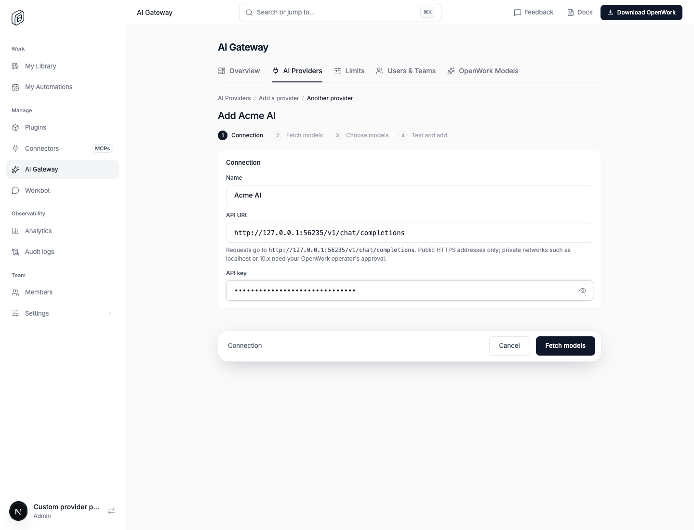
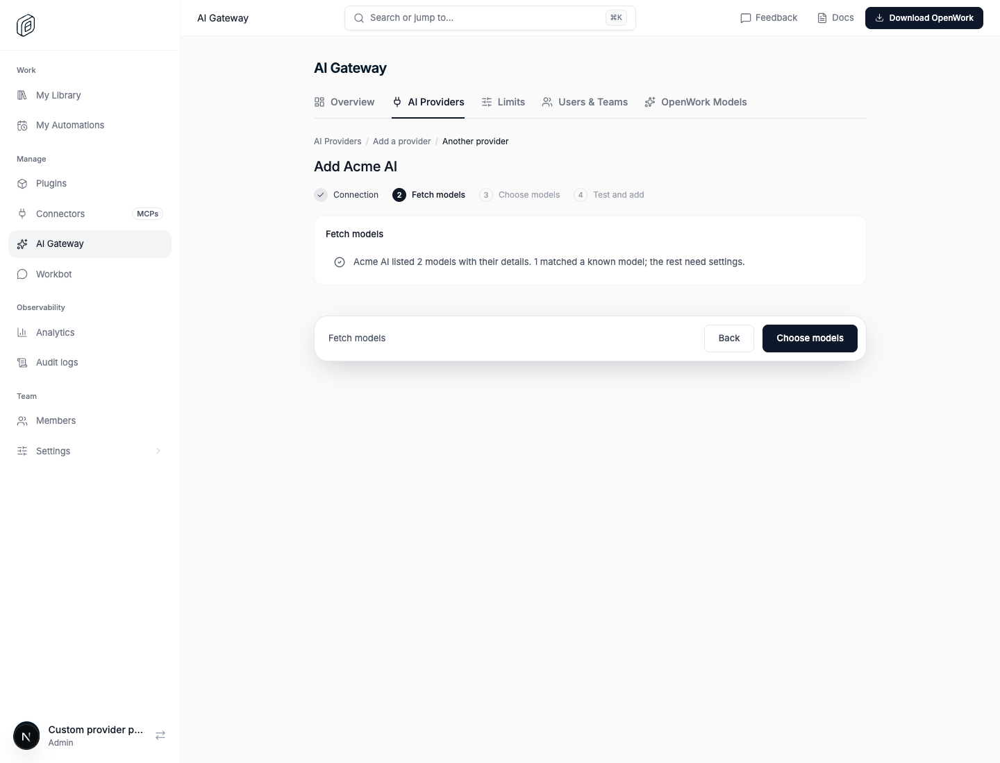
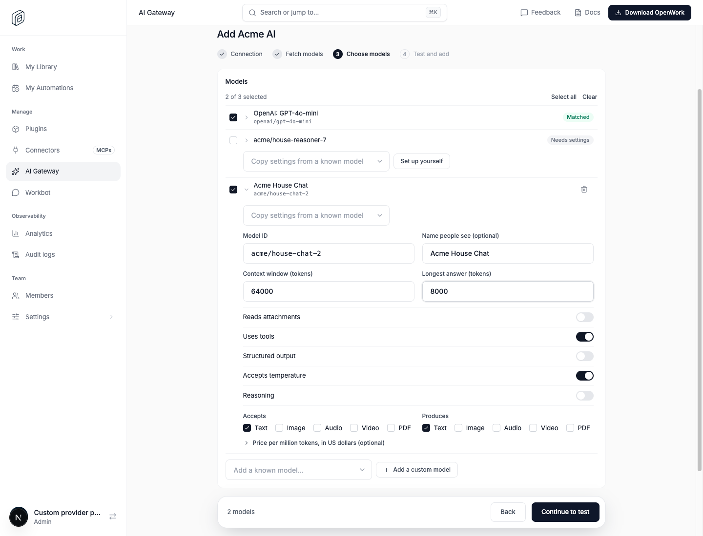
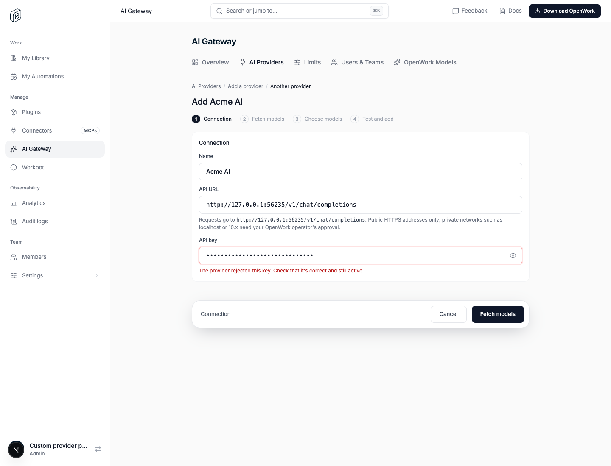
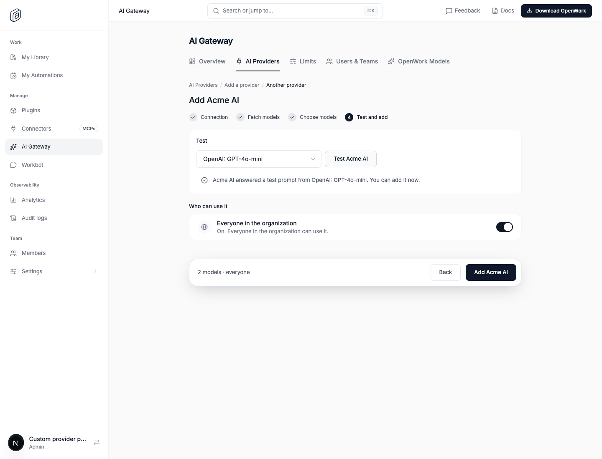
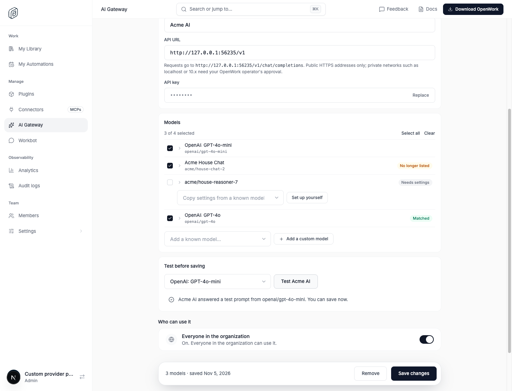
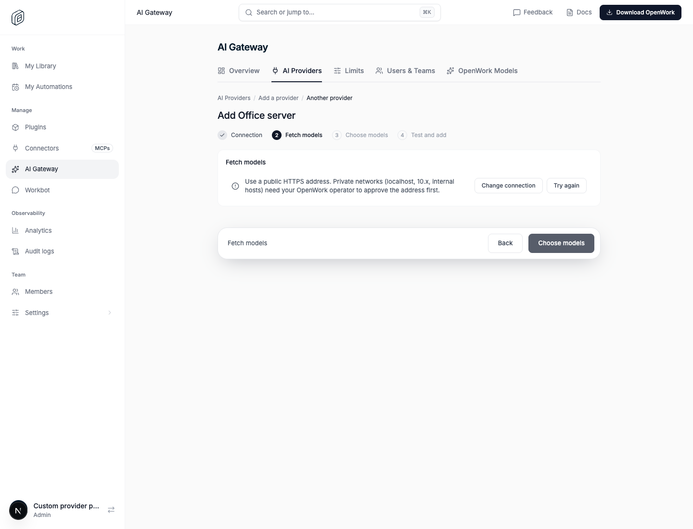

# AI Gateway: custom OpenAI-compatible providers

> **GA:** Available without a feature flag. The former rollout key is retired.
> The flag-off screenshot below is a historical comparison.

Retired rollout key: `gatewayCustomProviders` · Deployments: cloud and self-hosted · Status: generally available (no flag) · Author: [@OmarMcAdam](https://github.com/OmarMcAdam)

## What changes

In Den › AI Gateway › Add a provider, the **Another provider** row ("Anything
with an OpenAI-compatible API, self-hosted included") used to open the first
models.dev provider whose SDK is `@ai-sdk/openai-compatible` (today 302.AI),
with that provider's address and models. It now opens a four-step wizard for
any OpenAI-compatible provider instead.

1. **Connection**: a name (what members see in the model picker), the API
   address (for example `https://api.example.com/v1`; a trailing
   `/chat/completions` is removed and the page shows where requests go) and one
   API key.

   

2. **Fetch models**: Den calls `GET {address}/models` with the key and says
   what it found: a detailed (OpenRouter-style) list, a plain list of ids, or
   nothing (then models are added by hand on the next step).

   

3. **Choose models**: models matched to the models.dev OpenRouter catalog are
   ticked with their settings filled in. Unmatched ones show **Needs settings**:
   copy settings from a known model or **Set up yourself**. **Add a known
   model** and **Add a custom model** add models the provider did not list; the
   full form covers the model id, name, context window, longest answer,
   attachments, tools, structured output, temperature, reasoning (with toggle
   and effort levels), input and output types and prices.

   

4. **Test and add**: one short prompt goes through AI Gateway to one chosen
   model. **Add** is enabled only after a passing test with exactly what is on
   screen. A failure takes the admin back to the step that caused it, with
   everything still filled in: a rejected key or unreachable address to step 1,
   a model the provider refuses to step 3.

   

   

The provider then appears in AI Providers like any other. Its page edits the
name, address, key (**Replace**), models and who can use it. **Re-fetch
models** reads `/models` again with the saved key: new ids are offered (not
ticked), models the provider no longer lists are flagged **No longer listed**,
never removed. A new address, key or model id must pass a test before **Save
changes**; other edits save directly.

Members get the provider's models like any other AI Gateway provider; their
desktop never sees the upstream key.

Addresses must be public HTTPS, or an origin the operator allowlisted. Private
networks are refused before anything is contacted, with a plain message:

Proof: `pnpm evals:e2e gateway-custom-provider --local`
(`evals/proofs/gateway-custom-provider.proof.test.ts`) runs a real Den, a real
AI Gateway and a mock OpenAI-compatible provider (allowlisted through
`GATEWAY_EGRESS_ALLOWED_ORIGINS`) in headless Chrome: the wizard with a detailed list, a models.dev match and a custom
model, a failing test with a wrong key that returns to step 1, a passing test
and Add, Re-fetch models and Save on the provider's page, a member's chat
completion through AI Gateway reaching the provider with the custom model's id,
and a refused private address. It needs network access to models.dev
(`models.openworklabs.com`) for the OpenRouter match.

## API (den-api)

All routes need Manage Gateway providers and enabled Gateway management.

| Route | What it does |
|---|---|
| `POST /v1/inference-providers/custom/discover-models` | Calls `/models` with a typed key, or a saved provider's key (same host only). `detailed`, `basic` or `unavailable`. |
| `POST /v1/inference-providers/custom/test-connection` | One test prompt through AI Gateway (`providerId: "openwork-custom"`, `customModel`). Adds `step` to failures. |
| `POST /v1/inference-providers/custom` | Creates the provider, models, "All Allowed Models" group, organization key and grants. |
| `PATCH /v1/inference-providers/:id/custom` | Name, address, key, models. An address on another host needs the key again. |

Shared request and response schemas: `packages/types/src/den/gateway-custom-providers.ts`.

## Storage

No new table. A `gateway_providers` row with `provider_id = "openwork-custom"`,
`provider_config = { id, name, npm: "@ai-sdk/openai-compatible", env: ["OPENWORK_CUSTOM_API_KEY"] }`,
`settings.upstreamBaseUrl` and `settings.custom = { version: 1, catalog, discovery }`.
The catalog is the provider's own model list: catalog refreshes never call
models.dev for it. Generic models.dev routes (`POST /v1/inference-providers`,
`/test-connection`) refuse it with `custom_setup_required`. The gateway forwards
to `settings.upstreamBaseUrl` + `/chat/completions`.

## Safety

- Addresses must be public HTTPS, or an origin the operator allowlisted
  (`GATEWAY_EGRESS_ALLOWED_ORIGINS`, which may be `http://`, for example an
  in-cluster vLLM or LiteLLM). Den web accepts `http://` and `https://` and
  leaves the decision to den-api, which refuses private networks before any
  request. `/models` is fetched through the egress-guarded transport: guarded
  DNS, no redirects, 10-second timeout, 5 MB and 500 models at most.
- Keys are write-only. A saved key is only sent to the host it was saved for.
- Discovery and tests are rate limited like provider tests (20 per member, 60 per
  organization every ten minutes).

## Try it

1. Sign in as an organization admin with AI Gateway configured.
2. Den › AI Gateway › Add a provider › **Another provider**: enter a name, an
   OpenAI-compatible address and key, pick models, **Test**, then **Add**.

## What to watch

`[gateway-provider-test]` warnings in den-api logs (AI Gateway unreachable),
request logs for `/v1/inference-providers/custom/*` 4xx rates, and gateway
upstream errors for providers with `provider_id = "openwork-custom"`.
