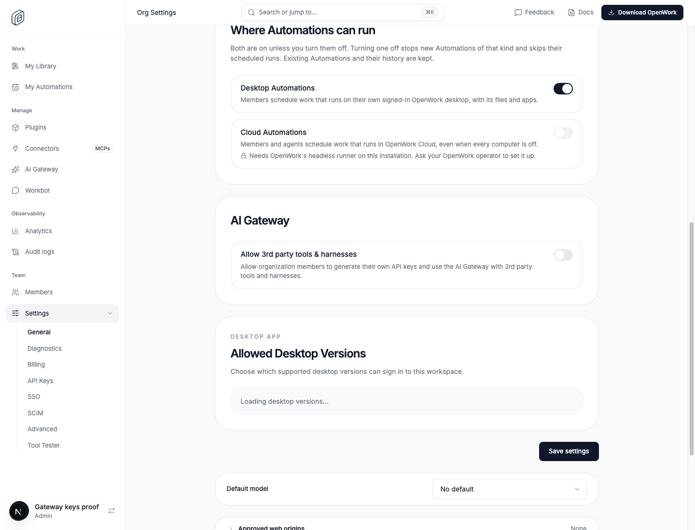
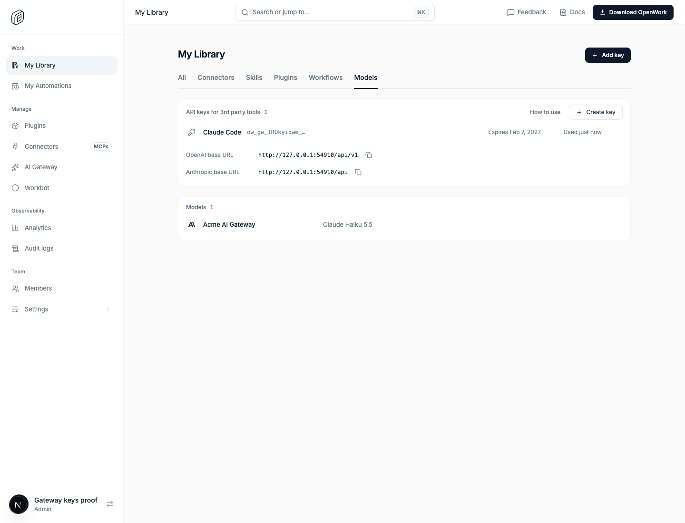
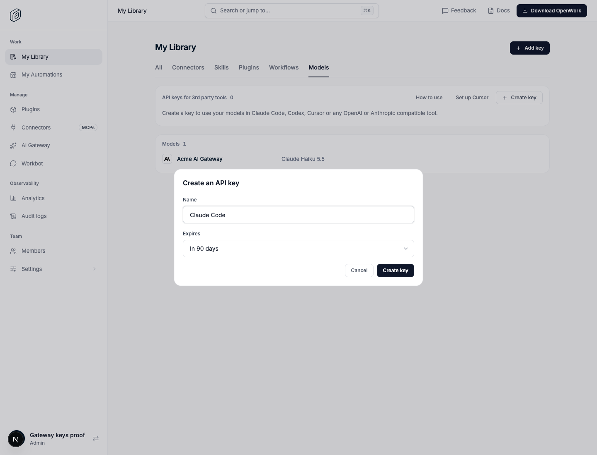
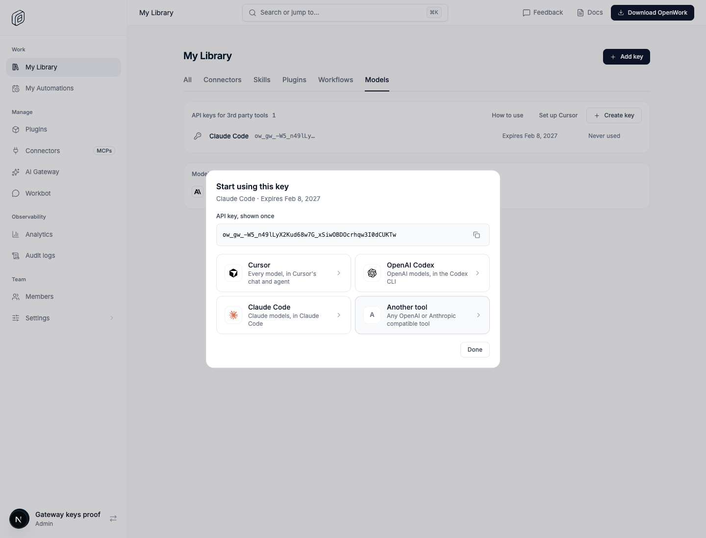
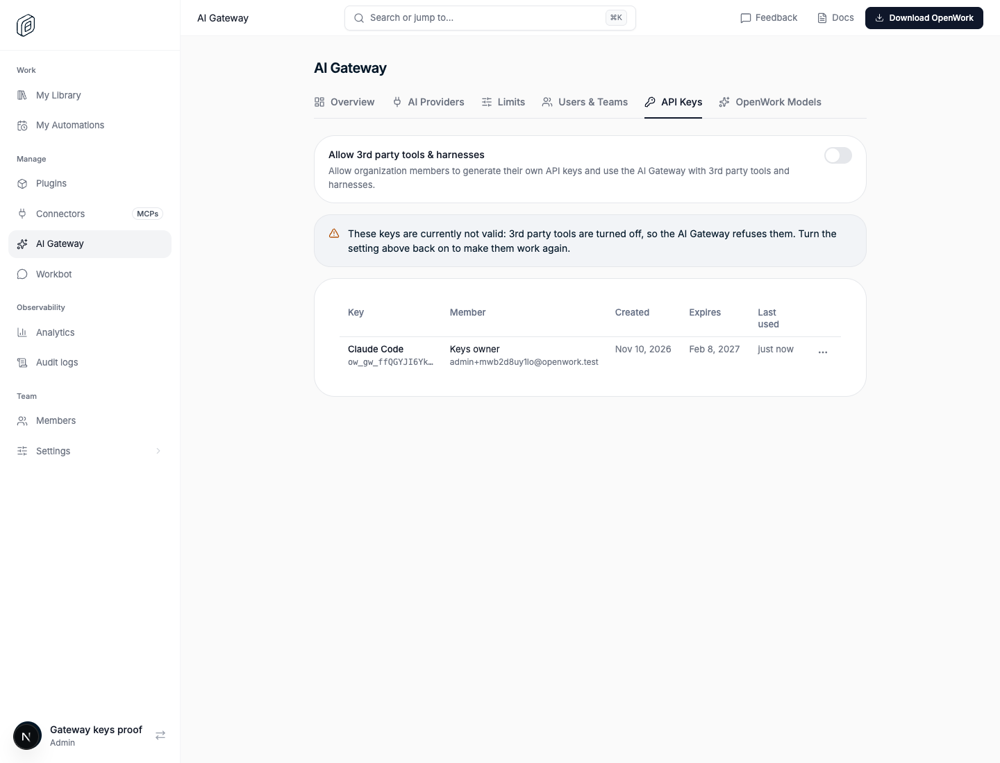

# AI Gateway: API keys for 3rd party tools

> **GA:** Available without a feature flag. The former rollout key is retired.
> The organization setting below still decides whether members may use keys.

- **Retired rollout key:** `gatewayMemberApiKeys`
- **Deployments:** cloud and self-hosted, generally available (no flag)
- **Author:** OmarMcAdam
- **Public docs:** `packages/docs/ai-gateway/third-party-tools.mdx`

Members create their own AI Gateway API keys and call the Gateway's models from
any tool or harness (Claude Code, Codex, Cursor, SDKs, eval scripts) through the
provider-less endpoints: `GET /api/v1/models`, `POST /api/v1/chat/completions`,
`/api/v1/responses` and `/api/v1/messages`.

## The organization setting

The setting at the top of AI Gateway › API Keys, **Allow 3rd party tools &
harnesses** (`organization.metadata.aiGateway.memberApiKeys`, off by default,
needs Edit organization settings), decides whether members may create and use
keys. A key works only while it is on. The Gateway checks it on every request
(cached up to 15 seconds per organization).

## What people see

**Members**, in My Library › Models, get an "API keys for 3rd party tools"
section at the top: their keys, when each expires and was last used, a menu
with **Set up** and **Revoke**, a **How to use** docs link and **Set up
Cursor**. **Create key** asks for a name and an expiry (7, 30, 90 days, 1 year
or never; 90 days by default), then shows **Start using this key**: the key
once and a choice of tools (Cursor, OpenAI Codex, Claude Code, another tool),
each with its setup steps. See `docs/features/gateway-cursor-setup/README.md`
for the tool steps and the Gateway's Cursor endpoint.

**Admins** get an **API Keys** tab in AI Gateway after Users & Teams. The setting
sits at the top. Below it:

- **Keys exist:** every key that isn't revoked with its member, created, expiry
  and last used times (expired keys in red). While the setting is off, a notice
  above the table says the keys are currently not valid.
- **No keys, setting on:** a panel explaining that members create keys for
  themselves, with **Create your own key now**, which opens Library › Models
  with the create dialog already open (`?show=models&create-key=1`).
- **No keys, setting off:** the same panel, asking to turn the setting on.

Listing needs View Gateway providers; revoking someone else's key needs Manage
Gateway providers and a recent sign-in; the setting needs Edit organization
settings.

## How it works

- Keys live in `gateway_api_keys` (migration `0189_gateway_api_keys.sql`),
  separate from `gateway_keys`, which holds the one key OpenWork issues to each
  member's own apps. Only an HMAC digest and a 16-character prefix are stored.
  `expires_at` is optional (null never expires). Each member can hold 20
  unexpired keys.
- Den routes: `GET|PUT /v1/org/ai-gateway-settings`,
  `GET|POST /v1/org/ai-gateway/api-keys/mine`,
  `DELETE /v1/org/ai-gateway/api-keys/mine/:apiKeyId`,
  `GET /v1/org/ai-gateway/api-keys`, `DELETE /v1/org/ai-gateway/api-keys/:apiKeyId`.
- Gateway: `findActiveGatewayKey` looks up `gateway_keys` first, then
  `gateway_api_keys` (skipping revoked and expired keys). An API key then needs
  the setting on.
  The caller is the key's member (`keySource: "api_key"`), so grants, limits,
  usage and logging are exactly that member's. Every access read re-checks that
  the key is still active and unexpired, so a revoked or expired key stops on
  its next request.
  `last_used_at` is written at most once a minute per key.
- Request logs record the key in `gateway_request_logs.gateway_api_key_id`
  (and leave `gateway_key_id` empty) for requests made with a member API key.
- Removing a member revokes their API keys with the rest of their Gateway
  credentials; deleting the organization deletes them.

## Turning it off

The kill switch (or turning the setting off) makes the Gateway refuse every
member API key with `401 invalid_api_key` within 15 seconds. Nothing is
deleted: keys, their names and history are kept and work again when it is
turned back on. OpenWork's own member keys (desktop, Workbot, Automations) are
not affected.

## What to watch

- Gateway: 401s on `/api/v1/*` from `ow_gw_` keys; `[gateway] could not record
  API key use` warnings (last-used writes only, never fail a request).
- `gateway_request_logs` rows with `gateway_api_key_id` set: traffic from 3rd
  party tools.

## Proof

`evals/proofs/gateway-member-api-keys.proof.test.ts` drives the whole flow on a
real Den and AI Gateway; `ee/apps/den-api/test/api/gateway-api-keys.api.test.ts`
covers permissions and isolation; `ee/apps/gateway/test/gateway-api-keys.test.ts`
covers the Gateway identity and logging.
