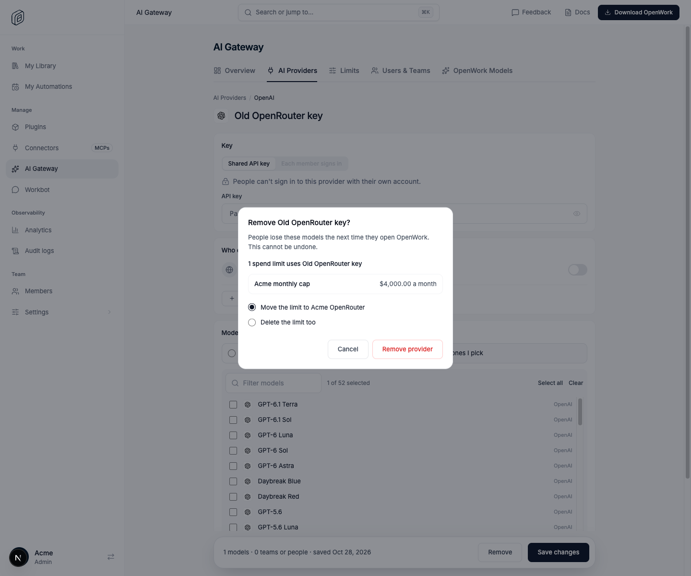
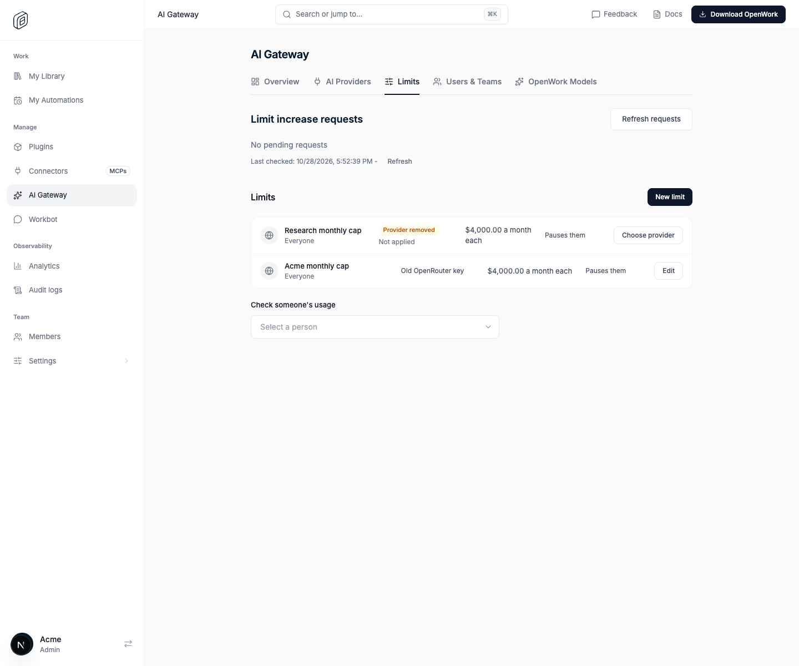

# AI Gateway: keep spend limits when removing a provider

> **GA:** Available without a feature flag. The former rollout key is retired.
> Off/on screenshots below are historical comparisons, not current deployment options.

- **Retired rollout key:** `gatewayProviderRemovalLimits`
- **Deployments:** OpenWork Cloud and self-hosted
- **Author:** [benjaminshafii](https://github.com/benjaminshafii)

A spend limit can be scoped to one AI Gateway provider. Before this feature,
removing that provider left the limit active but pointing at nothing: it capped
no requests, and the provider that replaced it had no cap.

By default:

- **Removing a provider** (AI Gateway › AI Providers › a provider › Remove)
  lists the spend limits on it and asks what happens to them: move them to
  another active provider of the organization, or delete them too. The default
  is moving to the first other active provider.

  

- **Limits whose provider was already removed** (before GA) show **Provider removed** and **Not applied** on the Limits page,
  with **Choose provider** opening the limit editor, which explains it and lets
  the admin pick a live provider.

  

## API

`DELETE /v1/inference-providers/{id}` accepts `usageLimits=move` with
`moveUsageLimitsTo=<provider id>`, or `usageLimits=archive`. With active limits on the provider, a request without a choice changes nothing
and returns `409 provider_has_usage_limits` with the limits (name, amounts).
Moving to a provider of another organization is `404
usage_limit_provider_not_found`; to the same or a turned-off provider, `400` or
`409`. Moving or archiving bumps each limit's revision (pending increase
requests on those limits expire, as for an edit) and writes a gateway usage
audit row (`policy_provider_moved` or `policy_archived` with
`reason: "provider_removed"`). It needs only Manage Gateway providers.

`GET /v1/gateway/usage-limit-policies` returns `providerStatus`
(`available`, `removed`, or null for default limits).

## Availability

Generally available. The rollout flag is retired; organization/member overrides,
operator locks and old kill-switch rows no longer disable this behavior.
Authorization, provider setup, consent and runtime compatibility still apply.

## How to try it

Add two providers in a test organization, create a limit
on one of them and remove that provider. `evals/proofs/provider-removal-limits.proof.test.ts`
walks through both screens.
