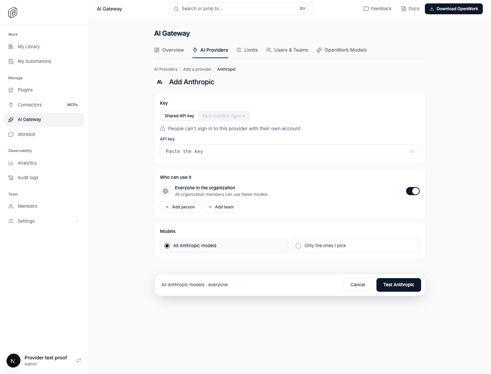
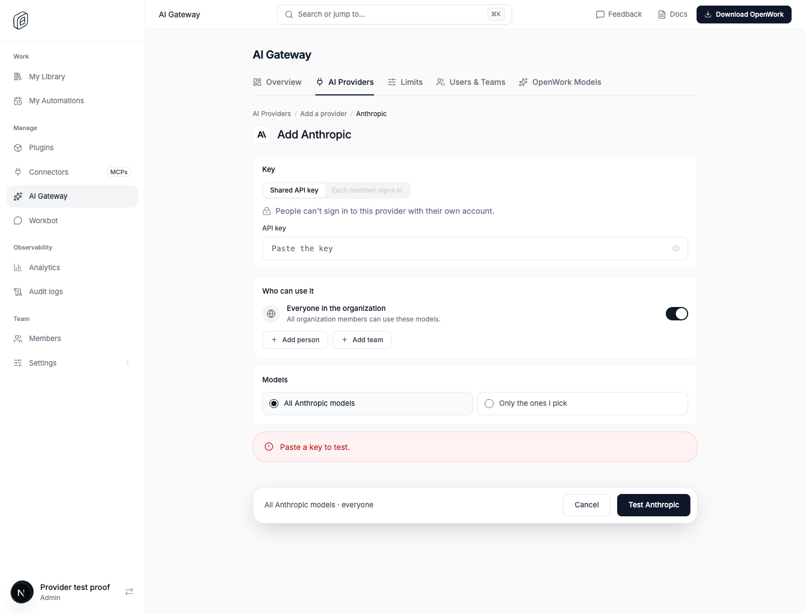

# AI Gateway: test a provider before adding it

> **GA:** Available without a feature flag. The former rollout key is retired.
> Off/on screenshots below are historical comparisons, not current deployment options.

Retired rollout key: `gatewayProviderTest` · Deployments: cloud and self-hosted · Status: generally available (no flag) · Author: [@OmarMcAdam](https://github.com/OmarMcAdam)

## What changes

In Den › AI Gateway › Add a provider, when the admin uses a **Shared API key**,
the **Add {Provider}** button is replaced by **Test {Provider}**. Testing sends
one short prompt ("Reply with the single word OK.", at most 16 output tokens)
through AI Gateway with exactly what is on the screen: the provider, its
settings (region, project, resource name), the pasted key and one model.

The model list under "Only the ones I pick" is sorted newest release first
(models.dev `release_date`), and the test uses:

- **All {Provider} models**: the first model in that list that can answer a
  text prompt (not deprecated, not an image, video or embedding model).
- **Only the ones I pick**: the first such model among the picked ones, in
  list order. If none qualifies, the first picked model.

If the provider answers, a green message appears and the button becomes
**Add {Provider}**. If not, a red message says why (key rejected, access
denied, model not found, rate limited or out of credit, provider unreachable).
Changing anything on the page clears the message and brings back the Test
button, so a provider can only be added with the configuration that passed.

Editing an existing provider and "Each member signs in" are unchanged.

Proof: `pnpm evals:e2e gateway-provider-test` (`evals/proofs/gateway-provider-test.proof.test.ts`)
runs a real Den, a real AI Gateway and a mock Anthropic upstream: the Test
button, the red message and its dismissal in the browser, then a passing test
with the right key, a failing one with a wrong key, and a refused custom address.

## How it works

1. Den web calls `POST /v1/inference-providers/test-connection` (Den API).
   It requires Manage Gateway providers, Gateway management on, and a person:
   the agent and API keys are refused. It is limited to 20 tests per member
   and 60 per organization every ten minutes.
2. Den checks the trusted catalog, the model, the settings and the key shape
   (the same checks as saving; Amazon Bedrock can reuse saved AWS keys), then
   calls the gateway's `POST /api/v1/provider-tests` with the admin's own
   Gateway key. Den signs that exact request for the organization and member
   with a key derived from `DEN_DB_ENCRYPTION_KEY` (already shared by Den and
   the gateway); the gateway refuses any test without a fresh, matching
   signature, so a Gateway key alone cannot run one.
3. The gateway builds the request in the provider's native API from its own
   catalog (a custom `upstreamBaseUrl` is only used when its origin is in the
   operator's `GATEWAY_EGRESS_ALLOWED_ORIGINS`), signs or authenticates it like a real
   request, sends it and answers ok or a plain message. Upstream error text is
   only shown with the key removed, and never for AWS (signature errors can
   echo credentials).

Nothing is stored, no request log or usage is written, and the key is never
returned. The test can use a few tokens on the provider account.

## Try it

1. Sign in as an organization admin with AI Gateway configured.
2. Den › AI Gateway › Add a provider › pick one › paste a key › **Test**.
3. Paste a wrong key to see the red message; fix it to see the green one;
   change any field and the message goes away.

## Availability

Generally available. The rollout flag is retired; organization/member overrides,
operator locks and old kill-switch rows no longer disable this behavior.
Authorization, provider setup, consent and runtime compatibility still apply.

## What to watch

- Den API logs: `[gateway-provider-test] gateway answered <status>` or
  `could not reach the gateway` (Den cannot reach the gateway, or the Gateway
  key was refused).
- 429 `rate_limited` from Den when people retry a lot.
